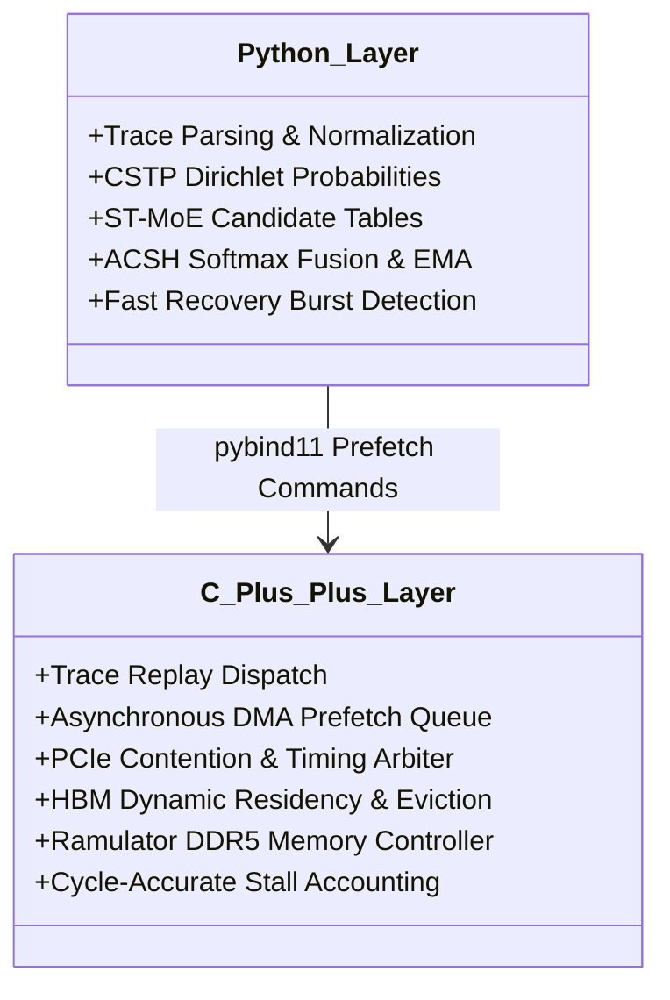

# Next Implementation Roadmap: Hardware-Aware MoE Prefetching (E0–E6)

**Document:** `docs/NEXT_IMPLEMENTATION_ROADMAP.md`  
**Project:** MoE Memory Wall: Predicting and Prefetching Experts for Faster LLM Inference  
**Repository:** `LLMSimulator` (`/home/mohman/ca_project/LLMSimulator`)  
**Scope:** Engineering Specification from Predictor Validation to Physical Hardware Simulation  
**Auditor / Author:** ML Systems Research & Reproducibility Team  

---

## 1. Architectural Vision: Bridging Prediction to Silicon

To transition from host-side algorithmic prediction to cycle-accurate hardware prefetch simulation, the system must bridge the Python statistical layer with the C++ discrete-event hardware engine:

```mermaid
flowchart TD
    subgraph Host Predictor Layer (Python / C++)
        Router["Model Routing Ingestion / Replay"] --> Pred["ACSH Predictor (44.6 us)"]
        Pred --> PrefetchMsg["Prefetch Command: {req_id, layer, expert_id, budget}"]
    end

    subgraph C++ Discrete-Event Hardware Engine
        PrefetchMsg --> AsyncQueue["E3: Asynchronous Prefetch Queue"]
        AsyncQueue --> Contention["PCIe / DDR5 Bandwidth Arbiter"]
        Contention --> InFlight["In-Flight DMA Transfers"]
        InFlight --> Residency["E4: HBM Residency & Eviction Manager"]
        
        GPUCompute["GPU Layer Compute Loop"] --> CheckResident{"Expert in HBM?"}
        Residency -.-> CheckResident
        CheckResident -- Hit --> FastCompute["Zero Memory Stall (HBM Hit)"]
        CheckResident -- Miss --> DemandStall["Demand Stall (Block for DDR5 Transfer)"]
    end
```

---

## 2. Phased Engineering Roadmap (E0 through E6)

### Phase E0: Baseline Freeze & Statistical Validation
- **Objective:** Establish an unalterable verification baseline before modifying C++ simulation internals.
- **Tasks:**
  1. Freeze all Phase D CSV result files in `results/endsem_phase_d/`.
  2. Implement prompt/request-clustered bootstrap standard errors to replace unclustered event-level $p$-values.
  3. Validate that test splits across `moe_anywhere`, `moe_suite`, and `correlated_synthetic` remain strictly isolated.

---

### Phase E1: Predictor-to-Prefetch C++/Python Interface
- **Objective:** Create a high-performance, non-blocking interface passing predictive candidates into C++.
- **Interface Specification (`src/predictor/prefetch_interface.h`):**
  ```cpp
  struct PrefetchCandidate {
    int expert_id;
    float confidence_score;
    int rank;
  };

  struct PrefetchRequest {
    int request_id;
    int token_id;
    int current_stage;
    int target_stage;
    int horizon;
    uint64_t timestamp_ns;
    int budget;
    std::vector<PrefetchCandidate> candidates;
  };
  ```
- **Requirements:**
  - Must return candidate expert IDs with associated confidence scores.
  - Must never expose ground-truth future routing labels to the predictor.
  - Zero-copy C-types or pybind11 integration with $<5\ \mu s$ inter-language overhead.

---

### Phase E2: Real Routing Trace Replay in C++ Engine
- **Objective:** Enable `LLMSimulator` to replay genuine multi-$K$ real-model routing choices.
- **Tasks:**
  1. Refactor [`Scheduler::initExpertList`](file:///home/mohman/ca_project/LLMSimulator/src/scheduler/scheduler.cpp#L508-L580) to parse arbitrary $K$-expert records from CSV/Parquet files.
  2. Add command-line and YAML configuration flag: `routing_mode: "trace_replay"`.
  3. Support loading `data/downloads/moe_anywhere/e1-sage-a1.5.parquet` and `data/downloads/moe_suite/*.parquet`.
  4. Ensure that when `trace_replay` is active, `Scheduler::getRandomExpert()` is **never** invoked.

---

### Phase E3: Asynchronous DDR5-to-HBM Prefetch Queue
- **Objective:** Remove the blocking DRAM interface in `src/dram/dram_interface.cpp` and support concurrent transfers.
- **Tasks:**
  1. Replace synchronous calls to `issueRamulatorBatch()` with a non-blocking request queue.
  2. Implement an in-flight transfer tracker that models PCIe Gen4/Gen5 DMA channels (e.g., 32 GB/s or 64 GB/s).
  3. Enforce PCIe link contention: concurrent prefetch transfers share available link bandwidth.
  4. Deduplication: If expert $E_i$ is already resident or currently in flight, redundant prefetch commands are suppressed.

---

### Phase E4: Dynamic HBM Residency & Eviction Manager
- **Objective:** Model physical accelerator memory capacity limits and replacement policies.
- **Tasks:**
  1. Configure `hbm_prefetch_buffer_capacity_gb` in `SystemConfig` (e.g., 8 GB to 32 GB allocated for dynamic experts).
  2. Track expert residency status: `RESIDENT_HBM`, `IN_FLIGHT_TRANSFER`, `OFFCHIP_DDR5`.
  3. Implement eviction policies when the buffer fills:
     - **LRU (Least Recently Used):** Evicts experts with the oldest access timestamp.
     - **Belady / Predictor-Guided:** Evicts experts with the lowest ACSH predicted future probability.
  4. Track expert tensor sizing: distinguish between attention weights, FFN gating, and intermediate activations.

---

### Phase E5: Integrated Predictor-Hardware Co-Design
- **Objective:** Evaluate end-to-end interactions between prediction confidence and prefetch depth.
- **Policies to Evaluate:**
  1. **Demand-Only:** No prefetching; every expert miss blocks execution.
  2. **Random Prefetch:** Randomly loads $B$ experts ahead of time (negative control).
  3. **Frequency Prefetch:** Statically caches the most popular global experts.
  4. **ST-MoE Prefetch:** Issues transfers based on discrete 2-bit counter rankings.
  5. **CSTP Prefetch:** Issues transfers based on continuous spatio-temporal probabilities.
  6. **ACSH Prefetch:** Dynamically throttles prefetch budget: if confidence $R < 0.3$, drops budget to avoid wasting PCIe bandwidth; if $R > 0.8$, aggressively prefetches at $B=16$.

---

### Phase E6: End-to-End Latency & Speedup Evaluation
- **Objective:** Measure real simulated execution time reduction and memory efficiency.
- **Metrics to Measure:**
  1. **End-to-End Latency:** Wall-clock simulated time per token (ms/token).
  2. **Memory Stall Time:** Aggregate time the GPU spent waiting for DDR5-to-HBM transfers.
  3. **HBM Buffer Hit Rate:** Fraction of expert activations served from resident HBM.
  4. **Useful vs. Wasted Prefetches:** Useful transfers (prefetched and used) vs. wasted transfers (prefetched and evicted before use).
  5. **PCIe Bandwidth Utilization:** Average and peak gigabytes transferred per second.
  6. **Predictor Overhead Ratio:** Host CPU compute time divided by layer compute time.

---

## 3. Division of Responsibilities: Python vs. C++



---

## 4. Risk Analysis & Mitigation Strategies

| Risk | Consequence | Mitigation Strategy |
| :--- | :--- | :--- |
| **PCIe Link Contention** | Aggressive prefetching clogs bus, delaying urgent demand loads | Implement strict transfer prioritization: demand-driven loads preempt prefetch transfers. |
| **HBM Cache Pollution** | Inaccurate prefetches evict useful experts | Modulate prefetch budget $B$ based on ACSH confidence; apply conservative eviction thresholds. |
| **Simulation Runtime Explosion** | Detailed cycle-level Ramulator calls for every transfer slow simulation | Maintain execution timing caches for verified identical physical access patterns. |
| **Inter-Language Overhead** | Slow Python-C++ bridge negates prefetch gains | Compile ACSH core scoring into optimized C++ once algorithm parameters are frozen. |

