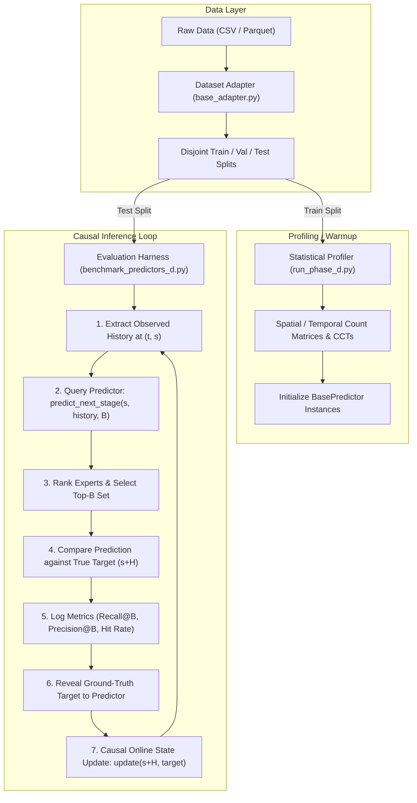

# Python Pipeline Explained: Ingestion, Profiling, Inference & Evaluation

**Document:** `docs/PYTHON_PIPELINE_EXPLAINED.md`  
**Project:** MoE Memory Wall: Predicting and Prefetching Experts for Faster LLM Inference  
**Repository:** `LLMSimulator` (`/home/mohman/ca_project/LLMSimulator`)  
**Scope:** Data Ingestion, Adapters, Statistical Profiling, Causal Inference Loop, Online Adaptation  
**Auditor / Author:** ML Systems Research & Reproducibility Team  

---

## 1. End-to-End Pipeline Overview

The Python evaluation framework for MoE expert prediction decouples trace parsing, dataset adaptation, statistical profiling, and inference evaluation into modular subsystems.



---

## 2. Dataset Adapters & Ingestion Pipeline

All dataset loaders implement the abstract interface `RoutingDatasetAdapter` defined in [`src/predictor/adapters/base_adapter.py:27-145`](file:///home/mohman/ca_project/LLMSimulator/src/predictor/adapters/base_adapter.py#L27-L145).

### 2.1 The Data Container: `PredictionRecord`
Every prediction opportunity across all datasets is normalized into a standard dataclass (`src/predictor/adapters/base_adapter.py:12-25`):
```python
@dataclass
class PredictionRecord:
  request_id: Any  # Request / prompt / task identifier
  token_id: int  # Token sequence index (0 .. T-1)
  source_stage: int  # Current MoE stage s
  target_stage: int  # Target MoE stage s + H
  observed_experts: List[int]  # Active expert IDs at source stage (|E| = K)
  target_experts: List[int]  # True active expert IDs at target stage (|E| = K)
  prediction_horizon: int  # Lookahead horizon H
  task_id: Optional[str] = None  # Task label for multi-task benchmarks
  metadata: Optional[Dict[str, Any]] = None  # Router weights, timestamps, etc.
```

---

### 2.2 Trace Ingestion by Dataset

#### A. Duplex A100 Adapter (`SimulatorDatasetAdapter`)
- **Source File:** [`src/predictor/adapters/simulator_adapter.py:21-135`](file:///home/mohman/ca_project/LLMSimulator/src/predictor/adapters/simulator_adapter.py#L21-L135)
- **Trace Ingested:** `reproduction_A100/results/a100_duplex/traces/expert_routing.csv`
- **Execution Path:**
  1. `SimulatorDatasetAdapter.load()` instantiates `RoutingTraceParser`.
  2. Parses CSV with columns: `request_id,token_id,layer_id,topk_rank,expert_id`.
  3. Reconstructs MoE stages: if `first_k_dense > 0`, maps `moe_stage_id = layer_id - first_k_dense`.
  4. Groups rows by key `(request_id, token_id, moe_stage_id)`. Each group forms a list of $K=2$ expert IDs.
  5. Partitions requests into disjoint train/test splits (24 training requests, 8 testing requests).

#### B. Correlated Synthetic Adapter (`SyntheticCorrelatedDatasetAdapter`)
- **Source File:** [`src/predictor/adapters/synthetic_adapter.py:17-125`](file:///home/mohman/ca_project/LLMSimulator/src/predictor/adapters/synthetic_adapter.py#L17-L125)
- **Trace Ingested:** `results/endsem_phase1/benchmark_correlated_trace.csv`
- **Execution Path:**
  1. Checks if trace exists; if missing, calls `scripts.generate_correlated_benchmark_trace.generate_benchmark_trace()`.
  2. Reads CSV via Pandas.
  3. Maps `moe_stage_id = raw_layer - 3` (accounting for 3 dense pre-stages).
  4. Groups by `(request_id, token_id, moe_stage_id)` to form lists of $K=8$ expert IDs.
  5. Computes request splits: requests 1..12 for training/profiling; requests 13..16 for out-of-sample evaluation.

#### C. MoE Anywhere Adapter (`MoeAnywhereDatasetAdapter`)
- **Source File:** [`src/predictor/adapters/moe_anywhere_adapter.py:20-130`](file:///home/mohman/ca_project/LLMSimulator/src/predictor/adapters/moe_anywhere_adapter.py#L20-L130)
- **Trace Ingested:** `data/downloads/moe_anywhere/e1-sage-a1.5.parquet`
- **Execution Path:**
  1. Reads Parquet file using `pyarrow.parquet.read_table()`.
  2. Iterates over rows containing:
     - `prompt_id` $\to$ maps to `request_id`.
     - `token_pos` $\to$ maps to `token_id`.
     - `layer` $\to$ maps to `moe_stage_id` (0..39).
     - `experts` $\to$ list of 8 integers (chosen expert IDs).
     - `weights` $\to$ list of 8 floats (router softmax probabilities).
  3. Stores structured records in memory dictionary:
     `self.routes[(prompt_id, token_pos, layer)] = (experts, weights)`.
  4. Strictly partitions by prompt: 52 train prompts, 8 validation prompts, 14 test prompts.

#### D. MoE Suite Adapter (`MoeSuiteDatasetAdapter`)
- **Source File:** [`src/predictor/adapters/moe_suite_adapter.py:20-110`](file:///home/mohman/ca_project/LLMSimulator/src/predictor/adapters/moe_suite_adapter.py#L20-L110)
- **Trace Ingested:** `data/downloads/moe_suite/corpus-*.parquet`
- **Execution Path:**
  1. Ingests 12 task-specific Parquet files.
  2. Reads the `route_selected` column, representing a 3D tensor of shape $(N_{\text{tokens}}, 75, 8)$ with dtype uint16.
  3. Converts tensor slices into ordered routing sequences where index 0..74 corresponds to model layers 3..77.
  4. Maintains official task-disjoint splits: 8 train tasks, 2 validation tasks, 2 test tasks (`corpus-12-typescript-migration-planner`, `corpus-13-go-fenced-leases`).
  5. Default prediction horizon is fixed to $H=2$.

---

## 3. Concrete Step-by-Step Data Walkthrough

To understand the internal transformation, consider a sequence of routing decisions from a model with $K=4, E=64$:

### Step 1: Raw Record Ingestion
Raw rows from CSV/Parquet are read into memory:
| Request ID | Token Pos | Layer ID | Rank | Expert ID |
| :---: | :---: | :---: | :---: | :---: |
| `req_42` | 0 | 0 | 1 | 4 |
| `req_42` | 0 | 0 | 2 | 12 |
| `req_42` | 0 | 0 | 3 | 19 |
| `req_42` | 0 | 0 | 4 | 35 |
| `req_42` | 0 | 1 | 1 | 4 |
| `req_42` | 0 | 1 | 2 | 12 |
| `req_42` | 0 | 1 | 3 | 22 |
| `req_42` | 0 | 1 | 4 | 35 |

### Step 2: Grouping into Stage-Level Events
The adapter aggregates individual lines by `(request_id, token_id, layer_id)` into complete token-layer sets:
$$\mathcal{E}_{\text{req\_42}, 0, 0} = \{4, 12, 19, 35\}$$
$$\mathcal{E}_{\text{req\_42}, 0, 1} = \{4, 12, 22, 35\}$$

### Step 3: Yielding `PredictionRecord` Instances
When the evaluation harness requests predictions for horizon $H=1$, the adapter generates:
```python
PredictionRecord(
    request_id="req_42",
    token_id=0,
    source_stage=0,
    target_stage=1,
    observed_experts=[4, 12, 19, 35],
    target_experts=[4, 12, 22, 35],
    prediction_horizon=1,
)
```

The predictor receives **the complete token-layer expert set** ($\mathcal{E}_{r, t, s}$), never flattened or fragmented tokens.

---

## 4. How Training and Profiling Work in Python

None of our predictors use PyTorch, backpropagation, stochastic gradient descent, or neural network training.  
Instead, **"profiling" is the accumulation of statistical frequency matrices and contingency tables** across the training split.

### 4.1 CSTP Profiling Logic
Located in [`src/predictor/cstp_predictor.py:50-120`](file:///home/mohman/ca_project/LLMSimulator/src/predictor/cstp_predictor.py#L50-L120):
- **Marginal Frequency Matrix:** `C_marg` of shape $(S, E)$, dtype int32.
  - When expert $e$ appears at stage $s$, `C_marg[s, e] += 1`.
- **Spatial Transition Tensor:** `C_spat` of shape $(S, S, E, E)$, dtype int32.
  - For every source expert $e_s \in \mathcal{E}_{r, t, s}$ and target expert $e_t \in \mathcal{E}_{r, t, s+H}$, `C_spat[s, s+H, e_s, e_t] += 1`.
- **Temporal Transition Tensor:** `C_temp` of shape $(S, E, E)$, dtype int32.
  - For every expert $e_{\text{prev}} \in \mathcal{E}_{r, t-1, s}$ and subsequent expert $e_{\text{curr}} \in \mathcal{E}_{r, t, s}$, `C_temp[s, e_{\text{prev}}, e_{\text{curr}}] += 1`.
- **Smoothing:** During inference, raw counts are converted to probabilities via Laplace smoothing:
  $$P(e_t \mid e_s) = \frac{C[s, s+H, e_s, e_t] + \lambda \cdot P_{\text{marg}}(e_t)}{\sum C + \lambda}$$

### 4.2 ST-MoE Paper Profiling Logic
Located in [`src/predictor/st_moe_paper.py:40-95`](file:///home/mohman/ca_project/LLMSimulator/src/predictor/st_moe_paper.py#L40-L95):
- **Co-activation Frequency Profiling:** During the profiling pass, ST-MoE tallies co-activation counts between source expert $e_s$ and target expert $e_t$.
- **CCT Construction:** For each source expert $e_s$, the top $N_{\text{cand}}$ target experts with the highest co-activation counts are populated into the Candidate Co-activation Table (CCT).
- **Counter Initialization:** All initial candidates in CCT are initialized with a 2-bit counter value of $c = 1$ (`01`).

### 4.3 ACSH Profiling Logic
Located in [`src/predictor/acsh_predictor.py:65-110`](file:///home/mohman/ca_project/LLMSimulator/src/predictor/acsh_predictor.py#L65-L110):
- ACSH does not profile independent state; it encapsulates a profiled `CSTPPredictor` instance and a profiled `STMoEPaperPredictor` instance.
- Initializes online reliability trackers:
  - `reliability_c = 0.5`
  - `reliability_m = 0.5`
  - In `acsh_stage_aware`, allocates an array of shape $(S, 2)$ initialized to $0.5$.

---

## 5. The Inference & Evaluation Lifecycle

The evaluation harness strictly enforces causal ordering to prevent information leakage:

```
[Inference Step Execution Sequence]
1. Harness queries predictor:
   scores = predictor.predict_next_stage(
       request_id=rec.request_id,
       current_stage=rec.source_stage,
       current_experts=rec.observed_experts,
       budget=B
   )
   
2. Predictor ranks all E experts and returns top B candidate IDs.

3. Harness computes instantaneous performance:
   hits = len(set(candidates).intersection(set(rec.target_experts)))
   recall_at_b = hits / len(rec.target_experts)
   precision_at_b = hits / B
   hit_rate = 1.0 if hits > 0 else 0.0

4. Harness reveals true target experts to predictor:
   predictor.update(
       request_id=rec.request_id,
       target_stage=rec.target_stage,
       target_experts=rec.target_experts
   )
```

### 5.1 Querying & Ranking Logic in ACSH
Inside `ACSHPredictor.predict_next_stage()` ([`src/predictor/acsh_predictor.py:120-175`](file:///home/mohman/ca_project/LLMSimulator/src/predictor/acsh_predictor.py#L120-L175)):
1. Calls `cstp.predict_next_stage()` $\to$ obtains continuous score vector $\mathbf{y}_C \in \mathbb{R}^E$.
2. Calls `st_moe.predict_next_stage()` $\to$ obtains discrete counter score vector $\mathbf{y}_S \in \mathbb{R}^E$.
3. Normalizes both vectors using softmax:
   $$\tilde{\mathbf{y}}_C = \text{Softmax}(\mathbf{y}_C / \tau_c), \quad \tilde{\mathbf{y}}_S = \text{Softmax}(\mathbf{y}_S / \tau_s)$$
4. Retrieves fusion weights $(w_C, w_S)$ from current reliability $(R_C, R_S)$ using fusion softmax:
   $$w_C = \frac{\exp(R_C / \tau_{\text{fuse}})}{\exp(R_C / \tau_{\text{fuse}}) + \exp(R_S / \tau_{\text{fuse}})}$$
5. Fuses scores:
   $$\mathbf{y}_{\text{ACSH}} = w_C \tilde{\mathbf{y}}_C + w_S \tilde{\mathbf{y}}_S$$
6. Ranks experts using stable sort with tie-breaking:
   ```python
   # Deterministic ranking: sort by (-score, expert_id)
   ranked_experts = sorted(
       range(num_experts), key=lambda e: (-combined_scores[e], e)
   )
   return ranked_experts[:budget]
```

---

### 5.2 Causal Online Update Logic
Inside `ACSHPredictor.update()` ([`src/predictor/acsh_predictor.py:180-245`](file:///home/mohman/ca_project/LLMSimulator/src/predictor/acsh_predictor.py#L180-L245)):
1. Checks for pending prediction record corresponding to `(request_id, target_stage)`.
2. Computes the individual objective performance of CSTP and ST-MoE against the newly revealed target:
   $$r_C = \frac{|\hat{\mathcal{E}}_C \cap \mathcal{E}_{\text{target}}|}{K}, \quad r_S = \frac{|\hat{\mathcal{E}}_S \cap \mathcal{E}_{\text{target}}|}{K}$$
3. Updates Exponential Moving Average (EMA) with smoothing factor $\beta = 0.1$:
   $$R_C \leftarrow (1 - \beta) R_C + \beta \cdot r_C$$
   $$R_S \leftarrow (1 - \beta) R_S + \beta \cdot r_S$$
4. Fast Recovery Check (if variant is `acsh_fast_recovery`):
   - Maintains rolling window of last 3 prediction hits.
   - If 3 consecutive predictions yield zero hits, penalizes reliability: $R \leftarrow 0.5 R$.
5. Calls underlying updates:
   - `cstp.update(request_id, target_stage, target_experts)` (updates online counts).
   - `st_moe.update(request_id, target_stage, target_experts)` (increments/decrements 2-bit counters).

---

## 6. Prediction Horizon Mechanics ($H=1$ vs. $H=2$)

- **Horizon $H=1$ (Adjacent Layer):**
  - Input: Active experts at layer $s$.
  - Target: Active experts at layer $s+1$.
  - Used in `moe_anywhere`, `correlated_synthetic`, `duplex_a100`.
- **Horizon $H=2$ (Skip Layer):**
  - Input: Active experts at layer $s$.
  - Target: Active experts at layer $s+2$.
  - Required in `moe_suite` to match official benchmark methodology.
  - **Memory & Latency Implication:** At $H=2$, the prefetch scheduler has twice as much GPU computation time to complete the DRAM transfer ($2 \times t_{\text{layer}}$), but prediction accuracy degrades due to weaker spatial correlation across non-adjacent layers.

---

## 7. Causality Safeguards & Leakage Prevention

The evaluation pipeline enforces four strict causality rules:
1. **Split-Level Isolation:** Requests or prompts in the test split are never ingested during offline profiling.
2. **Buffer Isolation:** Predictors maintain strictly separate history tables per `request_id`. History from Request $A$ cannot pollute Request $B$.
3. **No Target Leakage:** The target expert set is passed to `predictor.update()` strictly *after* `predictor.predict_next_stage()` has returned its candidate set.
4. **Why Random Row Splitting Is Forbidden:** In temporal MoE routing, token $t$ strongly influences token $t+1$. Random row-level splitting would allow the model to train on token $t$ and test on token $t+1$ of the same request, resulting in massive artificial memorization. All splits are strictly partitioned by **Request ID**, **Prompt ID**, or **Task ID**.

