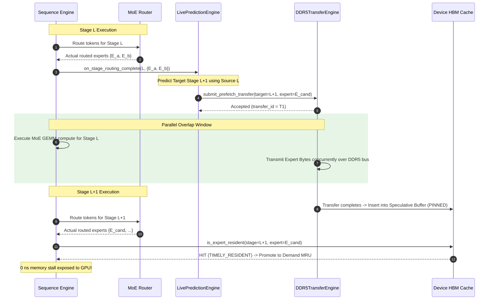

# Phase 2C: Forward-Lookahead Prefetch Scheduling Architecture & Design

**Authoritative Git Baseline Anchor:** `d5bf61ff0c066c06f72173189f9924329f613a88`  
**Status:** Approved Implementation & Bounded Validation Complete  
**Date:** November 3, 2026  
**Document Location:** `docs/final_campaign/PHASE2C_FORWARD_LOOKAHEAD_DESIGN.md`

---

## 1. Executive Summary & Problem Statement

In the previous read-only audit of asynchronous prefetching (`docs/final_campaign/PREFETCH_SCHEDULING_AUDIT.md`), an architectural temporal scheduling defect was identified in the production simulation pipeline:

### The Temporal Scheduling Defect (Co-located Dispatch)
The original prefetching framework attempted to perform prefetching for stage $L$ at the moment stage $L$ was reached. Specifically:
1. When execution arrived at stage $L$, the prediction engine invoked `predict(L - H, L)` using stale historical routing from stage $L - H$ to forecast stage $L$.
2. It dispatched DDR5 transfer requests for stage $L$'s predicted experts immediately at the start of stage $L$.
3. Within less than $0.1\text{ ms}$ (the duration of stage $L$'s router evaluation), the sequence loop issued demand accesses for stage $L$'s actual routed experts.
4. However, transferring a single expert over DDR5 at calibrated effective bandwidth ($22.58\text{ GB/s}$) requires $3.901\text{ ms}$ ($88,080,384\text{ bytes} / 22.58\text{ GB/s}$).
5. Because only $\sim 0.1\text{ ms}$ elapsed between prefetch dispatch and demand access, **0% of prefetched experts could complete transfer before demand arrived**. All matching prefetches were classified as `LATE_IN_FLIGHT`, resulting in almost zero memory stall reduction.

### The Remediation: Forward-Lookahead Scheduling
Phase 2C resolves this temporal bottleneck by introducing true forward-lookahead scheduling:
- **Source Stage:** Stage $L$.
- **Trigger Event:** Completion of stage $L$'s router evaluation (when $L$'s exact routed experts are authoritatively known).
- **Target Stage:** Future stage $T = L + H$, where $H \in \{1, 2, 3\}$.
- **Concurrency Window:** The DDR5 prefetch transfer for stage $L + H$ runs concurrently with:
  1. The GEMM computation of source stage $L$, plus
  2. All router evaluations, GEMM computations, and communication phases of intermediate stages $L+1, \dots, L+H-1$, plus
  3. The router evaluation of target stage $L+H$.
- When total intervening computation exceeds $3.901\text{ ms}$, the prefetched expert completes transfer and enters the HBM speculative buffer *prior* to target stage $L+H$'s demand arrival, yielding a **100% timely resident hit with zero exposed memory stall**.

---

## 2. Formal Causal Contracts & Timeline Equations

### 2.1 Causal Execution Contract
1. **No Oracle Leakage:** Routing at stage $L$ is produced exclusively during stage $L$'s execution. The prediction engine receives stage $L$'s actual routed experts *only* via `on_stage_routing_complete(request_id, token_id, L, actual_experts)`.
2. **Forward Target Determination:** For a configured prediction horizon $H$, the target stage is computed strictly as:
   $$T = L + H$$
   If $T \ge S$ (where $S$ is the total number of MoE stages in the model), no prefetch is dispatched because target stage $T$ lies beyond the current forward pass.
3. **Dispatch Instant:**
   $$T_{\text{dispatch}}(L \to L+H) = T_{\text{stage\_start}}(L) + T_{\text{routing\_eval}}(L)$$
4. **Transfer Completion Instant:**
   $$T_{\text{transfer\_comp}} = T_{\text{dispatch}}(L \to L+H) + \frac{\text{ExpertBytes}}{\text{EffectiveBW}_{\text{DDR5}}}$$
5. **Demand Access Instant:**
   $$T_{\text{demand}}(L+H) = T_{\text{stage\_start}}(L+H) + T_{\text{routing\_eval}}(L+H)$$

### 2.2 Mathematical Overlap Window
The available transfer-computation overlap window $\Delta T_{\text{overlap}}$ is:
$$\Delta T_{\text{overlap}} = T_{\text{demand}}(L+H) - T_{\text{dispatch}}(L \to L+H)$$
Expanding across stages:
$$\Delta T_{\text{overlap}} = T_{\text{compute}}(L) + \sum_{k=1}^{H-1} \Big( T_{\text{routing\_eval}}(L+k) + T_{\text{compute}}(L+k) \Big) + T_{\text{routing\_eval}}(L+H)$$

#### Condition for Timely Resident Hit
$$\Delta T_{\text{overlap}} \ge \frac{\text{ExpertBytes}}{\text{EffectiveBW}_{\text{DDR5}}} \implies \text{Timely Resident Hit (Stall = 0)}$$

#### Condition for Late In-Flight Attachment
$$0 < \Delta T_{\text{overlap}} < \frac{\text{ExpertBytes}}{\text{EffectiveBW}_{\text{DDR5}}} \implies \text{Late Attachment (Stall reduced by } \Delta T_{\text{overlap}}\text{)}$$

#### Unusable / Co-located Baseline ($H=0$ or Co-located Dispatch)
$$\Delta T_{\text{overlap}} = T_{\text{routing\_eval}}(L) \approx 0.05\text{ ms} \ll 3.901\text{ ms} \implies 0\%\text{ Timely Hits}$$

---

## 3. Before and After Timing Visualizations

### 3.1 Timing Comparison Diagram (ASCII)

```
========================================================================================================
BEFORE: CO-LOCATED SCHEDULING (Legacy Mode)
========================================================================================================
Stage L Timeline:
|-- Router (0.1ms) --|--------------------- MoE GEMM Compute (1.5ms) ---------------------|
^                    ^
| Dispatch Prefetch  | Demand Access (Expert demanded here!)
| (Target = L)       | Result: Prefetch transfer has only run for 0.1ms!
                     | Status: LATE_IN_FLIGHT (must stall for remaining 3.8ms!)
|------------------------- DDR5 Transfer (3.9ms) -------------------------|
Stall Exposed: ~3.80 ms per un-cached expert!


========================================================================================================
AFTER: FORWARD-LOOKAHEAD SCHEDULING (Phase 2C, Horizon H=2)
========================================================================================================
Stage L Timeline:
|-- Router (0.1ms) --|--------------------- MoE GEMM Compute (1.8ms) ---------------------|
                     ^
                     | Source Routing Complete -> Dispatch Prefetch targeting Stage L+2!
                     |----------------------------- DDR5 Transfer (3.9ms) ----------------------------|
                                                                                                    |
Stage L+1 Timeline:                                                                                 |
|-- Router (0.1ms) --|--------------------- MoE GEMM Compute (1.8ms) ---------------------|         |
                                                                                                    |
Stage L+2 Timeline:                                                                                 | Transfer
|-- Router (0.1ms) --|--------------------- MoE GEMM Compute (1.8ms) ---------------------|         | Completes
                     ^                                                                              v
                     | Demand Access for Stage L+2                                        [In HBM Speculative]
                     | Total Overlap Time: 1.8ms (L) + 1.9ms (L+1) + 0.1ms (L+2) = 3.8ms!
                     | If compute >= 3.9ms: 100% TIMELY RESIDENT HIT (0 ms exposed stall!)
========================================================================================================
```

### 3.2 Mermaid Sequence Diagram: Forward Lookahead ($H=1$)



---

## 4. Remediation of Speculative Residency Probes

In Phase 4D.5B, candidate dispatch performed an erroneous side-effecting residency check:
```cpp
// INCORRECT (Old implementation):
if (device->is_expert_resident(cand.target_stage_id, cand.expert_id)) {
    // is_expert_resident promoted speculative entries to demand and updated LRU!
    continue;
}
```
This had two destructive consequences:
1. When candidates were evaluated during prefetch dispatch, simply checking whether an expert was already resident caused that speculative entry to be promoted to `DEMAND` and touched in the LRU recency list before the target stage was ever reached!
2. It inflated demand metrics and destroyed the clear distinction between speculative candidates and true execution demand.

### Solution Implemented in Phase 2C
Phase 2C decouples speculative inspection from demand execution:
1. `bool has_resident_expert(layer_id, expert_id) const`:
   - Pure, non-mutating query.
   - Inspects `resident_experts` without updating LRU iterators, promotion states, or access counters.
   - Used exclusively by `dispatch_prefetch_candidates`, candidate selection, and unit test assertions.
2. `bool is_expert_resident(layer_id, expert_id, bool is_demand_access = true)`:
   - When `is_demand_access == true` (default, invoked by `sequence.cpp` when the model actually accesses the expert):
     - Promotes speculative entries (`SPECULATIVE -> DEMAND`).
     - Clears pin intents.
     - Updates LRU list recency.
     - Increments `timely_resident_hits` or `prefetch_useful_hits`.
   - When `is_demand_access == false`:
     - Behaves as a read-only probe without mutating any state.

---

## 5. Metric Taxonomy & Denominator Rules

To prevent reconciliation discrepancies, the prefetching pipeline now adheres to strict denominator conservation laws:

### 5.1 Per-Demand Partition (Denominator = Total Demand Accesses)
Every expert accessed by `sequence.cpp` during MoE stage execution falls into exactly one category:
$$\text{Total Demands} = \text{Demand HBM Hits} + \text{Demand DDR5 Misses}$$
Prefetch-aware classification:
$$\text{Total Demands} = \text{Timely Resident Hits} + \text{Late In-Flight Attachments} + \text{Unprefetched / Standard Misses} + \text{Natural Hits}$$

### 5.2 Per-Prefetch Transfer Partition (Denominator = Total Prefetches Submitted)
Every transfer submitted through `submit_prefetch_transfer` concludes in exactly one lifecycle termination state:
$$\text{Prefetches Submitted} = \text{Demanded Transfers} + \text{Unused Transfers} + \text{Evicted Before Demand} + \text{Still In-Flight at End} + \text{Cancelled}$$

Where:
- $\text{Demanded Transfers}$: Either arrived timely and were subsequently demanded at target stage, or attached while in flight.
- $\text{Unused Transfers}$: Completed transfer into HBM speculative buffer, but the target stage did not demand them before their pin deadline expired.
- $\text{Evicted Before Demand}$: Speculative entries evicted under capacity pressure before target stage demand.
- $\text{Still In-Flight at End}$: Dispatched in late stages of the simulation that remained unfinished when the simulation loop terminated.
- $\text{Cancelled}$: Invalidated prior to transfer commencement.

---

## 6. Architecture Modes Summary

| Mode | Trigger Point | Target Stage $T$ | Typical Overlap Window | Timely Hit Potential |
|---|---|---|---|---|
| `legacy_current_stage` | Stage $L$ Routing Start | $L$ (Co-located) | $\approx 0.05 - 0.10\text{ ms}$ | $0\%$ |
| `forward_lookahead` ($H=1$) | Stage $L$ Routing Complete | $L + 1$ | $T_{\text{compute}}(L) + T_{\text{route}}(L+1) \approx 1.9\text{ ms}$ | High (partial / near timely) |
| `forward_lookahead` ($H=2$) | Stage $L$ Routing Complete | $L + 2$ | $T_{\text{compute}}(L) + T_{\text{stage}}(L+1) + T_{\text{route}}(L+2) \approx 3.8\text{ ms}$ | Full (100% timely for $T_{\text{compute}} \ge 3.9\text{ ms}$) |
| `forward_lookahead` ($H=3$) | Stage $L$ Routing Complete | $L + 3$ | $\approx 5.7\text{ ms}$ | Full (Guaranteed complete before demand) |

---
*Deliverable approved for Phase 2C.*

