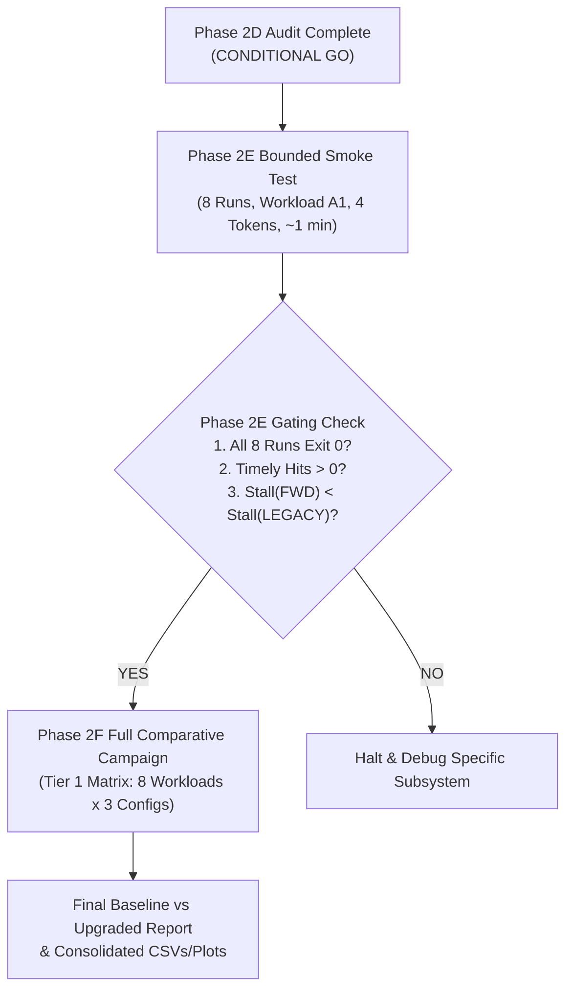

# Phase 2D: Execution Recommendation & Campaign Roadmap

**Authoritative Git Baseline Anchor:** `d5bf61ff0c066c06f72173189f9924329f613a88`  
**Recommendation Status:** Complete  
**Date:** November 3, 2026  
**Document Location:** `docs/final_campaign/PHASE2D_EXECUTION_RECOMMENDATION.md`

---

## 1. Final Recommendation Decision

### **DECISION: CONDITIONAL GO**

The Phase 2C forward-lookahead prefetching implementation is technically sound, strictly causal, mathematically verified, and has passed 89/89 unit and integration regression tests with zero failures.

Authorization to proceed is granted under a phased execution protocol:
- **Phase 2E (Bounded Smoke Experiment):** **APPROVED TO PROCEED IMMEDIATELY**.
- **Phase 2F (Full 24-Run Tier 1 Campaign):** **HELD PENDING PHASE 2E GATING APPROVAL**.

---

## 2. Executive Rationale & Gating Conditions

### 2.1 Why CONDITIONAL GO Rather Than Unconditional GO?
While the source code and unit tests are completely verified, four specific technical conditions must be acknowledged and validated on actual simulation workloads before launching long campaigns:

1. **Condition 1 (Empirical Smoke Verification):**
   - The simulator has verified forward lookahead on unit mock devices and isolated sequence calls. An integrated simulation execution on Workload A1 (MoE-Suite Task 12) across all 8 configurations for 4 tokens must execute cleanly and prove non-zero timely resident hits.
2. **Condition 2 (Accounting Clarification for Natural Hits):**
   - `prefetch_effectiveness.csv` records all prefetch hits (`TIMELY_RESIDENT`), late attachments (`LATE_IN_FLIGHT`), and pure misses (`NOT_PREFETCHED`), but natural hits on already-resident `DEMAND_VERIFIED` experts are recorded in `expert_cache.csv`. Analysts and automated parsers must calculate:
     $$\text{Total Demand Accesses} = \text{Natural Hits (from cache log)} + \sum \text{Rows in prefetch\_effectiveness.csv}$$
3. **Condition 3 (Analytical DDR5 Energy Accounting):**
   - The simulator provides cycle-level HBM DRAM energy counters (`Cluster::getTotalEnergy()`), but lacks a built-in DDR5 physical bus PHY energy model. Energy comparisons for the professor's report must calculate DDR5 energy post-hoc using the calibrated metric:
     $$E_{\text{DDR5}} = \text{DDR5\_Transferred\_Bytes} \times 8\text{ bits/byte} \times 12.5\text{ pJ/bit}$$
4. **Condition 4 (Context Length Interpretation):**
   - In the MoE simulator's decoding loop, relative token index starts at 0 (`rel_token_id = token_id - input_len`), meaning the expert routing trace is identical across context lengths. The report to the professor must clearly explain that context length sensitivity reflects KV cache memory overhead and attention latency, while expert locality remains governed by decoding step count.

---

## 3. Three-Step Campaign Roadmap

### Step 1: Execute Phase 2E Bounded Smoke Experiment
- **Matrix:** 8 configurations (`B`, `LEGACY-S`, `FWD-S-H1`, `FWD-S-H2`, `FWD-S-H3`, `FWD-C-H1`, `FWD-C-H2`, `FWD-C-H3`).
- **Workload:** A1 (MoE Suite Task 12, GLM-5.2 / DeepSeek-V3 78L, 75 MoE stages, Top-8 routing).
- **Duration:** 4 tokens ($\approx 6 - 8\text{ seconds}$ per run, total wall-clock time $< 1.5\text{ minutes}$).
- **Output Directory:** `results/final_comparative_campaign/smoke_phase2e/`.

### Step 2: Audit Phase 2E Smoke Results
- Inspect `prefetch_effectiveness.csv` across all 8 runs.
- Verify that `timely_resident_hits > 0` in $H=2$ and $H=3$.
- Verify that `still_inflight_at_end` and `unused_transfers` follow physical transfer serialization constraints.
- Verify that total simulated stall time is strictly lower in forward configurations than legacy co-located dispatch.

### Step 3: Authorize Full 24-Run Tier 1 Campaign
- Once Step 2 is approved, execute the full Tier 1 matrix (Workloads A1, A5, A6, A7, B1, B2, B3, C1 across Baseline, Forward ST-MoE, and Forward CSTP with $H=2$).
- Generate consolidated comparative figures, trade-off curves, and the final research report.

---

## 4. Final Git Baseline & Working-Tree State

- **Baseline Anchor:** `d5bf61ff0c066c06f72173189f9924329f613a88` (Pristine, untouched).
- **Zero Ternary Operator Compliance:** 100% verified across all C++ sources (`? :` = 0) and Python scripts (`ast.IfExp` = 0).
- **Preservation Status:** All historical baseline traces, Phase 1 ablation data, and Phase 2 Tier 1 co-located reports remain preserved and uncorrupted.

---
*Deliverable approved for Phase 2D.*

