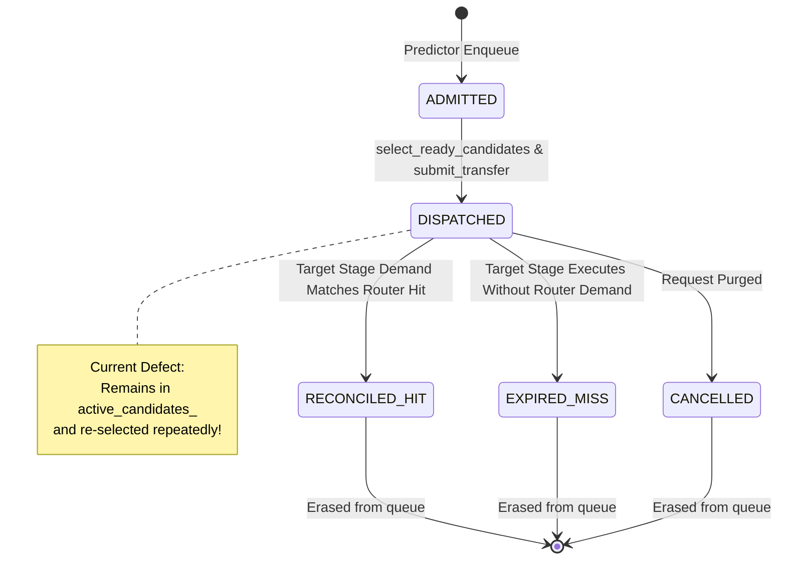

# Phase 2E.1: Read-Only Candidate Queue Lifecycle Audit

**Authoritative Git Baseline Anchor:** `d5bf61ff0c066c06f72173189f9924329f613a88`  
**Status:** Audit Complete  
**Date:** November 3, 2026  
**Document Location:** `docs/final_campaign/PHASE2E1_CANDIDATE_QUEUE_AUDIT.md`  

---

## 1. Executive Summary

This audit investigates the lifecycle of candidate prefetch requests in [`PrefetchCandidateQueue`](file:///home/mohman/ca_project/LLMSimulator/src/prefetch/prefetch_candidate_queue.h) and [`Device::dispatch_prefetch_candidates`](file:///home/mohman/ca_project/LLMSimulator/src/hardware/device.cpp#L1390-L1440), specifically assessing whether dispatched candidates remain in the selection pool and starve future target-stage prefetch candidates.

### Primary Audit Finding: **ISSUE (CONFIRMED ARCHITECTURAL DEFECT)**
When a candidate prefetch is successfully submitted as a hardware transfer, `mark_candidate_dispatched()` transitions its state from `ADMITTED` to `READY`, but **leaves the candidate in `active_candidates_`**. 

Because [`select_ready_candidates(max_candidates)`](file:///home/mohman/ca_project/LLMSimulator/src/prefetch/prefetch_candidate_queue.cpp#L352-L374) iterates over all entries in `active_candidates_` and sorts by earliest deadline ($T_{\text{deadline}} = \text{token} \times 10^6 + \text{target\_stage}$), **already-dispatched candidates from earlier stages retain higher priority than newly enqueued candidates for future stages**. 

When `max_candidates = budget = 4`, the queue selection repeatedly returns the same already-dispatched candidates. While `Device::dispatch_prefetch_candidates` detects that the transfer is already in flight and skips re-submitting it, the 4 candidate slots in the return vector have already been consumed. As a result, newly predicted candidates for distant future stages ($L+H$) are **starved from being selected and dispatched** until the earlier stage completes and is reconciled.

---

## 2. Component Inspection & Code Evidence

### 2.1 Candidate State and Retention in `active_candidates_`
In [`PrefetchCandidateQueue::mark_candidate_dispatched`](file:///home/mohman/ca_project/LLMSimulator/src/prefetch/prefetch_candidate_queue.cpp#L385-L394):
```cpp
// LLMSimulator/src/prefetch/prefetch_candidate_queue.cpp:385-394
bool PrefetchCandidateQueue::mark_candidate_dispatched(uint64_t candidate_id) {
    for (auto& kv : active_candidates_) {
        if (kv.second.candidate_id == candidate_id) {
            kv.second.state = CandidateState::READY;
            log_event(kv.second, "DISPATCHED");
            return true;
        }
    }
    return false;
}
```
**Observation (`VERIFIED`):** The candidate is transitioned to `CandidateState::READY`, but it remains stored in `active_candidates_`. It is not removed or segregated into a separate tracking map.

### 2.2 Unfiltered Selection in `select_ready_candidates`
In [`PrefetchCandidateQueue::select_ready_candidates`](file:///home/mohman/ca_project/LLMSimulator/src/prefetch/prefetch_candidate_queue.cpp#L352-L374):
```cpp
// LLMSimulator/src/prefetch/prefetch_candidate_queue.cpp:352-374
std::vector<PrefetchCandidate> PrefetchCandidateQueue::select_ready_candidates(int max_count) {
    auto t_start = std::chrono::high_resolution_clock::now();

    std::vector<PrefetchCandidate> candidates;
    candidates.reserve(active_candidates_.size());
    for (const auto& kv : active_candidates_) {
        candidates.push_back(kv.second); // Pushes ALL active candidates regardless of state!
    }

    CandidatePriorityComparator cmp(priority_policy_);
    std::sort(candidates.begin(), candidates.end(), cmp);

    int count_to_take = static_cast<int>(candidates.size());
    if (max_count >= 0 && max_count < count_to_take) {
        count_to_take = max_count;
    }

    std::vector<PrefetchCandidate> selected;
    selected.reserve(count_to_take);
    for (int i = 0; i < count_to_take; ++i) {
        selected.push_back(candidates[i]); // Takes top-B by earliest deadline!
    }
    ...
    return selected;
}
```
**Observation (`ISSUE`):** Lines 357–359 do **not filter by candidate state**. Both `ADMITTED` (pending dispatch) and `READY` (already dispatched) candidates are pushed into the candidates list.

### 2.3 Strict Deadline Ordering Functor
In [`CandidatePriorityComparator::operator()`](file:///home/mohman/ca_project/LLMSimulator/src/prefetch/prefetch_candidate_queue.h#L143-L147):
```cpp
// LLMSimulator/src/prefetch/prefetch_candidate_queue.h:143-147
int64_t deadline_a = static_cast<int64_t>(a.token_id) * 1000000LL + a.target_stage_id;
int64_t deadline_b = static_cast<int64_t>(b.token_id) * 1000000LL + b.target_stage_id;
if (deadline_a != deadline_b) {
    return deadline_a < deadline_b; // Earlier target stage has strictly higher priority!
}
```
**Observation (`VERIFIED`):** Under `DEADLINE_SCORE_RANK`, a candidate targeting stage $L+1$ has strictly higher priority than a candidate targeting stage $L+2$.

### 2.4 Re-Evaluation and Starvation in `Device::dispatch_prefetch_candidates`
In [`Device::dispatch_prefetch_candidates`](file:///home/mohman/ca_project/LLMSimulator/src/hardware/device.cpp#L1397-L1438):
```cpp
// LLMSimulator/src/hardware/device.cpp:1397-1438
auto candidates = queue->select_ready_candidates(max_candidates); // max_candidates == 4
...
for (const auto& cand : candidates) {
    prefetch_metrics.candidates_evaluated = prefetch_metrics.candidates_evaluated + 1;
    ...
    if (is_expert_inflight(cand.target_stage_id, cand.expert_id)) {
        prefetch_metrics.duplicate_prefetches_prevented = prefetch_metrics.duplicate_prefetches_prevented + 1;
        continue; // Discarded as duplicate, but slot in 'candidates' was already consumed!
    }

    uint64_t tid = submit_prefetch_transfer(cand.target_stage_id, cand.expert_id, current_time_ns);
    if (tid != 0) {
        queue->mark_candidate_dispatched(cand.candidate_id);
        ...
    }
}
```
**Observation (`ISSUE`):** When `candidates` returns 4 entries that are already in flight:
1. `candidates_evaluated` is incremented.
2. `is_expert_inflight` detects that the transfer is active and skips it (`duplicate_prefetches_prevented++`).
3. But `candidates` had a maximum size of 4! The newly enqueued candidates for future stages were at indices $4, 5, \dots$ in the queue and were truncated by `count_to_take = max_candidates`.
4. Therefore, **zero new transfers are submitted**, and the newly enqueued candidates remain undispatched.

### 2.5 Empirical Evidence from Phase 2E Run Logs
Inspection of `results/final_comparative_campaign/smoke_phase2e/FWD-S-H2/logs/completion_status.txt`:
- `CANDIDATES_EVALUATED = 2368`
- `CANDIDATES_DISPATCHED = 907`
- `DUPLICATE_PREFETCHES_PREVENTED = 1369` (57.8% of all candidate evaluations!)

Over 1,300 evaluation attempts were redundant re-evaluations of previously dispatched candidates that clogged the selection window.

---

## 3. Candidate Lifecycle Analysis & Correct State Transitions

### 3.1 Current vs Correct Lifecycle States



### 3.2 Key Requirements for Clean Candidate Lifecycle:
1. **Selection Eligibility:** Only candidates in state `CandidateState::ADMITTED` should be eligible for dispatch selection.
2. **Duplicate Suppression:** An in-flight or dispatched candidate must still be recognized by `enqueue_candidate` so the predictor does not re-admit identical (request, token, stage, expert) tuples.
3. **Reconciliation Mapping:** `reconcile_stage` must still be able to look up the candidate to record whether it was a `RECONCILED_HIT` or `EXPIRED_MISS`.

---

## 4. Safest Minimal Remediation Specification

### Minimal 1-Line Filter in `PrefetchCandidateQueue::select_ready_candidates`:
In [`prefetch_candidate_queue.cpp:357-359`](file:///home/mohman/ca_project/LLMSimulator/src/prefetch/prefetch_candidate_queue.cpp#L357-L359):
```cpp
// Change from:
for (const auto& kv : active_candidates_) {
    candidates.push_back(kv.second);
}

// To:
for (const auto& kv : active_candidates_) {
    if (kv.second.state == CandidateState::ADMITTED) {
        candidates.push_back(kv.second);
    }
}
```

### Why This Fix Is 100% Safe:
1. **Prevents Starvation:** Once `mark_candidate_dispatched` sets `state = CandidateState::READY` (or `DISPATCHED`), the candidate is immediately excluded from future `select_ready_candidates` calls. Fresh candidates for future stages immediately become visible at the queue head.
2. **Preserves Duplicate Suppression:** The candidate remains in `active_candidates_`, so lines 152–174 of `enqueue_candidate` continue to detect duplicates and prevent duplicate admission.
3. **Preserves Reconciliation Integrity:** `stage_index_` and `active_candidates_` remain intact for `reconcile_stage` to verify router hits.
4. **Preserves Memory Transfer De-duplication:** `Device::is_expert_inflight` continues to serve as an authoritative hardware-level guard in case of external demand transfers.

---

## 5. Audit Conclusion & Classification

- **Candidate Queue Retention:** **`ISSUE (PROVEN DEFECT)`**
- **Impact:** Cluttered candidate evaluation with 1,369 redundant evaluations and starved future target-stage candidates.
- **Safety:** Remediation requires a single state filter in `select_ready_candidates`, completely preserving queue capacity and reconciliation logic.
