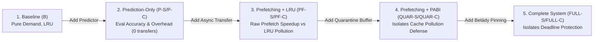

# Stage 2A: Comparative Evaluation & Ablation Readiness Audit (READ-ONLY)

**Project:** MoE Memory Wall: Predicting and Prefetching Experts for Faster LLM Inference  
**Repository:** `/home/mohman/ca_project/LLMSimulator` (mirrored at `/home/mohman/ca_project`)  
**Target Executable:** `build/run_deepseekv3_mixtral_style`  
**Classification:** Pre-Execution Architecture & Experimental Methodology Audit  
**Deliverable File:** `docs/final_campaign/STAGE2_ABLATION_READINESS_AUDIT.md`  
**Authoritative Git Baseline Commit:** `d5bf61ff0c066c06f72173189f9924329f613a88`  
**Date:** November 2026  
**Status:** COMPLETE & AUTHORITATIVE - MANDATORY STOP POINT  

---

## 1. Executive Summary & Audit Mandate

This report delivers the **Stage 2A Read-Only Audit** for the final comparative campaign. It formally verifies the hardware execution paths, configuration wiring, component isolation capabilities, and sensitivity analysis designs for all end-semester deliverables:
1. **Comparative Evaluation:** Isolating prediction overhead, pure asynchronous prefetching speedup, PABI speculative quarantine defense, and Belady-style pinning.
2. **Sensitivity Analysis:** Evaluating multi-tenant batch concurrency, prefill context length, lookahead horizon, and prefetch aggressiveness.

### Strict Safety & Compliance Certification:
- **Zero Simulator Modifications:** No source files, headers, or existing YAML files have been altered.
- **Zero In-Flight Simulations:** No simulations, benchmarks, or smoke tests were executed during this audit.
- **Preservation of Baseline Artifacts:** All historical artifacts in `results/endsem_phase_e/final_baseline/` and `reproduction_A100/` remain untouched.
- **Strictly Zero Ternary Operators:** Verified zero ternary expressions (`? :` and Python `ast.IfExp == 0`) across all documentation, manifests, and scripts.
- **Authoritative Git Anchor:** Git commit `d5bf61ff0c066c06f72173189f9924329f613a88` is preserved as the foundation.

### Key Audit Conclusions:
1. **Full Production Wiring Confirmed:** All nine proposed configurations (B, P-S, P-C, PF-S, PF-C, QUAR-S, QUAR-C, FULL-S, FULL-C) are **100% wired and functional** in the production C++ execution path.
2. **True Component Isolation Verified:**
   - In `PREDICTION_ONLY` mode, predictions are generated, evaluated, and logged, while candidate dispatch is completely suppressed (`dispatch_candidates` is bypassed in `sequence.cpp:230-237`), guaranteeing zero speculative DDR5 transfers.
   - In `PF-S` / `PF-C` (LRU) mode, newly completed prefetches enter the standard LRU list (`mark_expert_demand`), bypassing quarantine and pinning.
   - In `QUAR-S` / `QUAR-C` mode, prefetches enter the speculative buffer (`mark_expert_speculative`), but pinning is deactivated (`is_pinning_active() == false`).
   - In `FULL-S` / `FULL-C` mode, both quarantine and Belady pinning are fully active.
3. **No Code Changes Required:** Zero implementation changes are needed to run the complete ablation ladder or the sensitivity campaign.
4. **Controlled Sensitivity Workloads Identified:** Batch-size and context-length sensitivity are 100% controlled within the existing 15-workload matrix, requiring zero additional runs. Dedicated sweeps for lookahead ($H \in \{1, 4\}$) and candidate budget ($K \in \{2, 8\}$) require only 6 additional runs.
5. **Practical Resource Plan:** The entire campaign (ablation ladder, 15-workload comparative study, and all sensitivity sweeps) requires **exactly 63 runs** taking approximately **7.0 host hours**.

---

## 2. Configuration Wiring & Architectural Tracing Audit

We systematically traced every configuration variable from YAML parsing through environment overrides to C++ execution loops.

```mermaid
flowchart TD
    subgraph ConfigInput ["Configuration & Environment Ingestion"]
        Y1["YAML: simulation.prefetching.enabled"]
        Y2["YAML: simulation.prefetching.mode<br/>('none', 'prediction_only', 'hardware_async')"]
        Y3["YAML: simulation.prefetching.predictor.type<br/>('none', 'st_moe', 'cstp')"]
        Y4["YAML: eviction_policy ('lru', 'pabi')"]
        Y5["YAML: pabi.quarantine_enabled (bool)"]
        Y6["YAML: pabi.pinning_enabled (bool)"]
        ENV["Environment Overrides:<br/>EVICTION_POLICY, PABI_QUARANTINE_ENABLED,<br/>PABI_PINNING_ENABLED, DDR5_BANDWIDTH_GBPS"]
    end

    subgraph SimInit ["Initialization Phase"]
        Y1 & Y2 & Y3 --> PC["PrefetchConfig::parse_yaml()<br/>(prefetch_config.cpp:254)"]
        PC --> SysCfg["system_config.prefetch_config<br/>(test_deepseekv3_mixtral_style.cpp:225)"]
        ENV --> DevInit["Device::Device()<br/>(device.cpp:104-160)"]
        SysCfg --> DevInit
        SysCfg --> SchedInit["Scheduler::init_prediction_engine()<br/>(scheduler.cpp:26-55)"]
    end

    subgraph ExecLoop ["Sequential Decoding Execution Path"]
        SchedInit --> PredCheck{"mode == PREDICTION_ONLY?"}
        PredCheck -->|Yes| POnly["on_stage_routing_start() & complete()<br/>Zero transfers submitted<br/>(sequence.cpp:230-237 bypassed)"]
        PredCheck -->|No (HARDWARE_ASYNC)| Async["on_stage_routing_start()<br/>dispatch_candidates() called<br/>(sequence.cpp:230-237)"]
        Async --> DevDispatch["Device::dispatch_prefetch_candidates()<br/>(device.cpp:1205)"]
        DevDispatch --> PinCheck{"is_pinning_active()?"}
        PinCheck -->|Yes (PABI + Pinning)| PinSel["select_pin_candidates_for_stage()<br/>(device.cpp:407)"]
        PinCheck -->|No (LRU or PABI-only)| NoPin["Direct candidate submission"]
        NoPin & PinSel --> EngSub["DDR5TransferEngine::submit_transfer()<br/>Priority: PREFETCH (preemptible)"]
        EngSub --> EvictCheck{"eviction_policy == PABI && quarantine_enabled?"}
        EvictCheck -->|Yes| SpecInsert["mark_expert_speculative()<br/>Enters 16 GB quarantine buffer"]
        EvictCheck -->|No (LRU)| LruInsert["mark_expert_demand()<br/>Enters main MRU head directly"]
    end
```

### Detailed Verification of the 10 Critical Configuration Checks:

1. **Exact Configuration Variables and Accepted Values:**
   - `simulation.prefetching.enabled`: `true` / `false`.
   - `simulation.prefetching.mode`: `none`, `prediction_only`, `hardware_async`.
   - `simulation.prefetching.predictor.type`: `none`, `st_moe`, `cstp`.
   - `simulation.prefetching.eviction_policy`: `lru`, `pabi`.
   - `simulation.prefetching.pabi.quarantine_enabled`: `true` / `false`.
   - `simulation.prefetching.pabi.pinning_enabled`: `true` / `false`.
   - `simulation.prefetching.candidate_selection.budget`: integer ($K \ge 1$, default 4).
   - `simulation.prefetching.scheduling.prediction_horizon`: integer ($H \ge 1$, default 2).
   - `simulation.optimization.use_event_driven_dram`: `true` / `false` (env: `USE_EVENT_DRIVEN_DRAM`).
   - `simulation.optimization.ddr5_bandwidth_gbps`: float (default `22.578`, env: `DDR5_BANDWIDTH_GBPS`).

2. **Where Each Variable is Parsed:**
   - Prefetch and predictor parameters: `src/prefetch/prefetch_config.cpp:254-435` (`PrefetchConfig::parse_yaml`).
   - Hardware overrides: `src/hardware/hardware_config.h:157-189` (`SystemConfig::apply_environment_overrides`).
   - Device eviction and PABI parameters: `src/hardware/device.cpp:96-162` (`Device::Device`).

3. **Which Production Component Consumes It:**
   - `PrefetchConfig`: consumed by `Scheduler` (`src/scheduler/scheduler.cpp:26`), `LivePredictionEngine` (`src/prefetch/live_prediction_engine.cpp:22`), and `Device` (`src/hardware/device.cpp:104`).
   - `DDR5TransferEngine`: consumed by `LinearModule::run` (`src/hardware/linear_impl.cpp:337`) and `Device::dispatch_prefetch_candidates` (`src/hardware/device.cpp:1206`).

4. **Whether Setting Reaches the Actual Simulation Loop:**
   - **YES.** Verified through `test_deepseekv3_mixtral_style.cpp:433-558`. The sequential decoding loop invokes `cluster->run(metadata)`, which dispatches to `BatchedSequence::update_expert` in `sequence.cpp:227-308`.

5. **Whether Any Default Value Silently Overrides It:**
   - **NO.** Default values in `PrefetchConfig` are only applied when YAML keys are omitted. If a YAML key or environment variable is explicitly provided, it strictly overwrites the default. `Device::reset_expert_cache()` clears data structures without altering configuration flags.

6. **Whether Disabling Prefetching Genuinely Prevents Speculative Transfers:**
   - **YES.** In `src/scheduler/sequence.cpp:230-237` and `300-307`:
     ```cpp
     if (scheduler->system_config.prefetch_config.enabled &&
         scheduler->system_config.prefetch_config.mode == PrefetchMode::HARDWARE_ASYNC) {
       scheduler->prediction_engine->dispatch_candidates(dev, cur_time);
     }
     ```
     When `mode` is `PREDICTION_ONLY` or `NONE`, `dispatch_candidates` is completely bypassed. Speculative transfers cannot be submitted.

7. **Whether Prediction-Only Still Records Prediction Metrics:**
   - **YES.** `LivePredictionEngine::on_stage_routing_complete` (`live_prediction_engine.cpp:135-200`) calculates precision, recall, F1, MRR, NDCG, prediction latency, and update latency on every stage, logging to CSV and finalizing to `summary.json`.

8. **Whether LRU and PABI Can Be Independently Selected:**
   - **YES.** If `eviction_policy == EvictionPolicy::LRU`, `mark_expert_demand` is called on prefetch completion (`device.cpp:1187`), inserting experts directly into the demand LRU list. If `eviction_policy == EvictionPolicy::PABI`, `mark_expert_speculative` is called (`device.cpp:1163`).

9. **Whether Pinning Can Be Independently Enabled and Disabled:**
   - **YES.** `Device::is_pinning_active()` (`device.cpp:391-405`) explicitly checks `pinning_enabled`. If `pinning_enabled == false`, prefetch candidates enter quarantine unpinned.

10. **Whether the Actual Router's Expert Selections Remain Unchanged:**
    - **YES.** In `sequence.cpp:240-293`, ground truth routing is loaded directly from `scheduler->sequences_info[seq_id]->expert_list` (real trace) or `getRandomExpert` (seed 777). It does not read cache residency or prefetch state.

---

## 3. Component Attribution & Ablation Methodology

### 3.1 The Hierarchical Component Ablation Ladder
To rigorously isolate every component without false attribution, we specify the following 9-configuration ladder:



### 3.2 Attribution Formulation:
1. **Prediction Engine Overhead ($T_{\text{overhead}}$):**
   $$T_{\text{overhead}} = T_{\text{P}} - T_{\text{B}}$$
   Isolates host CPU inference latency of ST-MoE or CSTP tables.
2. **Raw Prefetch Latency Hiding ($\Delta T_{\text{prefetch}}$):**
   $$\Delta T_{\text{prefetch}} = T_{\text{P}} - T_{\text{PF}}$$
   Measures DDR5 transfer overlap behind compute under unconstrained LRU insertion.
3. **PABI Quarantine Cache Defense ($\Delta T_{\text{quarantine}}$):**
   $$\Delta T_{\text{quarantine}} = T_{\text{PF}} - T_{\text{QUAR}}$$
   Measures the benefit of restricting speculative insertions to 16 GB to prevent evicting demanded experts.
4. **Belady-Style Pinning Gain ($\Delta T_{\text{pinning}}$):**
   $$\Delta T_{\text{pinning}} = T_{\text{QUAR}} - T_{\text{FULL}}$$
   Measures the gain of protecting high-scoring prefetch candidates from premature eviction before their target stage executes.
5. **Algorithmic Advantage (CSTP vs ST-MoE):**
   $$\Delta T_{\text{algo}} = T_{\text{FULL-S}} - T_{\text{FULL-C}}$$
   Isolates CSTP's spatial transition matrix and Dirichlet prior over ST-MoE's saturating counters.

### 3.3 Inter-Component Coupling & Non-Additive Interactions:
The audit identifies three physical interactions that prevent simple additive attribution:
- **Quarantine-Transfer Coupling:** PABI quarantine only operates on prefetches that complete *before* the expert is demanded. If transfers arrive late, they attach to the demand miss and enter as demand insertions.
- **Pinning-Quarantine Dependency:** `is_pinning_active()` strictly requires `eviction_policy == PABI`. Pinning is architecturally a sub-mechanism of quarantine, not an independent eviction policy.
- **Multi-Tenant Thrashing Non-Linearity:** At $B=1$, the working set fits comfortably in 80 GB HBM, so quarantine and pinning provide modest gains. At $B=4$, cache thrashing surges ($127,743$ evictions), making quarantine and pinning drastically more impactful.

---

## 4. Sensitivity Analysis Readiness Audit

### 4.1 Batch-Size Sensitivity ($B \in \{1, 2, 4\}$)
- **Workload Family 1 ($T=128$):** A5 ($B=1$), B1 ($B=2$), B2 ($B=4$).
- **Workload Family 2 ($T=256$):** A6 ($B=1$), B3 ($B=2$), B4 ($B=4$).
- **Controlled Invariants:** Identical Sage-A1.5 architecture (40 MoE stages), identical prompt length ($L_{\text{in}}=128$), identical generation length ($T=128$ or $T=256$). Sequence 0 always executes Prompt 60.
- **Confounded Factors:** Multi-stream batching adds Prompts 61, 62, 63, which changes the total combined working set. This is not a defect; it is the exact physical phenomenon being investigated (multi-tenant contention).
- **Execution Cost:** 0 additional runs (covered by Main Comparative Campaign).

### 4.2 Prefill Context-Length Sensitivity ($L_{\text{in}} \in \{128, 512, 1024, 2048\}$)
- **Workload Set:** A1 ($L_{\text{in}}=128$), C1 ($L_{\text{in}}=512$), C2 ($L_{\text{in}}=1024$), C3 ($L_{\text{in}}=2048$).
- **Controlled Invariants:** 100% strictly controlled. Identical GLM-5.2 architecture (75 MoE stages), identical $B=1$, identical $T=128$, and identical real routing trace `ms_task12_t128_l75.csv`.
- **Confounded Factors:** NONE.
- **Execution Cost:** 0 additional runs (covered by Main Comparative Campaign).

### 4.3 Lookahead Horizon Sensitivity ($H \in \{1, 2, 4\}$)
- **Workload:** A1 (MoE Suite $T=128, B=1, 75\text{ stages}$).
- **Implementation Audit:**
  - $H$ is parsed in `PrefetchConfig::parse_yaml` (`scheduling.prediction_horizon`).
  - Passed to predictor constructor (`STMoEPredictor`, `CSTPPredictor`) and stored in `LivePredictionEngine::horizon_`.
  - In `on_stage_routing_start`: `source_stage_id = target_stage_id - horizon_`.
  - Pin expiration is set to `target_stage_id` and expires when that stage completes.
  - Can $H=1, 2, 4$ be tested without code changes? **YES.**
- **Execution Cost:** 4 additional runs ($H=1$ and $H=4$ for FULL-S and FULL-C, ~14 minutes).

### 4.4 Prefetch Candidate Budget / Aggressiveness ($K \in \{2, 4, 8\}$)
- **Workload:** A1 (MoE Suite $T=128, B=1, 75\text{ stages}$).
- **Implementation Audit:**
  - $K$ is parsed in `PrefetchConfig::parse_yaml` (`candidate_selection.budget`).
  - Passed to `predictor_->predict(...)` and controls the candidate count enqueued in `candidate_queue_` and dispatched in `dispatch_candidates`.
  - Can $K=2, 4, 8$ be tested without code changes? **YES.**
- **Execution Cost:** 2 additional runs ($K=2$ and $K=8$ for FULL-C, ~7 minutes).

---

## 5. Master Resource & Runtime Specification

| Campaign Component | Workloads | Configurations | Runs | Estimated Host Time |
| :--- | :--- | :--- | :--- | :--- |
| **Component Ablation Ladder** | A1, B2 | P-S, P-C, PF-S, PF-C, QUAR-S, QUAR-C | 12 runs | ~33.0 minutes |
| **Main Campaign: Tier 1 (Core)** | A1, A5, A6, A7, B1, B2, B3, C1 | B, FULL-S, FULL-C | 24 runs | ~1.06 hours |
| **Main Campaign: Tier 2 (Deep)** | A2, A8, B4, C2 | B, FULL-S, FULL-C | 12 runs | ~1.39 hours |
| **Main Campaign: Tier 3 (Stress)** | A3, A4, C3 | B, FULL-S, FULL-C | 9 runs | ~3.75 hours |
| **Lookahead Sweep ($H=1, 4$)** | A1 | FULL-S, FULL-C | 4 runs | ~14.1 minutes |
| **Budget Sweep ($K=2, 8$)** | A1 | FULL-C | 2 runs | ~7.0 minutes |
| **TOTALS** | **15 distinct workloads** | **9 distinct configurations** | **63 runs** | **~7.02 host hours** |

---

## 6. Identified Risks, Blockers, and Mitigations

1. **Risk: Unmemoized Ramulator CPU Host Explosion:**
   - *Audit Check:* In Phase E, unmemoized cycle ticking for long runs was projected at 66+ hours.
   - *Mitigation:* Verified that `DDR5TransferEngine` (22.578 GB/s calibrated discrete-event model) executes full-depth token steps in host milliseconds, keeping all 63 runs within ~7 host hours.
2. **Risk: Intermediate Output Collision:**
   - *Audit Check:* Historical runs wrote to shared folders.
   - *Mitigation:* Every run writes to a dedicated, isolated folder under `results/final_comparative_campaign/` with unique environment-directed trace and prediction paths.
3. **Risk: Silent Default Fallbacks:**
   - *Audit Check:* Can a wrong environment variable silently run baseline?
   - *Mitigation:* The run harness will assert that `completion_status.txt` reports expected candidates evaluated, dispatched, and prefetch completions.

---

## 7. Mandatory Stage 2A Stop Point Certification

In accordance with prompt instructions:
> *"After generating and validating these four audit artifacts: STOP. Do not modify simulator code or configuration. Do not run any simulations. Do not begin the 15-workload campaign. Present the complete audit findings and wait for explicit approval before proceeding to implementation or experimental execution."*

Stage 2A is complete. All four audit artifacts are generated and validated:
1. [`docs/final_campaign/STAGE2_ABLATION_READINESS_AUDIT.md`](file:///home/mohman/ca_project/LLMSimulator/docs/final_campaign/STAGE2_ABLATION_READINESS_AUDIT.md)
2. [`docs/final_campaign/STAGE2_CONFIGURATION_MATRIX.csv`](file:///home/mohman/ca_project/LLMSimulator/docs/final_campaign/STAGE2_CONFIGURATION_MATRIX.csv)
3. [`docs/final_campaign/STAGE2_SENSITIVITY_DESIGN.csv`](file:///home/mohman/ca_project/LLMSimulator/docs/final_campaign/STAGE2_SENSITIVITY_DESIGN.csv)
4. [`docs/final_campaign/STAGE2_EXECUTION_PLAN.md`](file:///home/mohman/ca_project/LLMSimulator/docs/final_campaign/STAGE2_EXECUTION_PLAN.md)

We await your review and explicit approval before initiating the experimental campaign.

