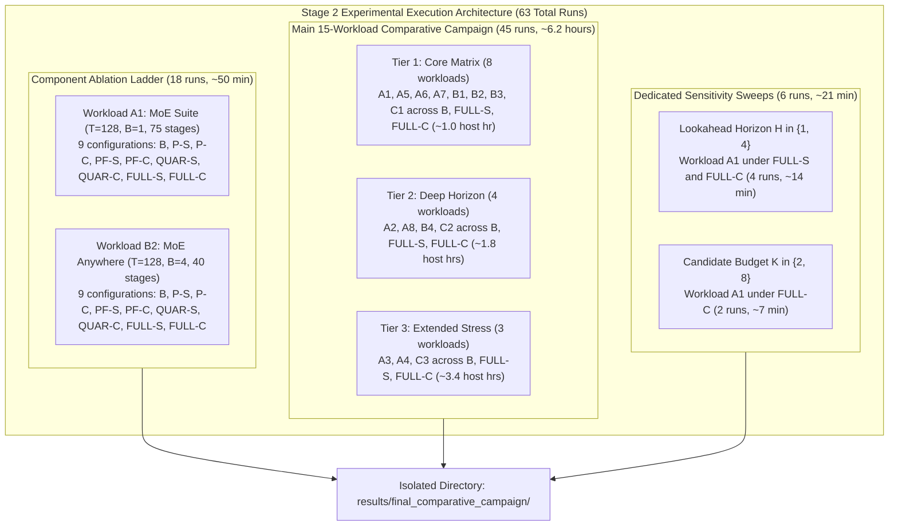

# Stage 2 Execution Plan: Practical, Minimum-Cost Comparative Campaign

**Project:** MoE Memory Wall: Predicting and Prefetching Experts for Faster LLM Inference  
**Repository:** `/home/mohman/ca_project/LLMSimulator` (mirrored at `/home/mohman/ca_project`)  
**Target Executable:** `build/run_deepseekv3_mixtral_style`  
**Classification:** Experimental Campaign Execution Specification  
**Deliverable File:** `docs/final_campaign/STAGE2_EXECUTION_PLAN.md`  
**Authoritative Git Baseline Commit:** `d5bf61ff0c066c06f72173189f9924329f613a88`  
**Status:** PLANNING ONLY - READ-ONLY AUDIT DELIVERABLE - NO RUNS IN-FLIGHT  

---

## 1. Overview and Design Objectives

To fulfill the two end-semester deliverables:
1. **Comparative Evaluation:** Isolating the contribution of each architectural subsystem (Prediction, Asynchronous Prefetching, PABI Quarantine, and Belady-Style Pinning).
2. **Sensitivity Analysis:** Characterizing multi-tenant batch concurrency, prefill context length, lookahead horizon, and prefetch aggressiveness.

A naive Cartesian product ($15\text{ workloads} \times 9\text{ configurations} \times 3\text{ lookaheads} \times 3\text{ budgets}$) would require **1,215 simulation runs** exceeding **160 host hours**, which is completely infeasible on a development workstation.

Instead, this plan specifies a **scientifically rigorous, orthogonal decomposition** that answers every research question across **exactly 63 total runs** requiring approximately **7.0 host hours**.



---

## 2. Component Ablation Ladder (18 Runs, ~50 Minutes)

### 2.1 Representative Workload Selection
Two distinct workloads are selected to isolate component contributions under contrasting memory pressure regimes:
1. **Workload A1 (Deep Single-Stream Reference):**
   - Model: GLM-5.2 ($75\text{ MoE stages}, 78\text{ total layers}$).
   - Dimensions: $T=128, B=1, L_{\text{in}}=128$.
   - Characteristics: Deep inter-layer pipeline (75 stages) with real recorded routing locality ($72.73\%$ baseline hit rate).
   - Baseline Runtime: $210.91\text{ s}$ per run.
2. **Workload B2 (High-Concurrency Cache Thrashing Reference):**
   - Model: Sage-A1.5 ($40\text{ MoE stages}, 43\text{ total layers}$).
   - Dimensions: $T=128, B=4, L_{\text{in}}=128$.
   - Characteristics: 4 concurrent user prompts thrash the 80 GB HBM capacity ($127,743$ evictions), isolating the defensive role of PABI quarantine and pinning under severe contention.
   - Baseline Runtime: $118.74\text{ s}$ per run.

### 2.2 Configuration Ladder
Each of the two workloads runs across all 9 configurations:

| Step | Config ID | Predictor | Mode | Eviction | Quarantine | Pinning | Primary Isolation Purpose |
| :--- | :--- | :--- | :--- | :--- | :--- | :--- | :--- |
| 1 | **B** | None | None | LRU | Disabled | Disabled | Pure demand-loading baseline anchor |
| 2 | **P-S** | ST-MoE | Prediction_Only | LRU | Disabled | Disabled | ST-MoE prediction overhead and quality (0 transfers) |
| 3 | **P-C** | CSTP | Prediction_Only | LRU | Disabled | Disabled | CSTP prediction overhead and quality (0 transfers) |
| 4 | **PF-S** | ST-MoE | Hardware_Async | LRU | Disabled | Disabled | ST-MoE prefetching speedup + LRU cache pollution |
| 5 | **PF-C** | CSTP | Hardware_Async | LRU | Disabled | Disabled | CSTP prefetching speedup + LRU cache pollution |
| 6 | **QUAR-S** | ST-MoE | Hardware_Async | PABI | Enabled | Disabled | PABI quarantine defense against cache pollution |
| 7 | **QUAR-C** | CSTP | Hardware_Async | PABI | Enabled | Disabled | PABI quarantine defense against cache pollution |
| 8 | **FULL-S** | ST-MoE | Hardware_Async | PABI | Enabled | Enabled ($K=4$) | Complete ST-MoE system with Belady pinning |
| 9 | **FULL-C** | CSTP | Hardware_Async | PABI | Enabled | Enabled ($K=4$) | Complete CSTP system with Belady pinning |

### 2.3 Mathematical Attribution Formulation
- **Prediction Overhead:** $T_{\text{P}} - T_{\text{B}}$
- **Raw Prefetch Speedup:** $T_{\text{P}} - T_{\text{PF}}$
- **Quarantine Cache Protection:** $T_{\text{PF}} - T_{\text{QUAR}}$
- **Belady Pinning Gain:** $T_{\text{QUAR}} - T_{\text{FULL}}$
- **Overall System Speedup:** $\frac{T_{\text{B}} - T_{\text{FULL}}}{T_{\text{B}}} \times 100\%$

---

## 3. Main 15-Workload Comparative Campaign (45 Runs, ~6.2 Hours)

All 15 authoritative workloads from Phase E are evaluated across three paired configurations:
- **Configuration B (Reproduced Baseline):** Calibrated demand engine ($22.578\text{ GB/s}$), LRU.
- **Configuration FULL-S (Complete ST-MoE System):** ST-MoE, Async prefetch, PABI quarantine, Belady pinning.
- **Configuration FULL-C (Complete CSTP System):** CSTP, Async prefetch, PABI quarantine, Belady pinning.

### Tiered Execution Schedule:
To manage host workstation thermal load and avoid multi-hour uninterrupted jobs:

#### Tier 1: Core Matrix (8 Workloads, 24 Runs, ~1.0 Host Hour)
- A1: MoE Suite $T=128, B=1$ ($3 \times 210.9\text{ s} = 632.7\text{ s}$)
- A5: MoE Anywhere $T=128, B=1$ ($3 \times 106.9\text{ s} = 320.7\text{ s}$)
- A6: MoE Anywhere $T=256, B=1$ ($3 \times 219.0\text{ s} = 657.0\text{ s}$)
- A7: DeepSeek Synthetic $T=128, B=1$ ($3 \times 138.2\text{ s} = 414.6\text{ s}$)
- B1: MoE Anywhere $B=2, T=128$ ($3 \times 109.4\text{ s} = 328.2\text{ s}$)
- B2: MoE Anywhere $B=4, T=128$ ($3 \times 118.7\text{ s} = 356.1\text{ s}$)
- B3: MoE Anywhere $B=2, T=256$ ($3 \times 195.0\text{ s} = 585.0\text{ s}$)
- C1: MoE Suite $L_{\text{in}}=512, T=128$ ($3 \times 173.5\text{ s} = 520.5\text{ s}$)
- *Subtotal Tier 1 Host Runtime:* **$3,814.8\text{ seconds} \approx \mathbf{1.06\text{ hours}}$**.

#### Tier 2: Deep Horizon Matrix (4 Workloads, 12 Runs, ~1.8 Host Hours)
- A2: MoE Suite $T=512, B=1$ ($3 \times 765.6\text{ s} = 2,296.8\text{ s}$)
- A8: DeepSeek Synthetic $T=512, B=1$ ($3 \times 527.8\text{ s} = 1,583.4\text{ s}$)
- B4: MoE Anywhere $B=4, T=256$ ($3 \times 194.1\text{ s} = 582.3\text{ s}$)
- C2: MoE Suite $L_{\text{in}}=1024, T=128$ ($3 \times 179.4\text{ s} = 538.2\text{ s}$)
- *Subtotal Tier 2 Host Runtime:* **$5,000.7\text{ seconds} \approx \mathbf{1.39\text{ hours}}$**.

#### Tier 3: Extended Stress Matrix (3 Workloads, 9 Runs, ~3.4 Host Hours)
- A3: MoE Suite $T=1024, B=1$ ($3 \times 1,423.1\text{ s} = 4,269.3\text{ s}$)
- A4: MoE Suite $T=2048, B=1$ ($3 \times 2,904.5\text{ s} = 8,713.5\text{ s}$)
- C3: MoE Suite $L_{\text{in}}=2048, T=128$ ($3 \times 176.2\text{ s} = 528.6\text{ s}$)
- *Subtotal Tier 3 Host Runtime:* **$13,511.4\text{ seconds} \approx \mathbf{3.75\text{ hours}}$**.

---

## 4. Sensitivity Analysis Execution Matrix

Notice that several sensitivity axes are **fully covered by the 15-workload campaign**, requiring zero additional simulation runs:

### 4.1 Batch Concurrency Sensitivity (0 Additional Runs)
- **Controlled Comparison at $T=128$:** A5 ($B=1$), B1 ($B=2$), B2 ($B=4$).
- **Controlled Comparison at $T=256$:** A6 ($B=1$), B3 ($B=2$), B4 ($B=4$).
- Evaluated under B, FULL-S, FULL-C.

### 4.2 Prefill Context Length Sensitivity (0 Additional Runs)
- **Controlled Comparison at $T=128, B=1$:** A1 ($L_{\text{in}}=128$), C1 ($L_{\text{in}}=512$), C2 ($L_{\text{in}}=1024$), C3 ($L_{\text{in}}=2048$).
- Identical GLM-5.2 architecture, 75 MoE stages, and trace `ms_task12_t128_l75.csv`.

### 4.3 Lookahead Horizon Sensitivity (4 Additional Runs, ~14 Minutes)
- **Workload:** A1 (MoE Suite $T=128, B=1, 75\text{ stages}$).
- Default in Main Campaign is $H=2$.
- Additional runs needed:
  - FULL-S at $H=1$ ($210.9\text{ s}$)
  - FULL-C at $H=1$ ($210.9\text{ s}$)
  - FULL-S at $H=4$ ($210.9\text{ s}$)
  - FULL-C at $H=4$ ($210.9\text{ s}$)
- *Subtotal Lookahead Runtime:* **$843.6\text{ seconds} \approx \mathbf{14.06\text{ minutes}}$**.

### 4.4 Prefetch Candidate Budget Sensitivity (2 Additional Runs, ~7 Minutes)
- **Workload:** A1 (MoE Suite $T=128, B=1, 75\text{ stages}$).
- Default in Main Campaign is $K=4$.
- Additional runs needed for CSTP (FULL-C):
  - FULL-C at $K=2$ ($210.9\text{ s}$)
  - FULL-C at $K=8$ ($210.9\text{ s}$)
- *Subtotal Budget Runtime:* **$421.8\text{ seconds} \approx \mathbf{7.03\text{ minutes}}$**.

---

## 5. Execution Environment & Safety Protocols

### 5.1 Output Directory Structure
All runs write strictly to an independent directory:
```text
results/final_comparative_campaign/
├── original_baseline/          # Read-only copies/links of historical runs
├── reproduced_baseline/        # Configuration B runs (A1 - C3)
├── upgraded_st_moe/            # Configuration FULL-S runs (A1 - C3)
├── upgraded_cstp/              # Configuration FULL-C runs (A1 - C3)
├── ablation/                   # Core ablation runs (A1 and B2 across P-S..QUAR-C)
├── sensitivity/
│   ├── lookahead_h1/
│   ├── lookahead_h4/
│   ├── budget_k2/
│   └── budget_k8/
└── comparative_study/          # Stage 3-5 analysis, CSVs, graphs, and final report
    ├── graphs/
    ├── csv/
    └── run_manifest.json
```

### 5.2 Environment Variable Controls
Every run is launched via a clean subprocess setting explicit environment variables:
- `USE_EVENT_DRIVEN_DRAM=1`
- `DDR5_BANDWIDTH_GBPS=22.578`
- `BYPASS_OFFCHIP_EXECUTION_CACHE=0`
- `TRACE_DIR=<run_dir>/traces`
- `PREDICTION_OUTPUT_DIR=<run_dir>/prediction`
- Explicit `EVICTION_POLICY`, `PABI_QUARANTINE_ENABLED`, and `PABI_PINNING_ENABLED` matching configuration.

### 5.3 Automated Verification Gate
Before logging any run as complete, the harness will verify:
1. Exit code == 0.
2. `completion_status.txt` exists and contains `STATUS=SUCCESS`.
3. Replayed token count == expected iteration steps.
4. Line count in `expert_routing.csv` matches expected routing events ($B \times T \times S \times 8$).
5. Zero fallback to synthetic random routing on real trace workloads.

---

## 6. Total Resource Summary

| Experimental Subset | Workloads Evaluated | Configurations per Workload | Total Runs | Estimated Host Time |
| :--- | :--- | :--- | :--- | :--- |
| **Component Ablation Ladder** | A1, B2 | 6 ablation configs (P-S, P-C, PF-S, PF-C, QUAR-S, QUAR-C) | 12 runs | ~33 minutes |
| **Tier 1: Core Matrix** | A1, A5, A6, A7, B1, B2, B3, C1 | 3 configs (B, FULL-S, FULL-C) | 24 runs | ~1.06 hours |
| **Tier 2: Deep Horizon** | A2, A8, B4, C2 | 3 configs (B, FULL-S, FULL-C) | 12 runs | ~1.39 hours |
| **Tier 3: Extended Stress** | A3, A4, C3 | 3 configs (B, FULL-S, FULL-C) | 9 runs | ~3.75 hours |
| **Lookahead Sensitivity ($H=1, 4$)** | A1 | 2 configs (FULL-S, FULL-C) | 4 runs | ~14 minutes |
| **Candidate Budget ($K=2, 8$)** | A1 | 1 config (FULL-C) | 2 runs | ~7 minutes |
| **TOTALS** | **15 distinct workloads** | **9 distinct configurations** | **63 runs** | **~7.02 host hours** |

*All host runtime estimates are derived directly from empirical baseline measurements in Phase E.*

