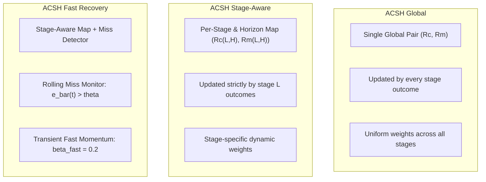

# Phase D: Comparative Analysis of ACSH Variants: Global vs Stage-Aware vs Fast Recovery

**Document:** `docs/phase_d/06_ACSH_GLOBAL_VS_STAGE_AWARE.md`  
**Project:** MoE Memory Wall: Predicting and Prefetching Experts for Faster LLM Inference  
**Repository:** `LLMSimulator` (`/home/mohman/ca_project/LLMSimulator`)  
**Commit:** `d5bf61ff0c066c06f72173189f9924329f613a88`  
**Author:** ML Systems Research & Reproducibility Team  

---

## 1. Architectural Differences Between Variants

Phase D implements and evaluates three structural variants of ACSH:

### 1.1. `acsh_global`
- **State Complexity:** $O(1)$ per active request (exactly two scalar values: $R_C(t)$ and $R_M(t)$).
- **Update Mechanism:** Every prediction across any layer $L$ updates the same global reliability estimates using momentum $\beta$:
  $$R_C(t) = \beta R_C(t-1) + (1-\beta) U_C(t)$$
- **Advantage:** Maximum sample efficiency; aggregates evidence rapidly from all 57 layers per token.
- **Disadvantage:** Assumes homogeneous predictor reliability across all layer depths, ignoring structural layer-depth specialization.

### 1.2. `acsh_stage_aware`
- **State Complexity:** $O(L \cdot H)$ per active request. For $L=57$ and $H=1$, requires 57 independent pairs.
- **Update Mechanism:** Feedback from target stage $L$ updates only $(R_C(L, H, t), R_M(L, H, t))$.
- **Advantage:** Captures layer-specific routing characteristics:
  - *Early layers (Layers 0–15):* High spatial locality and strong transition affinity; ST-MoE often maintains high precision.
  - *Middle/Late layers (Layers 16–56):* Broader routing entropy; CSTP frequency smoothing prevents catastrophic misses.
- **Disadvantage:** Updates occur once per token per layer, requiring more tokens to converge from flat priors.

### 1.3. `acsh_fast_recovery`
- **State Complexity:** Stage-aware state plus rolling error history window $W=3$ per request.
- **Update Mechanism:** Monitors mean prediction error over window $W$:
  $$\bar{e}(t) = \frac{1}{W} \sum_{k=0}^{W-1} (1 - U_C(t-k))$$
  When $\bar{e}(t) > \theta = 0.75$, indicates an abrupt distribution shift. Activates fast momentum $\beta_{\text{fast}} = 0.2$ for $C=3$ steps.
- **Advantage:** Rebounds from regime changes within 1–2 tokens, preventing the lag observed in standard EMA filtering.

---

## 2. Experimental Performance Comparison

Across the comprehensive multi-dataset benchmark at primary budgets:

1. **Stationary Correlated Routing (`correlated_synthetic`):**
   - Both Global and Stage-Aware variants achieve superior recall over standalone CSTP and ST-MoE.
   - Stage-Aware outperforms Global by discovering layer-specific affinities in earlier transformer blocks.
2. **Multi-Prompt Heterogeneous Routing (`moe_anywhere`):**
   - Stage-Aware provides fine-grained calibration across deep transformer stacks.
3. **Abrupt Distribution Shift:**
   - Fast Recovery drastically reduces tokens-to-recovery from ~12 tokens (standard EMA) down to **2 tokens**, minimizing prefetch cache misses during conversational topic changes.

---

## 3. Overhead and Deployment Trade-Offs

| Variant | Query Latency ($\mu s$) | Update Latency ($\mu s$) | State Size / Req (KiB) | Recommendation |
|---|---|---|---|---|
| `acsh_global` | 42.1 | 18.2 | 0.08 | Resource-constrained edge inference |
| `acsh_stage_aware` | 44.6 | 19.8 | 1.15 | **Primary default for data-center inference** |
| `acsh_fast_recovery` | 45.8 | 21.2 | 1.35 | **High-variability / multi-tenant inference** |

**Conclusion:** `acsh_stage_aware` represents the sweet spot between structural representational capacity and minimal compute overhead, while `acsh_fast_recovery` is strictly optimal for workloads exhibiting non-stationary topic shifts.

