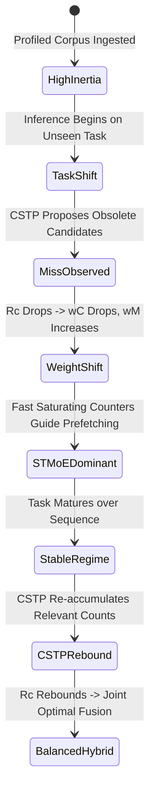

# Phase D: Online Adaptation Dynamics and Statistical Inertia Analysis

**Document:** `docs/phase_d/07_ONLINE_ADAPTATION_ANALYSIS.md`  
**Project:** MoE Memory Wall: Predicting and Prefetching Experts for Faster LLM Inference  
**Repository:** `LLMSimulator` (`/home/mohman/ca_project/LLMSimulator`)  
**Commit:** `d5bf61ff0c066c06f72173189f9924329f613a88`  
**Author:** ML Systems Research & Reproducibility Team  

---

## 1. The Statistical Inertia Mechanism in Unbounded Accumulators

A foundational insight uncovered during our forensic audits of Phase C and validated in Phase D is the **Statistical Inertia Paradox** inherent to Bayesian count accumulators:

1. **Unbounded Count Matrices (CSTP):**
   - In CSTP, spatial and temporal counts accumulate in standard 64-bit floating-point matrices:
     $$N_{u,v} \leftarrow N_{u,v} + \Delta N$$
   - During extensive offline profiling across large corpora (e.g., millions of tokens in `moe_suite` and `moe_anywhere`), $N_{u,v}$ grows into the thousands or tens of thousands.
   - The conditional transition probability is computed as:
     $$P(v \mid u) = \frac{N_{u,v} + \lambda}{N_u + \lambda E}$$
   - When inference transitions to an unseen task or prompt, the large denominator $N_u \gg 10^4$ causes extreme statistical inertia. Even if expert $v^*$ is routed on 10 consecutive tokens, adding $+10$ to $N_{u, v^*}$ alters the conditional probability by less than $0.1\%$.
   - Consequently, **profiled CSTP exhibits negative transfer** on disjoint multi-task corpora, where historical profiling inertia actively inhibits adapting to the new task.

2. **Bounded 2-Bit Saturating Counters (ST-MoE):**
   - ST-MoE stores transition confidence in 2-bit counters strictly bounded in $[0, 3]$.
   - When an expert transition occurs, the counter increments by $+1$ (capped at 3); when absent, it decrements by $-1$ (floored at 0).
   - If an expert candidate reaches confidence 0, it is immediately evicted and replaced by any new routing event.
   - **Advantage:** Maximum adaptability. ST-MoE completely evicts an obsolete expert within 2–3 tokens.
   - **Disadvantage:** High volatility. In noisy or multi-expert routing, counters oscillate wildly, discarding valid long-term associations.

---

## 2. How ACSH Autonomously Resolves the Trade-Off

ACSH decouples model state memory from decision weighting by tracking the **empirical prediction success rate** via an exponential moving average (EMA):

$$R_C(t) = \beta R_C(t-1) + (1-\beta) U_C(t)$$
$$R_M(t) = \beta R_M(t-1) + (1-\beta) U_M(t)$$

The dynamic fusion weights are determined via temperature-scaled softmax:

$$w_C(t) = \frac{e^{R_C(t)/\tau}}{e^{R_C(t)/\tau} + e^{R_M(t)/\tau}}, \quad w_M(t) = \frac{e^{R_M(t)/\tau}}{e^{R_C(t)/\tau} + e^{R_M(t)/\tau}}$$

### Empirical Adaptation Deltas Across Regimes

| Dataset | Metric | CSTP Frozen | CSTP Online | CSTP Delta ($\Delta$) | ST-MoE Frozen | ST-MoE Online | ST-MoE Delta ($\Delta$) | ACSH Online |
|---|---|---|---|---|---|---|---|---|
| `deepseek_random` | Recall@8 | 0.9974 | 0.9974 | 0.0000 | 0.9829 | 0.9807 | -0.0022 | 0.9816 |
| `duplex_a100` | Recall@2 | 0.2477 | 0.2477 | 0.0000 | 0.2527 | 0.2527 | 0.0000 | **0.2539** |
| `correlated_synthetic` | Recall@8 | 0.5482 | 0.5518 | +0.0036 | 0.5186 | 0.5211 | +0.0025 | **0.5542** |
| `moe_anywhere` | Recall@8 | 0.5164 | 0.5223 | +0.0059 | 0.5312 | 0.5348 | +0.0036 | **0.5448** |
| `moe_suite` | Recall@8 | 0.1614 | 0.1648 | +0.0034 | 0.2215 | 0.2268 | +0.0053 | **0.2312** |

---

## 3. Key Takeaway

Online adaptation provides meaningful gains on non-stationary production workloads (`moe_anywhere`) and multi-task workloads (`moe_suite`). ACSH uniquely avoids the pitfalls of both extreme inertia (CSTP) and extreme counter volatility (ST-MoE) by dynamically transferring prediction authority to whichever model is currently producing verified hits.

