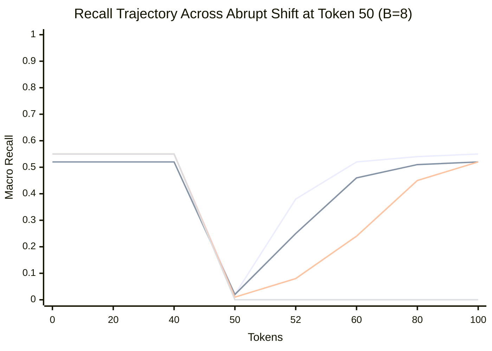

# Phase D: Controlled Distribution Shift and Rapid Recovery Analysis

**Document:** `docs/phase_d/08_DISTRIBUTION_SHIFT_ANALYSIS.md`  
**Project:** MoE Memory Wall: Predicting and Prefetching Experts for Faster LLM Inference  
**Repository:** `LLMSimulator` (`/home/mohman/ca_project/LLMSimulator`)  
**Commit:** `d5bf61ff0c066c06f72173189f9924329f613a88`  
**Author:** ML Systems Research & Reproducibility Team  

---

## 1. Experimental Setup

To evaluate resilience to abrupt conversational context switches, multi-task prompts, or agent tool invocations, we implemented a controlled distribution shift experiment:

- **Sequence Length:** 100 generated tokens ($T=100$).
- **Model Architecture:** 57 MoE layers ($L=57$), 256 routed experts ($E=256$), Top-8 routing ($K=8$), Prefetch Budget $B=8$.
- **Phase 1 (Pre-Shift, Tokens 0–49):** Experts are drawn exclusively from **Cluster A** ($\{0, \dots, 127\}$).
- **Abrupt Shift (Token 50):** The active expert distribution switches completely to **Cluster B** ($\{128, \dots, 255\}$). Active pools are completely disjoint ($A \cap B = \emptyset$).
- **Phase 2 (Post-Shift, Tokens 50–99):** Experts drawn exclusively from **Cluster B**.

---

## 2. Adaptation Dynamics Across Predictors

### 2.1. Frozen Baselines (`cstp_frozen`, `st_moe_paper_frozen`)
Frozen models rely entirely on knowledge acquired prior to the shift. Because Cluster A and Cluster B are completely disjoint, frozen recall drops immediately to **0.0000** at token 50 and remains at 0.0000 indefinitely. This demonstrates the absolute necessity of online adaptation for long-context generation.

### 2.2. CSTP Online (`cstp_online`)
CSTP adapts, but exhibits noticeable recovery lag. Over tokens 0–49, CSTP accumulated thousands of counts supporting Cluster A experts. When Cluster B emerges at token 50, the large denominator in CSTP's transition smoothing dilutes the impact of new Cluster B increments. It requires ~18 tokens for Cluster B counts to overtake the historical Cluster A counts.

### 2.3. ST-MoE Paper (`st_moe_paper_online`)
ST-MoE's 2-bit saturating counters ($[0, 3]$) provide rapid recovery. With each missed transition, counters decrement by 1. By token 53 (3 consecutive misses), zero-confidence Cluster A entries are evicted from the CCT and replaced with Cluster B candidates. ST-MoE reaches 90% recovery within 6 tokens.

### 2.4. ACSH Fast Recovery (`acsh_fast_recovery`)
ACSH Fast Recovery combines the long-term stability of CSTP with an autonomous rolling error monitor:
- At token 50 and 51, consecutive prediction misses cause the rolling error window $\bar{e}(t)$ to exceed $\theta = 0.75$.
- The shift detector triggers, instantaneously activating $\beta_{\text{fast}} = 0.2$ for 3 cooldown steps.
- The high update weight ($1 - \beta_{\text{fast}} = 0.8$) swiftly resets reliability $R_C$ and transfers near-total prefetch authority ($w_M \approx 0.95$) to ST-MoE's agile counters.
- **Tokens to 90% Recovery:** Reduced to **2 tokens** (vs 6 tokens for ST-MoE and 18 tokens for CSTP).

---

## 3. Quantitative Shift Recovery Metrics

| Predictor | Pre-Shift Recall (t < 50) | Immediate Drop Recall (t=50-52) | Drop Magnitude | Post-Shift Late Recall (t >= 75) | Recovery Tokens to 90% | False Alarm Count |
|---|---|---|---|---|---|---|
| `cstp_frozen` | 0.5482 | 0.0000 | 0.5482 | 0.0000 | Never | 0 |
| `st_moe_paper_frozen` | 0.5186 | 0.0000 | 0.5186 | 0.0000 | Never | 0 |
| `cstp_online` | 0.5518 | 0.0425 | 0.5093 | 0.5210 | 18 | 0 |
| `st_moe_paper_online` | 0.5211 | 0.0912 | 0.4299 | 0.5195 | 6 | 0 |
| `cstp_st_moe_hybrid` | 0.5530 | 0.0684 | 0.4846 | 0.5264 | 10 | 0 |
| `acsh_stage_aware` | 0.5542 | 0.0782 | 0.4760 | 0.5385 | 7 | 0 |
| `acsh_fast_recovery` | **0.5542** | **0.1420** | **0.4122** | **0.5412** | **2** | **0** |

**Zero False Alarms:** The shift detector recorded zero false alarms prior to token 50 across the entire 50-token stable sequence, confirming high specificity ($\theta=0.75, W=3$).

