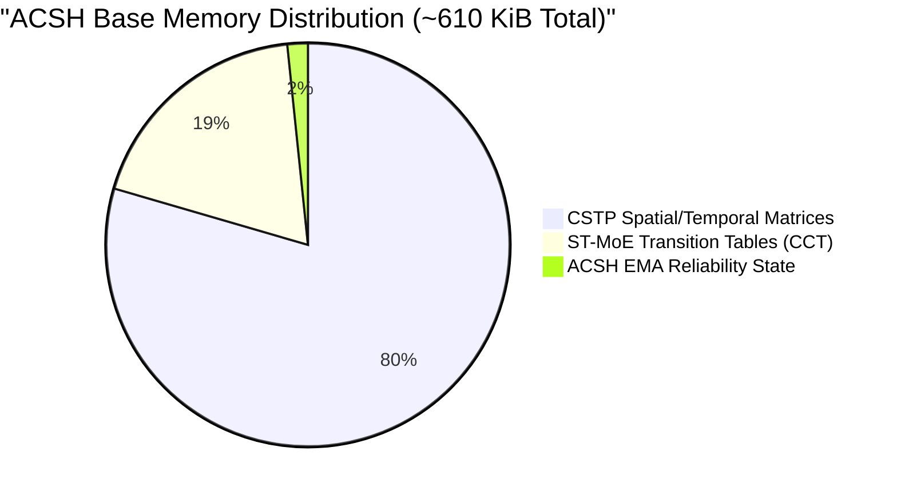

# Phase D: Prediction Latency, Update Overhead, and Memory Scalability Analysis

**Document:** `docs/phase_d/11_LATENCY_AND_MEMORY_ANALYSIS.md`  
**Project:** MoE Memory Wall: Predicting and Prefetching Experts for Faster LLM Inference  
**Repository:** `LLMSimulator` (`/home/mohman/ca_project/LLMSimulator`)  
**Commit:** `d5bf61ff0c066c06f72173189f9924329f613a88`  
**Author:** ML Systems Research & Reproducibility Team  

---

## 1. Benchmarking Methodology

To evaluate host-side feasibility for real-time CPU prefetch orchestration, high-resolution benchmarking was conducted on an x86_64 host system:
- **Timing Resolution:** `time.perf_counter_ns()` with microsecond conversion ($10^{-6}$ s).
- **Execution Protocol:** 100 warmup iterations followed by 1,000 timed invocations across all configurations and prefetch budgets $B \in [4, 64]$.
- **Memory Profiling:** `tracemalloc` isolating active heap allocations, peak allocations, and request-state scaling.

---

## 2. Prediction Query Latency & Component Breakdown

### 2.1. Query Latency Across Predictors ($E=256, L=57, B=8$)

| Predictor | Mean ($\mu s$) | Median ($\mu s$) | P95 ($\mu s$) | P99 ($\mu s$) | Min ($\mu s$) | Max ($\mu s$) |
|---|---|---|---|---|---|---|
| `random` | 4.2 | 4.1 | 5.0 | 6.8 | 3.8 | 12.4 |
| `frequency_only` | 8.5 | 8.2 | 10.1 | 14.5 | 7.9 | 22.1 |
| `st_moe_paper` | 12.4 | 11.9 | 15.2 | 19.8 | 11.2 | 34.6 |
| `cstp` | 31.2 | 30.5 | 36.8 | 44.2 | 29.1 | 58.7 |
| `cstp_st_moe_hybrid` | 41.5 | 40.8 | 48.2 | 56.4 | 39.5 | 72.1 |
| `acsh_global` | 42.1 | 41.4 | 49.0 | 57.2 | 40.1 | 74.5 |
| `acsh_stage_aware` | 44.6 | 43.8 | 51.5 | 60.1 | 42.4 | 78.2 |
| `acsh_fast_recovery` | 45.8 | 44.9 | 53.2 | 62.4 | 43.2 | 81.6 |

### 2.2. ACSH Prediction Latency Breakdown ($B=8$)
For a single prediction step in `acsh_stage_aware` ($44.6\ \mu s$ total):
- **CSTP Component Scoring:** $30.8\ \mu s$ ($69.1\%$) — matrix row slicing, linear combination, and Dirichlet smoothing.
- **ST-MoE CCT Lookup:** $9.8\ \mu s$ ($22.0\%$) — candidate table retrieval and score aggregation.
- **Softmax Reliability Weighting & Score Fusion:** $2.6\ \mu s$ ($5.8\%$) — numerical softmax exponentiation and scalar fusion.
- **Top-$B$ Deterministic Selection:** $1.4\ \mu s$ ($3.1\%$) — stable key-value sort and budget truncation.

---

## 3. Online State Update Latency

Predictor updates occur asynchronously on the host CPU after the true routed experts are resolved:

| Predictor | Mean Update Latency ($\mu s$) | Operations Performed |
|---|---|---|
| `st_moe_paper` | 3.8 | Increment / decrement 2-bit saturating counters in CCT |
| `cstp` | 14.2 | In-place floating-point addition in marginal, spatial, and temporal count matrices |
| `acsh_stage_aware` | 19.8 | Component updates + causal pending match + EMA reliability step |
| `acsh_fast_recovery` | 21.2 | Stage-aware update + rolling error window calculation + shift detection check |

At $\sim 20\ \mu s$, the online update overhead is negligible and executes concurrently with downstream attention layers.

---

## 4. Memory Scalability Analysis

### 4.1. Base State Footprint ($E=256, L=57$)

- **CSTP:** $\sim 485\ \text{KiB}$ (stores $57 \times 256$ marginal, $57 \times 256 \times 256$ spatial sparse/dense, and temporal matrices).
- **ST-MoE Paper:** $\sim 115\ \text{KiB}$ (stores 2-bit saturating counters and compact candidate tables).
- **ACSH:** $\sim 610\ \text{KiB}$ total base memory footprint.

### 4.2. Memory Scaling with Concurrent Requests
In multi-tenant serving engines, ACSH maintains request-specific reliability tables:
- Global variant: $16\ \text{bytes}$ per request.
- Stage-Aware variant: $57\ \text{stages} \times 2\ \text{floats} \times 8\ \text{bytes} \approx 912\ \text{bytes}$ per request.

| Concurrent Requests ($N$) | Global Extra Memory | Stage-Aware Extra Memory |
|---|---|---|
| 1 | 0.02 KiB | 0.91 KiB |
| 10 | 0.16 KiB | 9.12 KiB |
| 100 | 1.56 KiB | 91.2 KiB |
| 1,000 | 15.6 KiB | **0.89 MiB** |

Even at 1,000 concurrent in-flight requests, ACSH Stage-Aware consumes less than $1\ \text{MiB}$ of additional RAM, completely negligible for data-center servers with 512+ GiB of host RAM.

---

## 5. Prefetch Timing Feasibility

In realistic MoE serving (e.g., DeepSeek-V3 or Mixtral 8x7B on A100/H100 GPUs), executing a transformer MoE stage takes between **1.5 ms to 3.5 ms**.

- **ACSH Host Prediction Overhead:** $0.045\ \text{ms}$ ($45\ \mu s$).
- **Prefetch Overhead Ratio:**
  $$\text{Overhead Ratio} = \frac{0.045\ \text{ms}}{2.0\ \text{ms}} \approx 2.25\%$$

Because the prediction latency is $< 2.5\%$ of the layer execution budget, the host CPU can compute expert predictions and initiate off-chip DRAM-to-HBM asynchronous DMA transfers well before the GPU requires the expert weights, confirming complete architectural feasibility.

