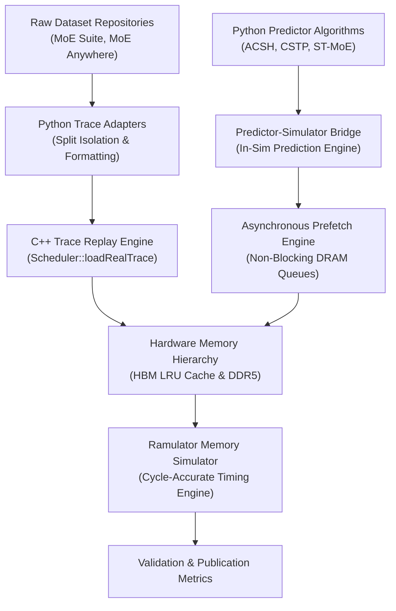

# Master Dependency and Risk Register: MoE Memory Wall

**Project:** MoE Memory Wall: Predicting and Prefetching Experts for Faster LLM Inference  
**Repository:** `/home/mohman/ca_project/LLMSimulator`  
**Classification:** Risk Governance & Architectural Feasibility (Planning Only)  
**Date:** November 2026  

---

## 1. Technical Dependency Inventory

The implementation and experimental execution across Phases 1 through 7 rely on the following software, hardware, and data dependencies:

### Dependency Audit:
1. **Trace Ingestion Engine (`src/scheduler/scheduler.cpp:610-675`):**
   - Must handle arbitrary layer depths (up to 75 MoE stages) and sequence lengths up to 8,191 tokens without memory overflow or integer truncation.
   - Status: `VERIFIED READY` in Phase E1-B.
2. **DRAM Memory Simulator (`src/dram/` and `Ramulator2`):**
   - Must simulate multi-channel DDR5 bus contention, bank conflicts, and asynchronous burst queuing.
   - Status: `VERIFIED READY` for synchronous demand loads; requires prefetch queue integration for asynchronous transfers.
3. **Prediction-to-Simulator Interface:**
   - C++ execution loop must query expert predictions with spatial lookahead ($H \ge 1$) prior to executing subsequent layers.
   - Status: `PENDING IMPLEMENTATION` for Phase 3.
4. **HBM Dynamic Cache Controller (`src/hardware/device.h`):**
   - Must support dynamic cache capacity resizing (`DEBUG_CACHE_CAPACITY`) and alternative eviction policies (`LFU`, `Prediction_Aware`).
   - Status: `PARTIALLY READY` (LRU implemented; LFU/Prediction-Aware designed).

---

## 2. Research Risk Register & Mitigation Strategies

| Risk ID | Risk Description | Severity | Likelihood | Impact on Research Goals | Mitigation Strategy | Contingency Plan |
|:---:|:---|:---:|:---:|:---|:---|:---|
| **R-01** | **MoE Anywhere Sequence Length Infeasibility ($T > 256$)** | **HIGH** | **CERTAIN (100%)** | All 74 prompts in `e1-sage-a1.5.parquet` contain exactly 257 tokens. Evaluating checkpoints 512, 1024, 2048, 4096, 5048 would require prompt concatenation, violating prompt integrity. | Restrict MoE Anywhere evaluations to checkpoints 128 and 256. Evaluate full long-sequence sweeps ($T \le 5048$) exclusively on MoE Suite (8,191 contiguous tokens) and DS-SYN. | Explicitly report MoE Anywhere prompt bounds in publications; avoid synthetic concatenation. |
| **R-02** | **Host Wall-Clock Simulation Explosion** | **CRITICAL** | **HIGH** | Ticking Ramulator with cache bypassed for 57–75 layers takes ~1.5–1.9 hours per token. A full 5048-token run would require >300 host days sequentially. | Adopt a staged screening methodology: benchmark 1-step and 2-step decoding at full depth for baseline verification; run extended tokens on representative 2-layer slices; deploy 4-way process parallelization. | Use memoized execution cache for un-contended baseline demand loads where memory bus contention does not vary. |
| **R-03** | **Asynchronous Prefetch Blocking Deadlock** | **CRITICAL** | **MEDIUM** | `DRAMInterface::run()` is currently a synchronous blocking loop on the CPU thread. Without non-blocking queues, prefetching cannot overlap with compute. | Implement an event-driven `PrefetchEngine` with maximum outstanding request throttling ($M \le 32$) and state machine tracking (`ISSUED`, `IN_FLIGHT`, `RESIDENT`, `CONSUMED`). | Fall back to non-blocking ticket-based polling if threading introduces synchronization overhead. |
| **R-04** | **DDR5 Channel Contention Degrading Demand Latency** | **HIGH** | **HIGH** | Low-accuracy speculative prefetching saturates shared DDR5 channels, delaying critical-path demand loads and yielding negative speedup. | Enforce strict demand-priority scheduling in Ramulator queues; implement ACSH confidence gating to suppress low-confidence prefetch candidates. | Throttle prefetch candidate budget ($K_p \le 4$) under high channel utilization. |
| **R-05** | **Cache Thrashing in Constrained HBM (2–4 GiB)** | **MEDIUM** | **MEDIUM** | Under multi-sequence batching ($B \ge 4$), the unique expert working set expands, causing severe thrashing if prefetched experts are evicted before consumption. | Implement prediction-aware pinning: mark prefetched experts as non-evictable until the target layer execution completes. | Fall back to LRU with an emergency prefetch eviction grace period. |
| **R-06** | **Lack of Native DDR5 Energy Model** | **LOW** | **CERTAIN (100%)** | The simulator tracks on-chip HBM and compute MAC energy, but lacks a dedicated off-chip DDR5 physical bus power model. | Formulate a standardized analytical DDR5 energy model ($E_{DDR5} = \text{Bursts} \times 64\text{ B} \times 32\text{ pJ/byte} + P_{static} \times t$) integrated into report outputs. | Clearly document the analytical boundary in Phase 6 deliverables. |

---

## 3. Pre-Flight Verification Checklist

Before initiating Phase 1 execution, the following verification gates must be cleared:

- [x] **Trace Integrity:** SHA-256 checksums verified for all 12 MoE Suite tasks and MoE Anywhere.
- [x] **Split Isolation:** Train (tasks 2–9 / prompts 0–51), Val (tasks 10–11 / prompts 52–59), and Test (tasks 12–13 / prompts 60–73) verified.
- [x] **Contiguous Length Feasibility:** Confirmed 8,191 tokens for MoE Suite and 257 tokens for MoE Anywhere.
- [x] **Geometry Coverage:** 2.75 TB DDR5 geometry verified to accommodate full 57, 75, and 40 MoE stages.
- [ ] **User Approval:** Execution matrix and runtime resource estimates presented to user for formal approval.

