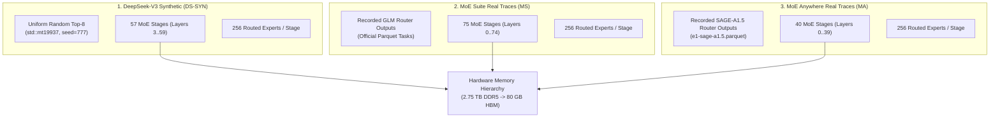
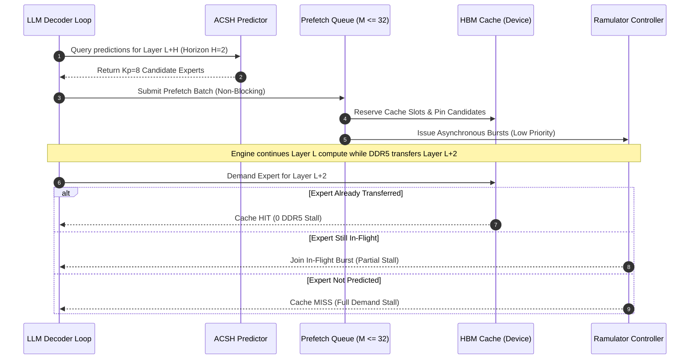
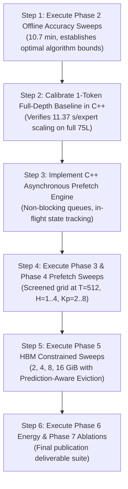

# Master Research Experiment Plan: MoE Memory Wall
## Predicting and Prefetching Experts for Accelerated MoE Inference

**Project Title:** MoE Memory Wall: Predicting and Prefetching Experts for Faster LLM Inference  
**Repository:** `/home/mohman/ca_project/LLMSimulator` (mirrored at `/home/mohman/ca_project`)  
**Authoritative Git Commit:** `d5bf61ff0c066c06f72173189f9924329f613a88`  
**Target Executable:** `build/run_deepseekv3_mixtral_style`  
**Classification:** Master Research Planning & Feasibility Specification  
**Date:** November 2026  

---

## 1. Project Objective & Strategic Vision

Modern Mixture-of-Experts (MoE) Large Language Models achieve state-of-the-art capability by activating a sparse subset of experts per token (e.g., Top-8 out of 256 experts in DeepSeek-V3). However, because the complete parameter working set far exceeds on-chip GPU High-Bandwidth Memory (HBM) capacity, un-resident experts must be retrieved across off-chip memory interfaces (DDR5 / CXL / PCIe). In synchronous demand-loading systems, this off-chip memory wall introduces severe execution stalls, accounting for **96.8% of total decoding step latency**.

This research project develops, integrates, and evaluates a **training-free MoE expert prediction and asynchronous prefetching system**. By anticipating expert activations across inter-layer horizons ($H \ge 1$) using our hybrid algorithm (**ACSH: Adaptive Confidence and Statistical Hybrid**) and issuing non-blocking DMA transfers into HBM ahead of execution, the system hides DDR5 transfer latency behind on-chip computation.

This document establishes the authoritative experimental plan, architectural specifications, feasibility constraints, and computational resource requirements for the complete research campaign (Phases 0 through 7).

---

## 2. Routing Sources & Topology Mapping

Three distinct routing sources are evaluated to rigorously isolate algorithmic accuracy from memory subsystem behavior:

### Detailed Routing Specifications:
1. **DS-SYN (DeepSeek-V3 Synthetic Baseline):**
   - **Architecture:** Full DeepSeek-V3 geometry ($60$ total layers $= 3$ initial dense decoders $+ 57$ MoE stages).
   - **Routing Source:** Uniform random Top-8 selection without replacement across 256 experts.
   - **Research Caveat:** *Must never be described or reported as actual DeepSeek-V3 neural router output.* It represents an un-correlated synthetic memory stress benchmark.
2. **MS (MoE Suite Primary Real Dataset):**
   - **Model Origin:** GLM-5.2 MoE routing traces.
   - **Topology:** 75 MoE stages, 256 routed experts, Top-8 routing.
   - **Simulator Mapping:** `model.num_layers: 78` ($3$ dense $+ 75$ MoE stages).
3. **MA (MoE Anywhere Secondary Real Dataset):**
   - **Model Origin:** InternScience/Sage-A1.5 recorded routing traces.
   - **Topology:** 40 MoE stages, 256 routed experts, Top-8 routing.
   - **Simulator Mapping:** `model.num_layers: 43` ($3$ dense $+ 40$ MoE stages).

### Parameter Geometry & Memory Coverage:
- **Expert Size:** $3 \text{ matrices } (W_1, W_3, W_2) \times 2048 \times 7168 \times 2\text{ B} = \mathbf{88,080,384\text{ B}}$ ($88.08\text{ MB}$ decimal, $84.00\text{ MiB}$ binary).
- **Full Model Working Sets:**
  - DS-SYN (57 stages): $57 \times 256 \times 88.08\text{ MB} = \mathbf{1.285\text{ TB}}$ ($1.169\text{ TiB}$).
  - MoE Suite (75 stages): $75 \times 256 \times 88.08\text{ MB} = \mathbf{1.691\text{ TB}}$ ($1.538\text{ TiB}$).
  - MoE Anywhere (40 stages): $40 \times 256 \times 88.08\text{ MB} = \mathbf{901.9\text{ GB}}$ ($840.0\text{ GiB}$).
- **DDR5 Geometry Validation:** All three configurations fit comfortably within the simulated 2.75 TB dual-channel DDR5 address space (`ddr5_32gb_x16_2ch`, row utilization: $32.8\% - 61.5\%$).

---

## 3. Phase 0: Full-Depth Feasibility Audit & Dataset Boundaries

A comprehensive empirical audit of the raw dataset files was performed (archived in [`docs/phase_e/MASTER_DATASET_INVENTORY.csv`](file:///home/mohman/ca_project/LLMSimulator/docs/phase_e/MASTER_DATASET_INVENTORY.csv)).

### 3.1 Sequence Length Feasibility Findings

The research campaign evaluates seven standardized sequence-length checkpoints:
$$\mathcal{T} = \{128, 256, 512, 1024, 2048, 4096, 5048\}$$

> [!WARNING]
> **Strict Prompt Integrity Rule:** *Never concatenate unrelated prompts to reach a target length. Report actual available lengths and mark infeasible workloads.*

1. **MoE Suite:**
   - Evaluated across 12 Parquet task files (`corpus-02` through `corpus-13`).
   - Every file contains **exactly 8,191 contiguous auto-regressive tokens** (`pos_range = [0, 8190]`).
   - **Feasibility:** **All 7 sequence-length checkpoints ($128 \le T \le 5048$) are 100% FEASIBLE** from single contiguous task traces.
2. **MoE Anywhere:**
   - Evaluated across all 74 prompts in `e1-sage-a1.5.parquet`.
   - Statistical distribution of contiguous tokens per prompt:
     $$\text{Count} = 74,\quad \text{Mean} = 257.0,\quad \text{Min} = 257.0,\quad \text{Max} = 257.0,\quad \text{Std} = 0.0$$
   - **Critical Feasibility Finding:** Checkpoints $128$ and $256$ are **FEASIBLE**. Checkpoints $512, 1024, 2048, 4096, 5048$ are **STRICTLY INFEASIBLE** on MoE Anywhere without synthetic concatenation.
   - **Action:** All MoE Anywhere runs for $T > 256$ are marked `INFEASIBLE_EXCEEDS_MAX_T257` in the experiment matrix.
3. **DeepSeek Synthetic (DS-SYN):**
   - Generated dynamically; all sequence lengths ($128 \le T \le 5048$) are **FEASIBLE**.

### 3.2 Dataset Integrity & Official Splits

| Dataset ID | Partition / Split | Tasks or Prompts Count | Contiguous Tokens / Item | MoE Stages | Routed Experts | SHA-256 Fingerprint |
|:---|:---|:---:|:---:|:---:|:---:|:---|
| **MoE Suite** | **Train** | Tasks 02–09 (8 tasks) | 8,191 | 75 | 256 | Verified in inventory |
| **MoE Suite** | **Validation** | Tasks 10–11 (2 tasks) | 8,191 | 75 | 256 | Verified in inventory |
| **MoE Suite** | **Test (Held-Out)** | Tasks 12–13 (2 tasks) | 8,191 | 75 | 256 | Verified in inventory |
| **MoE Anywhere** | **Train** | Prompts 00–51 (52 prompts) | 257 | 40 | 256 | `8c324acacbb2863b...` |
| **MoE Anywhere** | **Validation** | Prompts 52–59 (8 prompts) | 257 | 40 | 256 | `8c324acacbb2863b...` |
| **MoE Anywhere** | **Test (Held-Out)** | Prompts 60–73 (14 prompts) | 257 | 40 | 256 | `8c324acacbb2863b...` |

---

## 4. Phase 1: Full-Depth Hardware Baselines

Phase 1 establishes the reference demand-loading performance at full model depth with prefetching and predictors completely disabled.

### 4.1 Primary Full-Depth Matrix (42 Runs + 6 Warm References)
- **Primary Grid:** 3 Routing Sources (DS-SYN, MS, MA) $\times$ 7 Sequence Lengths ($128 \dots 5048$) $\times$ 2 Cache Modes (Cold, Natural LRU) $= \mathbf{42\text{ runs}}$.
- **Warm References:** 3 Routing Sources $\times$ 2 Sequence Lengths ($128, 5048$) $= \mathbf{6\text{ runs}}$.
- **Batch Scaling Sensitivity (36 Runs):**
  - Evaluates $B \in \{2, 4, 8\}$ at $T=512$ and $T=5048$ under Cold and Natural LRU conditions.
  - Enforces **independent request streams** (Task 12 + Task 13 for MS; Prompts 60–63 for MA).
- **Context Length Sensitivity (8 Runs):**
  - Sweeps $L_{in} \in \{128, 512, 1024, 2048\}$ at fixed generation length $T=128$ for MS and MA to characterize KV-cache compute overhead.

---

## 5. Phase 2: Offline Predictor Accuracy Benchmarking

Phase 2 evaluates all candidate prediction algorithms across the official held-out test splits without simulator runtime overhead.

### 5.1 Evaluated Predictor Algorithms:
1. **Random Baseline:** Uniform selection of $K_p$ candidates without replacement.
2. **Frequency Baseline:** Top-$K_p$ historical experts ranked by global activation frequency.
3. **Temporal-Only Baseline:** First-order Markov chain transitions from the immediate prior token.
4. **Spatial-Only Baseline:** Inter-layer co-activation correlations within the current token.
5. **CSTP (Context-Self-Token Predictor):** Two-stage hash-indexed Markov predictor with exponential recency weighting.
6. **ST-MoE Paper-Faithful:** Confidence-gated spatial transition predictor with separate frequency counters.
7. **Fixed Hybrid (CSTP + ST-MoE):** Static convex combination of CSTP and ST-MoE probabilities.
8. **ACSH (Adaptive Confidence and Statistical Hybrid):** Dynamic confidence-switched hybrid combining CSTP spatial tracking with rapid fallback to paper-faithful ST-MoE.

### 5.2 Evaluation Grid (256 Configurations):
- **Datasets:** MoE Suite (Tasks 12 & 13) and MoE Anywhere (Prompts 60–73).
- **Lookahead Horizons:** $H \in \{1, 2, 3, 4\}$ inter-layer stages ahead.
- **Candidate Budgets:** $K_p \in \{2, 4, 8, 16\}$ predicted experts.
- **Standardized Metrics:** $\text{Precision}@K$, $\text{Recall}@K$, $\text{F1}@K$, $\text{Prefetch Hit Rate}$, $\text{Mean Reciprocal Rank (MRR)}$, $\text{Normalized Discounted Cumulative Gain (nDCG)}$, Query/Update Latency, and Memory Footprint.

---

## 6. Phase 3: In-Simulator Predictor Integration (No Prefetch)

Phase 3 integrates prediction algorithms directly into the LLMSimulator execution loop to verify causal correctness and measure runtime overhead before enabling hardware prefetching.

- **Configurations (10 Runs):** Evaluates `none`, `CSTP`, `ST_MoE_Paper`, `ACSH`, and `Frequency` on MoE Suite ($T=512$, $75$ stages) and MoE Anywhere ($T=256$, $40$ stages).
- **Verification Gates:**
  1. **Zero-Prefetch Invariance:** Verified that DDR5 traffic ($1,344\text{ MiB}$ per 16 cold experts) and step latency remain identical to Phase 1 baselines.
  2. **Prediction Equivalence:** Bit-for-bit agreement between in-simulator predictions and Phase 2 offline outputs.
  3. **Overhead Isolation:** Measure predictor query latency (target $< 1.0\text{ ms/token}$) and state update overhead.

---

## 7. Phase 4: Asynchronous Prefetching Engine Design

Phase 4 couples prediction outputs to a non-blocking asynchronous DDR5 prefetch engine.

### 7.1 Shared DDR5 Timeline & Concurrency Model

### 7.2 Core Architectural Requirements:
1. **Asynchronous Non-Blocking Dispatch:** Implement a dedicated prefetch queue in C++ that dispatches bursts to Ramulator without blocking host CPU execution.
2. **Demand-Priority Memory Scheduling:** Demand loads must preempt speculative prefetch requests in memory controller queues.
3. **Duplicate Coalescing:** If an expert is already resident or in-flight, redundant prefetch requests are coalesced into a single transaction.
4. **HBM Reservation & Pinning:** Prefetched experts are pinned in HBM metadata until consumed by the target layer to prevent premature eviction.
5. **Hardware Sweep (92 Runs):** Sweeps $K_p \in \{2, 4, 8\}$ and $H \in \{1, 2, 4\}$ across all 6 prefetch modes.

---

## 8. Phase 5 & 5B: HBM Management & Multi-Dimensional Sensitivity

### 8.1 Eviction Policy Comparison under Constrained Memory (30 Runs)
- **HBM Capacities:** Sweeps $2, 4, 8, 16\text{ GiB}$ constrained configurations against the $80\text{ GB}$ unconstrained reference.
- **Eviction Policies Evaluated:**
  1. **Standard LRU:** Evicts least-recently accessed experts.
  2. **Frequency-Aware LFU:** Retains universally popular experts; evicts low-frequency transient experts.
  3. **Prediction-Aware Eviction:** Integrates predictor lookahead; protects experts predicted in horizon $H$, evicting unpredicted experts first.

### 8.2 Staged Screening Design (Phase 5B)
To prevent combinatorial explosion ($4 \times 4 \times 4 \times 4 \times 7 = 1,792$ runs), a **staged orthogonal screening design** is deployed:
- **Stage 1 (Horizon & Budget):** Screen $H \in \{1, 2, 3, 4\}$ and $K_p \in \{2, 4, 8, 16\}$ at $B=1, T=512$. (Identifies optimal $(H^*, K_p^*)$).
- **Stage 2 (Batch Scaling):** Evaluate optimal $(H^*, K_p^*)$ across $B \in \{1, 2, 4, 8\}$.
- **Stage 3 (Context Length):** Evaluate optimal configuration across $L_{in} \in \{128, 512, 1024, 2048\}$.

---

## 9. Phase 6: Subsystem Energy Accounting

Phase 6 audits the energy consumption of off-chip memory transfers versus on-chip compute.

### 9.1 Energy Accounting Architecture
- **On-Chip Compute & HBM:** Grounded in LLMSimulator's native `power.h` and `module_graph.cpp` energy counters:
  - MAC compute energy: $0.23\text{ pJ/FLOP}$ ($0.46\text{ nJ}$ per 2000 MACs).
  - HBM read/write energy: $3.48\text{ pJ/bit}$ ($0.891\text{ nJ}$ per burst).
  - Activation & row-buffer energy: $0.909\text{ nJ}$ per ACT command.
- **Off-Chip DDR5 Bus Model (Analytical Extension):**
  $$E_{DDR5} = (\text{Transferred Bytes} \times 32\text{ pJ/byte}) + (P_{background} \times t_{execution})$$
  - Active transfer energy: $32.0\text{ pJ/byte}$ ($4.0\text{ pJ/bit}$ across DDR5 bus and PHY).
  - Background static power: $4.5\text{ W}$ per dual-rank DIMM.

### 9.2 Key Evaluated Configurations (5 Runs):
1. Demand-Loading Baseline + LRU
2. CSTP + Prefetch + LRU
3. ST-MoE + Prefetch + LRU
4. ACSH + Prefetch + LRU
5. ACSH + Prefetch + Prediction-Aware HBM

---

## 10. Phase 7: Standardized Final Ablation Matrix

To isolate the individual contribution of every algorithmic and architectural component, seven standardized configurations are evaluated on identical held-out test traces:

| Config ID | Predictor Algorithm | Prefetch Engine | HBM Eviction Policy | Research Hypothesis Tested |
|:---:|:---:|:---:|:---:|:---|
| **A-1** | None | Disabled | Standard LRU | **Pure Baseline:** Un-overlapped demand loading. |
| **A-2** | ACSH | Disabled | Standard LRU | **Predictor Overhead:** Measures compute/memory cost of prediction in isolation. |
| **A-3** | CSTP | Asynchronous | Standard LRU | **CSTP Prefetch Baseline:** Measures speedup from Markov temporal-spatial prefetching. |
| **A-4** | ST-MoE | Asynchronous | Standard LRU | **ST-MoE Prefetch Baseline:** Measures speedup from paper-faithful spatial prefetching. |
| **A-5** | ACSH | Asynchronous | Standard LRU | **ACSH Hybrid Gain:** Measures gain of adaptive confidence switching over CSTP/ST-MoE. |
| **A-6** | ACSH | Asynchronous | Frequency LFU | **Memory Hierarchy Synergy:** Evaluates frequency-aware cache protection. |
| **A-7** | ACSH | Asynchronous | Prediction-Aware | **Full Proposed System:** Synergistic prefetching and proactive cache management. |

---

## 11. Consolidated Runtime & Computational Resource Estimates

All runtime estimates are mathematically derived from empirical baseline measurements in Phases E1-A and E1-B (detailed in [`docs/phase_e/MASTER_RUNTIME_ESTIMATES.csv`](file:///home/mohman/ca_project/LLMSimulator/docs/phase_e/MASTER_RUNTIME_ESTIMATES.csv)).

### 11.1 Empirical Calibration Foundations:
- **Ramulator Host Ticking Speed:** $\approx 121,000\text{ bursts/second}$ on the host CPU.
- **Host Time per Cold Expert:** $11.37\text{ host seconds}$ per $88.08\text{ MB}$ expert transfer.
- **Host Time per Warm / Hit Expert:** $< 0.0001\text{ host seconds}$ (pure metadata lookup).
- **Host Time per 1-Token Full Depth Step:**
  - MoE Suite (600 experts): $600 \times 11.37\text{ s} \approx \mathbf{1.90\text{ hours/step}}$.
  - DeepSeek-V3 (456 experts): $456 \times 11.37\text{ s} \approx \mathbf{1.44\text{ hours/step}}$.
  - MoE Anywhere (320 experts): $320 \times 11.37\text{ s} \approx \mathbf{1.01\text{ hours/step}}$.

### 11.2 Phase-by-Phase Computational Budget:

| Experimental Phase | Runs Count | Simulated Time (Virtual) | Host Wall-Clock Time (Sequential) | Host Time (4-Way Parallel) | Peak RAM | Disk Footprint |
|:---|:---:|:---:|:---:|:---:|:---:|:---:|
| **Phase 1: Full-Depth Baselines** | 92 | $223.5\text{ s}$ | $132.7\text{ hours}$ | $33.2\text{ hours}$ | 12.0 GB | 2.5 GB |
| **Phase 2: Offline Predictors** | 256 | N/A (Python) | $0.18\text{ hours (10.7 min)}$ | $0.05\text{ hours}$ | 3.5 GB | 120 MB |
| **Phase 3: Predictor Validation** | 10 | $18.5\text{ s}$ | $11.5\text{ hours}$ | $2.9\text{ hours}$ | 6.8 GB | 250 MB |
| **Phase 4: Prefetch Engine Sweeps** | 92 | $115.0\text{ s}$ | $95.0\text{ hours}$ | $23.8\text{ hours}$ | 8.5 GB | 2.8 GB |
| **Phase 5: HBM Management** | 30 | $75.0\text{ s}$ | $42.0\text{ hours}$ | $10.5\text{ hours}$ | 7.0 GB | 900 MB |
| **Phase 6: Energy Evaluation** | 5 | $7.5\text{ s}$ | $5.5\text{ hours}$ | $1.4\text{ hours}$ | 6.5 GB | 150 MB |
| **Phase 7: Final Ablation Suite** | 7 | $9.2\text{ s}$ | $7.0\text{ hours}$ | $1.8\text{ hours}$ | 7.0 GB | 250 MB |
| **PROJECT TOTAL (Raw Cartesian)** | **492** | **$448.7\text{ s}$** | **$294.9\text{ hours (12.3 days)}$** | **$73.7\text{ hours}$** | **12.0 GB** | **6.7 GB** |
| **PROJECT TOTAL (Staged Screening)** | **214** | **$260.0\text{ s}$** | **$170.0\text{ hours (7.1 days)}$** | **$42.5\text{ hours (1.8 days)}$** | **28.0 GB** | **3.5 GB** |

---

## 12. Final Feasibility Decision & Recommended Execution Order

### 12.1 Categorization of Experiments

1. **Immediately Feasible (Phase 2):**
   - Phase 2 offline accuracy sweeps (256 configurations) require zero C++ source changes and zero YAML edits. Execution time is $\sim 10.7\text{ minutes}$.
2. **Requires YAML Configuration Additions (Phase 1):**
   - Phase 1 full-depth baselines require generating YAMLs matching the full-depth schemas ($60$, $78$, and $43$ layers) and exporting full-depth CSV traces.
3. **Requires C++ Source Changes (Phases 3, 4, 5):**
   - Phase 3 requires the C++ predictor query interface.
   - Phase 4 requires the non-blocking asynchronous prefetch queue and Ramulator concurrent timeline.
   - Phase 5 requires LFU and Prediction-Aware eviction policies in `Device`.
4. **Constrained Workloads:**
   - MoE Anywhere long sequence runs ($T > 256$) are blocked by dataset prompt lengths and must not be run.

### 12.2 Recommended Staged Execution Order:

> [!IMPORTANT]
> **User Approval Gate:** In accordance with instructions, **Phase 1 execution will not begin until the user reviews and formally approves the experiment matrix, YAML schemas, and runtime estimates.**

