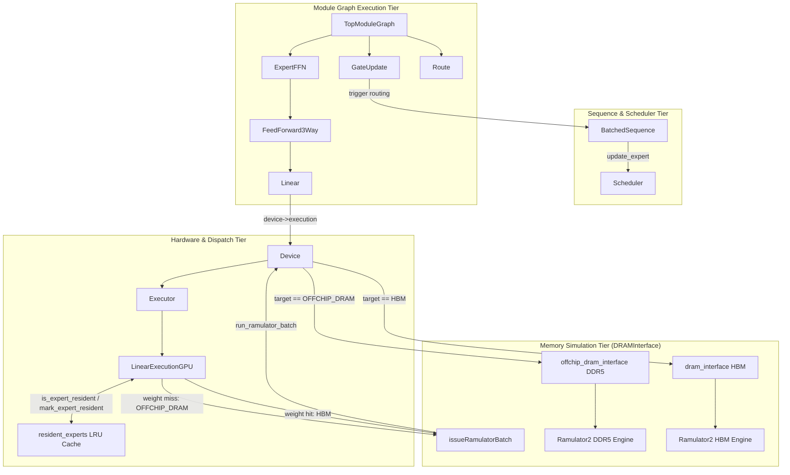
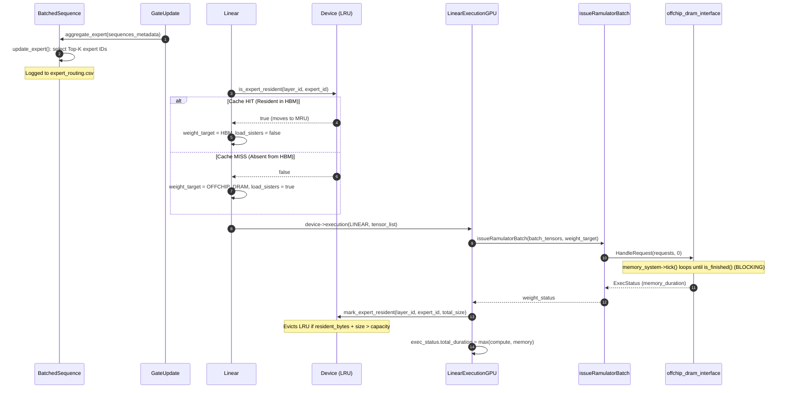
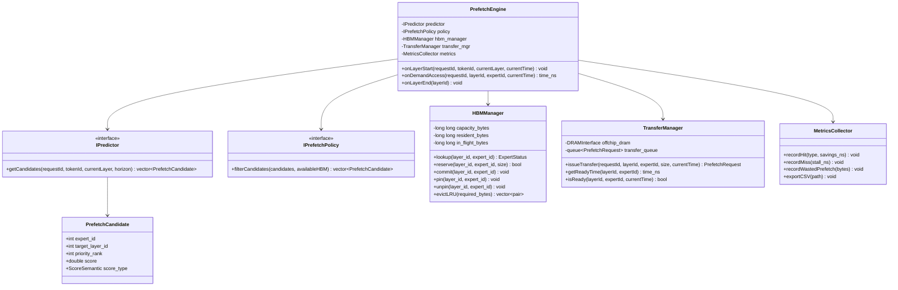
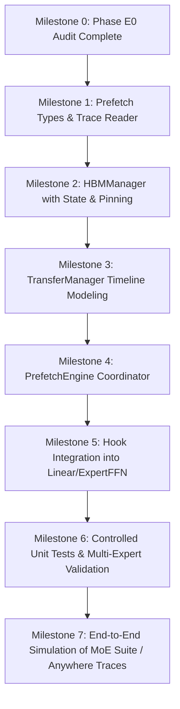

# Phase E0: Read-Only Hardware Prefetch Architecture Audit
## Architectural Analysis, Expert Request Lifecycle, Memory Subsystem Forensic Audit, and Predictor-Independent Asynchronous Prefetch Engine Design

**Date:** November 1, 2026  
**Project:** MoE Memory Wall: Predicting and Prefetching Experts for Faster LLM Inference  
**Repository:** `/home/mohman/ca_project/LLMSimulator`  
**Commit Audited:** `d5bf61ff0c066c06f72173189f9924329f613a88`  
**Audit Mode:** Strictly READ-ONLY (No code, configurations, historical results, or test harnesses modified)  
**Deliverable Document:** `docs/phase_e/PHASE_E0_HARDWARE_ARCHITECTURE_AUDIT.md`  
**Inventory Companion:** `docs/phase_e/PHASE_E0_SOURCE_INVENTORY.csv`  

---

## 1. Executive Summary

Our Python predictor and prefetch evaluation framework has been thoroughly benchmarked across four distinct routing workloads, including real-world traces from **MoE Suite** and **MoE Anywhere**. In Phase D, we established that our proposed **ACSH** and paper-faithful **ST-MoE** predictors achieve up to $90.8\% - 91.2\%$ prefetch Hit Rate at lookahead horizons $H \in \{1, 2, 3, 4\}$.

The immediate objective of **Phase E** is to bridge the gap between offline prediction and actual hardware latency reduction: **connecting predicted expert candidates to simulated asynchronous DDR5-to-HBM transfers inside the LLMSimulator C++ engine**.

This forensic audit investigates the C++ simulator's memory, execution, and scheduling infrastructure to determine how expert memory transfers currently operate, whether asynchronous prefetching is supported, and how to implement a modular, predictor-independent asynchronous prefetching engine.

### Key Audit Findings:
1. **Zero Existing Prefetching:** The existing C++ simulator possesses **no prefetching mechanism whatsoever**. Expert memory transfers occur exclusively on-demand when an un-cached expert weight tensor is accessed during execution.
2. **Synchronous, Blocking Execution:** All off-chip DDR5 memory transfers in `issueRamulatorBatch` are strictly synchronous. When an expert is not resident in HBM (`is_expert_resident == false`), the GPU execution thread blocks while Ramulator2 executes cycle-by-cycle DDR5 simulation to completion.
3. **No In-Flight Transfer State:** The existing expert residency tracker in `Device` operates as a simple binary LRU table (`resident_experts`). It has no concept of *in-flight*, *pending*, or *pinned* experts. A concurrent access to an expert that is currently being fetched cannot detect that a transfer is already underway.
4. **Execution Cache Interaction (Task 8 Finding):** When `bypass_offchip_execution_cache` is `false` (the default setting), off-chip DDR5 requests reuse an analytical memoization cache (`execution_time_cache`) based solely on tensor size. For cycle-accurate prefetch contention modeling, `bypass_offchip_execution_cache = true` must be enforced so that Ramulator2 simulates genuine DDR5 channel and bank conflicts.
5. **Clean Interface Separation:** The Python prediction pipeline and the C++ hardware simulator should be interfaced via an **offline precomputed prediction trace** (`IPredictorTraceReader`) for reproducible benchmark replay, with an abstract `IPredictor` interface enabling future runtime co-simulation.

---

## 2. Existing Architecture and Component Diagram

The following diagram illustrates the current execution and memory subsystem hierarchy of LLMSimulator:



---

## 3. Investigation 1: Expert Request Lifecycle

We trace the complete lifecycle of an expert request from routing selection through memory dispatch to compute execution:



### Exact Code Attribution:
1. **Expert Selection:**
   - **File:** [`LLMSimulator/src/scheduler/sequence.cpp`](file:///home/mohman/ca_project/LLMSimulator/src/scheduler/sequence.cpp#L152)
   - **Class/Function:** `BatchedSequence::update_expert(int num_expert, int top_k, bool need_new_expert)` (Lines 152–245).
   - **Mechanism:** Selects expert IDs either deterministically via `scheduler->sequences_info[seq_id]->expert_list` or stochastically via `scheduler->getRandomExpert(top_k)` / `scheduler->getZipfianRandomExpert`.
2. **Expert ID Representation:**
   - **Representation:** Integer scalar `e_id \in [0, num_routed_expert - 1]`.
   - **Storage:** Logged to CSV via `routing_file << request_id << "," << token_id << "," << cur_layer << "," << (k + 1) << "," << e_id << "\n";` (Lines 197, 230), and aggregated into `num_token_in_expert[e_id]`.
3. **Memory Address / Storage Determination:**
   - **File:** [`LLMSimulator/src/dram/mmap_controller.cpp`](file:///home/mohman/ca_project/LLMSimulator/src/dram/mmap_controller.cpp#L17)
   - **Class/Function:** `MMapController::setNormal(Tensor::Ptr tensor)` (Lines 170–180) and `MMapController::getAddrVec(addr address, long long bundle_idx)` (Lines 21–35).
   - **Mechanism:** Linear weights receive monotonically increasing logical addresses `start_addr_normal += tensor->getSize()`. On memory access, `addrToVec()` hashes the address across channel, rank, bankgroup, bank, row, and column coordinates.
4. **Size Determination:**
   - **File:** [`LLMSimulator/src/module/tensor.h`](file:///home/mohman/ca_project/LLMSimulator/src/module/tensor.h)
   - **Class/Function:** `Tensor::getSize()` computes $\prod \text{shape} \times \text{precision\_byte}$.
   - **Sister Weight Grouping:** In [`LLMSimulator/src/module/expert.cpp`](file:///home/mohman/ca_project/LLMSimulator/src/module/expert.cpp#L105-L128), `FeedForward3Way` links `W1_gate`, `W3_up`, and `W2_down` via `sister_weights`. Total expert transfer size is $\sum_{i=1}^3 \text{size}(W_i)$ ($\approx 88.08\,\text{MB}$ for DeepSeek-V3; $\approx 16.78\,\text{MB}$ for Mixtral).
5. **Submission to Memory System:**
   - **File:** [`LLMSimulator/src/hardware/layer_impl.cpp`](file:///home/mohman/ca_project/LLMSimulator/src/hardware/layer_impl.cpp#L57)
   - **Class/Function:** `issueRamulatorBatch(...)` lines 57–95.
   - **Mechanism:** Builds a `std::list<DRAMRequest::Ptr>` for the batch and calls `device->run_ramulator_batch(requests, target)`.
6. **Transfer Completion Detection:**
   - **File:** [`LLMSimulator/src/dram/dram_interface.cpp`](file:///home/mohman/ca_project/LLMSimulator/src/dram/dram_interface.cpp#L36)
   - **Class/Function:** `DRAMInterface::HandleRequest(...)` lines 36–75 and `DRAMInterface::run()` lines 122–128.
   - **Mechanism:** Loop calls `memory_system->tick()` until `memory_system->is_finished()` returns true. Completion is strictly synchronous.
7. **Availability for Execution:**
   - **File:** [`LLMSimulator/src/hardware/linear_impl.cpp`](file:///home/mohman/ca_project/LLMSimulator/src/hardware/linear_impl.cpp#L68)
   - **Class/Function:** `LinearExecutionGPU(...)` lines 68–75.
   - **Mechanism:** Once `issueRamulatorBatch` returns, `device->mark_expert_resident(layer_id, expert_id, total_size)` inserts the expert into `resident_experts`, and compute execution immediately consumes the weights.

---

## 4. Investigation 2: DDR5 / DRAM Transfer Engine

### 4.1 Interface Architecture
The memory subsystem is encapsulated in `DRAMInterface` (`src/dram/dram_interface.cpp`). `Device` owns two distinct instances:
1. `device->dram_interface`: Simulates on-chip HBM (or GPU device memory).
2. `device->offchip_dram_interface`: Simulates off-chip DDR5 memory (instantiated when `config.offchip_dram_cfg_path` is specified, e.g. `dram_config_DDR5.yaml` with scale factor $0.625$).

### 4.2 Blocking vs Non-Blocking Execution
In `DRAMInterface::run()`:
```cpp
void DRAMInterface::run() {
  for (uint64_t i = 0;; i++) {
    memory_system->tick();
    if (memory_system->is_finished()) {
      break;
    }
  }
}
```
`HandleRequest()` pushes all requests to the Ramulator frontend and immediately loops until `is_finished() == true`. 
- **There is no asynchronous event queue.**
- **There are no completion callbacks.**
- **There is no non-blocking polling mechanism.**
- **The calling host thread blocks until the entire memory transfer finishes.**

### 4.3 Multi-Expert Overlap Capability
Can multiple independent expert transfers overlap in the current implementation?
- **Within a single expert:** The three sister weights ($W_1, W_2, W_3$) are submitted together as a batch in `issueRamulatorBatch`. Ramulator schedules these requests concurrently across its internal DDR5 channels and bank groups. Thus, intra-expert weight transfer overlap is modeled.
- **Across multiple experts:** In `ExpertFFN::forward` (`src/module/expert.cpp` lines 205–213), the simulator iterates sequentially through each selected expert:
  ```cpp
  for (int expert_id = expert_offset; expert_id < expert_offset + num_expert_per_device; expert_id++) {
    Module::Ptr expert_ffn = get_module("expert_FFN_" + std::to_string(expert_id));
    result = (*expert_ffn)(route_out.at(expert_id), sequences_metadata);
    expert_out.push_back(result);
  }
  ```
  If Expert 0 misses in HBM, it synchronously loads $W_1, W_2, W_3$ from DDR5. Only after Expert 0 completely finishes compute does the loop proceed to Expert 1.
- **Conclusion:** **Transfers of different experts CANNOT overlap in the current architecture.** Furthermore, memory transfers cannot overlap with GPU compute because execution is strictly serialized within `LinearExecutionGPU`.

### 4.4 Execution Cache Bypass (Task 8 Invariant)
In `layer_impl.cpp` (lines 14–33, 63–80):
```cpp
CacheKey key = std::make_tuple(layer_type, processor_type, dram_request_type, total_size, target);
bool bypass_cache = false;
if (target == MemoryTarget::OFFCHIP_DRAM) {
  if (device->config.bypass_offchip_execution_cache) {
    bypass_cache = true;
  }
}
if (bypass_cache || !device->checkExecutionCache(exec_status, key)) { ... }
```
- When `bypass_offchip_execution_cache == false`, Ramulator is invoked only once for a given tensor size; all subsequent transfers reuse the memoized `exec_status`. This analytical shortcut bypasses cycle-accurate DRAM simulation.
- **For asynchronous prefetch modeling:** We must set `device->config.bypass_offchip_execution_cache = true` to accurately simulate multi-request bus contention and queueing delays.

---

## 5. Investigation 3: HBM Residency and Eviction Lifecycle

### 5.1 Existing LRU Cache Implementation
In `Device` (`src/hardware/device.h` lines 125–136 and `src/hardware/device.cpp` lines 272–330):
- **Data Structures:**
  ```cpp
  std::list<std::tuple<int, int, long long>> lru_expert_list; // (layer_id, expert_id, size)
  std::unordered_map<std::pair<int, int>, 
                     std::list<std::tuple<int, int, long long>>::iterator, 
                     PairHash> resident_experts;
  long long cache_capacity_bytes = 80000000000LL; // 80 GB default
  long long resident_bytes = 0;
  ```
- **Lookup (`is_expert_resident`):** Checks if `(layer_id, expert_id)` is in `resident_experts`. If found (HIT), moves the node to the MRU position (back of `lru_expert_list`) and returns `true`. If not found (MISS), logs to `expert_cache.csv` and returns `false`.
- **Insertion (`mark_expert_resident`):** Evicts from the LRU position (front of `lru_expert_list`) while `resident_bytes + expert_size > cache_capacity_bytes`, then inserts the new expert at MRU.

### 5.2 Critical Limitations of Existing Residency Tracker:
1. **Binary State Only:** An expert is either fully resident or absent. There is no state representing an expert *currently being prefetched* (in-flight).
2. **No Pinning or Reservation:** If an expert is prefetched for layer $l+2$, subsequent memory allocations at layer $l$ or $l+1$ can evict this prefetched expert before it is ever used, resulting in wasted prefetch traffic and cache thrashing.
3. **No Duplicate Request Suppression:** If two requests need the same expert while a prefetch is in flight, the current code cannot coalesce them.
4. **Layer-Agnostic Eviction:** LRU treats all layers identically; an expert needed in 50 nanoseconds for layer 2 can be evicted by an expert needed for layer 60.

---

## 6. Investigation 4: Execution Dependencies

### 6.1 How Demand Requests Behave Under Different States:
| Expert State | Current Simulator Behavior | Required Asynchronous Prefetch Behavior |
| :--- | :--- | :--- |
| **Already in HBM** | Cache HIT: weight read from HBM; zero off-chip stall. | Identical: Cache HIT; immediate execution. |
| **Absent from HBM (Not Prefetched)** | Cache MISS: synchronous DDR5 read; execution stalls for full transfer duration ($T_{\text{demand\_stall}} = \Delta T_{\text{DDR5}}$). | Demand MISS: issue urgent DDR5 transfer; execution stalls for full duration $\Delta T_{\text{DDR5}}$. |
| **Currently Being Prefetched (In-Flight)** | **Unsupported:** Treated as absent; launches redundant synchronous transfer. | **Partial Hit / In-Flight Join:** Calculate remaining transfer time: $\text{Stall} = \max(0LL, T_{\text{ready}} - T_{\text{demand}})$. Do not re-issue transfer. |
| **Prefetched and Completed Before Demand** | **Unsupported:** Not possible without prefetch engine. | **Full Prefetch Hit:** Expert is already resident in HBM; $\text{Stall} = 0$. Latency is $100\%$ hidden. |
| **Evicted Before Use** | Treated as regular miss. | **Wasted Prefetch:** Logged as cache pollution / premature eviction metric. |

---

## 7. Investigation 5: Predictor Integration Recommendation

### 7.1 Python Predictor Output Formats
Our evaluated Python predictors (`CSTPPredictor`, `STMoEPaperPredictor`, `ACSHPredictor`) generate:
- Target stage ($l \in [0, 74]$).
- Lookahead distance ($H \in \{1, 2, 3, 4\}$).
- Ranked list of candidate expert IDs ($e_1, e_2, \dots, e_B$).
- Confidence scores / probability values.

### 7.2 Semantic Difference in Predictor Scores:
- **CSTP:** Composite Bayesian probability $P(v) \in [0.0, 1.0]$ summing to $1.0$.
- **ST-MoE Paper:** Integer counter values: Spatial counter $c_{\text{spatial}} \in [0, 3]$ + Temporal counter $c_{\text{temporal}} \in [0, 2]$. Maximum score is 5. These are **confidence counter sums, NOT probabilities**.
- **ACSH:** Temperature-scaled softmax probability distribution $P_{\text{ACSH}}(v) \in [0.0, 1.0]$.

### 7.3 Integration Recommendation: Trace-Driven Offline Co-Simulation
To guarantee reproducibility and avoid inter-language runtime dependencies, we recommend the **Offline Prediction Trace Architecture**:
1. The Python evaluation harness outputs a standardized prefetch trace file: `prefetch_trace.csv`.
2. Schema:
   ```
   request_id,token_id,source_layer_id,target_layer_id,horizon,rank,expert_id,score,score_type
   ```
   where `score_type` is an integer tag: `0 = PROBABILITY`, `1 = CONFIDENCE_COUNTER`, `2 = RANK_ONLY`.
3. The C++ simulator instantiates a `RoutingTraceReplay` / `PrefetchTraceReader` that ingests this file and feeds candidates directly into `PrefetchEngine`.
4. This decoupled design allows testing any Python predictor (CSTP, ST-MoE, ACSH, baselines) without modifying a single line of C++ code or embedding Python runtimes.

---

## 8. Investigation 6: Proposed Modular Architecture

We design a clean, modular, predictor-independent prefetching architecture adhering to strict separation of concerns:



### Proposed Component Roles:
1. **`IPredictor`:** Abstract interface for retrieving candidate experts. Implemented initially by `TraceReplayPredictor` (reading `prefetch_trace.csv`).
2. **`IPrefetchPolicy`:** Implements budget capping ($B$), score thresholding ($\tau$), and capacity-aware admission control.
3. **`HBMManager`:** Replaces the raw `resident_experts` map. Explicitly tracks expert lifecycle: `EMPTY`, `IN_FLIGHT`, `RESIDENT`, `PINNED`, and `EVICTED`. Supports pinning so active experts cannot be evicted.
4. **`TransferManager`:** Decoupled from the compute execution path. Calculates DDR5 transfer completion timestamps based on simulated bus throughput and queueing, tracking when in-flight transfers become ready.
5. **`PrefetchEngine`:** Central coordinator. At layer $l - H$, requests prefetch candidates for layer $l$, reserves HBM space, and issues asynchronous transfers. At layer $l$, intercepts demand requests, checks if the expert is ready, calculates remaining stall time (if in-flight), and unpins executed experts.
6. **`MetricsCollector`:** Records full hits, partial hits, demand misses, wasted prefetches, and net latency reduction.

---

## 9. Investigation 7: Correctness and Performance Risks

| Risk Category | Specific Failure Mode | Preventive Architectural Mechanism |
| :--- | :--- | :--- |
| **Race Conditions / Out-of-Order Events** | Host wall-clock progression vs simulated discrete timestamps desynchronize. | Single monotonic simulation timeline: all transfer events and completions are governed strictly by simulated timestamps (`time_ns`), never host wall-clock time. |
| **Duplicate Transfers** | Multiple tokens or speculative lookaheads issue prefetch for the same expert concurrently. | `TransferManager` maintains an in-flight transfer registry. Duplicate issues coalesce into the existing transfer handle without extra DRAM traffic. |
| **HBM Oversubscription** | Speculative prefetches exceed available HBM capacity before demand access. | `HBMManager` reserves capacity at prefetch *issue* time (`in_flight_bytes`). Prefetches are rejected if capacity cannot be reserved. |
| **Cache Pollution / Stale Prefetches** | Inaccurate predictions evict soon-to-be-needed experts. | Unpinning policy: only unpinned, executed experts are eligible for eviction. Speculative prefetches cannot evict pinned experts. |
| **Memory Bus Contention** | Low-priority prefetches block urgent demand requests. | Demand transfers are given strict priority in `TransferManager`; pending prefetches can be deferred or preempted if bus bandwidth saturates. |
| **Execution Cache Invalidation** | Memoized latency shortcuts mask real contention during concurrent prefetches. | Enforce `device->config.bypass_offchip_execution_cache = true` during all prefetching experiments. |

---

## 10. Required Source-Code Changes Grouped by File

### 1. `src/hardware/hardware_config.h`
- Add configuration parameters:
  - `bool enable_expert_prefetch = false;`
  - `int prefetch_horizon = 2;`
  - `int prefetch_budget = 8;`
  - `double prefetch_threshold = 0.0;`
  - `std::string prefetch_trace_path = "";`
  - `std::string prefetch_policy = "budget_only";`

### 2. `src/hardware/device.h` & `src/hardware/device.cpp`
- Replace raw `resident_experts` with `std::shared_ptr<HBMManager> hbm_manager;`.
- Add `std::shared_ptr<PrefetchEngine> prefetch_engine;`.
- Expose hooks: `on_stage_start(int layer_id)` and `on_stage_end(int layer_id)`.

### 3. `src/module/expert.cpp` & `src/module/route.cpp`
- In `ExpertFFN::forward`: notify `prefetch_engine` before and after layer execution.
- In `GateUpdate::aggregate_expert`: pass current layer and token metadata to the prefetch coordinator.

### 4. `src/module/linear.cpp` & `src/hardware/linear_impl.cpp`
- In `Linear::forward`: replace boolean `is_expert_resident` with `prefetch_engine->query_expert_status(layer_id, expert_id)`.
- In `LinearExecutionGPU`: calculate stall duration:
  - If resident: `stall = 0`.
  - If in-flight: `stall = prefetch_engine->get_remaining_stall(layer_id, expert_id, current_time)`.
  - If miss: `stall = full_ddr5_duration`.

### 5. New Modules to Add under `src/prefetch/`:
- `src/prefetch/prefetch_types.h`: Data structures (`PrefetchCandidate`, `PrefetchRequest`, enums).
- `src/prefetch/i_predictor.h`: Predictor interface and `TraceReplayPredictor`.
- `src/prefetch/hbm_manager.h` & `.cpp`: HBM capacity, reservation, and pinning.
- `src/prefetch/transfer_manager.h` & `.cpp`: DDR5 asynchronous transfer tracking.
- `src/prefetch/prefetch_engine.h` & `.cpp`: Main prefetch coordinator.
- `src/prefetch/metrics_collector.h` & `.cpp`: Statistics and CSV exporter.

---

## 11. Implementation Dependencies



---

## 12. Recommended Phase E1 Implementation Order

1. **Step 1: Core Prefetch Data Structures (`src/prefetch/prefetch_types.h`)**
   Define `PrefetchCandidate`, `PrefetchRequest`, `ExpertState`, and `ScoreSemantic`.
2. **Step 2: Trace Replay Predictor (`src/prefetch/trace_predictor.h/cpp`)**
   Implement `IPredictor` reading `prefetch_trace.csv`, enabling immediate testing with our Phase D prediction outputs.
3. **Step 3: State-Aware HBMManager (`src/prefetch/hbm_manager.h/cpp`)**
   Implement HBM reservation, allocation, pinning, and eviction with complete unit tests verifying that pinned experts cannot be evicted.
4. **Step 4: Asynchronous TransferManager (`src/prefetch/transfer_manager.h/cpp`)**
   Implement queueing and timeline tracking for DDR5 transfers, calculating exact simulated ready times without blocking the host execution thread.
5. **Step 5: PrefetchEngine Orchestrator (`src/prefetch/prefetch_engine.h/cpp`)**
   Integrate policy filtering, issue lookahead prefetches, and reconcile demand misses.
6. **Step 6: Integration into `LinearExecutionGPU`**
   Replace synchronous blocking DDR5 misses with prefetch-aware latency accounting.
7. **Step 7: Validation Test Suite (`eval/test_prefetch_engine.cpp`)**
   Create controlled unit tests verifying:
   - Zero-stall full prefetch hit.
   - Partial stall when demand access occurs while prefetch is in flight.
   - Full stall on unpredicted demand miss.
   - Prevention of duplicate transfers.
   - Inability to evict pinned in-flight experts.

