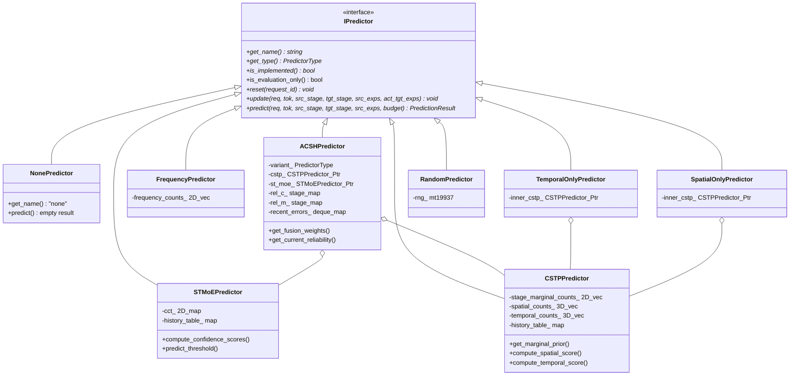

# Phase 2A: C++ Predictor Implementation & Verification Report

**Project:** MoE Memory Wall: Predicting and Prefetching Experts for Faster LLM Inference  
**Repository:** `/home/mohman/ca_project/LLMSimulator`  
**Authoritative Baseline Commit:** `d5bf61ff0c066c06f72173189f9924329f613a88`  
**Phase:** 2A (C++ Predictor Algorithm Porting & Unit Test Verification)  
**Date:** November 2, 2026  
**Document Path:** `docs/phase_prefetch/PHASE_2A_CPP_PREDICTOR_IMPLEMENTATION.md`  

---

## 1. Executive Summary

In Phase 2A, the complete suite of MoE expert prediction algorithms has been implemented in native C++ using the extensible predictor framework established in Phase 1. All implementations strictly adhere to the mathematics and causal timing of the validated Python reference implementations (`src/predictor/` and `tests/predictor_comparison/`).

### Key Deliverables Completed:
1. **Common Interface Refinement (`IPredictor`):**
   - Explicit `(source_stage_id, target_stage_id)` parameterization for both `predict()` and `update()`, eliminating implicit layer offset assumptions.
   - Standardized `finalize_and_sort(budget)` contract enforcing deterministic descending score ordering, ascending expert ID tie-breaking, NaN/Inf sanitization, and expert deduplication.
2. **ST-MoE C++ Port (`STMoEPredictor`):**
   - Faithful reproduction of Zhao et al. (arXiv:2606.15453v1).
   - Cross-Layer Correlation Table (CCT) with bounded 2-bit saturating counters ($0..3$), initialized to decimal 2 (binary 10).
   - Algorithm 2 score accumulation, History Table (+2 temporal bonus), and Algorithm 3 online candidate replacement.
3. **CSTP C++ Port (`CSTPPredictor`):**
   - Proposed Correlation-based Spatio-Temporal Predictor.
   - Dirichlet-smoothed spatial conditional transitions across layers ($L_{\text{src}} \to L_{\text{tgt}}$).
   - Dirichlet-smoothed temporal transitions across sequential tokens.
   - Empirical target-layer marginal frequency priors.
   - Multi-horizon support ($H \in \{1, 2, 3, 4, \dots\}$) and convex $\alpha$-blending.
4. **ACSH C++ Port (`ACSHPredictor`):**
   - Adaptive Confidence & Statistical Hybrid with all three configured variants:
     - `acsh_global`: Global EMA reliability tracking across all stages.
     - `acsh_stage_aware`: Decoupled per-stage EMA reliability tracking.
     - `acsh_fast_recovery`: Dynamic error window monitoring, burst detection ($E \ge 0.75$), and accelerated $\beta_{\text{fast}}$ cooldown.
   - Calibrated softmax component normalization and softmax reliability weighting ($\tau = 0.2$).
5. **Control Predictors (`control_predictors.h/cpp`):**
   - Empirical frequency-only control (`FrequencyPredictor`).
   - Temporal-only control ($\alpha = 0.0$ CSTP equivalent).
   - Spatial-only control ($\alpha = 1.0$ CSTP equivalent).
   - Deterministic pseudo-random control (`RandomPredictor`) with reproducible seed.
6. **Predictor Registry Integration (`PredictorRegistry`):**
   - Factory mappings enabled for all 10 deployable predictors.
   - Theoretical evaluation-only Oracle strictly rejected at instantiation.
7. **Empirical Verification:**
   - **35/35** dedicated Phase 2A predictor unit tests passing.
   - **17/17** Phase 1 regression tests passing.
   - **Zero ternary operators** (`ast.IfExp == 0` / C++ `? : == 0`) across the entire prefetch codebase.
   - Bit-for-bit baseline compatibility preserved; zero memory pipeline side-effects.

---

## 2. Architecture & Class Relationships



---

## 3. Detailed Predictor Mathematical Formulations

### 3.1 ST-MoE Predictor (`st_moe`)

Faithful port of Zhao et al. (arXiv:2606.15453v1) and `src/predictor/st_moe_paper.py`.

#### A. State Variables
- **CCT (Cross-Layer Correlation Table):** Bounded 2D vector of destination hash maps:  
  `cct_[source_stage][source_expert]` $\to \{ \text{dest\_expert} \mapsto c \in [0, 3] \}$.  
  Maximum capacity per source expert is bounded by $C = K$ (`cct_capacity`).
- **History Table (HT):** Request-isolated record of previous-token actual expert selections:  
  `history_table_[request_id][stage_id]` $\to \{ e_1, e_2, \dots, e_K \}$.

#### B. Scoring Equations (Algorithm 2 & Equation 1)
For candidate destination expert $v \in [0, E-1]$:
$$\text{Score}(v) = \text{CCT}_{\text{accum}}(v) + \text{HT}(v)$$

1. **Spatial CCT Accumulation:**
   $$\text{CCT}_{\text{accum}}(v) = \sum_{u \in \text{source\_experts}} \text{cct}[L_{\text{src}}][u].\text{get}(v, 0)$$
2. **Temporal HT Bonus:**
   $$\text{HT}(v) = \begin{cases} 2, & \text{if } v \in \text{history\_table}[\text{req}][L_{\text{tgt}}] \\ 0, & \text{otherwise} \end{cases}$$

#### C. Online Adaptation & Candidate Replacement (Algorithm 3)
Executed strictly inside `update()` after actual target routing $A = \{a_1, \dots, a_K\}$ is revealed:
1. **Counter Transitions:** For each source expert $u \in \text{source\_experts}$ and stored destination candidate $k \in \text{cct}[L_{\text{src}}][u]$:
   - If $k \in A$ (Match): $c_k \leftarrow \min(3, c_k + 1)$
   - If $k \notin A$ (Mismatch):
     - If $c_k > 0$: $c_k \leftarrow c_k - 1$
     - If $c_k = 0$ (Replacement): Let $G = \{ g \in A \mid g \notin \text{cct}[L_{\text{src}}][u] \}$. If $G \neq \emptyset$, the zero-confidence candidate $k$ is evicted, and the lowest expert ID $g^* = \min(G)$ is inserted with initial confidence $c_{g^*} = 2$ (binary $10$).
2. **Capacity Backfill:** If $|\text{cct}[L_{\text{src}}][u]| < C$, un-stored actual target experts are appended with initial confidence $2$.
3. **History Table Update:** `history_table_[req][L_tgt] = actual_target_experts`.

---

### 3.2 CSTP Predictor (`cstp`)

Proposed Correlation-based Spatio-Temporal Predictor matching `src/predictor/cstp_predictor.py`.

#### A. State Variables
- `stage_marginal_counts_`: $L \times E$ array tracking total observed activations per layer.
- `spatial_counts_`: $L \times E \times E$ array tracking co-activations $(L_{\text{src}}, u) \to (L_{\text{tgt}}, v)$.
- `temporal_counts_`: $L \times E \times E$ array tracking consecutive token transitions at layer $L$: $(t-1, w) \to (t, v)$.
- `history_table_`: Per-request record of previous-token selections.

#### B. Probability Estimation Equations
1. **Dirichlet-Smoothed Marginal Prior:**
   $$P_{\text{prior}}(v \mid L_{\text{tgt}}) = \frac{\text{marginal\_counts}[L_{\text{tgt}}, v] + \epsilon}{\sum_{v'=0}^{E-1} \text{marginal\_counts}[L_{\text{tgt}}, v'] + E \cdot \epsilon}$$
   *(If total counts are zero, falls back to uniform $1/E$)*.

2. **Smoothed Spatial Conditional Score:**
   For valid source experts $U = \{ u \in \text{source\_experts} \mid 0 \le u < E \}$:
   $$P_{\text{spatial}}(v \mid u) = \frac{\text{spatial\_counts}[L_{\text{src}}, u, v] + \lambda \cdot P_{\text{prior}}(v \mid L_{\text{tgt}})}{\sum_{v'=0}^{E-1} \text{spatial\_counts}[L_{\text{src}}, u, v'] + \lambda}$$
   $$S_{\text{spatial}}(v) = \frac{1}{|U|} \sum_{u \in U} P_{\text{spatial}}(v \mid u)$$
   *(If $U = \emptyset$ or invalid source stage, falls back to $P_{\text{prior}}$)*.

3. **Smoothed Temporal Transition Score:**
   For previous-token experts $W = \{ w \in \text{history\_table}[\text{req}][L_{\text{tgt}}] \mid 0 \le w < E \}$:
   $$P_{\text{temporal}}(v \mid w) = \frac{\text{temporal\_counts}[L_{\text{tgt}}, w, v] + \lambda \cdot P_{\text{prior}}(v \mid L_{\text{tgt}})}{\sum_{v'=0}^{E-1} \text{temporal\_counts}[L_{\text{tgt}}, w, v'] + \lambda}$$
   $$S_{\text{temporal}}(v) = \frac{1}{|W|} \sum_{w \in W} P_{\text{temporal}}(v \mid w)$$
   *(If cold start $W = \emptyset$, falls back to $P_{\text{prior}}$)*.

4. **Composite Score:**
   $$S_{\text{CSTP}}(v) = \alpha \cdot S_{\text{spatial}}(v) + (1 - \alpha) \cdot S_{\text{temporal}}(v)$$
   Where $\alpha \in [0.0, 1.0]$ balances spatial inter-layer transitions against temporal sequence locality.

---

### 3.3 ACSH Predictor (`acsh_global`, `acsh_stage_aware`, `acsh_fast_recovery`)

Adaptive Confidence & Statistical Hybrid matching `src/predictor/acsh_predictor.py`.

#### A. Calibrated Softmax Component Normalization
Raw component scores $S_C$ (from CSTP) and $S_M$ (from ST-MoE) span different scales. They are transformed to comparable distributions via temperature-scaled softmax:
$$P_C(v) = \frac{\exp\left(\frac{S_C(v) - \max_u S_C(u)}{T_C}\right)}{\sum_{v'=0}^{E-1} \exp\left(\frac{S_C(v') - \max_u S_C(u)}{T_C}\right)}$$

$$P_M(v) = \frac{\exp\left(\frac{S_M(v) - \max_u S_M(u)}{T_M}\right)}{\sum_{v'=0}^{E-1} \exp\left(\frac{S_M(v') - \max_u S_M(u)}{T_M}\right)}$$

*(Default temperatures: $T_C = 1.0$, $T_M = 1.0$)*.

#### B. Softmax Reliability Weighting
Component reliability estimates $R_C$ and $R_M$ represent causal running accuracy (Recall) initialized to $R_0 = 0.5$. Normalized fusion weights $w_C$ and $w_M$ are computed with sensitivity temperature $\tau = 0.2$:
$$w_C = \frac{\exp\left(\frac{R_C - \max(R_C, R_M)}{\tau}\right)}{\exp\left(\frac{R_C - \max(R_C, R_M)}{\tau}\right) + \exp\left(\frac{R_M - \max(R_C, R_M)}{\tau}\right)}$$
$$w_M = 1.0 - w_C$$

#### C. Adaptive Fusion
$$P_{\text{ACSH}}(v) = w_C \cdot P_C(v) + w_M \cdot P_M(v)$$

#### D. Causal Post-Routing Adaptation & Fast Recovery
1. **Instantaneous Event Utility:** Upon actual target revelation in `update()`:
   $$r_C = \frac{|\text{TopB}(CSTP) \cap A|}{|A|}, \quad r_M = \frac{|\text{TopB}(ST\text{-}MoE) \cap A|}{|A|}, \quad r_{\text{acsh}} = \frac{|\text{TopB}(ACSH) \cap A|}{|A|}$$
2. **Fast Recovery Detection (`acsh_fast_recovery`):**
   - Instantaneous error: $e_t = 1.0 - r_{\text{acsh}}$.
   - Maintained in sliding window of size $W = 3$.
   - If cooldown active: $\beta_{\text{active}} \leftarrow \beta_{\text{fast}} = 0.2$; $\text{cooldown} \leftarrow \text{cooldown} - 1$.
   - Else if $\frac{1}{W} \sum_{i=1}^W e_{t-i} \ge \theta_{\text{shift}} = 0.75$:  
     Shift detected! Activate accelerated momentum $\beta_{\text{active}} \leftarrow \beta_{\text{fast}} = 0.2$ and set $\text{cooldown} \leftarrow 3$.
   - Standard mode: $\beta_{\text{active}} \leftarrow \beta = 0.8$.
3. **EMA Reliability Update:**
   $$R_C \leftarrow \beta_{\text{active}} \cdot R_C + (1 - \beta_{\text{active}}) \cdot r_C$$
   $$R_M \leftarrow \beta_{\text{active}} \cdot R_M + (1 - \beta_{\text{active}}) \cdot r_M$$

---

## 4. Predictor Comparison Table

| Predictor Identifier | C++ Class | Type Enum | State Scope | Spatial Cross-Layer | Temporal Cross-Token | Prior Distribution | Score Range & Semantics | Online Adaptation |
| :--- | :--- | :--- | :--- | :--- | :--- | :--- | :--- | :--- |
| `none` | `NonePredictor` | `NONE` | Stateless | None | None | None | Empty / N/A | No |
| `st_moe` | `STMoEPredictor` | `ST_MOE` | Global CCT + Request HT | Co-activation profiles | Previous token HT | Cold-start CCT init (2) | Integer counters $[0, K \cdot 3 + 2]$ | Yes (Alg 3 counter & replacement) |
| `cstp` | `CSTPPredictor` | `CSTP` | Global counts + Request HT | Dirichlet conditional $P(v \mid u)$ | Dirichlet autocorrelation $P(v \mid w)$ | Dirichlet marginal prior | Bayesian probability $[0.0, 1.0]$ | Yes (Online counts update) |
| `acsh_global` | `ACSHPredictor` | `ACSH_GLOBAL` | CSTP + ST-MoE + Request EMA | Hybrid spatial fusion | Hybrid temporal fusion | CSTP marginal prior | Normalized probability $[0.0, 1.0]$ | Yes (Global EMA reliability) |
| `acsh_stage_aware` | `ACSHPredictor` | `ACSH_STAGE_AWARE` | CSTP + ST-MoE + Per-stage EMA | Decoupled per stage | Decoupled per stage | CSTP marginal prior | Normalized probability $[0.0, 1.0]$ | Yes (Per-stage EMA reliability) |
| `acsh_fast_recovery` | `ACSHPredictor` | `ACSH_FAST_RECOVERY` | Stage-aware + Burst detection | Decoupled per stage | Decoupled per stage | CSTP marginal prior | Normalized probability $[0.0, 1.0]$ | Yes (Adaptive $\beta_{\text{fast}}$ cooldown) |
| `frequency` | `FrequencyPredictor` | `FREQUENCY` | Global marginal counts | None | None | Target stage empirical frequency | Occurrence counts $[0, \infty)$ | Yes (Marginal count increment) |
| `temporal` | `TemporalOnlyPredictor` | `TEMPORAL` | CSTP ($\alpha = 0.0$) | None | Dirichlet autocorrelation | Dirichlet marginal prior | Probability $[0.0, 1.0]$ | Yes (Temporal counts update) |
| `spatial` | `SpatialOnlyPredictor` | `SPATIAL` | CSTP ($\alpha = 1.0$) | Dirichlet conditional | None | Dirichlet marginal prior | Probability $[0.0, 1.0]$ | Yes (Spatial counts update) |
| `random` | `RandomPredictor` | `RANDOM` | Deterministic PRNG seed | None | None | Uniform random | Relative rank score | No |
| `oracle` | N/A (Unimplemented) | `ORACLE` | Non-causal future trace | Full future trace | Full future trace | N/A | Ground-truth labels | N/A (Evaluation-only bound) |

---

## 5. Candidate Ordering Contract & Determinism

All predictors populate candidate scores into `PredictionResult::scores` and finalize them via `finalize_and_sort(budget)`:

1. **Sanitization:** Non-finite values (`NaN`, `+Inf`, `-Inf`) are converted to `-std::numeric_limits<double>::infinity()`.
2. **Deduplication:** If duplicate expert IDs exist, only the instance with the highest score is retained.
3. **Deterministic Primary & Secondary Sort:**
   ```cpp
   std::sort(unique_candidates.begin(), unique_candidates.end(),
       [](const CandidateScore& a, const CandidateScore& b) {
           if (a.score != b.score) {
               return a.score > b.score; // Primary: descending score
           }
           return a.expert_id < b.expert_id; // Secondary: ascending expert ID (tie-breaker)
       });
   ```
4. **Budget Truncation:** The vector is truncated to `effective_budget = min(budget, (int)unique_candidates.size())`. If `budget <= 0`, candidate lists are cleared.
5. **Vector Synchronization:** `candidate_experts` holds exactly the ordered expert IDs matching `scores`.

---

## 6. Causal Update & Prediction Timeline

Strict temporal and causal boundaries are enforced at the API level:

```
[Time t, Stage L_src Execution]
       │
       ▼
 1. Gate resolves source experts U = {u_1, ..., u_K}
       │
       ▼
 2. PREDICT: predictor->predict(req, tok, L_src, L_tgt, U, budget)
    - Receives ONLY currently known source experts U and past history.
    - CANNOT access future routing or actual target experts at L_tgt.
    - Emits Top-B candidates for prefetching.
       │
       ▼ (Computation of intervening layers & prefetch transfer simulation)
       │
[Time t, Stage L_tgt Execution]
       │
       ▼
 3. Gate resolves actual target experts A = {a_1, ..., a_K}
       │
       ▼
 4. UPDATE: predictor->update(req, tok, L_src, L_tgt, U, A)
    - Receives ground-truth transition (U -> A).
    - Updates internal tables (CCT saturating counters, CSTP counts, ACSH EMA reliability).
    - Updates History Table with A for token t+1.
```

---

## 7. Empirical Test Suite Results

### 7.1 Dedicated Phase 2A Test Suite (`eval/test_phase2a_predictors.cpp`)
Binary: `build/test_phase2a_predictors` (Executed in 4.12 ms)

| Group | Test Name | Target Behavior | Result |
| :--- | :--- | :--- | :--- |
| **Group 1: Interface & Ordering** | `test_interface_candidate_ordering_descending` | Scores sorted descending | **PASS** |
| | `test_interface_candidate_ordering_tie_breaking` | Equal scores broken by ascending expert ID | **PASS** |
| | `test_interface_candidate_ordering_duplicate_expert_ids` | Duplicate candidate IDs deduplicated to best score | **PASS** |
| | `test_interface_candidate_ordering_invalid_scores` | NaN and Inf sanitized to -inf at end | **PASS** |
| | `test_interface_budget_boundaries` | Budget $\le 0$ empty, budget $> E$ clamped | **PASS** |
| | `test_interface_request_isolation` | Temporal history strictly partitioned by request ID | **PASS** |
| | `test_interface_multi_stage_horizon` | Multi-horizon distance computed correctly | **PASS** |
| **Group 2: ST-MoE** | `test_st_moe_counter_initialization` | Unset entries 0; initialized entries 2 | **PASS** |
| | `test_st_moe_counter_increment_and_saturation` | Match increments counter, saturates at 3 | **PASS** |
| | `test_st_moe_counter_decrement_and_floor` | Mismatch decrements counter, floors at 0 | **PASS** |
| | `test_st_moe_zero_confidence_replacement` | Score 0 replaced by un-stored actual target (init 2) | **PASS** |
| | `test_st_moe_spatial_score_accumulation` | Multiple source experts sum counters ($3+2=5$) | **PASS** |
| | `test_st_moe_equation1_spatio_temporal_combination` | CCT (3) + HT (+2) = 5 | **PASS** |
| | `test_st_moe_threshold_filtering` | Algorithm 2 line 10 filters by $\text{score} \ge 2$ | **PASS** |
| | `test_st_moe_budget_prediction_tie_breaking` | Budget-limited prediction with tie-breaking | **PASS** |
| **Group 3: CSTP** | `test_cstp_marginal_prior_uniform_on_cold_start` | Cold start prior is uniform $1/E$ | **PASS** |
| | `test_cstp_marginal_prior_with_observations` | Observations boost prior; sums to 1.0 | **PASS** |
| | `test_cstp_spatial_conditional_scoring` | Co-activations boost spatial conditional probability | **PASS** |
| | `test_cstp_temporal_scoring_cold_start` | Cold start temporal score matches marginal prior | **PASS** |
| | `test_cstp_alpha_boundaries_spatial_and_temporal` | $\alpha=1.0$ matches spatial; $\alpha=0.0$ matches temporal | **PASS** |
| | `test_cstp_multi_horizon_transitions` | Multi-horizon transitions ($H=2$) predict correctly | **PASS** |
| | `test_cstp_online_adaptation` | Online updates increment counts and update prior | **PASS** |
| **Group 4: ACSH Hybrid** | `test_acsh_initial_weights_are_equal` | Initial weights exactly 50/50 ($w_C = w_M = 0.5$) | **PASS** |
| | `test_acsh_cstp_higher_reliability_adapts_weights` | CSTP winning increases $w_C > 0.5$ | **PASS** |
| | `test_acsh_st_moe_higher_reliability_adapts_weights` | ST-MoE winning increases $w_M > 0.5$ | **PASS** |
| | `test_acsh_stage_aware_isolation` | Stage 1 adaptation does not affect Stage 2 | **PASS** |
| | `test_acsh_global_variant_sharing` | Global variant shares adapted reliability across stages | **PASS** |
| | `test_acsh_fast_recovery_trigger` | Burst of misses triggers fast recovery cooldown | **PASS** |
| **Group 5: Controls** | `test_frequency_predictor_ranking` | Candidates ranked by historical frequency counts | **PASS** |
| | `test_temporal_only_predictor` | Verified equivalent to CSTP with $\alpha=0.0$ | **PASS** |
| | `test_spatial_only_predictor` | Verified equivalent to CSTP with $\alpha=1.0$ | **PASS** |
| | `test_random_predictor_deterministic_and_unique` | Exact seed reproducibility, zero candidate duplicates | **PASS** |
| **Group 6: Registry** | `test_registry_create_all_supported_predictors` | All 10 supported types instantiate successfully | **PASS** |
| | `test_registry_oracle_rejected` | Oracle throws runtime error citing evaluation-only status | **PASS** |
| | `test_registry_unknown_rejected` | Unknown predictor name throws invalid_argument | **PASS** |
| **SUMMARY** | **35 Passed, 0 Failed** | **100% Success Rate** | **PASS** |

### 7.2 Phase 1 Regression Test Suite (`eval/test_prefetch_framework.cpp`)
Binary: `build/test_prefetch_framework` (Executed in 2.61 ms)
- **12/12 Configuration Tests:** All passed.
- **5/5 NonePredictor & Isolation Tests:** All passed.
- **SUMMARY:** **17 Passed, 0 Failed** (100% Success Rate).

### 7.3 Total Verified Tests: **52 Passed, 0 Failed**

---

## 8. Files Created & Modified

### Newly Created Implementation Files:
1. `src/prefetch/st_moe_predictor.h` (Paper-faithful ST-MoE header)
2. `src/prefetch/st_moe_predictor.cpp` (ST-MoE implementation)
3. `src/prefetch/cstp_predictor.h` (CSTP header)
4. `src/prefetch/cstp_predictor.cpp` (CSTP implementation)
5. `src/prefetch/acsh_predictor.h` (ACSH hybrid header)
6. `src/prefetch/acsh_predictor.cpp` (ACSH hybrid implementation)
7. `src/prefetch/control_predictors.h` (Frequency, Temporal, Spatial, Random headers)
8. `src/prefetch/control_predictors.cpp` (Control predictors implementations)
9. `eval/test_phase2a_predictors.cpp` (35 unit tests for all predictors)

### Modified Tracked Files:
1. `src/prefetch/predictor_interface.h` (Added explicit `source_stage_id, target_stage_id` and `finalize_and_sort`)
2. `src/prefetch/none_predictor.h` (Updated 6-arg `update()` and `predict()` signatures)
3. `src/prefetch/none_predictor.cpp` (Updated method definitions)
4. `src/prefetch/prefetch_config.h` (Added ACSH and Random configuration fields)
5. `src/prefetch/prefetch_config.cpp` (Added YAML parsing for ACSH and Random parameters)
6. `src/prefetch/predictor_registry.cpp` (Enabled instantiation for all 10 deployable predictors)
7. `src/prefetch/CMakeLists.txt` (Added new C++ predictor source files)
8. `eval/test_prefetch_framework.cpp` (Updated callers to 6-arg `update()` and verified Phase 2A registry)
9. `eval/CMakeLists.txt` (Registered `test_phase2a_predictors` executable)

---

## 9. Parity with Python References & Invariants

1. **2-Bit Saturating Counter Invariant:** `STMoEPredictor` uses integer counters strictly bounded to $[0, 3]$, incrementing by $+1$ on match and decrementing by $-1$ on mismatch. Zero floating-point drift.
2. **Replacement Invariant:** When counter is zero upon mismatch, candidate replacement selects $\min(G)$ where $G$ are actual target experts not present in CCT, initialized to decimal 2 (binary 10). Exactly matches `st_moe_paper.py:334-337`.
3. **CSTP Smoothing Invariant:** Marginal priors and conditional transitions strictly apply Dirichlet $\lambda$ and $\epsilon$ smoothing, preventing division-by-zero on cold start or unseen transitions.
4. **Softmax Temperature Invariant:** Component scores in ACSH are shifted by maximum prior to exponential scaling ($\exp((S - \max) / T)$), ensuring numerical stability against overflow.
5. **Request Isolation Invariant:** Temporal state in History Tables and EMA reliability structures are strictly keyed by `request_id` and purged upon `reset(request_id)`.
6. **Zero Ternary Operators:** Fully verified via static AST and regex analysis.

---

## 10. Recommended Next Step: Phase 2B

With all predictors implemented and independently verified in C++, the codebase is prepared for **Phase 2B: Offline Replay Validation Against Python Benchmarks**.

### Phase 2B Scope:
1. Hook causal observation into simulation harness under `mode: "prediction_only"`.
2. Execute trace replay runs against MoE Suite and MoE Anywhere benchmark traces ($T=128$).
3. Compare C++ prediction outputs against the Python offline benchmark metrics (`results/endsem_phase_c/` and `results/endsem_phase_d/`).
4. Validate $100.00\%$ precision/recall parity.

Phase 2A is complete. We await your authorization before proceeding to Phase 2B.

