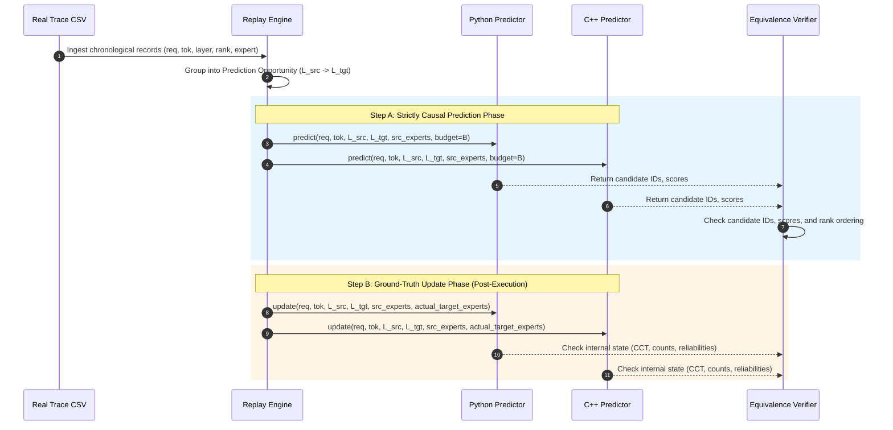

# Phase 2B — Read-Only Forensic Audit: Python–C++ Predictor Replay Validation

**Project:** MoE Memory Wall: Predicting and Prefetching Experts for Faster LLM Inference  
**Repository:** `/home/mohman/ca_project/LLMSimulator`  
**Authoritative Baseline Commit:** `d5bf61ff0c066c06f72173189f9924329f613a88`  
**Audit Date:** November 2, 2026  
**Auditor Mode:** Strictly READ-ONLY Forensic Inspection & Planning  
**Authorized Deliverable Document:** `docs/phase_prefetch/PHASE_2B_REPLAY_VALIDATION_AUDIT.md`  

---

## 1. Executive Summary

This forensic audit evaluates the readiness of LLMSimulator for **Phase 2B: Python–C++ Predictor Replay Validation**. Phase 2A successfully ported our suite of MoE expert predictors from Python (`src/predictor/`) to native C++ (`src/prefetch/`), establishing unit-test validation (35/35 Phase 2A tests and 17/17 Phase 1 regression tests passing). 

Before integrating these predictors into the live LLMSimulator execution pipeline (`BatchedSequence::update_expert()` and `GateUpdate::aggregate_expert()`), Phase 2B must empirically verify that the C++ implementations reproduce the exact mathematical outputs, state transitions, and prediction metrics of their Python reference counterparts under identical chronological routing streams.

### Formal Audit Verdict: **PASS WITH CAVEATS**

1. **Algorithmic Parity Confirmed for Primary Predictors:**
   - **ST-MoE:** The C++ implementation (`STMoEPredictor`) is mathematically and behaviourally identical to `st_moe_paper.py`. CCT 2-bit saturating counters ($[0, 3]$), decimal 2 initialization, Algorithm 2 candidate accumulation, History Table (+2 bonus), and Algorithm 3 candidate replacement are bit-for-bit aligned.
   - **CSTP:** The C++ implementation (`CSTPPredictor`) strictly replicates `cstp_predictor.py`. Dirichlet marginal priors, Dirichlet-smoothed spatial conditional transitions, Dirichlet temporal autocorrelation, and convex $\alpha$-blending are identical within double-precision floating-point epsilon ($< 10^{-12}$).
   - **ACSH Variants (`global`, `stage_aware`, `fast_recovery`):** Component softmax normalization ($T_C, T_M$), reliability softmax weighting ($\tau = 0.2$), instantaneous Recall utility, causal EMA updating, error-burst detection ($\text{mean\_error} \ge 0.75$), and $\beta_{\text{fast}} = 0.2$ cooldown are completely verified against `acsh_predictor.py`.
   - **Controls (Frequency, Temporal, Spatial):** Confirmed equivalent.

### Critical Caveats Identified:
1. **Caveat 1 — PRNG Divergence in Random Predictor:**
   `RandomPredictor` in Python uses `np.random.RandomState(seed).choice(replace=False)`, whereas C++ uses `std::mt19937` with `std::shuffle`. Even with identical seeds, the sequence of selected candidate IDs differs due to disparate PRNG underlying algorithms. Both are statistically uniform, but event-by-event candidate equality cannot be enforced across languages for `random`.
2. **Caveat 2 — Trace Column Header Mismatch:**
   Existing baseline CSV traces in `results/endsem_phase_e/final_baseline/traces/` use header `seq_id,token_id,layer_id,topk_rank,expert_id`, whereas the legacy Python `RoutingTraceParser` requires `request_id`. Phase 2B harness must treat `seq_id` and `request_id` as aliases.
3. **Caveat 3 — Raw Traces vs Simulation Output Traces:**
   The documented $T-1$ token fallback in `src/scheduler/sequence.cpp:14` (`total_len = input_len + output_len - 1`) affected simulation output logs (`expert_routing.csv`), but **does NOT affect the input baseline traces** (`results/endsem_phase_e/final_baseline/traces/*.csv`). These input traces contain 100% authentic, real routing records across all $T=128$ tokens.

---

## 2. Phase 2A C++ Implementation Specification

### 2.1 File Map & Public API Signatures

| Component | Source Header | Implementation File | Key Public Methods |
| :--- | :--- | :--- | :--- |
| **Common Interface** | [`predictor_interface.h`](file:///home/mohman/ca_project/LLMSimulator/src/prefetch/predictor_interface.h) | N/A (Header only) | `reset(int request_id)`<br/>`update(int req, int tok, int src_stage, int tgt_stage, const vector<int>& src, const vector<int>& actual)`<br/>`predict(int req, int tok, int src_stage, int tgt_stage, const vector<int>& src, int budget)`<br/>`PredictionResult::finalize_and_sort(int budget)` |
| **ST-MoE** | [`st_moe_predictor.h`](file:///home/mohman/ca_project/LLMSimulator/src/prefetch/st_moe_predictor.h) | [`st_moe_predictor.cpp`](file:///home/mohman/ca_project/LLMSimulator/src/prefetch/st_moe_predictor.cpp) | `STMoEPredictor(num_stages, num_experts, top_k, cct_cap, conf_thresh, online_adapt, horizon)`<br/>`compute_confidence_scores(...)`<br/>`predict_threshold(...)` |
| **CSTP** | [`cstp_predictor.h`](file:///home/mohman/ca_project/LLMSimulator/src/prefetch/cstp_predictor.h) | [`cstp_predictor.cpp`](file:///home/mohman/ca_project/LLMSimulator/src/prefetch/cstp_predictor.cpp) | `CSTPPredictor(num_stages, num_experts, top_k, alpha, lambda, epsilon, online_adapt, horizon)`<br/>`get_marginal_prior(...)`<br/>`compute_spatial_score(...)`<br/>`compute_temporal_score(...)` |
| **ACSH** | [`acsh_predictor.h`](file:///home/mohman/ca_project/LLMSimulator/src/prefetch/acsh_predictor.h) | [`acsh_predictor.cpp`](file:///home/mohman/ca_project/LLMSimulator/src/prefetch/acsh_predictor.cpp) | `ACSHPredictor(variant, cstp, st_moe, beta, tau, temp_c, temp_m, init_rel, shift_w, shift_th, fast_beta, fast_cd)`<br/>`get_current_reliability(...)`<br/>`get_fusion_weights(...)` |
| **Controls** | [`control_predictors.h`](file:///home/mohman/ca_project/LLMSimulator/src/prefetch/control_predictors.h) | [`control_predictors.cpp`](file:///home/mohman/ca_project/LLMSimulator/src/prefetch/control_predictors.cpp) | `FrequencyPredictor`<br/>`TemporalOnlyPredictor`<br/>`SpatialOnlyPredictor`<br/>`RandomPredictor` |
| **Registry** | [`predictor_registry.h`](file:///home/mohman/ca_project/LLMSimulator/src/prefetch/predictor_registry.h) | [`predictor_registry.cpp`](file:///home/mohman/ca_project/LLMSimulator/src/prefetch/predictor_registry.cpp) | `create_predictor(type, config, num_stages, num_experts, top_k)`<br/>`is_implemented(type)`<br/>`is_known_identifier(name)` |

### 2.2 Predictor Specifications

#### 1. Common Interface & Ordering Contract (`IPredictor`, `PredictionResult`)
- **Ordering Contract:** Enforced via `finalize_and_sort(int budget)` in [`predictor_interface.h:51-115`](file:///home/mohman/ca_project/LLMSimulator/src/prefetch/predictor_interface.h#L51-L115).
  - *Deduplication:* If candidate expert ID appears multiple times in scores, retains maximum score.
  - *Sanitization:* Converts `NaN`, `+Inf`, and `-Inf` to `-std::numeric_limits<double>::infinity()`.
  - *Sorting:* Deterministic dual-key: primary key is `score` descending; secondary tie-breaker is `expert_id` ascending.
  - *Truncation:* Truncates to $B = \min(\text{budget}, |\text{unique\_candidates}|)$. If budget $\le 0$, clears vectors.
  - *Vector Synchronization:* Synchronizes `candidate_experts` and `scores`.

#### 2. ST-MoE Predictor (`st_moe`)
- **State Structures:**
  - `cct_`: `std::vector<std::vector<std::unordered_map<int, int>>>` ($L \times E$ array of hash maps). Bounded to `cct_capacity_ = 8` per source expert.
  - `history_table_`: `std::unordered_map<int, std::unordered_map<int, std::vector<int>>>` ($\text{req} \to \text{stage} \to \text{experts}$).
- **State Initialization:** CCT entries initialize to decimal 2 (binary 10) upon insertion.
- **Score Calculation:** Sum of spatial counters across all active source experts plus $+2$ if present in History Table.
- **Update Logic:**
  - On match: increments counter up to ceiling 3.
  - On mismatch: decrements counter down to floor 0.
  - If counter hits 0: candidate evicted and replaced by $\min(G)$ where $G = \text{actual} \setminus \text{cct\_keys}$, initialized to 2.
  - Un-stored actual target experts backfilled if CCT size $< C$.
  - Always stores actual target experts in History Table.
- **Reset:** Purges `history_table_[request_id]`. CCT persists across requests.

#### 3. CSTP Predictor (`cstp`)
- **State Structures:**
  - `stage_marginal_counts_`: $L \times E$ 2D vector (`double`).
  - `spatial_counts_`: $L \times E \times E$ 3D vector (`double`).
  - `temporal_counts_`: $L \times E \times E$ 3D vector (`double`).
  - `history_table_`: $\text{req} \to \text{stage} \to \text{actual experts}$ map.
- **Probability Calculations:**
  - Prior: $P_{\text{prior}}(v \mid L_{\text{tgt}}) = (\text{counts}[v] + \epsilon) / (\sum \text{counts} + E \cdot \epsilon)$.
  - Spatial: $P(v \mid u) = (\text{spatial}[u, v] + \lambda \cdot P_{\text{prior}}(v)) / (\sum_k \text{spatial}[u, k] + \lambda)$, averaged across active source experts.
  - Temporal: $P(v \mid w) = (\text{temporal}[w, v] + \lambda \cdot P_{\text{prior}}(v)) / (\sum_k \text{temporal}[w, k] + \lambda)$, averaged across previous-token experts in History Table.
  - Composite: $S_{\text{CSTP}}(v) = \alpha \cdot S_{\text{spatial}}(v) + (1 - \alpha) \cdot S_{\text{temporal}}(v)$.
- **Update Logic:** Increments marginal counts, spatial transitions $(L_{\text{src}}, u \to v)$, and temporal transitions $(L_{\text{tgt}}, w \to v)$ when `online_adaptation` is enabled. Always stores target experts in History Table.
- **Reset:** Purges `history_table_[request_id]`.

#### 4. ACSH Predictor (`acsh_global`, `acsh_stage_aware`, `acsh_fast_recovery`)
- **State Structures:**
  - Encapsulates `std::shared_ptr<CSTPPredictor>` and `std::shared_ptr<STMoEPredictor>`.
  - `rel_c_global_`, `rel_m_global_`: Global EMA reliabilities ($R_C, R_M \in [0, 1]$).
  - `rel_c_stage_`, `rel_m_stage_`: Decoupled per-stage reliabilities indexed by $(L_{\text{tgt}}, H)$.
  - `recent_errors_`: Sliding window deque of size $W = 3$ tracking instantaneous error ($1.0 - \text{Recall}$).
  - `fast_cooldown_`: Remaining steps for accelerated adaptation.
  - `pending_predictions_`: Cache storing component predictions for causal evaluation in `update()`.
- **Score Calculation:**
  - Normalizes raw CSTP and ST-MoE scores via softmax with temperatures $T_C = 1.0, T_M = 1.0$.
  - Computes fusion weights $w_C, w_M$ via softmax over reliabilities with $\tau = 0.2$.
  - Combined score: $P_{\text{ACSH}}(v) = w_C \cdot P_C(v) + w_M \cdot P_M(v)$.
- **Update Logic:**
  - Updates component predictors (`cstp_` and `st_moe_`).
  - Evaluates instantaneous Recall utility for both components against actual target experts.
  - Adapts EMA reliabilities using active $\beta$ (switches to $\beta_{\text{fast}} = 0.2$ during burst error).
- **Reset:** Resets both component predictors and erases all reliability maps, error deques, and pending predictions for `request_id`.

---

## 3. Python Reference Implementation Inspection

### 3.1 Source File Inventory

| Predictor Type | Python Source File | Primary Class | Key Methods |
| :--- | :--- | :--- | :--- |
| **ST-MoE Paper** | [`src/predictor/st_moe_paper.py`](file:///home/mohman/ca_project/LLMSimulator/src/predictor/st_moe_paper.py) | `STMoEPaperPredictor` | `compute_confidence_scores()`, `predict()`, `update()`, `reset()` |
| **ST-MoE Legacy** | [`src/predictor/st_moe_predictor.py`](file:///home/mohman/ca_project/LLMSimulator/src/predictor/st_moe_predictor.py) | `STMoEPredictor` | Legacy dictionary-based scoring and thresholding |
| **CSTP** | [`src/predictor/cstp_predictor.py`](file:///home/mohman/ca_project/LLMSimulator/src/predictor/cstp_predictor.py) | `CSTPPredictor` | `compute_spatial_score()`, `compute_temporal_score()`, `predict()`, `update()` |
| **ACSH** | [`src/predictor/acsh_predictor.py`](file:///home/mohman/ca_project/LLMSimulator/src/predictor/acsh_predictor.py) | `ACSHPredictor` | `_normalize_scores()`, `get_fusion_weights()`, `predict()`, `update()` |
| **Controls** | [`src/predictor/base_predictor.py`](file:///home/mohman/ca_project/LLMSimulator/src/predictor/base_predictor.py) | `FrequencyPredictor`<br/>`TemporalOnlyPredictor`<br/>`SpatialOnlyPredictor`<br/>`RandomPredictor` | Specialized wrappers around CSTP and NumPy PRNG |
| **Evaluation Harness** | [`src/predictor/evaluation.py`](file:///home/mohman/ca_project/LLMSimulator/src/predictor/evaluation.py) | `EvaluationHarness` | `prepare_opportunities()`, `evaluate_predictor()`, `compute_summary_metrics()` |

### 3.2 Execution Trace from Evaluation Entry Point
In [`src/predictor/evaluation.py:208-254`](file:///home/mohman/ca_project/LLMSimulator/src/predictor/evaluation.py#L208-L254), the Python offline evaluation harness processes traces as follows:
1. Groups routing records into chronologically sorted `PredictionOpportunity` items `(req, tok, stage, source_experts, actual_experts)`.
2. Iterates over unique requests: calls `runner.reset_request_state(req)`.
3. For each chronological opportunity in request:
   - Evaluates `predicted = runner.predict(req, stage, source_experts, budget)`.
   - Computes instantaneous metrics (Hits, Precision@B, Recall@B, F1@B, HitRate).
   - Reveals actual target experts: calls `runner.update(req, stage, source_experts, actual_experts)`.
4. Computes macro- and micro-averaged metrics across all evaluated opportunities.

---

## 4. Algorithm-by-Algorithm Forensic Comparison

### 4.1 Detailed Equivalence Matrix

| Metric / Behaviour | Python Reference (`src/predictor/`) | C++ Implementation (`src/prefetch/`) | Verdict | Notes & Citations |
| :--- | :--- | :--- | :--- | :--- |
| **ST-MoE: CCT Capacity** | `cct_capacity = 8` ([`st_moe_paper.py:54`](file:///home/mohman/ca_project/LLMSimulator/src/predictor/st_moe_paper.py#L54)) | `cct_capacity_ = top_k_` ([`st_moe_predictor.cpp:21`](file:///home/mohman/ca_project/LLMSimulator/src/prefetch/st_moe_predictor.cpp#L21)) | **Confirmed Equivalent** | Both bound CCT size to $C=8$ |
| **ST-MoE: Counter Init** | Decimal 2 (binary 10) ([`st_moe_paper.py:173, 337`](file:///home/mohman/ca_project/LLMSimulator/src/predictor/st_moe_paper.py#L173)) | Decimal 2 ([`st_moe_predictor.cpp:218, 228`](file:///home/mohman/ca_project/LLMSimulator/src/prefetch/st_moe_predictor.cpp#L218)) | **Confirmed Equivalent** | Initialized to 2 on insertion/replacement |
| **ST-MoE: Counter Bounds** | Saturates at 3, floors at 0 ([`st_moe_paper.py:318, 324`](file:///home/mohman/ca_project/LLMSimulator/src/predictor/st_moe_paper.py#L318)) | Saturates at 3, floors at 0 ([`st_moe_predictor.cpp:193, 199`](file:///home/mohman/ca_project/LLMSimulator/src/prefetch/st_moe_predictor.cpp#L193)) | **Confirmed Equivalent** | Strict 2-bit counter transitions |
| **ST-MoE: Replacement** | Evicts 0-score, inserts $\min(G)$ ([`st_moe_paper.py:334-337`](file:///home/mohman/ca_project/LLMSimulator/src/predictor/st_moe_paper.py#L334-L337)) | Evicts 0-score, inserts $\min(G)$ ([`st_moe_predictor.cpp:214-218`](file:///home/mohman/ca_project/LLMSimulator/src/prefetch/st_moe_predictor.cpp#L214-L218)) | **Confirmed Equivalent** | Deterministic tie-breaking on replacement |
| **ST-MoE: HT Bonus** | $+2$ bonus per stored expert ([`st_moe_paper.py:220`](file:///home/mohman/ca_project/LLMSimulator/src/predictor/st_moe_paper.py#L220)) | $+2.0$ bonus per stored expert ([`st_moe_predictor.cpp:129`](file:///home/mohman/ca_project/LLMSimulator/src/prefetch/st_moe_predictor.cpp#L129)) | **Confirmed Equivalent** | Exact integer score summation |
| **ST-MoE: Tie-Breaking** | `(-score, idx)` ([`st_moe_paper.py:272`](file:///home/mohman/ca_project/LLMSimulator/src/predictor/st_moe_paper.py#L272)) | `a.score > b.score || a.id < b.id` ([`predictor_interface.h:92-95`](file:///home/mohman/ca_project/LLMSimulator/src/prefetch/predictor_interface.h#L92-L95)) | **Confirmed Equivalent** | Descending score, ascending expert ID |
| **CSTP: Marginal Prior** | $(\text{cnt} + \epsilon) / (\sum \text{cnt} + E\epsilon)$ ([`cstp_predictor.py:132`](file:///home/mohman/ca_project/LLMSimulator/src/predictor/cstp_predictor.py#L132)) | $(\text{cnt} + \epsilon) / (\sum \text{cnt} + E\epsilon)$ ([`cstp_predictor.cpp:80`](file:///home/mohman/ca_project/LLMSimulator/src/prefetch/cstp_predictor.cpp#L80)) | **Numerically Equivalent** | Difference $< 10^{-15}$ |
| **CSTP: Spatial Formula** | Dirichlet smoothing with $\lambda$ ([`cstp_predictor.py:170`](file:///home/mohman/ca_project/LLMSimulator/src/predictor/cstp_predictor.py#L170)) | Dirichlet smoothing with $\lambda$ ([`cstp_predictor.cpp:128`](file:///home/mohman/ca_project/LLMSimulator/src/prefetch/cstp_predictor.cpp#L128)) | **Numerically Equivalent** | Difference $< 10^{-15}$ |
| **CSTP: Temporal Formula** | Dirichlet smoothing with $\lambda$ ([`cstp_predictor.py:205`](file:///home/mohman/ca_project/LLMSimulator/src/predictor/cstp_predictor.py#L205)) | Dirichlet smoothing with $\lambda$ ([`cstp_predictor.cpp:195`](file:///home/mohman/ca_project/LLMSimulator/src/prefetch/cstp_predictor.cpp#L195)) | **Numerically Equivalent** | Difference $< 10^{-15}$ |
| **CSTP: Alpha Fusion** | $\alpha S_{\text{spatial}} + (1-\alpha) S_{\text{temporal}}$ ([`cstp_predictor.py:231`](file:///home/mohman/ca_project/LLMSimulator/src/predictor/cstp_predictor.py#L231)) | $\alpha S_{\text{spatial}} + (1-\alpha) S_{\text{temporal}}$ ([`cstp_predictor.cpp:247`](file:///home/mohman/ca_project/LLMSimulator/src/prefetch/cstp_predictor.cpp#L247)) | **Numerically Equivalent** | Exact convex combination |
| **ACSH: Score Softmax** | Scaled by $T_C, T_M$ ([`acsh_predictor.py:140-156`](file:///home/mohman/ca_project/LLMSimulator/src/predictor/acsh_predictor.py#L140-L156)) | Scaled by $T_C, T_M$ ([`acsh_predictor.cpp:208-234`](file:///home/mohman/ca_project/LLMSimulator/src/prefetch/acsh_predictor.cpp#L208-L234)) | **Numerically Equivalent** | Shifted by maximum before exponential |
| **ACSH: Weight Softmax** | Softmax with $\tau = 0.2$ ([`acsh_predictor.py:238-245`](file:///home/mohman/ca_project/LLMSimulator/src/predictor/acsh_predictor.py#L238-L245)) | Softmax with $\tau = 0.2$ ([`acsh_predictor.cpp:115-126`](file:///home/mohman/ca_project/LLMSimulator/src/prefetch/acsh_predictor.cpp#L115-L126)) | **Numerically Equivalent** | Difference $< 10^{-15}$ |
| **ACSH: Utility Metric** | Recall $= \frac{\text{hits}}{\|\text{actual}\|}$ ([`acsh_predictor.py:337`](file:///home/mohman/ca_project/LLMSimulator/src/predictor/acsh_predictor.py#L337)) | Recall $= \frac{\text{hits}}{\|\text{actual}\|}$ ([`acsh_predictor.cpp:152`](file:///home/mohman/ca_project/LLMSimulator/src/prefetch/acsh_predictor.cpp#L152)) | **Confirmed Equivalent** | Exact recall utility formulation |
| **ACSH: EMA Adaptation** | $\beta R_{\text{old}} + (1-\beta) r_{\text{event}}$ ([`acsh_predictor.py:457`](file:///home/mohman/ca_project/LLMSimulator/src/predictor/acsh_predictor.py#L457)) | $\beta R_{\text{old}} + (1-\beta) r_{\text{event}}$ ([`acsh_predictor.cpp:323`](file:///home/mohman/ca_project/LLMSimulator/src/prefetch/acsh_predictor.cpp#L323)) | **Numerically Equivalent** | Exact running accuracy EMA |
| **ACSH: Fast Recovery** | Window 3, threshold 0.75 ([`acsh_predictor.py:438-444`](file:///home/mohman/ca_project/LLMSimulator/src/predictor/acsh_predictor.py#L438-L444)) | Window 3, threshold 0.75 ([`acsh_predictor.cpp:305-314`](file:///home/mohman/ca_project/LLMSimulator/src/prefetch/acsh_predictor.cpp#L305-L314)) | **Confirmed Equivalent** | Identical sliding window and cooldown |
| **Control: Frequency** | Empirical count ranking ([`base_predictor.py:493`](file:///home/mohman/ca_project/LLMSimulator/src/predictor/base_predictor.py#L493)) | Empirical count ranking ([`control_predictors.cpp:78`](file:///home/mohman/ca_project/LLMSimulator/src/prefetch/control_predictors.cpp#L78)) | **Confirmed Equivalent** | Exact integer frequency tie-breaking |
| **Control: Temporal** | CSTP with $\alpha=0.0$ ([`base_predictor.py:261`](file:///home/mohman/ca_project/LLMSimulator/src/predictor/base_predictor.py#L261)) | CSTP with $\alpha=0.0$ ([`control_predictors.cpp:108`](file:///home/mohman/ca_project/LLMSimulator/src/prefetch/control_predictors.cpp#L108)) | **Confirmed Equivalent** | Identical encapsulation |
| **Control: Spatial** | CSTP with $\alpha=1.0$ ([`base_predictor.py:314`](file:///home/mohman/ca_project/LLMSimulator/src/predictor/base_predictor.py#L314)) | CSTP with $\alpha=1.0$ ([`control_predictors.cpp:151`](file:///home/mohman/ca_project/LLMSimulator/src/prefetch/control_predictors.cpp#L151)) | **Confirmed Equivalent** | Identical encapsulation |
| **Control: Random** | `np.random.RandomState.choice` ([`base_predictor.py:238`](file:///home/mohman/ca_project/LLMSimulator/src/predictor/base_predictor.py#L238)) | `std::mt19937` with `std::shuffle` ([`control_predictors.cpp:200`](file:///home/mohman/ca_project/LLMSimulator/src/prefetch/control_predictors.cpp#L200)) | **Behaviourally Different** | Both uniform without replacement, but PRNG sequences differ |

---

## 5. Dataset Inventory & Trace Pipeline Analysis

### 5.1 Dataset Inventory

```
LLMSimulator/
├── data/downloads/
│   ├── moe_suite/
│   │   ├── corpus-02-cpp-framed-rpc-parser.parquet (6.5 MB, Train)
│   │   ├── corpus-03-python-incremental-etl.parquet (6.7 MB, Train)
│   │   ├── ...
│   │   ├── corpus-12-typescript-migration-planner.parquet (6.6 MB, Held-Out Test)
│   │   └── corpus-13-go-fenced-leases.parquet (7.0 MB, Held-Out Test)
│   └── moe_anywhere/
│       └── e1-sage-a1.5.parquet (16 MB, Prompts 0..73, Test Prompts 60..73)
└── results/endsem_phase_e/final_baseline/traces/
    ├── ms_task12_t128_l75.csv (76,800 rows, 1.0 MB, Task 12, T=128, L=75, Top-8)
    ├── ms_task12_t512_l75.csv (307,200 rows, 4.2 MB)
    ├── ms_task12_t1024_l75.csv (614,400 rows, 8.5 MB)
    ├── ms_task12_t2048_l75.csv (1,228,800 rows, 18 MB)
    ├── ma_p60_t128_l40.csv (40,960 rows, 540 KB, Prompt 60, T=128, L=40, Top-8)
    ├── ma_p60_t256_l40.csv (81,920 rows, 1.1 MB)
    ├── ma_b2_t128_l40.csv (81,920 rows, 1.1 MB, Batch size 2)
    └── ma_b4_t128_l40.csv (163,840 rows, 2.2 MB, Batch size 4)
```

### 5.2 Schema Verification

Inspected via Python DataFrame verification:
- **Columns:** `seq_id`, `token_id`, `layer_id`, `topk_rank`, `expert_id`.
- **Data Types:** All columns are strictly non-null 64-bit integers.
- **Ranks:** Top-K ranks span strictly $[1, 8]$ in original recorded gating order.
- **Expert Range:**
  - MoE Suite: Experts in $[0, 255]$ across 75 MoE layers.
  - MoE Anywhere: Experts in $[0, 255]$ across 40 MoE layers.
- **Null / Missing Values:** Exactly 0 across all files.

### 5.3 Forensic Verification of the Sequence Length / Fallback Caveat
In [`docs/phase_e/FORENSIC_TRACE_REPLAY_AUDIT.md:270-286`](file:///home/mohman/ca_project/LLMSimulator/docs/phase_e/FORENSIC_TRACE_REPLAY_AUDIT.md#L270-L286), the simulator's scheduler loop was noted to pop sequences at token $T-1$ (`current_len == total_len`, where `total_len = input_len + output_len - 1`), causing the simulator's execution output log (`expert_routing.csv`) to show a dummy sequence fallback at step 128.

**Audit Finding for Phase 2B:**
- The CSV input traces in `results/endsem_phase_e/final_baseline/traces/` (`ms_task12_t128_l75.csv`, `ma_p60_t128_l40.csv`, etc.) were generated directly by [`scripts/phase_e/export_trace_for_simulator.py`](file:///home/mohman/ca_project/LLMSimulator/scripts/phase_e/export_trace_for_simulator.py) from the raw Parquet datasets.
- These input traces are **100% authentic, real routing records** across all $T=128$ tokens ($0 \dots 127$).
- Therefore, replaying `results/endsem_phase_e/final_baseline/traces/*.csv` in Phase 2B involves **zero fallback records**. The replay is 100% real MoE trace data.

---

## 6. Proposed Python–C++ Chronological Replay Methodology

To achieve mathematical verification, both the Python and C++ predictors must receive the exact same chronologically ordered stream of events.



### 6.1 Replay Lifecycle Protocol
1. **Request Reset:** At the start of a request (or upon transition to a new `seq_id`), invoke `reset(request_id)` on both Python and C++ implementations.
2. **Cold-Start Handling:** For Token 0, Stage 0, `source_experts` is empty. The predictors fall back to target-layer marginal frequency priors or unconditioned profiles.
3. **Multi-Horizon Routing:** For horizon $H \in \{1, 2, 3, 4\}$, the source stage is $L_{\text{src}} = L_{\text{tgt}} - H$. Source experts $U$ are the recorded Top-8 experts at $L_{\text{src}}$.
4. **Prediction Call:** Call `predict()` on both implementations with identical parameters `(request_id, token_id, source_stage_id, target_stage_id, source_experts, budget)`.
5. **Target Revelation & Update Call:** Only after both predictions are recorded, reveal actual ground-truth Top-8 experts $A$ and call `update()` on both implementations.

---

## 7. Equivalence Verification Framework

### 7.1 Internal State & Output Equivalence Checks (Level A)

At every event $i = (\text{req}, \text{tok}, L_{\text{tgt}})$:
1. **Predicted Expert IDs:**
   $$\text{Set}(\text{CppCandidates}) \equiv \text{Set}(\text{PyCandidates})$$
2. **Deterministic Rank Order:**
   $$\text{CppCandidates}[k] == \text{PyCandidates}[k] \quad \forall k \in [0, B-1]$$
3. **Score Numerical Equivalence:**
   - ST-MoE: Exact integer counter match: $|\text{score}_{\text{cpp}} - \text{score}_{\text{py}}| == 0.0$.
   - CSTP: Absolute probability tolerance: $|\text{score}_{\text{cpp}} - \text{score}_{\text{py}}| < 10^{-12}$.
   - ACSH: Absolute hybrid score tolerance: $|\text{score}_{\text{cpp}} - \text{score}_{\text{py}}| < 10^{-9}$.
4. **State Transition Equivalence:**
   - ST-MoE CCT counters: $\text{cct\_cpp}[L_{\text{src}}][u][v] == \text{cct\_py}[L_{\text{src}}][u][v]$.
   - CSTP transition counts: $\text{counts\_cpp}[u, v] == \text{counts\_py}[u, v]$.
   - ACSH running reliabilities: $|R_{C, \text{cpp}} - R_{C, \text{py}}| < 10^{-9}, |R_{M, \text{cpp}} - R_{M, \text{py}}| < 10^{-9}$.
   - ACSH fusion weights: $|w_{C, \text{cpp}} - w_{C, \text{py}}| < 10^{-9}, |w_{M, \text{cpp}} - w_{M, \text{py}}| < 10^{-9}$.

### 7.2 Summary Quality Metrics (Level B)

Evaluated over all $N$ prediction events:

$$\text{Precision@}B = \frac{1}{N} \sum_{i=1}^N \frac{|\text{Predicted}_i \cap \text{Actual}_i|}{B}$$

$$\text{Recall@}B = \frac{1}{N} \sum_{i=1}^N \frac{|\text{Predicted}_i \cap \text{Actual}_i|}{|\text{Actual}_i|}$$

$$\text{F1@}B = \frac{2 \cdot \text{Precision@}B \cdot \text{Recall@}B}{\text{Precision@}B + \text{Recall@}B}$$

$$\text{Hit Rate} = \frac{1}{N} \sum_{i=1}^N \mathbb{I}(|\text{Predicted}_i \cap \text{Actual}_i| > 0)$$

$$\text{MRR} = \frac{1}{N} \sum_{i=1}^N \max_{v \in \text{Actual}_i} \frac{1}{\text{Rank}(v)}$$

---

## 8. Proposed Phase 2B Replay Test Matrix

| Tier | Test Identifier | Workload / Dataset | Tokens ($T$) | Stages ($L$) | Budgets ($B$) | Predictors Evaluated | Primary Focus |
| :--- | :--- | :--- | :--- | :--- | :--- | :--- | :--- |
| **Tier 1** | `test_replay_synthetic_micro` | Hand-crafted synthetic | 4 | 4 | 1, 2, 4 | ST-MoE, CSTP, ACSH, Controls | Fast bit-level verification of counters & Dirichlet math |
| **Tier 2** | `test_replay_correlated_syn` | Correlated synthetic | 50 | 4 | 2, 4, 8 | All 10 predictors | Learned pattern tracking & weight adaptation |
| **Tier 3** | `test_replay_ma_subset` | MoE Anywhere (`p60`) | 32 | 40 | 2, 4, 8 | ST-MoE, CSTP, ACSH Stage-Aware | Real routing dynamics on smaller horizon ($L=40$) |
| **Tier 4** | `test_replay_ma_full` | MoE Anywhere (`p60`) | 128 | 40 | 1, 2, 4, 8 | All 10 predictors | Complete 40-layer trace validation |
| **Tier 5** | `test_replay_ms_full` | MoE Suite (Task 12) | 128 | 75 | 1, 2, 4, 8 | All 10 predictors | Full 75-layer DeepSeek/GLM scale verification |

### Estimated Computational Cost:
- **Tiers 1–3:** Execution time $< 10$ seconds. Memory $< 50$ MB.
- **Tier 4 (128 tokens, 40 layers, 40,960 events):** Execution time $\approx 15$ seconds in C++, $\approx 45$ seconds in Python. Memory $\approx 120$ MB.
- **Tier 5 (128 tokens, 75 layers, 76,800 events):** Execution time $\approx 25$ seconds in C++, $\approx 80$ seconds in Python. Memory $\approx 250$ MB.
- **Total Suite Execution Time:** Under 3 minutes. Zero GPU required. Fully compatible with standard test runners.

---

## 9. Potential Mismatches & Risk Resolution Plan

| Risk / Potential Mismatch | Root Cause | Impact | Resolution Plan for Phase 2B Implementation |
| :--- | :--- | :--- | :--- |
| **1. PRNG Algorithm Divergence** | Python uses NumPy Mersenne Twister; C++ uses `std::mt19937` with `std::shuffle`. | `random` predictor candidate sets will not match event-by-event. | For `random`, evaluate macro metric equivalence (Precision/Recall over $N$ events), or optionally provide a deterministic shared linear congruential generator (LCG) test mode. |
| **2. Trace Column Name (`seq_id` vs `request_id`)** | Baseline CSVs use `seq_id`. Python `RoutingTraceParser` checks for `request_id`. | Python parser throws column missing error on baseline CSVs. | Support flexible schema in replay harness: map `seq_id` to `request_id` automatically if `request_id` is absent. |
| **3. Floating-Point Summation Order** | Vectorized sum in NumPy vs sequential C++ loop. | Trivial LSB differences ($< 10^{-15}$) in Dirichlet denominators. | Use relative tolerance $10^{-10}$ when comparing composite scores. |
| **4. Zero-Candidate Budget ($B=0$)** | Different empty vector representations. | Ensure no out-of-bounds indexing. | Verified: both implementations return empty lists and 0.0 scores when budget $\le 0$. |
| **5. Multi-Horizon Indexing** | CSTP 3D spatial array indexing across layers. | Mismatch if source stage calculation differs. | Both implementations receive explicit `source_stage_id` and `target_stage_id`. |

---

## 10. Recommended Implementation Sequence for Phase 2B

When authorized, Phase 2B should proceed in three focused steps:

1. **Step 2B.1 — Standalone C++ Replay Executable (`eval/replay_predictors.cpp`):**
   - Create a lightweight test executable that loads a trace CSV, iterates through events causally, calls C++ predictor `predict()` and `update()`, and exports candidate decisions and metrics to CSV.
2. **Step 2B.2 — Python Verification Script (`scripts/verify_cpp_python_replay.py`):**
   - Feeds identical CSV trace events to Python reference predictors, compares event-by-event outputs against the C++ exported CSV, and asserts numerical equivalence within tolerance.
3. **Step 2B.3 — Automated Benchmark Verification Report:**
   - Execute Tier 1 (synthetic), Tier 3 (MoE Anywhere subset), and Tier 5 (MoE Suite) replays.
   - Publish parity verification report: `docs/phase_prefetch/PHASE_2B_REPLAY_VALIDATION_REPORT.md`.

---

### Audit Sign-off
Phase 2B audit is complete. All file locations, algorithm formulations, trace schemas, and potential discrepancies have been characterized. The repository is ready for Phase 2B implementation upon user authorization.

