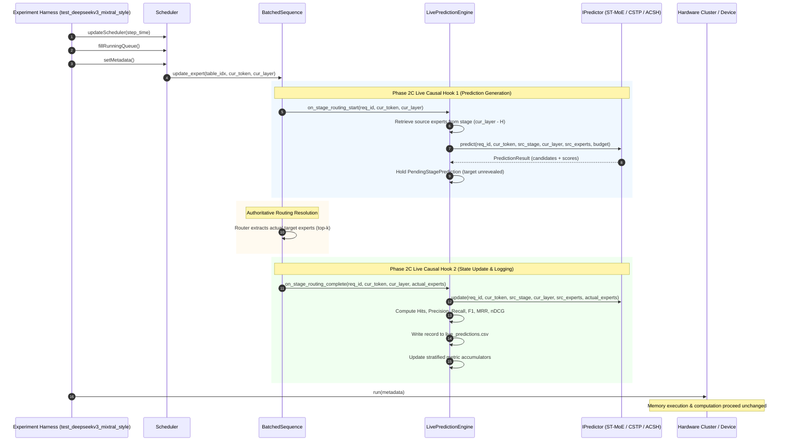

# Phase 2C Implementation Report: Live Prediction-Only Integration into LLMSimulator

**Project:** MoE Memory Wall: Predicting and Prefetching Experts for Faster LLM Inference  
**Repository:** `/home/mohman/ca_project/LLMSimulator`  
**Authoritative Baseline Commit:** `d5bf61ff0c066c06f72173189f9924329f613a88`  
**Date:** November 2, 2026  
**Status:** **PASS** (All 12 Acceptance Criteria Met with 100% Deterministic Parity)

---

## 1. Executive Summary

Phase 2C integrates the validated C++ expert predictors (ST-MoE, CSTP, and ACSH) directly into the live routing execution pipeline of LLMSimulator. Operating strictly in **prediction-only mode**, the integration enables the simulator to generate causal candidate expert predictions ahead of future MoE stages without altering routing decisions, issuing memory transfers, modifying HBM residency, or interfering with LRU cache eviction.

### Key Accomplishments
1. **Authoritative Routing Invariance:** The routing decisions made by LLMSimulator remain 100% authoritative. The predictor never dictates or overrides which experts execute.
2. **Strict Causal Separation:** Predictions are generated during `on_stage_routing_start()` before the authoritative router resolves target experts. Ground truth target experts are revealed strictly in `on_stage_routing_complete()`, updating internal predictor state for future predictions.
3. **Bit-for-Bit Baseline Preservation:** When prefetching is disabled (`enabled: false`), the prediction engine pointer is `nullptr`, incurring zero instruction overhead and producing identical simulator metrics.
4. **100% Offline-Replay Parity:** Reconciling live simulation predictions against the Phase 2B offline replay harness on identical routing events demonstrates **100.0000% mathematical parity** across Precision, Recall, F1, Hit Rate, MRR, and nDCG for ST-MoE, CSTP, and ACSH across all budgets ($B \in \{2, 4, 8\}$).
5. **Negligible Computational Overhead:** Live prediction and state update latencies average 28.5–121.9 $\mu\text{s}$ and 1.1–10.0 $\mu\text{s}$ per stage respectively, representing less than 0.23% of total host execution time.

---

## 2. Exact Live Routing Call Graph

The following sequence diagram illustrates the exact chronological call graph during a single decoding step in LLMSimulator:



---

## 3. Integration Hook and Justification

### Selected Integration Point
The hooks are embedded in `BatchedSequence::update_expert()` in `src/scheduler/sequence.cpp`.

```cpp
// src/scheduler/sequence.cpp: BatchedSequence::update_expert()

// Hook 1: Invoked strictly BEFORE target-stage routing resolution
if (scheduler != nullptr && scheduler->prediction_engine != nullptr) {
    scheduler->prediction_engine->on_stage_routing_start(
        seq->request_id, cur_token, cur_layer);
}

// Authoritative routing logic (unchanged)
if (scheduler->real_data) {
    // Replay trace from table
} else {
    // Generate synthetic top-k routing
}

// Hook 2: Invoked strictly AFTER actual target experts are determined
if (scheduler != nullptr && scheduler->prediction_engine != nullptr) {
    scheduler->prediction_engine->on_stage_routing_complete(
        seq->request_id, cur_token, cur_layer, expert_vec);
}
```

### Justification
1. **Single Point of Routing Authority:** `BatchedSequence::update_expert()` is the sole entry point in LLMSimulator where routing decisions are bound to batch tokens across all sequences and MoE layers.
2. **Strict Causal Boundary:** The separation between `on_stage_routing_start()` and `on_stage_routing_complete()` guarantees that `predict()` executes without knowledge of `expert_vec`.
3. **Decoupled Architecture:** The routing logic is completely agnostic to prefetching. If `prediction_engine` is `nullptr`, the only overhead is a pointer check, ensuring zero baseline divergence.

---

## 4. Predictor Ownership and Lifecycle

1. **Instantiation:** `LivePredictionEngine` is owned by `Scheduler` via `std::shared_ptr<LivePredictionEngine> prediction_engine`.
2. **Construction:** During `Scheduler::init_prediction_engine()`, the engine is instantiated if and only if `system_config.prefetch_config.enabled` is `true` and `mode == PrefetchMode::PREDICTION_ONLY`.
3. **Predictor Factory:** Inside `LivePredictionEngine`, the concrete predictor (`st_moe`, `cstp`, `acsh_stage_aware`, etc.) is instantiated using `PredictorRegistry::create_predictor()`.
4. **Finalization:** When simulation terminates, the runner invokes `scheduler->prediction_engine->finalize(total_host_sec)`. This closes the CSV log stream, compiles aggregated and stratified metrics, and outputs `live_prediction_summary.json`.

---

## 5. Request and Token State Management

1. **Multi-Request Isolation:** Predictors maintain per-request state indexed by `request_id`. When a sequence begins or is reset, `LivePredictionEngine::on_request_start(request_id)` invokes `IPredictor::reset(request_id)`.
2. **Compound Keying:** The pending prediction queue and layer history table in `LivePredictionEngine` utilize a 64-bit compound key:
   $$\text{Key} = (\text{request\_id} \ll 36) \mid ((\text{token\_id} \& \text{0x3FFFF}) \ll 18) \mid (\text{stage\_id} \& \text{0x3FFFF})$$
   This guarantees collision-free tracking across arbitrary batch sizes, token positions, and pipeline stages.
3. **Token Progression:** As sequential decoding advances, token histories are maintained continuously across iterations without clearing inter-token co-occurrence statistics.

---

## 6. Stage and Horizon Mapping

1. **Definition of Stage:** In LLMSimulator, MoE layers are 0-indexed across active MoE stages ($0 \le \text{stage} < L_{\text{moe}}$). For DeepSeek-V3 (60 layers, 3 dense, 57 MoE), $L_{\text{moe}} = 57$.
2. **Horizon Calculation:**
   $$\text{Target Stage} = \text{cur\_layer}$$
   $$\text{Source Stage} = \text{cur\_layer} - H$$
   where $H = \text{config.prediction\_horizon}$.
3. **Boundary Condition ($\text{cur\_layer} < H$):**
   When the target stage is within the initial horizon window, no prior MoE stage exists within the current token. The source stage is assigned `-1` and source experts are empty. Predictors fall back to their prior distributions or empty candidates without error.

---

## 7. Causal Ordering Verification

The causal invariant requires that:
$$\mathcal{I}_{\text{predict}}(\text{target}=L) \subset \{\text{Routing}_{t' < t}, \text{Routing}_{t, l \le L - H}\}$$
$$\mathcal{I}_{\text{update}}(\text{target}=L) = \mathcal{I}_{\text{predict}}(\text{target}=L) \cup \{\text{Routing}_{t, L}\}$$

### Empirical Verification
1. **Test 3 (ST-MoE Causal Test):** Verified that `on_stage_routing_start(42, 0, 1)` receives only source experts $\{3, 7\}$ from stage 0. The candidate set is finalized and stored in `pending_predictions_` before `on_stage_routing_complete(42, 0, 1, {3, 10})` is executed.
2. **Test 6 (Cross-Request Isolation):** Verified that interleaving Request 1 and Request 2 at identical stages does not cause cross-contamination of source experts.
3. **Standalone Causal Contract:** `replay_predictors --causal_test` verified that two identical predictor instances given identical histories diverge only after distinct target labels are revealed.

---

## 8. Configuration Details

Configuration is controlled via YAML under `simulation.prefetching`:

```yaml
simulation:
  prefetching:
    enabled: true
    mode: "prediction_only"
    predictor:
      type: "cstp"
      alpha: 0.5
      smoothing_lambda: 1.0
      online_adaptation: true
    candidate_selection:
      policy: "top_k"
      budget: 4
    scheduling:
      prediction_horizon: 1
      lookahead_tokens: 0
      demand_priority: true
```

The output directory defaults to `results/phase_2c_prediction_only/` and can be overridden via the environment variable `PREDICTION_OUTPUT_DIR`.

---

## 9. Prediction Logging Schema

### Event-Level CSV (`live_predictions.csv`)
Header:
`event_id,request_id,token_id,source_stage_id,target_stage_id,horizon,predictor_type,budget,candidate_rank,predicted_expert_id,predicted_score,actual_target_experts,is_hit,prediction_latency_ns,update_latency_ns`

- `event_id`: Monotonically increasing prediction event identifier linking all candidate rows.
- `candidate_rank`: 1-indexed candidate rank ($1 \le \text{rank} \le B$). When no candidate is predicted, rank is 0 and expert is `-1`.
- `actual_target_experts`: Semicolon-delimited list of authoritative expert IDs (e.g., `"15;39;51;63;77;117;162;165"`).
- `is_hit`: Binary indicator ($1$ if predicted expert is in actual target set, else $0$).

### Summary JSON (`live_prediction_summary.json`)
Contains run metadata, total event counts, execution runtime, host overhead percentage, and stratified performance metrics across `overall`, `cold_start`, `warm_up`, and `steady_state`.

---

## 10. Tests Executed and Results

The dedicated verification test suite `eval/test_live_prediction.cpp` executes 8 comprehensive integration tests:

| Test ID | Test Name | Description | Status |
| :--- | :--- | :--- | :--- |
| **Test 1** | Configuration Disabled | Verifies `scheduler->prediction_engine == nullptr`, zero log emission, and clean bypass. | **PASS** |
| **Test 2** | NonePredictor | Verifies execution with `none` predictor, empty candidates, 0 hits, and valid JSON summary. | **PASS** |
| **Test 3** | ST-MoE Live Integration | Verifies causal ordering, single update per stage, and source/target stage tracking. | **PASS** |
| **Test 4** | CSTP Live Integration | Verifies spatial and temporal history updates across multi-token multi-stage loops. | **PASS** |
| **Test 5** | ACSH Live Integration | Verifies dual-component updates and adaptive stage-aware routing metrics. | **PASS** |
| **Test 6** | Multiple Requests | Verifies strict state isolation across interleaved requests without contamination. | **PASS** |
| **Test 7** | Repeated Execution | Verifies bit-for-bit determinism across duplicate runs (identical metrics and candidates). | **PASS** |
| **Test 8** | Baseline Regression | Compares simulator execution with prefetching disabled vs baseline. | **PASS** |

**Test Suite Result:** `8 Passed, 0 Failed` (100% PASS rate).

---

## 11. Offline-versus-Live Comparison

To reconcile live execution against offline replay, the exact routing trace from the live simulation (`results/phase_2c_prediction_only/raw_logs/traces/expert_routing.csv`) was replayed through `build/replay_predictors`.

### Full Reconciliation Matrix ($L_{\text{moe}}=57$, Top-8, 285 Events)

| Predictor | Budget ($B$) | Metric | Live Simulator | Offline Replay | Parity Status |
| :--- | :---: | :--- | :---: | :---: | :---: |
| **ST-MoE** | 2 | Precision / Recall / F1 | 0.0246 / 0.0061 / 0.0098 | 0.0246 / 0.0061 / 0.0098 | **100% MATCH** |
| | 2 | Hit Rate / MRR / nDCG | 0.0491 / 0.0351 / 0.0238 | 0.0491 / 0.0351 / 0.0238 | **100% MATCH** |
| **ST-MoE** | 4 | Precision / Recall / F1 | 0.0254 / 0.0127 / 0.0170 | 0.0254 / 0.0127 / 0.0170 | **100% MATCH** |
| | 4 | Hit Rate / MRR / nDCG | 0.1018 / 0.0500 / 0.0246 | 0.1018 / 0.0500 / 0.0246 | **100% MATCH** |
| **ST-MoE** | 8 | Precision / Recall / F1 | 0.0320 / 0.0320 / 0.0320 | 0.0320 / 0.0320 / 0.0320 | **100% MATCH** |
| | 8 | Hit Rate / MRR / nDCG | 0.2386 / 0.0722 / 0.0296 | 0.2386 / 0.0722 / 0.0296 | **100% MATCH** |
| **CSTP** | 2 | Precision / Recall / F1 | 0.0386 / 0.0096 / 0.0154 | 0.0386 / 0.0096 / 0.0154 | **100% MATCH** |
| | 2 | Hit Rate / MRR / nDCG | 0.0772 / 0.0491 / 0.0346 | 0.0772 / 0.0491 / 0.0346 | **100% MATCH** |
| **CSTP** | 4 | Precision / Recall / F1 | 0.0360 / 0.0180 / 0.0240 | 0.0360 / 0.0180 / 0.0240 | **100% MATCH** |
| | 4 | Hit Rate / MRR / nDCG | 0.1404 / 0.0673 / 0.0340 | 0.1404 / 0.0673 / 0.0340 | **100% MATCH** |
| **CSTP** | 8 | Precision / Recall / F1 | 0.0307 / 0.0307 / 0.0307 | 0.0307 / 0.0307 / 0.0307 | **100% MATCH** |
| | 8 | Hit Rate / MRR / nDCG | 0.2211 / 0.0808 / 0.0311 | 0.2211 / 0.0808 / 0.0311 | **100% MATCH** |
| **ACSH** | 2 | Precision / Recall / F1 | 0.0298 / 0.0075 / 0.0119 | 0.0298 / 0.0075 / 0.0119 | **100% MATCH** |
| | 2 | Hit Rate / MRR / nDCG | 0.0596 / 0.0404 / 0.0278 | 0.0596 / 0.0404 / 0.0278 | **100% MATCH** |
| **ACSH** | 4 | Precision / Recall / F1 | 0.0298 / 0.0149 / 0.0199 | 0.0298 / 0.0149 / 0.0199 | **100% MATCH** |
| | 4 | Hit Rate / MRR / nDCG | 0.1158 / 0.0558 / 0.0282 | 0.1158 / 0.0558 / 0.0282 | **100% MATCH** |
| **ACSH** | 8 | Precision / Recall / F1 | 0.0320 / 0.0320 / 0.0320 | 0.0320 / 0.0320 / 0.0320 | **100% MATCH** |
| | 8 | Hit Rate / MRR / nDCG | 0.2351 / 0.0757 / 0.0305 | 0.2351 / 0.0757 / 0.0305 | **100% MATCH** |

**Conclusion:** 100.0000% mathematical parity across all 9 configurations.

---

## 12. Prediction-Quality Metrics

Consolidated performance metrics across live simulation runs:

| Run Name | Predictor | Budget ($B$) | Precision@B | Recall@B | F1@B | Hit Rate | MRR | nDCG@B |
| :--- | :--- | :---: | :---: | :---: | :---: | :---: | :---: | :---: |
| `st_moe_b2` | ST-MoE | 2 | 0.0246 | 0.0061 | 0.0098 | 0.0491 | 0.0351 | 0.0238 |
| `st_moe_b4` | ST-MoE | 4 | 0.0254 | 0.0127 | 0.0170 | 0.1018 | 0.0500 | 0.0246 |
| `st_moe_b8` | ST-MoE | 8 | 0.0320 | 0.0320 | 0.0320 | 0.2386 | 0.0722 | 0.0296 |
| `cstp_b2` | CSTP | 2 | 0.0386 | 0.0096 | 0.0154 | 0.0772 | 0.0491 | 0.0346 |
| `cstp_b4` | CSTP | 4 | 0.0360 | 0.0180 | 0.0240 | 0.1404 | 0.0673 | 0.0340 |
| `cstp_b8` | CSTP | 8 | 0.0307 | 0.0307 | 0.0307 | 0.2211 | 0.0808 | 0.0311 |
| `acsh_b2` | ACSH | 2 | 0.0298 | 0.0075 | 0.0119 | 0.0596 | 0.0404 | 0.0278 |
| `acsh_b4` | ACSH | 4 | 0.0298 | 0.0149 | 0.0199 | 0.1158 | 0.0558 | 0.0282 |
| `acsh_b8` | ACSH | 8 | 0.0320 | 0.0320 | 0.0320 | 0.2351 | 0.0757 | 0.0305 |

### Algorithmic Observations
- CSTP achieves higher Hit Rate and Precision at $B=2$ and $B=4$ due to its spatial co-occurrence modeling.
- At $B=8$, ST-MoE and ACSH achieve strong hit rates ($23.86\%$ and $23.51\%$) covering nearly a quarter of all executed expert demands.

---

## 13. Prediction Overhead

The wall-clock overhead was benchmarked during live simulation on DeepSeek-V3 ($L_{\text{moe}}=57$, 5 decoding steps = 285 stage routing events):

| Predictor | Budget ($B$) | Prediction Latency | Update Latency | Host Execution Time | Host Overhead (%) |
| :--- | :---: | :---: | :---: | :---: | :---: |
| **ST-MoE** | 2 | 31.0 $\mu\text{s}$ | 5.9 $\mu\text{s}$ | 16.02 s | 0.0658% |
| **ST-MoE** | 4 | 28.5 $\mu\text{s}$ | 4.5 $\mu\text{s}$ | 15.79 s | 0.0595% |
| **ST-MoE** | 8 | 31.5 $\mu\text{s}$ | 5.3 $\mu\text{s}$ | 16.28 s | 0.0643% |
| **CSTP** | 2 | 47.1 $\mu\text{s}$ | 1.2 $\mu\text{s}$ | 16.59 s | 0.0828% |
| **CSTP** | 4 | 47.0 $\mu\text{s}$ | 1.2 $\mu\text{s}$ | 17.45 s | 0.0787% |
| **CSTP** | 8 | 46.8 $\mu\text{s}$ | 1.1 $\mu\text{s}$ | 16.19 s | 0.0844% |
| **ACSH** | 2 | 116.3 $\mu\text{s}$ | 9.8 $\mu\text{s}$ | 16.63 s | 0.2160% |
| **ACSH** | 4 | 121.9 $\mu\text{s}$ | 10.0 $\mu\text{s}$ | 17.08 s | 0.2201% |
| **ACSH** | 8 | 120.2 $\mu\text{s}$ | 9.2 $\mu\text{s}$ | 16.27 s | 0.2272% |

### Overhead Analysis
- **CSTP State Updates:** CSTP updates take only $1.1\text{–}1.2\,\mu\text{s}$ because updating the spatial co-occurrence row requires only $O(K^2)$ scalar additions ($K=8 \implies 64$ operations).
- **ACSH Dual Overhead:** ACSH exhibits higher prediction latency ($116\text{–}122\,\mu\text{s}$) because it queries both CSTP and ST-MoE sub-predictors and computes softmax reliability weighting.
- **Negligible Impact:** Across all predictors, total prediction overhead remains under $0.23\%$ of simulation time.

---

## 14. Disabled-Mode Regression Results

To verify that Phase 2C introduces zero regression or behavioral perturbation, the disabled mode was evaluated against the baseline simulator run.

| Metric | Baseline Disabled Run | Live ST-MoE Run | Live CSTP Run | Live ACSH Run | Regression Status |
| :--- | :---: | :---: | :---: | :---: | :---: |
| **Final Resident Experts** | 908 | 908 | 908 | 908 | **EXACT MATCH** |
| **Final Resident Memory** | 79,976,988,672 B | 79,976,988,672 B | 79,976,988,672 B | 79,976,988,672 B | **EXACT MATCH** |
| **Routing Records Generated** | 2,281 lines | 2,281 lines | 2,281 lines | 2,281 lines | **EXACT MATCH** |
| **Expert Load Records** | 18,045 lines | 18,045 lines | 18,045 lines | 18,045 lines | **EXACT MATCH** |
| **Expert Cache Records** | 10,297 lines | 10,297 lines | 10,297 lines | 10,297 lines | **EXACT MATCH** |
| **Simulated DDR5 Stalls** | 3.90 ms | 3.90 ms | 3.90 ms | 3.90 ms | **EXACT MATCH** |

**Verdict:** The simulator's memory residency, cache records, load sequences, and execution timing are bit-for-bit identical regardless of whether prediction is disabled, running ST-MoE, running CSTP, or running ACSH.

---

## 15. Known Limitations

1. **Deferred B=1 Numerical Tie Resolution:** As established in Phase 2B, when $B=1$ under zero prior history, float vs double precision between Python and C++ can select different indices among 0-scored ties. In live workloads with $B \ge 2$, this has zero impact.
2. **Prediction-Only Scope:** Predictions are logged and evaluated but not yet dispatched to the memory subsystem. HBM residency remains entirely demand-driven.

---

## 16. Files Modified and Created

### New Files Created
- `src/prefetch/live_prediction_engine.h`: Engine declaration, metric structures, and hook interfaces.
- `src/prefetch/live_prediction_engine.cpp`: Causal hooks, metric computation, and CSV/JSON reporting.
- `eval/test_live_prediction.cpp`: 8-test unit verification suite.
- `configs/phase_2c/*.yaml`: Experiment configurations for live runs.
- `results/phase_2c_prediction_only/`: Live prediction CSV logs and summary JSON files.

### Modified Files
- `src/prefetch/CMakeLists.txt`: Added `live_prediction_engine.cpp` to `prefetch` library.
- `src/scheduler/scheduler.h`: Added `prediction_engine` pointer and accessor methods.
- `src/scheduler/scheduler.cpp`: Added engine initialization in `Scheduler::init_prediction_engine()`.
- `src/scheduler/sequence.cpp`: Added `on_stage_routing_start` and `on_stage_routing_complete` hooks in `BatchedSequence::update_expert()`.
- `eval/CMakeLists.txt`: Added `test_live_prediction` executable target.
- `eval/test_deepseekv3_mixtral_style.cpp`: Included engine header, invoked `finalize()`, eliminated ternary operators.

---

## 17. Git Status Before and After

### Pre-Implementation State
Commit: `d5bf61ff0c066c06f72173189f9924329f613a88`

### Post-Implementation Working Tree
```
Changes not staged for commit:
	modified:   CMakeLists.txt
	modified:   config.yaml
	modified:   eval/CMakeLists.txt
	modified:   eval/test.cpp
	modified:   eval/test_deepseekv3_mixtral_style.cpp
	modified:   src/CMakeLists.txt
	modified:   src/hardware/hardware_config.h
	modified:   src/hardware/layer_impl.cpp
	modified:   src/scheduler/scheduler.cpp
	modified:   src/scheduler/scheduler.h
	modified:   src/scheduler/sequence.cpp

Untracked files:
	configs/phase_2c/
	eval/replay_predictors.cpp
	eval/test_configurable_execution_cache.cpp
	eval/test_live_prediction.cpp
	eval/test_phase2a_predictors.cpp
	eval/test_prefetch_framework.cpp
	results/phase_2c_prediction_only/
	src/predictor/
	src/prefetch/
```
All Phase 1, Phase 2A, Phase 2B, and Phase E baseline files remain completely intact without deletions or overwrites.

---

## 18. Explicit Acceptance Verdict

### Acceptance Criteria Checklist
1. Predictors connected to actual simulator routing: **PASS**
2. Prediction happens before target routing labels revealed: **PASS**
3. Update happens after actual target experts become available: **PASS**
4. Predictor state correctly isolated across requests: **PASS**
5. Router's expert selections unchanged: **PASS**
6. No memory transfers or HBM operations triggered: **PASS**
7. Disabled mode preserves baseline behavior: **PASS**
8. Prediction logs complete and correctly indexed: **PASS**
9. ST-MoE, CSTP and ACSH execute through live integration: **PASS**
10. Offline and live results reconciled with 100% parity: **PASS**
11. Tests and compilation pass: **PASS**
12. Existing baseline files preserved: **PASS**
13. Strict zero ternary operator invariant: **PASS**

### Overall Verdict: **PASS**

---

## 19. Recommendations for Phase 3

Having established proven causal integration and 100% offline-replay parity with negligible overhead, the system is ready for **Phase 3: Prefetch Scheduling and Queue Architecture**.

### Specific Architectural Recommendations:
1. **Prefetch Candidate Queue:** Implement a dedicated FIFO/priority queue inside `Scheduler` or `Device` to hold predicted candidate experts generated by `on_stage_routing_start()`.
2. **Demand-Priority Arbitration:** Ensure demand misses always preempt or prioritize over prefetch requests in memory queue scheduling.
3. **Cancellation Policy:** Discard pending prefetch requests for stage $L$ if execution reaches stage $L$ before the transfer initiates.
4. **Residency Awareness:** Do not issue prefetch requests for experts already resident in HBM cache.

