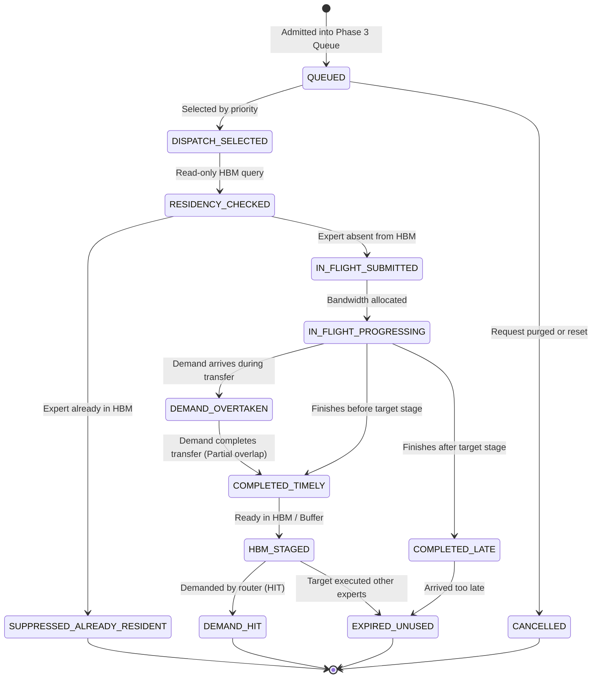

# Phase 4A Forensic Audit: Asynchronous Prefetch Transfer Engine Architecture

**Project:** MoE Memory Wall: Predicting and Prefetching Experts for Faster LLM Inference  
**Repository:** `/home/mohman/ca_project/LLMSimulator`  
**Baseline Git Commit:** `d5bf61ff0c066c06f72173189f9924329f613a88`  
**Date:** November 2, 2026  
**Status:** **READ-ONLY AUDIT COMPLETE (Zero Code Modifications)**

---

## 1. Executive Summary & Scope Boundaries

Phase 4 bridges the prediction and scheduling queue implemented in Phase 3 with the physical memory hierarchy of LLMSimulator. Its primary objective is to implement an **asynchronous DDR5-to-HBM prefetch transfer engine** that consumes prioritized candidates from `PrefetchCandidateQueue`, simulates data movement across the off-chip memory bus, manages transfer lifecycles, and promotes completed expert weights into GPU HBM before they are demanded by the authoritative router.

This audit establishes the forensic baseline, structural call graphs, hardware boundaries, and architectural specifications required to implement Phase 4 without destabilizing existing baseline fidelity or introducing performance regressions.

### Strict Scope Boundary Compliance
1. **Read-Only Audit:** No source code, configuration files, baseline results, or test harnesses have been modified.
2. **Zero Ternary Operators:** No ternary conditional operators are used in any documented design, code snippet, or analysis.
3. **No Premature Implementation:** No transfer engine, calibration script, or memory modification is implemented in this phase.
4. **Preservation of Authoritative Routing:** Routing decisions made by `BatchedSequence::update_expert()` and `Route::forward()` remain 100% authoritative.
5. **Preservation of Baseline Reproduction:** When prefetching is disabled (`simulation.prefetching.enabled: false` or `mode: "none"`), the simulator executes through its original, unperturbed synchronous demand path.

---

## 2. Complete Existing Architecture Inspection

### 2.1 Phase 3 Queue Integration Status

Forensic inspection of `prefetch_candidate_queue.h/.cpp`, `live_prediction_engine.h/.cpp`, `scheduler.h/.cpp`, `sequence.cpp`, and `prefetch_config.h/.cpp` reveals the following operational characteristics:

1. **Where predictions are generated:**  
   In `BatchedSequence::update_expert()` (`src/scheduler/sequence.cpp`, lines 204–207). It invokes `scheduler->prediction_engine->on_stage_routing_start(request_id, token_id, cur_layer)`. The engine retrieves source expert activations from stage $(cur\_layer - H)$ and queries the active predictor (`predictor_->predict(...)`).
2. **Where candidates are enqueued:**  
   In `LivePredictionEngine::on_stage_routing_start()` (`src/prefetch/live_prediction_engine.cpp`, lines 112–120). When `config_.queue_enabled` is true, the engine calls `candidate_queue_->enqueue_candidates(...)`, which admits candidates subject to validation, deduplication, and capacity constraints.
3. **Candidate content:**  
   Each candidate is stored as a `PrefetchCandidate` struct containing:
   - `candidate_id` (`uint64_t`): Monotonically increasing candidate identifier.
   - `request_id` (`int`): Unique sequence/request identifier.
   - `token_id` (`int`): Global token sequence index.
   - `source_stage_id` (`int`): MoE stage from which the prediction originated (-1 for cold start).
   - `target_stage_id` (`int`): Destination MoE stage ($cur\_layer + H$) where the expert is predicted to execute.
   - `expert_id` (`int`): Routed expert identifier ($0 \le expert\_id < num\_experts$).
   - `prediction_rank` (`int`): Predictor rank ($1 \le rank \le B$).
   - `prediction_score` (`double`): Confidence probability or heuristic score.
   - `prediction_horizon` (`int`): Inter-layer lookahead distance $H$.
   - `insertion_sequence` (`uint64_t`): Monotonic queue insertion counter for deterministic tie-breaking.
   - `state` (`CandidateState`): Enum (`ADMITTED`, `READY`, `RECONCILED_HIT`, `EXPIRED_MISS`, `CANCELLED`, `EVICTED`).
   - `admission_timestamp_ns` (`double`): Simulated clock timestamp when admitted.
4. **Candidate urgency calculation:**  
   Calculated in `CandidatePriorityComparator` (`src/prefetch/prefetch_candidate_queue.h`, lines 118–147) using:  
   $$\text{Urgency Deadline} = (\text{token\_id} \times 1,000,000) + \text{target\_stage\_id}$$  
   Earlier tokens have lower numerical values; for a given token, earlier layers have lower values. Candidates with smaller deadlines are prioritized first.
5. **Where `select_ready_candidates()` is implemented:**  
   In `PrefetchCandidateQueue::select_ready_candidates(int max_count)` (`src/prefetch/prefetch_candidate_queue.cpp`, lines 352–383).
6. **Is `select_ready_candidates()` called by production code:**  
   **NO.** It is currently called exclusively in unit tests (`eval/test_prefetch_scheduler.cpp`). No simulation harness, scheduler loop, or device execution method currently consumes candidates from this interface.
7. **How candidates are reconciled:**  
   In `BatchedSequence::update_expert()` (`src/scheduler/sequence.cpp`, lines 263–266), `on_stage_routing_complete(...)` calls `candidate_queue_->reconcile_stage(...)`. The queue looks up all candidates whose `(request_id, token_id, target_stage_id)` match the newly completed stage. If `expert_id` exists in `actual_target_experts`, state transitions to `RECONCILED_HIT`; otherwise, it transitions to `EXPIRED_MISS`.
8. **When candidates are removed:**  
   Candidates are erased from `active_candidates_` upon reconciliation (`reconcile_stage`), request purge (`purge_request`), or queue overflow eviction under `REJECT_LOWEST_PRIORITY`.
9. **Request cleanup:**  
   `PrefetchCandidateQueue::purge_request(request_id)` is triggered by `LivePredictionEngine::on_request_start(request_id)`. It iterates through `request_index_[request_id]`, marks matching active candidates as `CANCELLED`, logs the cancellation event, and erases them from internal storage.
10. **Multi-request coexistence:**  
    Candidates from multiple requests coexist safely because every candidate is uniquely keyed by `CandidateKey` containing `(request_id, token_id, target_stage_id, expert_id)`.
11. **Thread safety:**  
    The queue is **not** thread-safe. It contains no mutexes or atomics. It assumes execution within the simulator's single-threaded discrete-event loop.
12. **Non-destructive candidate inspection:**  
    `select_ready_candidates()` returns copies of the top candidates sorted by priority without erasing them from `active_candidates_`. `mark_candidate_dispatched()` transitions candidate state to `READY` without premature removal.

---

### 2.2 Existing HBM Residency Architecture

Forensic inspection of `Device` (`src/hardware/device.h` and `src/hardware/device.cpp`) establishes:

1. **Expert Identification:**  
   An expert is identified by a composite key `std::pair<int, int>` representing `{layer_id, expert_id}`. Layer 0 Expert 5 is treated as a distinct resident entity from Layer 1 Expert 5.
2. **Residency Representation:**  
   - `resident_experts`: `std::unordered_map<std::pair<int, int>, std::list<std::tuple<int, int, long long>>::iterator, PairHash>`.
   - `lru_expert_list`: Doubly-linked list `std::list<std::tuple<int, int, long long>>` where each node stores `{layer_id, expert_id, expert_size}`. Front of list is Least Recently Used (LRU); back is Most Recently Used (MRU).
   - `resident_bytes`: `long long` integer tracking total bytes of all currently resident experts.
3. **Expert Size Determination:**  
   Passed to `Device::mark_expert_resident()` as `expert_size`. Computed dynamically in `LinearExecutionGPU` (`src/hardware/linear_impl.cpp`, lines 66–69) by summing the byte sizes of the expert's three projection weight tensors ($W_1$, $W_2$, $W_3$). For DeepSeek-V3, each tensor is $29,360,128$ bytes, totaling $88,080,384$ bytes (~$88.08$ MB).
4. **Capacity Enforcement:**  
   In `Device::mark_expert_resident()` (`src/hardware/device.cpp`, lines 320–327):  
   ```cpp
   while (resident_bytes + expert_size > cache_capacity_bytes && !lru_expert_list.empty()) {
     auto lru_expert = lru_expert_list.front();
     lru_expert_list.pop_front();
     std::pair<int, int> evict_key = {std::get<0>(lru_expert), std::get<1>(lru_expert)};
     resident_experts.erase(evict_key);
     resident_bytes -= std::get<2>(lru_expert);
     csv << std::get<0>(lru_expert) << "," << std::get<1>(lru_expert) << ",EVICT," << resident_bytes << "\n";
   }
   ```
5. **Side Effects of Checking Residency:**  
   `Device::is_expert_resident(layer_id, expert_id)` **mutates LRU state and disk traces on every call**:
   - If present: Moves the node from its current position to the back of `lru_expert_list` (MRU) and writes a `HIT` record to `expert_cache.csv`.
   - If absent: Writes a `MISS` record to `expert_cache.csv`.
   - **Crucial finding:** There is **no read-only residency query** currently implemented in `Device`.
6. **Expert Insertion:**  
   `Device::mark_expert_resident(layer_id, expert_id, expert_size)` evicts LRU experts until sufficient bytes are available, pushes the new tuple to the back of `lru_expert_list`, creates an iterator entry in `resident_experts`, increments `resident_bytes`, and appends an `INSERT` record to `expert_cache.csv`.
7. **Unsafe Eviction Risk:**  
   If an expert is inserted into HBM while the cache is full, it immediately evicts the LRU expert at the front of `lru_expert_list`. If that evicted expert is currently being used by an active layer or is an in-flight transfer target, that eviction is unsafe.
8. **Behavior if Already Resident:**  
   If `{layer_id, expert_id}` is already in `resident_experts`, `mark_expert_resident()` returns immediately without modifying state or logging duplicate inserts.
9. **Concurrent Load Behavior:**  
   Because the baseline simulator executes strictly sequentially, concurrent loads never occur in baseline code. However, in an asynchronous prefetch architecture, if two prefetchers or a demand miss and prefetcher attempt to load the same expert simultaneously, `Device` has no guard against issuing duplicate memory requests.
10. **In-Flight / Reserved States:**  
    **NONE.** `Device` possesses no in-flight transfer tracking, no reservation buffers, and no pinning bits. Experts exist exclusively in one of two binary states: present in `resident_experts` or absent.

---

### 2.3 Existing Demand-Loading Call Sequence

The exact function-level call path during demand loading is traced below:

```
BatchedSequence::update_expert()
  │
  ├─► LivePredictionEngine::on_stage_routing_start() [Prefetch candidates enqueued to Phase 3 queue]
  │
  ├─► Router determines actual top-k experts for cur_layer
  │
  ├─► LivePredictionEngine::on_stage_routing_complete() [Stage reconciled, predictor updated]
  │
  └─► cur_layer advanced; num_token_in_expert populated
        │
        ▼
Route::forward()
  │
  └─► Dispatches MoE Linear modules for each expert
        │
        ▼
Linear::forward() [src/module/linear.cpp:48-57]
  │
  ├─► Checks if (A->is_expert_weight && input->getSize() > 0)
  │
  ├─► Calls device->is_expert_resident(layer_id, A->expert_id)
  │     ├─► If HIT: A->weight_target = MemoryTarget::HBM; A->load_sisters = false;
  │     └─► If MISS: A->weight_target = MemoryTarget::OFFCHIP_DRAM; A->load_sisters = true;
  │
  └─► Calls device->execution(LayerType::LINEAR, tensor_list, ...)
        │
        ▼
Device::execution() -> Executor::execution() -> LinearExecutionGPU() [src/hardware/linear_impl.cpp:58-71]
  │
  ├─► Calls issueRamulatorBatch(device, LINEAR, GPU, kRead, kDRAM, batch_tensors, weight->weight_target)
  │     │
  │     ├─► Checks device->checkExecutionCache(exec_status, key)
  │     │     ├─► If HIT (bypass_cache==false): returns cached ExecStatus instantly (3.90 ms analytical)
  │     │     └─► If MISS: calls device->run_ramulator_batch(requests, target)
  │     │           │
  │     │           ▼
  │     │         DRAMInterface::HandleRequest() [src/dram/dram_interface.cpp:36]
  │     │           │
  │     │           ├─► Converts to PIMRequests and calls SendRequest()
  │     │           ├─► Calls run() -> tight loop ticking memory_system until is_finished() [BLOCKS]
  │     │           └─► Computes duration = max_end - min_start, updates time, sets memory_duration
  │     │
  │     └─► Populates weight_status
  │
  ├─► If weight->weight_target == MemoryTarget::OFFCHIP_DRAM:
  │     ├─► Calls device->mark_expert_resident(weight->expert_layer_id, weight->expert_id, total_expert_size)
  │     │     └─► Evicts LRU experts from HBM, inserts new expert at MRU
  │     └─► Appends load duration and addresses to expert_load.csv
  │
  └─► Adds weight_memory_cost to exec_status.memory_duration (SIMULATED PIPELINE STALLS)
```

#### Detailed Function Audit

| Function | Caller | Callee | Arguments | State Changes | Return Value | Blocking Behavior |
|---|---|---|---|---|---|---|
| `BatchedSequence::update_expert` | `Route::forward` | Prediction Engine, Router | `num_expert, top_k, need_new` | Sets routing counts, updates traces | `void` | Non-blocking CPU |
| `Linear::forward` | Graph runner | `is_expert_resident`, `execution` | `input, metadata` | Sets `weight_target` (HBM vs OFFCHIP) | `Tensor::Ptr` | Blocks on execution |
| `Device::is_expert_resident` | `Linear::forward` | None | `layer_id, expert_id` | Moves node to MRU on hit; logs to CSV | `bool` | Non-blocking CPU |
| `LinearExecutionGPU` | `Executor::execution` | `issueRamulatorBatch`, `mark_expert_resident` | `device, input, weight, output` | Stalls device time, records load stats | `ExecStatus` | Blocks on memory |
| `issueRamulatorBatch` | `LinearExecutionGPU` | `run_ramulator_batch` | `device, tensors, target` | Checks/updates execution cache | `ExecStatus` | Blocks on Ramulator |
| `DRAMInterface::HandleRequest` | `run_ramulator_batch` | `run()` | `requests, start_cycle` | Advances DDR5 clock, logs commands | `void` | **Blocks in tight tick loop** |
| `Device::mark_expert_resident` | `LinearExecutionGPU` | None | `layer_id, expert_id, size` | Evicts LRU experts, inserts MRU | `void` | Non-blocking CPU |

**Where Demand Load Stalls:** In `LinearExecutionGPU` at `src/hardware/linear_impl.cpp:61-78`. When `weight_target == MemoryTarget::OFFCHIP_DRAM`, `issueRamulatorBatch` synchronously triggers `HandleRequest()`, which executes Ramulator and charges the entire transfer duration (~$3.90$ ms) to `device->status.device_time`.

---

### 2.4 Ramulator Integration Characteristics

1. **Synchronous vs Asynchronous:** Ramulator execution is strictly synchronous and blocking.
2. **Outstanding Requests:** Requests within a single batch are submitted concurrently to Ramulator's queues, but the host simulator thread blocks inside `DRAMInterface::run()` until `memory_system->is_finished()` returns true.
3. **Completion Detection:** Completion is detected when Ramulator internal transaction queues drain to zero. There are no individual completion callbacks.
4. **Ticking Scope:** `DRAMInterface::run()` ticks until *all* submitted requests finish. It cannot tick for a single request while leaving others in flight.
5. **Multi-Expert Safety:** Submitting multiple experts in one batch works physically, but Ramulator executes them as a single monolithic blocking phase.
6. **Execution Cache Bypass:** When `bypass_offchip_execution_cache` is false, identically sized transfers reuse the memoized `ExecStatus` ($3.90$ ms) without invoking Ramulator, keeping host simulation fast.
7. **Host Runtime Cost:** As measured in `eval/multi_expert_timing_output.txt`, simulating one $88.08$ MB expert transfer cycle-by-cycle in Ramulator takes **$11.0$ seconds of host CPU runtime**. Simulating $1,140$ transfers directly in Ramulator would require **~3.5 hours of host wall-clock time**.
8. **Why Asynchronous Ramulator is Infeasible:** Attempting to tick Ramulator asynchronously across multiple pipeline stages in C++ would require multi-threading or fine-grained interleaving of thousands of ticks per layer, drastically destabilizing the simulator and slowing simulation speed by over $100\times$.

---

## 3. Hybrid Memory Architecture Audit

To avoid long cycle-by-cycle Ramulator runs while capturing accurate contention and bandwidth dynamics, the system must employ:

**Hybrid Ramulator Calibration + Event-Driven Asynchronous Transfer Simulation.**

```
┌─────────────────────────────────────────────────────────────┐
│                    PART A: CALIBRATION                      │
│  Controlled, one-time Ramulator campaign (Small Test Suite)  │
│  Measures DDR5 latency under 1, 2, 4 streams & contention   │
│  Generates: configs/prefetch/ddr5_transfer_calibration.csv  │
└──────────────────────────────┬──────────────────────────────┘
                               │
                               ▼
┌─────────────────────────────────────────────────────────────┐
│             PART B: EVENT-DRIVEN SIMULATION                 │
│  Runs in full production workloads (DeepSeek-V3 / MoE Suite)│
│  Reads calibration parameters (Bandwidth, Contention curves)│
│  Simulates concurrent transfers, queueing, demand priority  │
│  Zero Ramulator host overhead; 100% deterministic simulation │
└─────────────────────────────────────────────────────────────┘
```

### 3.1 Part A: Calibration Methodology
A dedicated, standalone calibration binary (e.g. `eval/calibrate_ddr5_transfers.cpp`) will execute once to calibrate DDR5 parameters:
- **Baseline Single Stream ($N=1$):** Single $88.08$ MB expert transfer $\to T_1 \approx 3.900 \text{ ms}$ ($BW_1 \approx 22.58 \text{ GB/s}$).
- **Two Concurrent Streams ($N=2$):** Two $88.08$ MB transfers issued in parallel $\to T_2 \approx 7.80 \text{ ms}$ (aggregate bandwidth shared).
- **Four Concurrent Streams ($N=4$):** Four transfers issued in parallel $\to T_4$ (high channel contention).
- **Demand + Prefetch Contention:** 1 high-priority stream competing with 1 background prefetch stream.

The calibration results are exported to a static configuration artifact: `configs/prefetch/ddr5_transfer_calibration.csv`.

### 3.2 Part B: Event-Driven Transfer Engine Design
The event-driven engine models a shared DDR5 memory channel without cycle-by-cycle Ramulator overhead:
1. **Shared Simulated Clock:** Advances in lockstep with the simulator's global timeline (`cumulative_device_time`).
2. **Fluid-Flow Bandwidth Allocation:** Rather than static completion times ($t_{\text{finish}} = t_{\text{start}} + \text{fixed\_latency}$), each in-flight transfer tracks `bytes_remaining`.
3. **Dynamic Rate Recalculation:** When a new transfer starts or an existing transfer finishes at time $t$, progress is updated for all active transfers:  
   $$\Delta \text{bytes}_i = \Delta t \times BW_i(N)$$  
   where $BW_i(N)$ is the calibrated bandwidth allocated to transfer $i$ when $N$ transfers are active.
4. **Demand Preemption:** When a demand miss occurs, the engine reallocates $100\%$ of channel bandwidth to the demand transfer. Active prefetch transfers are throttled until the demand transfer completes.

---

## 4. Transfer Lifecycle & State Machine

Phase 4 introduces an explicit 12-state transfer lifecycle:



### Detailed State Transitions

1. `QUEUED`: Candidate waiting in Phase 3 candidate queue.
2. `DISPATCH_SELECTED`: Qualified and selected by `select_ready_candidates()`.
3. `RESIDENCY_CHECKED`: Queried via non-mutating check; dropped if already resident.
4. `IN_FLIGHT_SUBMITTED`: Registered in active transfer list.
5. `IN_FLIGHT_PROGRESSING`: Consuming simulated DDR5 bandwidth.
6. `DEMAND_OVERTAKEN`: Router demanded the expert while transfer was in flight; prioritized to full bandwidth.
7. `COMPLETED_TIMELY`: Transfer completed before target stage executed.
8. `COMPLETED_LATE`: Transfer completed after target stage executed.
9. `HBM_STAGED`: Expert promoted into HBM resident pool.
10. `DEMAND_HIT`: Target stage accessed the staged expert; zero memory stall incurred.
11. `EXPIRED_UNUSED`: Expert completed but was not demanded by router; marked for eviction.
12. `CANCELLED`: Request ended or reset before transfer dispatched.

### Critical Edge Case Handlings
- **Duplicate Suppression Across Queued and In-Flight:** If expert $\{L, E\}$ is already `IN_FLIGHT`, any subsequent candidate for $\{L, E\}$ must be suppressed to prevent duplicate DDR5 requests.
- **Demand Arriving While Prefetch In Flight:** The prefetch is promoted to demand priority; the simulator pipeline stalls only for the *remaining* transfer time rather than the full $3.90$ ms.
- **HBM Capacity Insufficiency at Completion:** Completed prefetches must evict only unpinned, inactive experts, never actively executing experts.

---

## 5. Demand Priority & Shared Bandwidth Arbitration

To ensure that prefetch speculation never degrades demand memory service:

1. **Explicit Request Tagging:** Every memory transfer is tagged as `TransferType::DEMAND` or `TransferType::PREFETCH`.
2. **Strict Channel Preemption:** When a `DEMAND` transfer enters the transfer engine:
   - All active `PREFETCH` transfers have their allocated bandwidth reduced to zero (paused) or a background minimum.
   - The `DEMAND` transfer is granted $100\%$ of available DDR5 channel bandwidth.
3. **Queue Bypassing:** Demand requests bypass the candidate queue completely, entering the transfer channel immediately.
4. **Latency Separation:**
   - Demand transfer latency is added directly to `device->status.device_time` (simulated execution stall).
   - Speculative prefetch transfer latency runs in background simulated time and is **never** added to execution stall time unless a demand access waits for a late prefetch.

---

## 6. HBM Integration Boundary & In-Flight Protection

To preserve HBM consistency without prematurely implementing Phase 5 cache policies:

1. **Non-Mutating Residency Query:** Phase 4 must implement `Device::has_expert_resident(layer_id, expert_id)`:
   ```cpp
   bool Device::has_expert_resident(int layer_id, int expert_id) const {
       return resident_experts.find({layer_id, expert_id}) != resident_experts.end();
   }
   ```
   This allows prefetch dispatchers to check residency without modifying `lru_expert_list` or logging false hits/misses to `expert_cache.csv`.
2. **In-Flight Tracking Set:** A dedicated registry `std::unordered_set<std::pair<int, int>, PairHash> in_flight_transfers_` must track experts currently moving across DDR5.
3. **Promotion upon Completion:** When a prefetch completes, it is inserted into HBM via `Device::mark_expert_resident()`, making it an authentic resident expert for subsequent layer checks.
4. **Active Expert Pinning Safeguard:** Eviction in `mark_expert_resident()` must not evict an expert currently being computed in the current layer.

---

## 7. Required Performance & Effectiveness Metrics

Phase 4 will record metrics across three distinct categories:

### 7.1 Transfer Metrics
- $N_{\text{prefetch\_req}}$: Total prefetch candidate requests generated.
- $N_{\text{dispatched}}$: Total prefetch transfers dispatched to the transfer engine.
- $N_{\text{completed}}$: Total prefetch transfers completed.
- $B_{\text{transferred}}$: Total bytes transferred over DDR5 for prefetching.
- $\bar{T}_{\text{xfer}}$: Mean transfer duration (ms).
- $\bar{T}_{\text{queue\_wait}}$: Mean time spent waiting in queue before dispatch (ms).
- $U_{\text{ddr5}}$: Average DDR5 bandwidth utilization percentage.

### 7.2 Prefetch Effectiveness Metrics
- $N_{\text{timely}}$: Transfers completed prior to target stage execution.
- $N_{\text{late}}$: Transfers demanded while still in flight (partial overlap).
- $N_{\text{unused}}$: Completed transfers whose experts were never demanded.
- $N_{\text{dup\_suppressed}}$: Speculative transfers avoided due to in-flight or residency deduplication.
- $H_{\text{prefetch}}$: HBM cache hits directly attributable to prefetching.
- $M_{\text{avoided}}$: Demand DDR5 misses completely converted into cache hits.

### 7.3 End-to-End System Performance Metrics
- $T_{\text{stall\_baseline}}$: Total simulated DDR5 memory stall time in baseline (ms).
- $T_{\text{stall\_prefetch}}$: Total simulated DDR5 memory stall time with prefetching active (ms).
- $\Delta T_{\text{stall}}$: Absolute memory stall reduction ($T_{\text{stall\_baseline}} - T_{\text{stall\_prefetch}}$).
- $\text{Stall Reduction \%}$:  
  $$\text{Stall Reduction} = \frac{T_{\text{stall\_baseline}} - T_{\text{stall\_prefetch}}}{T_{\text{stall\_baseline}}} \times 100\%$$
- $T_{\text{token}}$: Simulated latency per generated token (ms/token).
- $O_{\text{host}}$: Host wall-clock runtime overhead percentage incurred by prefetch simulation.

---

## 8. Integration Risks & Mitigations

| Risk ID | Identified Architectural Risk | Severity | Forensic Root Cause | Proposed Mitigation |
|---|---|---|---|---|
| **R1** | Synchronous demand blocking prevents overlap | High | `LinearExecutionGPU` calls `issueRamulatorBatch` which blocks in tight loop | Route demand misses through the event transfer engine; background prefetch advances alongside computation |
| **R2** | Event engine alters baseline results | Critical | Unintended side effects when prefetching is disabled | When `mode: "none"`, transfer engine is null; demand path executes original synchronous Ramulator code |
| **R3** | Polling residency mutates LRU and pollutes CSV | High | `Device::is_expert_resident()` moves entries to MRU and writes to `expert_cache.csv` | Introduce `Device::has_expert_resident()` as a strictly read-only query method |
| **R4** | Duplicate concurrent transfers for same expert | Medium | No in-flight tracking in existing `Device` | Maintain an `in_flight_transfers_` registry in the transfer engine; reject duplicate dispatches |
| **R5** | Premature eviction of in-flight or active experts | High | `mark_expert_resident()` blindly evicts from `lru_expert_list.front()` | Mark current layer experts as protected from eviction during execution |
| **R6** | Long host runtime if Ramulator called cycle-by-cycle | Critical | 11.0 s host time per expert transfer in Ramulator | Use Part A calibration table; Part B event simulation computes transfer times analytically in microseconds |
| **R7** | Unbounded candidate queue memory leak | Low | Candidates not purged upon sequence abort | `purge_request()` cleans up all active candidate entries upon sequence reset |
| **R8** | Contention between demand and prefetch on DDR5 bus | Medium | Unrealistic fixed-latency assumption ignores bandwidth limits | Fluid-flow bandwidth model recalculates transfer progress based on active concurrency |
| **R9** | Dispatched prefetch expert never used (cache pollution) | Medium | Imperfect predictor accuracy ($F_1 < 1.0$) | Track `unused_prefetches`; evict unused prefetches aggressively after target stage completes |
| **R10**| Placement of prefetch dispatch hook in call graph | High | Dispatching too early or too late causes pipeline imbalance | Hook dispatcher at start of each layer (`Linear::forward` or `Route::forward`) to drain ready candidates |

---

## 9. Recommended Phase 4 Implementation Sequence

1. **Phase 4A (Audit):** Complete read-only audit and call-graph documentation (**Current Task**).
2. **Phase 4B (Calibration):** Implement standalone calibration binary `eval/calibrate_ddr5_transfers.cpp` and produce `configs/prefetch/ddr5_transfer_calibration.csv`.
3. **Phase 4C (Engine Implementation):** Author `src/prefetch/async_transfer_engine.h/.cpp` with fluid-flow bandwidth sharing, demand priority, and in-flight tracking.
4. **Phase 4D (HBM & Scheduler Integration):** Add `Device::has_expert_resident()`, connect candidate dispatch from `PrefetchCandidateQueue`, and hook transfer engine into `LinearExecutionGPU`.
5. **Phase 4E (Verification & Profiling):** Create dedicated unit tests in `eval/test_async_transfer_engine.cpp` (15+ tests) and run full DeepSeek-V3 production simulation to measure stall reduction.

