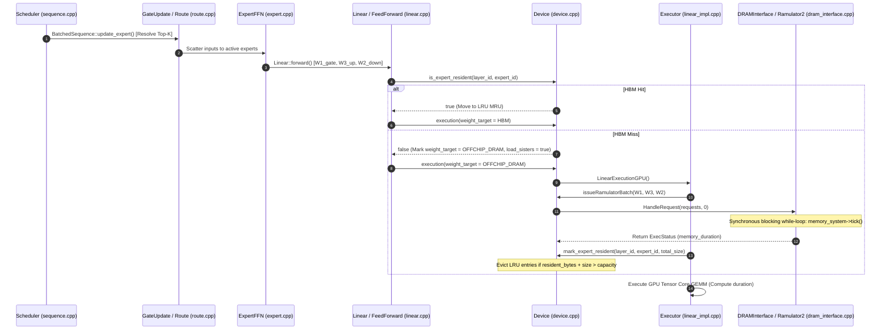

# Phase 0: Read-Only Prefetch Integration Architecture Audit

**Project:** MoE Memory Wall: Predicting and Prefetching Experts for Faster LLM Inference  
**Repository:** `/home/mohman/ca_project/LLMSimulator`  
**Baseline Git Commit:** `d5bf61ff0c066c06f72173189f9924329f613a88`  
**Audit Scope:** Comprehensive Forensic Inspection of Simulator Memory Subsystem, Scheduling Loops, Ramulator2 Integration, and Offline Predictors  
**Audit Mode:** Strictly READ-ONLY (Zero modifications to source code, YAML configurations, build scripts, or datasets)  
**Deliverable File:** `docs/phase_prefetch/PREFETCH_INTEGRATION_ARCHITECTURE_AUDIT.md`  
**Companion File Map:** `docs/phase_prefetch/PREFETCH_INTEGRATION_FILE_MAP.csv`  

---

## 1. Executive Summary

This document presents a comprehensive, read-only architectural audit of the LLMSimulator C++ simulation engine and its companion Python prediction infrastructure. The primary goal is to establish the exact technical requirements, structural interfaces, and operational boundaries necessary to integrate training-free expert predictors (**ST-MoE**, **CSTP**, and **ACSH** variants) and an asynchronous **DDR5-to-HBM prefetching engine** into the simulator.

### Core Audit Discoveries
1. **Demand-Loading Memory Stall Dominance:** In the current baseline, all expert loads are strictly synchronous and demand-driven. Memory stalls account for **97.02% to 99.15%** of end-to-end execution latency. The compute engine is completely idle while waiting for DDR5 transfers.
2. **Synchronous, Blocking Ramulator2 Interface:** The memory subsystem interface (`DRAMInterface::HandleRequest`) executes Ramulator2 cycles via a blocking while-loop (`DRAMInterface::run()`) until the memory system completely drains (`memory_system->is_finished()`). There is currently **zero asynchronous overlap** between DDR5 transfers and GPU compute kernels.
3. **Binary, Unprotected HBM Cache:** The on-device HBM cache (`Device::resident_experts`) maintains only a binary state: an expert is either `RESIDENT` (in LRU list) or `ABSENT`. There is no `IN_FLIGHT` state (leading to potential redundant demand loads during pending prefetches) and no `RESERVED` or pinned state (risking cache eviction of actively computing experts).
4. **Analytical Cache Bypass Requirement:** By default, LLMSimulator memoizes memory latencies in an `execution_time_cache` keyed only by `(LayerType, ProcessorType, DRAMRequestType, size, MemoryTarget)`. For cycle-accurate prefetch queueing and bus contention modeling, `bypass_offchip_execution_cache = true` must be enforced.
5. **Streaming-Ready Predictor Algorithms:** The existing Python predictor implementations (`CSTPPredictor`, `STMoEPaperPredictor`, `ACSHPredictor`) already adhere to an online, causal interface (`reset`, `predict`, `update`). They process one routing event at a time without requiring future routing information.

---

## 2. Repository and Existing Modification Audit

### 2.1 Git Status and Commit State
- **Authoritative Baseline Commit:** `d5bf61ff0c066c06f72173189f9924329f613a88` ("Finalize LLMSimulator: Add Group 13 master reference documentation and code changes guide, clean up intermediate manifests and experimental runs").
- **Working Tree Difference:** The working tree contains modifications across **9 tracked files** and several untracked research directories. These modifications represent the infrastructure established during Phase E1-B (Real MoE Trace Replay) and Task 8 (Cache Bypass Instrumentation).

### 2.2 Tracked File Modifications
The 9 modified tracked files and their exact responsibilities are:
1. `config.yaml`: Added `bypass_offchip_execution_cache: false` under `system.optimization`.
2. `eval/CMakeLists.txt`: Added build target for `test_configurable_execution_cache`.
3. `eval/test.cpp`: Added parsing for `bypass_offchip_execution_cache` and environment override invocation.
4. `eval/test_deepseekv3_mixtral_style.cpp`:
   - Added CLI flags `--trace-file` and `--warm-hbm`.
   - Ingested `simulation.trace_file` and `simulation.warm_hbm_preload` from YAML.
   - Connected `scheduler->loadRealTrace()` to populate `expert_list`.
   - Implemented warm HBM preloading logic and offchip cache bypass configuration.
5. `src/hardware/hardware_config.h`:
   - Added `bypass_offchip_execution_cache` boolean member to `SystemConfig`.
   - Implemented `apply_environment_overrides()` to read `BYPASS_OFFCHIP_EXECUTION_CACHE` from shell environment.
6. `src/hardware/layer_impl.cpp`:
   - Enforced cache bypass in `issueRamulator` and `issueRamulatorBatch` when `device->config.bypass_offchip_execution_cache` is true.
   - Added architectural documentation comments on `CacheKey` limitations.
7. `src/scheduler/scheduler.h`: Declared `void loadRealTrace(...)` in `Scheduler` class.
8. `src/scheduler/scheduler.cpp`: Implemented `Scheduler::loadRealTrace` for parsing CSV routing traces, validating token counts, layer depth, and Top-K completeness with zero random fallback.
9. `src/scheduler/sequence.cpp`:
   - Fixed MoE layer count calculation for DeepSeek architectures (`num_layers - first_k_dense`).
   - Implemented relative token decoding offset:
     $$\text{rel\_token\_id} = \text{token\_id} - \text{seq}\to\text{input\_len}$$
     Indexing: $\text{table\_idx} = \text{rel\_token\_id} \times \text{num\_layer} + \text{cur\_layer}$.
   - Added safety bounds checks and per-expert demand logging to `routing_file`.

### 2.3 Untracked Files Relevant to Prefetching
- `src/predictor/`:
  - `base_predictor.py`: Abstract base class and standardized wrappers.
  - `st_moe_paper.py`: Faithful implementation of Zhao et al. (ST-MoE) with 2-bit saturating counters.
  - `st_moe_predictor.py`: Legacy baseline ST-MoE implementation.
  - `cstp_predictor.py`: Confidence- and Frequency-Aware Spatio-Temporal Predictor.
  - `acsh_predictor.py`: Adaptive Confidence and Statistical Hybrid Predictor (Global, Stage-Aware, Fast-Recovery).
  - `evaluation.py`: Causal evaluation harness, split logic, and metric aggregators.
  - `trace_parser.py`: Multi-format routing trace parser and architecture configurations.
  - `adapters/`: Trace adapters for MoE Suite, MoE Anywhere, and Synthetic generators.
- `scripts/`:
  - `eval_predictors_offline.py`: Offline evaluation across budgets $B \in \{1, 2, 4, 8, 16, 32\}$.
  - `benchmark_predictor_latency.py`: Micro-benchmarking of predictor compute overhead.
  - `generate_predictor_structure_visualizations.py`: Transition matrix and CCT heatmap generator.
  - `phase_e/export_trace_for_simulator.py`: Trace extraction from Parquet to CSV.
- `docs/phase_e/`: Complete documentation of previous baselines and numerical reconciliation.

---

## 3. Actual Expert-Demand Execution Path

The end-to-end execution path of an expert demand was traced through the simulator codebase.



### Detailed Execution Call Graph
1. **Routing Resolution:**
   - **File:** [`src/scheduler/sequence.cpp:153`](file:///home/mohman/ca_project/LLMSimulator/src/scheduler/sequence.cpp#L153) (`BatchedSequence::update_expert`)
   - **Inputs:** `num_expert`, `top_k`, `need_new_expert`.
   - **Behavior:** If `seq->get_expert_from_list == true`, extracts recorded Top-K expert IDs from `scheduler->sequences_info[seq_id]->expert_list[table_idx]`. If false, invokes `scheduler->getRandomExpert` (PRNG seed 777). Updates `num_token_in_expert` frequency map.
2. **Expert Submodule Invocation:**
   - **File:** [`src/module/expert.cpp:164`](file:///home/mohman/ca_project/LLMSimulator/src/module/expert.cpp#L164) (`ExpertFFN::forward`)
   - **Behavior:** Executes `gate_fn`, triggers `gate_update->aggregate_expert` (which calls `update_expert`), performs `moe_scatter`, and invokes `FeedForward3Way::forward` for each active expert.
3. **Residency Check and Target Selection:**
   - **File:** [`src/module/linear.cpp:48-61`](file:///home/mohman/ca_project/LLMSimulator/src/module/linear.cpp#L48-L61) (`Linear::forward`)
   - **Check:**
     ```cpp
     if (A->is_expert_weight && input->getSize() > 0) {
       int layer_id = sequences_metadata->cur_layer;
       A->expert_layer_id = layer_id;
       if (!device->config.offchip_dram_cfg_path.empty()) {
         if (!device->is_expert_resident(layer_id, A->expert_id)) {
           A->weight_target = MemoryTarget::OFFCHIP_DRAM;
           A->load_sisters = true;
         }
       }
     }
     ```
   - **HBM Hit:** `weight_target` remains `MemoryTarget::HBM`.
   - **HBM Miss:** `weight_target` set to `MemoryTarget::OFFCHIP_DRAM`, and `load_sisters` set to `true` (indicating W1, W2, W3 must be loaded together).
4. **Execution Dispatch:**
   - **File:** [`src/hardware/device.cpp:187`](file:///home/mohman/ca_project/LLMSimulator/src/hardware/device.cpp#L187) (`Device::execution`) $\to$ [`src/hardware/executor.cpp:202`](file:///home/mohman/ca_project/LLMSimulator/src/hardware/executor.cpp#L202) $\to$ [`src/hardware/linear_impl.cpp:20`](file:///home/mohman/ca_project/LLMSimulator/src/hardware/linear_impl.cpp#L20) (`LinearExecutionGPU`).
5. **Memory Request Generation and Blocking Wait:**
   - **File:** [`src/hardware/linear_impl.cpp:52-70`](file:///home/mohman/ca_project/LLMSimulator/src/hardware/linear_impl.cpp#L52-L70)
   - Groups sister tensors (`weight`, `W3_up`, `W2_down`) into `batch_tensors`.
   - Calls [`src/hardware/layer_impl.cpp:52`](file:///home/mohman/ca_project/LLMSimulator/src/hardware/layer_impl.cpp#L52) (`issueRamulatorBatch`).
   - Dispatches to `Device::run_ramulator_batch` $\to$ [`src/dram/dram_interface.cpp:33`](file:///home/mohman/ca_project/LLMSimulator/src/dram/dram_interface.cpp#L33) (`DRAMInterface::HandleRequest`).
   - **Blocking Point:** In `DRAMInterface::run()`, the CPU thread loops inside `memory_system->tick()` until `memory_system->is_finished()` returns true.
6. **Residency Update:**
   - Upon return from `issueRamulatorBatch`, [`src/hardware/linear_impl.cpp:73`](file:///home/mohman/ca_project/LLMSimulator/src/hardware/linear_impl.cpp#L73) executes:
     ```cpp
     device->mark_expert_resident(weight->expert_layer_id, weight->expert_id, total_expert_size);
     ```
7. **Compute Execution:**
   - Only after DDR5 transfer completion does `LinearExecutionGPU` proceed to record compute latency (`compute_duration = total_flops / compute_peak_flops`).

### Answers to Mandatory Architectural Questions
1. **Where does the simulator obtain Top-K expert IDs?** In `BatchedSequence::update_expert()` ([`sequence.cpp:193`](file:///home/mohman/ca_project/LLMSimulator/src/scheduler/sequence.cpp#L193)), either by reading `sequences_info[seq_id]->expert_list` (real trace) or by querying `scheduler->getRandomExpert()` (synthetic).
2. **Where is each expert demand created?** In `Linear::forward()` ([`linear.cpp:55`](file:///home/mohman/ca_project/LLMSimulator/src/module/linear.cpp#L55)) when `A->is_expert_weight` is evaluated for an active input tensor.
3. **Where is HBM checked?** In `Linear::forward()` ([`linear.cpp:54`](file:///home/mohman/ca_project/LLMSimulator/src/module/linear.cpp#L54)) via `device->is_expert_resident(layer_id, A->expert_id)`.
4. **What happens on an HBM hit?** `is_expert_resident` moves the expert node to the MRU position (back of `lru_expert_list`), logs `HIT` to `expert_cache.csv`, and leaves `weight_target = MemoryTarget::HBM`. No DDR5 requests are generated.
5. **What happens on an HBM miss?** `is_expert_resident` logs `MISS`, sets `weight_target = MemoryTarget::OFFCHIP_DRAM`, and sets `load_sisters = true`.
6. **Where is expert weight size determined?** In `LinearExecutionGPU()` ([`linear_impl.cpp:74`](file:///home/mohman/ca_project/LLMSimulator/src/hardware/linear_impl.cpp#L74)) by summing `tensor->getSize()` across all sister weights (W1, W2, W3), yielding 88,080,384 bytes (~88 MB) for Mixtral/DeepSeek sub-matrices.
7. **Where are W1, W2, and W3 loaded?** In `LinearExecutionGPU()` ([`linear_impl.cpp:58`](file:///home/mohman/ca_project/LLMSimulator/src/hardware/linear_impl.cpp#L58)), where `sister_weights` are packed into `batch_tensors` and dispatched via a single `issueRamulatorBatch` call.
8. **When is the expert considered resident?** At [`linear_impl.cpp:78`](file:///home/mohman/ca_project/LLMSimulator/src/hardware/linear_impl.cpp#L78), immediately after `issueRamulatorBatch` completes and `device->mark_expert_resident(...)` is executed.
9. **When does the corresponding computation begin?** Computation duration is accounted for in `LinearExecutionGPU()`, logically executing after the transfer completes.
10. **Where does execution block while waiting for DDR5?** Inside [`src/dram/dram_interface.cpp:111`](file:///home/mohman/ca_project/LLMSimulator/src/dram/dram_interface.cpp#L111) (`DRAMInterface::run()`) during the synchronous `while (!memory_system->is_finished())` loop.

---

## 4. HBM Cache Architecture Audit

### 4.1 Data Structures and Implementation
- **Location:** [`src/hardware/device.h:116-133`](file:///home/mohman/ca_project/LLMSimulator/src/hardware/device.h#L116-L133) and [`src/hardware/device.cpp:273-333`](file:///home/mohman/ca_project/LLMSimulator/src/hardware/device.cpp#L273-L333).
- **Core State Objects:**
  ```cpp
  std::list<std::tuple<int, int, long long>> lru_expert_list; // (layer_id, expert_id, size)
  std::unordered_map<std::pair<int, int>, 
                     std::list<std::tuple<int, int, long long>>::iterator, 
                     PairHash> resident_experts;
  long long cache_capacity_bytes = 80000000000LL; // 80 GB nominal (~74.48 GiB)
  long long resident_bytes = 0;
  ```

### 4.2 Architectural Questions Analysis
1. **Centralized vs. Per-Layer Management:** **Centralized**. A single `resident_experts` hash table and a single `lru_expert_list` in `Device` manage all resident experts across all MoE layers.
2. **Tracking Granularity:** **Expert granularity**. Cache entries are keyed by `std::pair<int, int>` representing `(layer_id, expert_id)`. Individual weight matrices (W1, W2, W3) are not tracked independently in the residency table.
3. **Concurrent Sharing:** **Yes**. If two concurrent requests in a batch require `(layer_id, expert_id)`, the first hit moves it to MRU, and the second request hits immediately.
4. **Duplicate Expert Loads:** Under current synchronous execution, duplicates cannot occur because transfers block until resident. **However, under asynchronous prefetching, duplicate loads WILL occur** unless an `IN_FLIGHT` state is introduced to intercept demand misses while a prefetch is pending.
5. **In-Flight Loading State:** **Does not exist**. Currently strictly binary (resident vs absent).
6. **Eviction During Active Compute:** **Possible**. There is currently no reference counting, pin counter, or lock on resident experts. An eviction triggered by an aggressive prefetch could evict an expert currently being processed by GPU GEMM cores.
7. **Reserved HBM Capacity:** **Does not exist**. All 74.48 GB is dynamically claimed by the LRU pool.
8. **Handling Capacity Overflow:** Greedily pops entries from the front of `lru_expert_list` (least recently used) in a `while` loop until `resident_bytes + expert_size <= cache_capacity_bytes`.

### 4.3 Proposed Expert State Machine
To support prefetching safely, the binary state must be replaced by a 4-state lifecycle:

```text
       +-----------------------+
       |        ABSENT         |
       +-----------------------+
         |                   |
Prefetch |            Demand | Miss
Request  |                   |
         v                   v
   +-----------+       +-----------+
   | IN_FLIGHT |       | IN_FLIGHT | (Demand Priority)
   +-----------+       +-----------+
         |                   |
Transfer | Complete          | Transfer Complete
         v                   v
   +-----------+       +-----------+
   | RESIDENT  | <---> | RESERVED  | (Pinned during execution)
   +-----------+       +-----------+
         |                   ^
         | Eviction          | Release Pin
         v                   |
   +-----------+             |
   |  ABSENT   |-------------+
   +-----------+
```

- **ABSENT:** Expert resides only in host DDR5.
- **IN_FLIGHT:** Transfer issued across DDR5 bus; arrival pending. Demands for this expert must attach to the pending transfer rather than issuing a duplicate.
- **RESIDENT:** Present in HBM; eligible for LRU eviction if not pinned.
- **RESERVED (PINNED):** Present in HBM and actively locked by current layer compute or high-confidence prefetch buffer; **immune to LRU eviction**.

---

## 5. DDR5 and Ramulator Execution Audit

### 5.1 Analysis of Memory Subsystem and Ramulator Integration
1. **Request Issuance Point:** In `issueRamulatorBatch()` ([`layer_impl.cpp:92`](file:///home/mohman/ca_project/LLMSimulator/src/hardware/layer_impl.cpp#L92)), creating `DRAMRequest` objects mapped through `offchip_mmap_controller`.
2. **Ramulator Object Lifetime:** `memory_system` is instantiated in `DRAMInterface::DRAMInterface()` ([`dram_interface.cpp:16`](file:///home/mohman/ca_project/LLMSimulator/src/dram/dram_interface.cpp#L16)) and persists for the entire duration of the simulation run.
3. **Memory Timeline Persistence:** While the `memory_system` object is persistent, `HandleRequest()` calls `resetCounter()` on every invocation and passes `start_time_cycle = 0`. Ramulator ticks until all internal queues are empty (`memory_system->is_finished() == true`). Thus, **no timeline continuity is maintained across separate layer invocations**.
4. **Multiple Outstanding Requests:** Supported **only within a single batch** (e.g. W1, W2, W3 of one expert). Not supported across time or between prefetch and demand streams.
5. **Non-Blocking Issuance:** **Not supported**. There is no non-blocking enqueue API in `DRAMInterface`.
6. **Concurrent GPU Compute and DDR5 Progress:** **Impossible in current architecture**. Execution is single-threaded; the CPU thread ticks Ramulator synchronously, blocking all simulator progression.
7. **Completion Detection:** Detected solely by `memory_system->is_finished()` inside a synchronous loop.
8. **Request-to-Expert Association:** None inside Ramulator. Requests are raw physical/logical memory addresses.
9. **Contention Modeling:** Ramulator2 faithfully models DDR5 bank, row, and channel conflicts, but because requests are issued in isolated batches, **inter-expert and prefetch-vs-demand contention is never evaluated**.
10. **Execution Cache Memoization:** In `issueRamulatorBatch()`, `CacheKey` memoizes execution time based solely on `(LayerType, ProcessorType, DRAMRequestType, total_size, MemoryTarget)`.
11. **Contention Preservation in Cache:** **Memoized timing completely destroys dynamic contention**. Two transfers of identical size return identical durations regardless of DDR5 bus congestion.

### 5.2 The Biggest Obstacle to True Asynchronous Prefetching
The central obstacle is the **synchronous blocking execution model of `DRAMInterface`**:
In the current code:
```cpp
// src/dram/dram_interface.cpp:111
void DRAMInterface::run() {
  for (uint64_t i = 0;; i++) {
    memory_system->tick();
    if (memory_system->is_finished()) {
      break;
    }
  }
}
```
To achieve **True Asynchronous Prefetching**, the simulator must decouple:
1. **Issuing a transfer:** Enqueueing requests into Ramulator without ticking to completion.
2. **Advancing simulation time:** Ticking Ramulator concurrently as simulated GPU compute cycles elapse.
3. **Checking completion:** Polling whether a specific transfer's end cycle has been reached at the current simulation timestamp.

---

## 6. Predictor Implementation Inventory

All candidate predictors have been implemented and benchmarked in Python under `src/predictor/`:

| Predictor | Source File | Core Class / Method | Input Format | Output Format | Internal State | Streaming Ready? | Future Leakage Risk? |
|:---|:---|:---|:---|:---|:---|:---:|:---:|
| **ST-MoE (Paper)** | `st_moe_paper.py` | `STMoEPaperPredictor` | `req_id, target_stage, source_experts, budget` | `List[int]` (top-$B$ experts) | Cross-Layer Correlation Table (CCT, 2-bit counters); History Table (HT) | Yes (1 event at a time) | None (Strictly causal) |
| **ST-MoE (Legacy)** | `st_moe_predictor.py` | `STMoEPredictor` | `req_id, target_stage, source_experts, budget` | `List[int]` | Legacy frequency map | Yes | None |
| **CSTP** | `cstp_predictor.py` | `CSTPPredictor` | `req_id, target_stage, source_experts, budget` | `List[int]` | Dirichlet transition counts ($L \to L+H$); marginal priors; temporal counts | Yes | None |
| **ACSH Global** | `acsh_predictor.py` | `ACSHPredictor(variant="global")` | `req_id, target_stage, source_experts, budget` | `List[int]` | Global causal reliability tracker ($\beta=0.8$ EMA) | Yes | None |
| **ACSH Stage-Aware**| `acsh_predictor.py` | `ACSHPredictor(variant="stage_aware")` | `req_id, target_stage, source_experts, budget` | `List[int]` | Per-stage EMA reliability vector | Yes | None |
| **ACSH Fast-Recovery**| `acsh_predictor.py`| `ACSHPredictor(variant="fast_recovery")`| `req_id, target_stage, source_experts, budget` | `List[int]` | Shift detector window + fast adaptation rate | Yes | None |
| **Frequency Baseline**| `base_predictor.py` | `FrequencyPredictor` | `req_id, target_stage, budget` | `List[int]` | Cumulative access counts | Yes | None |
| **Oracle** | `base_predictor.py` | `OraclePredictor` | Target ground-truth trace | `List[int]` | Ground truth vector | No (Upper bound only) | **100% Future Knowledge** |

### Data Split and Future Information Verification
- In `EvaluationHarness::split_by_request()`, requests are strictly partitioned into train and test sets.
- In `EvaluationHarness::evaluate_predictor()`, `runner.predict()` is called **before** `runner.update()`. The predictor never observes the current layer's routing decisions prior to issuing its prediction.

---

## 7. Prediction Timing and Information Availability

A rigorous prefetching engine must respect the causality of information arrival:

```text
Token t-1                          Token t (Current)                           Token t+1
[Layer 0] ... [Layer L-1] ===> [Layer L: Executing] ===> [Layer L+H: Target] ===> [Layer 0]
      |                               |                           |
      | Observed History              | Current Source            | Prefetch Target
      v                               v                           v
+-----------------------------------------------------------------------------------+
| Permitted Predictor Inputs:                                                       |
| 1. Observed routing from all completed tokens (< t)                                |
| 2. Observed routing from preceding layers of current token (< L)                  |
| 3. Current active experts at Layer L (source_experts)                             |
|                                                                                   |
| FORBIDDEN Inputs (Ground Truth Only):                                             |
| 1. Actual routing of Layer L+H for Token t (Ground Truth)                         |
| 2. Actual routing of Token t+1 (Future Tokens)                                    |
+-----------------------------------------------------------------------------------+
```

### Distinction Between Horizons
1. **Intra-Token Inter-Layer ($H \in \{1, 2, 3, 4\}$):**
   - Source: Layer $L$ of Token $t$.
   - Target: Layer $L + H$ of Token $t$.
   - Information timing: Immediately after Layer $L$'s gate resolves.
2. **Inter-Token Temporal ($H_{\text{tok}} \ge 1$):**
   - Source: Layer $L$ of Token $t-1$.
   - Target: Layer $L$ of Token $t$.
   - Information timing: At the boundary between Token $t-1$ and Token $t$.

---

## 8. Proposed Modular Prefetch Architecture

We propose decoupling the prefetching engine into 7 modular, independent subsystems:

```mermaid
flowchart TD
    subgraph ConfigTier ["1. Configuration & Registry"]
        YAML[YAML Parser] --> PrefetchCfg[PrefetchConfig]
        PrefetchCfg --> Reg[PredictorRegistry]
    end

    subgraph PredictorTier ["2. Prediction Engine"]
        Reg --> IPred[IPredictor Interface]
        IPred --> STMoE[ST-MoE C++]
        IPred --> CSTP[CSTP C++]
        IPred --> ACSH[ACSH C++]
        IPred --> Oracle[Oracle Engine]
    end

    subgraph SelectionTier ["3. Candidate Selection & Scheduling"]
        IPred --> CandSel[CandidateSelector (Top-B, Confidence Filter)]
        CandSel --> Sched[PrefetchScheduler (Horizon Lookahead, Demand Priority)]
    end

    subgraph MemoryTier ["4. Memory & Hardware Management"]
        Sched --> HBMMan[HBM Residency Manager (4-State Lifecycle, Pinning)]
        Sched --> AsyncEng[AsyncTransferEngine (DDR5-to-HBM Pipeline)]
        AsyncEng --> Ram2[Ramulator2 Timeline Controller]
    end

    subgraph TelemetryTier ["5. Metrics & Instrumentation"]
        AsyncEng --> MetricEng[Prefetch Telemetry (Timeliness, Traffic, Over-fetch)]
    end
```

### Proposed YAML Schema
```yaml
simulation:
  prefetching:
    enabled: true                     # Global prefetch activation toggle
    mode: "hardware_async"            # ["none", "prediction_only", "hardware_sync", "hardware_async"]

    predictor:
      type: "cstp"                    # ["none", "st_moe", "cstp", "acsh_stage_aware", "frequency", "oracle"]
      alpha: 0.5                      # CSTP spatial/temporal balance
      smoothing_lambda: 1.0           # Dirichlet smoothing parameter
      confidence_threshold: 2         # ST-MoE counter threshold

    candidate_selection:
      policy: "top_k"                 # ["top_k", "threshold_filtered", "adaptive"]
      budget: 4                       # Maximum prefetch candidates per stage (B)

    scheduling:
      prediction_horizon: 2           # Inter-layer lookahead horizon (H)
      lookahead_tokens: 0             # Inter-token lookahead (0 = intra-token)
      demand_priority: true           # Demand misses preempt prefetch queue

    transfer:
      asynchronous: true              # True asynchronous Ramulator overlap
      max_outstanding_transfers: 4    # Maximum concurrent DDR5 in-flight streams
      bypass_execution_cache: true    # Force cycle-accurate Ramulator simulation

    hbm:
      eviction_policy: "lru_pinned"   # ["lru", "lru_pinned", "frequency_guided"]
      reserved_prefetch_bytes: 8589934592 # 8 GB reserved prefetch buffer
```

---

## 9. Exact Integration Points in C++ Engine

| Subsystem Hook | File & Exact Line | Action / Logic |
|:---|:---|:---|
| **Config Ingestion** | [`eval/test_deepseekv3_mixtral_style.cpp:175`](file:///home/mohman/ca_project/LLMSimulator/eval/test_deepseekv3_mixtral_style.cpp#L175) | Parse `simulation.prefetching` node; initialize `PrefetchConfig` in `SystemConfig`. |
| **Predictor Setup** | [`eval/test_deepseekv3_mixtral_style.cpp:280`](file:///home/mohman/ca_project/LLMSimulator/eval/test_deepseekv3_mixtral_style.cpp#L280) | Instantiate selected predictor from `PredictorRegistry`; bind to `Scheduler`. |
| **Routing Observation** | [`src/scheduler/sequence.cpp:215`](file:///home/mohman/ca_project/LLMSimulator/src/scheduler/sequence.cpp#L215) | Upon Top-K resolution in `update_expert`, notify predictor: `predictor->update(cur_layer, routed_experts)`. |
| **Prefetch Trigger** | [`src/module/route.cpp:165`](file:///home/mohman/ca_project/LLMSimulator/src/module/route.cpp#L165) | In `GateUpdate::aggregate_expert`, call `prefetch_scheduler->issue_prefetch(cur_layer + H)`. |
| **Demand Interception** | [`src/module/linear.cpp:54`](file:///home/mohman/ca_project/LLMSimulator/src/module/linear.cpp#L54) | Query HBM Manager: if `IN_FLIGHT`, wait for existing transfer; if `RESIDENT`, hit; if `ABSENT`, issue demand. |
| **Async Memory Tick** | [`src/hardware/linear_impl.cpp:52`](file:///home/mohman/ca_project/LLMSimulator/src/hardware/linear_impl.cpp#L52) | Advance Ramulator timeline during compute duration: `async_engine->advance_cycles(compute_cycles)`. |
| **Eviction Protection** | [`src/hardware/device.cpp:315`](file:///home/mohman/ca_project/LLMSimulator/src/hardware/device.cpp#L315) | In `mark_expert_resident`, skip eviction of any expert in `RESERVED` or `IN_FLIGHT` state. |

---

## 10. Recommended Implementation Sequence

We evaluate the proposed 10-step sequence and provide rigorous technical justification for a streamlined 6-phase deployment:


### Detailed Phase Specifications

#### Phase 1: Configuration, Data Structures, and Registry Setup
- **Files to Modify:** `src/hardware/hardware_config.h`, `eval/test_deepseekv3_mixtral_style.cpp`.
- **Files to Create:** `src/prefetch/prefetch_config.h`, `src/prefetch/predictor_interface.h`, `src/prefetch/predictor_registry.h`.
- **Deliverable:** Working YAML parser supporting `simulation.prefetching` with validation tests.
- **Risk:** Low.

#### Phase 2: C++ Predictor Porting and Prediction-Only Replay
- **Files to Create:** `src/prefetch/cstp_predictor.cpp`, `src/prefetch/st_moe_predictor.cpp`, `src/prefetch/acsh_predictor.cpp`.
- **Behavior:** Operates in `mode: "prediction_only"`. Predictors make predictions at runtime; accuracy, recall, and precision are logged to `prediction_metrics.csv` without initiating memory transfers.
- **Verification:** Match output identically ($100.00\%$ numerical equivalence) with Python `eval_predictors_offline.py`.
- **Risk:** Medium (ensuring zero numerical divergence).

#### Phase 3: HBM 4-State Lifecycle and Pinning Manager
- **Files to Modify:** `src/hardware/device.h`, `src/hardware/device.cpp`.
- **Files to Create:** `src/hardware/hbm_manager.h`, `src/hardware/hbm_manager.cpp`.
- **Behavior:** Introduces `ABSENT`, `IN_FLIGHT`, `RESIDENT`, `RESERVED`. Prevents duplicate loads and protects actively computing experts from eviction.
- **Unit Test:** Cache unit test verifying that pinned experts are not evicted under overflow.
- **Risk:** High (cache eviction bugs cause memory leaks or simulator crashes).

#### Phase 4: Asynchronous Ramulator2 Transfer Engine
- **Files to Modify:** `src/dram/dram_interface.h`, `src/dram/dram_interface.cpp`, `src/hardware/layer_impl.cpp`.
- **Files to Create:** `src/prefetch/async_transfer_engine.h`, `src/prefetch/async_transfer_engine.cpp`.
- **Behavior:** Implements non-blocking `enqueue_transfer()`, maintains a continuous Ramulator cycle timeline, and advances memory ticks concurrently during GPU compute duration.
- **Verification:** Benchmark against synthetic concurrent transfers to verify genuine channel/bank contention.
- **Risk:** Critical (Ramulator queue management and timeline synchronization).

#### Phase 5: Closed-Loop Prefetch Scheduler and Latency Elimination
- **Files to Modify:** `src/module/route.cpp`, `src/module/linear.cpp`, `src/hardware/linear_impl.cpp`.
- **Files to Create:** `src/prefetch/prefetch_scheduler.h`, `src/prefetch/prefetch_scheduler.cpp`.
- **Behavior:** Connects predicted candidates to asynchronous transfers. Evaluates $H \in \{1, 2, 3, 4\}$ on single-batch real traces (A1, A5).
- **Deliverable:** Measured memory stall reduction and end-to-end token throughput improvement.
- **Risk:** High (timing races between compute and prefetch arrival).

#### Phase 6: Multi-Tenant Batching Coordination and Full Campaign
- **Files to Modify:** `src/scheduler/scheduler.cpp`, `src/scheduler/sequence.cpp`.
- **Behavior:** Implements sequence-aware cache partitioning to mitigate multi-tenant eviction thrashing at $B \in \{2, 4\}$.
- **Deliverable:** Full evaluation across all 15 configurations comparing CSTP, ST-MoE, ACSH, and Baselines.
- **Risk:** Medium.

---

## 11. Risks, Caveats, and Unresolved Questions

1. **Ramulator2 Internal Clock Resets:**
   - *Issue:* `DRAMInterface::HandleRequest` calls `resetCounter()` and assumes isolated request batches.
   - *Resolution:* Must refactor `DRAMInterface` to maintain a single, persistent `current_cycle` counter that advances monotonically.
2. **Execution Cache Bypass Overhead:**
   - *Issue:* Setting `bypass_offchip_execution_cache: true` increases simulation host execution time by $2\times$ to $4\times$ because Ramulator ticks every cycle.
   - *Mitigation:* Ensure prefetch evaluation runs on optimized builds (`-O3`) and calibrate sequence lengths appropriately.
3. **Prefetch Traffic Amplification:**
   - *Issue:* Low-precision predictions issue speculative DDR5 transfers that pollute the HBM cache and consume memory bus bandwidth.
   - *Mitigation:* Implement candidate score thresholds (`confidence_threshold: 2` in ST-MoE, `prior_epsilon` in CSTP) to throttle low-confidence prefetches.
4. **Off-by-One Loop Termination Synchronization:**
   - *Issue:* At step $T-1$, the sequence queue falls back to dummy synthetic routing.
   - *Mitigation:* The prefetch scheduler must suppress lookahead prefetches beyond step $T-2$.

