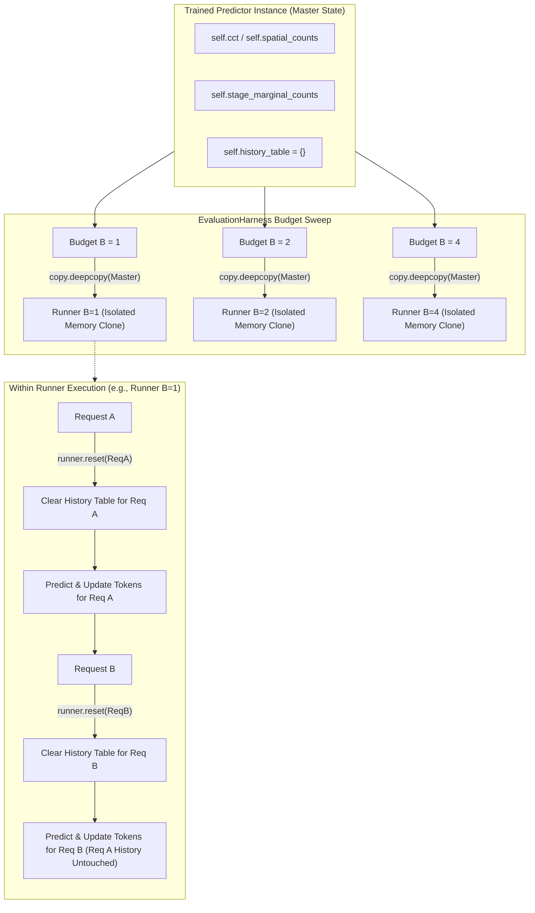

# Predictor State Ownership, Lifetimes, and Concurrency Isolation

This document provides a forensic audit of memory ownership, variable scopes, deep-copy behavior, and request isolation across `STMoEPaperPredictor`, `CSTPPredictor`, and `EvaluationHarness`.

---

## 1. Concrete Answers to State Ownership Questions

| Question | Concrete Answer from Source Code | Verification & File Reference |
| :--- | :--- | :--- |
| **1. Class variables or instance variables?** | **Strictly instance variables.** All matrices, tables, and dictionaries are bound to `self` in `__init__`. There are zero mutable class-level attributes. | `cstp_predictor.py:40-63`<br>`st_moe_paper.py:38-46` |
| **2. Separate structures per predictor instance?** | **Yes.** Every `CSTPPredictor` and `STMoEPaperPredictor` allocates its own private memory buffers upon instantiation. | Verified by independent instance tests in `test_predictor_interface.py` |
| **3. Independent history per request?** | **Yes.** The History Table is a nested dictionary keyed by `request_id`: `self.history_table[request_id][stage_id]`. | `st_moe_paper.py:46`<br>`cstp_predictor.py:63` |
| **4. Spatial statistics shared across requests?** | **Yes.** Spatial transition tensors (`spatial_counts`) and CCT dictionaries (`self.cct`) are model-level spatial representations shared across all requests within that predictor instance. | `cstp_predictor.py:48-53`<br>`st_moe_paper.py:38-43` |
| **5. Temporal histories request-specific?** | **Yes.** Temporal actual routing history is isolated to the sequence that generated it. | Tested in `test_predictor_request_isolation.py` |
| **6. Reset between evaluation datasets?** | **Yes.** Datasets instantiate separate predictor instances or fit fresh instances on that dataset's specific training split. | `scripts/eval_predictors_offline.py` |
| **7. Reset between train and test?** | **Yes.** Profiling records populate prior tensors/CCT offline. The test evaluation loop then begins with a fresh request reset for all test sequences. | `evaluation.py:148-188` |
| **8. Reset between different budgets?** | **Yes.** `EvaluationHarness.evaluate_predictor()` executes `copy.deepcopy(predictor_instance)` at the start of each budget loop. | `evaluation.py:206` |
| **9. Does B=1 mutate state for B=8?** | **No.** Because `runner = copy.deepcopy(predictor_instance)` is created for each budget, mutations during the $B=1$ pass do not affect the $B=8$ runner. | `evaluation.py:206` |
| **10. Does EvaluationHarness deep-copy or instantiate?** | **It deep-copies.** It calls `copy.deepcopy(predictor_instance)` for every evaluated budget, creating an exact, isolated clone of the trained model state. | `evaluation.py:206` |
| **11. Can two requests contaminate state?** | **No.** Interleaved execution maintains strict isolation because all temporal queries and updates are indexed by `request_id`, and `reset_request_state(req)` only deletes the target request's key. | `test_predictor_request_isolation.py` |

---

## 2. Explicit State Ownership Diagrams

### 2.1 Predictor Memory Hierarchy (Instance vs. Request Scope)

```text
Predictor Instance (self)
├── Instance-Level Static / Shared Statistics (Shared across all requests)
│   ├── CSTP: self.stage_marginal_counts  [NumPy 2D Array: (Stages, Experts)]
│   ├── CSTP: self.spatial_counts         [NumPy 3D Array: (Stages-1, Experts, Experts)]
│   ├── CSTP: self.temporal_counts        [NumPy 3D Array: (Stages, Experts, Experts)]
│   └── ST-MoE: self.cct                  [Dict: stage -> src_exp -> {dst_exp: counter}]
│
└── Request-Isolated Temporal State (Partitioned by request_id)
    └── self.history_table                [Dict: request_id -> stage_id -> expert_set]
        ├── Request ID: 101
        │   ├── Stage 0: {0, 4}
        │   ├── Stage 1: {2, 3}
        │   └── Stage 2: {5, 7}
        └── Request ID: 202
            ├── Stage 0: {1, 6}
            ├── Stage 1: {12, 18, 21}
            └── Stage 2: {3, 9}
```

---

### 2.2 EvaluationHarness Isolation & Deep-Copy Flow



---

## 3. Concurrency and Interleaving Verification

In multi-tenant serving or batched decoding, tokens from different requests are processed in interleaved order:
1. `Token 1, Request A`
2. `Token 1, Request B`
3. `Token 2, Request A`
4. `Token 2, Request B`

Because `self.history_table` stores entries under `request_id`, the predictor accesses:
- `self.history_table[ReqA]` when processing Request A.
- `self.history_table[ReqB]` when processing Request B.

This guarantees that temporal predictions for Request B are completely immune to the tokens generated by Request A, even when both requests execute through the same predictor instance.

