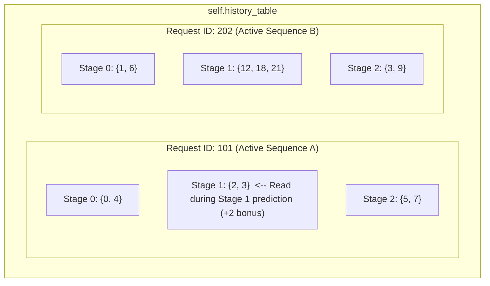
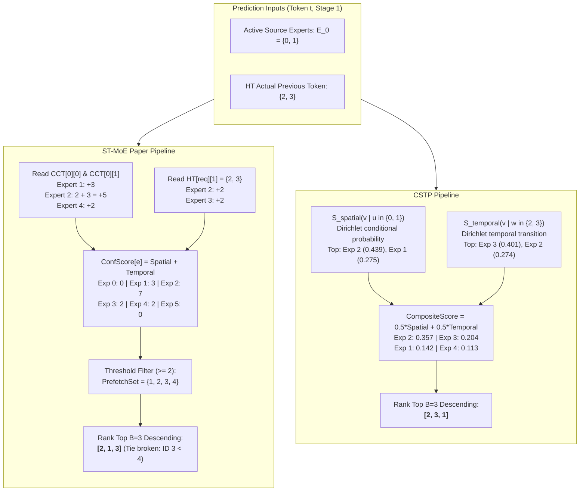
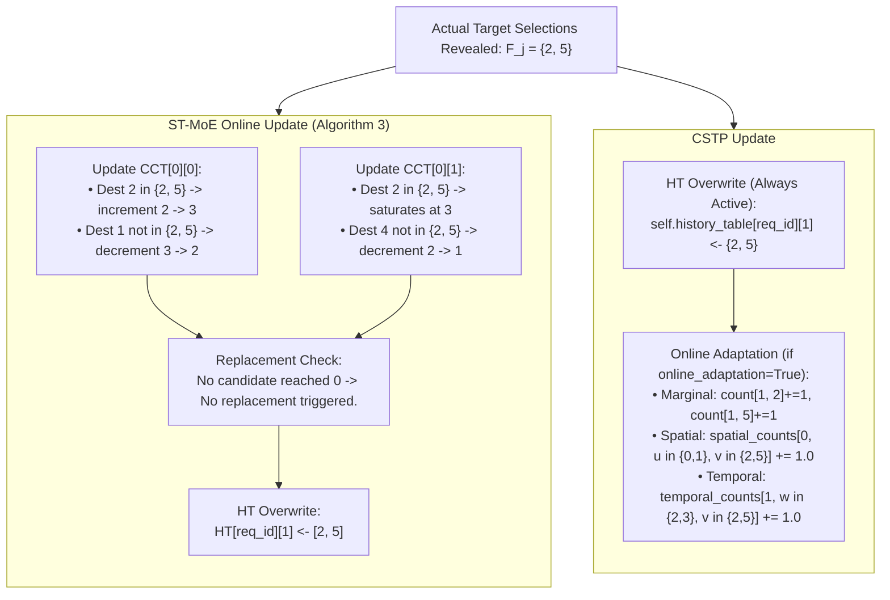

# Predictor Structure Visualizations, Pipeline Comparison, and Comparative Audit

This document presents structural visualizations, architectural flowcharts, and a side-by-side comparative walkthrough for **ST-MoE** (*Zhao et al., arXiv:2606.15453v1*) and **CSTP** on an identical running example.

High-resolution visual diagnostic charts have been generated in [`docs/predictor_comparison/structure_visualization/`](file:///home/mohman/ca_project/LLMSimulator/docs/predictor_comparison/structure_visualization/).

---

## 1. Concrete Running Example Setup (Identical Conditions)

To compare the exact arithmetic and structural mechanics of both predictors, we define a standardized running example:
- **Expert Vocabulary**: $8$ experts, indexed $\{0, 1, 2, 3, 4, 5, 6, 7\}$.
- **Top-$K$**: $K = 2$ experts selected per layer.
- **Source Stage**: MoE Stage $0$ ($L$).
- **Target Stage**: MoE Stage $1$ ($L+1$).
- **Current Token ($t$) Source Experts**: $E_L = \{0, 1\}$.
- **Previous Token ($t-1$) Target-Stage Experts**: $\text{Actual}_{t-1} = \{2, 3\}$.
- **Actual Target-Stage Experts Revealed Later**: $F_j = \{2, 5\}$.
- **Prefetch Budget**: $B = 3$.

---

## 2. Visualization 1: ST-MoE Cross-Layer Correlation Table (CCT)

*Generated Chart*: [`vis1_st_moe_cct.png`](file:///home/mohman/ca_project/LLMSimulator/docs/predictor_comparison/structure_visualization/vis1_st_moe_cct.png)

```
self.cct: Dict[source_stage, Dict[source_expert, Dict[dest_expert, 2-bit counter]]]

Stage 0 (L)
├── Source Expert 0 ──> { Dest 1: 3 (11) [Strongly Preferred], Dest 2: 2 (10) [Preferred] }
├── Source Expert 1 ──> { Dest 2: 3 (11) [Strongly Preferred], Dest 4: 2 (10) [Preferred] }
└── Source Expert 2 ──> { Dest 6: 1 (01) [Weakly Not Pref],    Dest 7: 0 (00) [ELIGIBLE FOR REPLACEMENT] }
```

| Source Stage | Source Expert | Dest Candidate | 2-Bit Counter | State Interpretation | Status & Replacement Eligibility |
| :---: | :---: | :---: | :---: | :--- | :--- |
| **Stage 0** | **Expert 0** | Expert 1 | `3 (11)` | Strongly Preferred | Saturated maximum; retained |
| **Stage 0** | **Expert 0** | Expert 2 | `2 (10)` | Preferred (Initial) | Initial profiling state; meets threshold |
| **Stage 0** | **Expert 1** | Expert 2 | `3 (11)` | Strongly Preferred | Nominated by both Expert 0 and Expert 1 |
| **Stage 0** | **Expert 1** | Expert 4 | `2 (10)` | Preferred (Initial) | Meets threshold |
| **Stage 0** | **Expert 2** | Expert 6 | `1 (01)` | Weakly Not Preferred | Decremented once upon mismatch |
| **Stage 0** | **Expert 2** | Expert 7 | `0 (00)` | Strongly Not Preferred | **ELIGIBLE FOR REPLACEMENT** upon next miss |

---

## 3. Visualization 2: ST-MoE History Table (HT)

*Generated Chart*: [`vis2_st_moe_ht.png`](file:///home/mohman/ca_project/LLMSimulator/docs/predictor_comparison/structure_visualization/vis2_st_moe_ht.png)



- Each sequence maintains its own isolated dictionary entry.
- When predicting for Request 101 at Stage 1, ST-MoE reads `HT[101][1] = {2, 3}`.
- Each expert in HT receives an implicit confidence score of $+2$.

---

## 4. Visualizations 3, 4, 5: CSTP Internal Probability Statistics

*Generated Charts*:
- Spatial: [`vis3_cstp_spatial.png`](file:///home/mohman/ca_project/LLMSimulator/docs/predictor_comparison/structure_visualization/vis3_cstp_spatial.png)
- Temporal: [`vis4_cstp_temporal.png`](file:///home/mohman/ca_project/LLMSimulator/docs/predictor_comparison/structure_visualization/vis4_cstp_temporal.png)
- Marginal: [`vis5_cstp_marginal.png`](file:///home/mohman/ca_project/LLMSimulator/docs/predictor_comparison/structure_visualization/vis5_cstp_marginal.png)

### 4.1 CSTP Spatial Transition Slice (`self.spatial_counts[0, u, :]`)
For source experts $u \in \{0, 1\}$ at Stage 0 to target experts $v \in \{0 \dots 7\}$ at Stage 1:

| Source Expert $u$ | Dest 0 | Dest 1 | Dest 2 | Dest 3 | Dest 4 | Dest 5 | Dest 6 | Dest 7 | $\sum \text{Counts}$ |
| :---: | :---: | :---: | :---: | :---: | :---: | :---: | :---: | :---: | :---: |
| **$u = 0$** | 0 | **8** | **5** | 0 | 1 | 0 | 0 | 0 | 14 |
| **$u = 1$** | 0 | 0 | **9** | 0 | **6** | 0 | 1 | 0 | 16 |

Applying Dirichlet smoothing with $\lambda = 1.0$ and uniform prior $P_{\text{prior}}(v) = 1/8 = 0.125$:
$$P_{\text{spatial}}(v \mid u=0) = \frac{\text{Count} + 1.0 \times 0.125}{14 + 1.0} \implies [0.008, \mathbf{0.542}, \mathbf{0.342}, 0.008, 0.075, 0.008, 0.008, 0.008]$$
$$P_{\text{spatial}}(v \mid u=1) = \frac{\text{Count} + 1.0 \times 0.125}{16 + 1.0} \implies [0.007, 0.007, \mathbf{0.537}, 0.007, \mathbf{0.360}, 0.007, 0.066, 0.007]$$
Averaged Spatial Score across $U = \{0, 1\}$:
$$S_{\text{spatial}} = [0.008, \mathbf{0.275}, \mathbf{0.439}, 0.008, \mathbf{0.218}, 0.008, 0.037, 0.008]$$

### 4.2 CSTP Temporal Transition Slice (`self.temporal_counts[1, w, :]`)
For previous-token experts $w \in \{2, 3\}$ at Stage 1:

| Prev Expert $w$ | Dest 0 | Dest 1 | Dest 2 | Dest 3 | Dest 4 | Dest 5 | Dest 6 | Dest 7 | $\sum \text{Counts}$ |
| :---: | :---: | :---: | :---: | :---: | :---: | :---: | :---: | :---: | :---: |
| **$w = 2$** | 1 | 0 | **6** | **2** | 0 | **4** | 0 | 0 | 13 |
| **$w = 3$** | 0 | 0 | 1 | **7** | 0 | 0 | 2 | 0 | 10 |

Averaged Smoothed Temporal Score across $W = \{2, 3\}$:
$$S_{\text{temporal}} = [0.043, 0.009, \mathbf{0.274}, \mathbf{0.401}, 0.009, \mathbf{0.155}, 0.100, 0.009]$$

---

## 5. Visualization 6: Complete Side-by-Side Prediction Scoring

*Generated Chart*: [`vis6_prediction_pipeline.png`](file:///home/mohman/ca_project/LLMSimulator/docs/predictor_comparison/structure_visualization/vis6_prediction_pipeline.png)



### Detailed Score Comparison on Example

| Candidate Expert | ST-MoE Spatial | ST-MoE Temporal | ST-MoE Total | ST-MoE Rank | CSTP Spatial $S_{\text{sp}}$ | CSTP Temporal $S_{\text{temp}}$ | CSTP Composite | CSTP Rank |
| :---: | :---: | :---: | :---: | :---: | :---: | :---: | :---: | :---: |
| **Expert 0** | 0 | 0 | **0** | 5 | 0.008 | 0.043 | **0.025** | 6 |
| **Expert 1** | 3 | 0 | **3** | **2** | 0.275 | 0.009 | **0.142** | **3** |
| **Expert 2** | 5 | 2 | **7** | **1** | 0.439 | 0.274 | **0.357** | **1** |
| **Expert 3** | 0 | 2 | **2** | **3** | 0.008 | 0.401 | **0.204** | **2** |
| **Expert 4** | 2 | 0 | **2** | 4 | 0.218 | 0.009 | **0.113** | 4 |
| **Expert 5** | 0 | 0 | **0** | 6 | 0.008 | 0.155 | **0.082** | 5 |
| **Expert 6** | 0 | 0 | **0** | 7 | 0.037 | 0.100 | **0.068** | 7 |
| **Expert 7** | 0 | 0 | **0** | 8 | 0.008 | 0.009 | **0.009** | 8 |

#### Why Predictions Differ Under Budget $B = 3$:
- **ST-MoE selects**: `[2, 1, 3]`
  - Expert 1 receives an integer confidence of $3$ directly from source expert 0, placing it ahead of Expert 3 (confidence $2$).
- **CSTP selects**: `[2, 3, 1]`
  - CSTP factors in temporal transition continuity. Because previous-token expert 3 had strong self-transition probability ($7/10 = 0.70$), Expert 3 achieves a composite continuous score of $0.204$, placing it ahead of Expert 1 ($0.142$).

---

## 6. Visualization 7: State Update Lifecycle when Actual Routing Revealed

*Generated Chart*: [`vis7_update_lifecycle.png`](file:///home/mohman/ca_project/LLMSimulator/docs/predictor_comparison/structure_visualization/vis7_update_lifecycle.png)

Now assume execution completes at Stage 1, and the gating network reveals actual routing:
$$F_j = \{2, 5\}$$



---

## 7. Concise 10-Dimension Architectural Comparison Table

| Aspect | CSTP (`cstp`) | ST-MoE Paper (`st_moe_paper`) |
| :--- | :--- | :--- |
| **1. Spatial Information** | 3D tensor of co-activation counts transformed via Dirichlet smoothing into continuous conditional probabilities $P(v \mid u)$. | Nested dictionary of bounded Top-$K$ candidate experts per source expert with 2-bit counters. |
| **2. Temporal Information** | 3D tensor of token-to-token transition counts $P(v \mid w)$ conditioned on previous token selections. | History Table recording previous token actual routing; contributes flat $+2$ confidence. |
| **3. Frequency Prior** | Explicit empirical marginal distribution $P_{\text{prior}}(v \mid \text{stage})$ with additive $\epsilon$ smoothing. | None (only tracks observed co-activations; optional offline marginal prior list for tie-breaks). |
| **4. Main Data Structures** | `numpy.ndarray` float64 matrices: `stage_marginal_counts`, `spatial_counts`, `temporal_counts`, `history_table`. | Nested Python dictionaries: `cct[stage][src_exp][dst_exp] -> counter`, `history_table[req][stage] -> list`. |
| **5. State Ownership** | Tensors are predictor instance-level; `history_table` is request-isolated; deep-copied per budget by harness. | Tables are predictor instance-level; `history_table` is request-isolated; deep-copied per budget by harness. |
| **6. Prediction Mechanism** | Evaluates all $E$ candidates via continuous linear interpolation $\alpha S_{\text{spatial}} + (1-\alpha) S_{\text{temporal}}$. | Accumulates integer spatial scores and temporal $+2$, filters by threshold $\ge 2$, ranks top-$B$. |
| **7. Online Updates** | HT updated every token; transition tensors updated dynamically if `online_adaptation=True` (default False). | Online 2-bit counter increment/decrement and slot replacement when counter hits 0. |
| **8. Cold-Start Behavior** | Falls back cleanly to smoothed marginal prior $P_{\text{prior}}(v)$ with non-zero probability for all $E$. | HT contribution is 0; prediction relies entirely on CCT spatial lookup. |
| **9. Memory Overhead** | $O(S \times E^2)$ float64 elements (e.g., DeepSeek-V3 57 stages $\times 256^2 \approx 29.8\text{ MB}$). | $O(S \times E \times K)$ entries (e.g., $57 \times 256 \times 8 \times 10\text{ bits} \approx 146\text{ KB}$). |
| **10. Request Isolation** | 100% isolated via `self.history_table[request_id]`; reset via `reset_request_state(req)`. | 100% isolated via `self.history_table[request_id]`; reset via `reset(req)`. |

