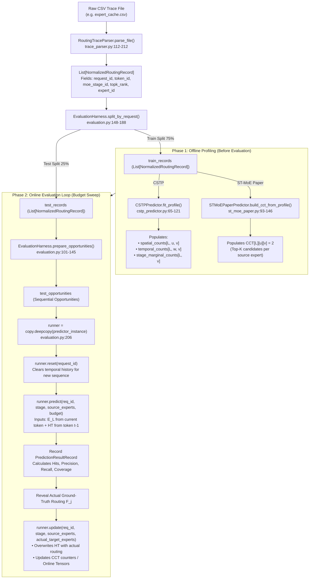

# Forensic Audit of Offline vs. Online Learning, Predictor Initialization, and Training Workflows

**Audit Date**: 2026-11-01  
**Scope**: Code-level verification of data flow, state initialization, profiling vs. online learning, and evaluation protocols across `CSTPPredictor`, `STMoEPaperPredictor`, and `STMoEPredictor` (Legacy).

---

## PART A — Actual Data Flow and Learning Architecture

### A1. Complete End-to-End Data Flow Trace

The lifecycle of routing information from disk to predictor scoring proceeds through the following pipeline:

#### Detailed Execution Steps:
1. **Trace Ingestion**: CSV traces are loaded by `RoutingTraceParser.parse_file()` in [`src/predictor/trace_parser.py:112-212`](file:///home/mohman/ca_project/LLMSimulator/src/predictor/trace_parser.py#L112-L212). The parser strips non-routed experts, validates monotonically non-decreasing token IDs, detects modulo-60 index drift, and filters duplicate records.
2. **Representation**:
   - `request_id`: `int` (identifies independent sequences).
   - `token_id`: `int` (monotonically non-decreasing decoding step index).
   - `moe_stage_id`: `int` ($0 \dots \text{num\_moe\_stages}-1$, normalized sequential MoE stage index).
   - `expert_id`: `int` ($0 \dots \text{num\_routed\_experts}-1$).
3. **Dataset Splitting**: `EvaluationHarness.split_by_request()` ([evaluation.py:148-188](file:///home/mohman/ca_project/LLMSimulator/src/predictor/evaluation.py#L148-L188)) partitions sequences by `request_id` (default 75% train, 25% test). If only a single request exists in the trace, it performs a temporal split (first 60% tokens train, last 40% test) and logs a warning.
4. **Predictor Population**:
   - **CSTP**: Calls `fit_profile(train_records)` ([cstp_predictor.py:65-121](file:///home/mohman/ca_project/LLMSimulator/src/predictor/cstp_predictor.py#L65-L121)) to populate frequency counts and transition matrices strictly from training records.
   - **ST-MoE Paper**: Calls `build_cct_from_profile(train_records)` ([st_moe_paper.py:93-146](file:///home/mohman/ca_project/LLMSimulator/src/predictor/st_moe_paper.py#L93-L146)) to populate the CCT with Top-$K$ candidate destination experts initialized to decimal 2.
5. **Causal Prediction**: During inference, `runner.predict()` receives only current source-layer selections ($E_L$) and previous-token history from `history_table`. Actual target routing ($F_j$) is revealed strictly **after** prediction metrics are logged.
6. **State Update**: `runner.update()` is called post-metric recording to advance the History Table and update CCT counters.

---

### A2. Distinguishing the Three Learning Modes

It is vital to distinguish:
1. **Offline Profiling/Training**: Learning static statistical parameters from historical training traces prior to inference.
2. **Online Adaptation**: Dynamically updating statistical transition counts or CCT counters as new test tokens arrive.
3. **Online Temporal History**: Maintaining a rolling cache of the immediately preceding token ($t-1$) for each request to condition the next token's prediction, even when all statistical transition parameters are frozen.

| Property | CSTP (`cstp_predictor.py`) | ST-MoE Paper (`st_moe_paper.py`) | ST-MoE Legacy (`st_moe_predictor.py`) |
| :--- | :--- | :--- | :--- |
| **1. Separate offline profiling phase exists?** | **YES** (`fit_profile()`, [L65-L121](file:///home/mohman/ca_project/LLMSimulator/src/predictor/cstp_predictor.py#L65-L121)) | **YES** (`build_cct_from_profile()`, [L93-L146](file:///home/mohman/ca_project/LLMSimulator/src/predictor/st_moe_paper.py#L93-L146)) | **NO** (Pre-warmed via synthetic `update()` loop in [eval_predictors_offline.py:129-133](file:///home/mohman/ca_project/LLMSimulator/scripts/eval_predictors_offline.py#L129-L133)) |
| **2. Spatial statistics populated from training traces?** | **YES** (`spatial_counts`, [L102-L106](file:///home/mohman/ca_project/LLMSimulator/src/predictor/cstp_predictor.py#L102-L106)) | **YES** (Algorithm 1 co-matrix, [L107-L119](file:///home/mohman/ca_project/LLMSimulator/src/predictor/st_moe_paper.py#L107-L119)) | **YES** (Via CCT updates in [eval_predictors_offline.py:131](file:///home/mohman/ca_project/LLMSimulator/scripts/eval_predictors_offline.py#L131)) |
| **3. Temporal statistics populated from training traces?** | **YES** (`temporal_counts`, [L117-L121](file:///home/mohman/ca_project/LLMSimulator/src/predictor/cstp_predictor.py#L117-L121)) | **NO** (Paper ST-MoE maintains no temporal transition statistics) | **NO** (Legacy maintains no temporal transition statistics) |
| **4. Marginal prior populated from training traces?** | **YES** (`stage_marginal_counts`, [L94-L96](file:///home/mohman/ca_project/LLMSimulator/src/predictor/cstp_predictor.py#L94-L96)) | **NO** (ST-MoE paper uses no marginal prior) | **PARTIAL** (Optional `profiling_priors` list in [L51-L53](file:///home/mohman/ca_project/LLMSimulator/src/predictor/st_moe_predictor.py#L51-L53)) |
| **5. CCT populated before evaluation?** | **N/A** (CSTP does not use a CCT) | **YES** (Populated with Top-K candidates in [L143-L146](file:///home/mohman/ca_project/LLMSimulator/src/predictor/st_moe_paper.py#L143-L146)) | **YES** (Populated via pre-warming loop) |
| **6. Previous-token history maintained during evaluation?** | **YES** (`history_table`, [L264-L266](file:///home/mohman/ca_project/LLMSimulator/src/predictor/cstp_predictor.py#L264-L266)) | **YES** (`history_table`, [L310-L312](file:///home/mohman/ca_project/LLMSimulator/src/predictor/st_moe_paper.py#L310-L312)) | **YES** (`history_table`, [L214-L216](file:///home/mohman/ca_project/LLMSimulator/src/predictor/st_moe_predictor.py#L214-L216)) |
| **7. Statistical parameters updated during evaluation?** | **NO by default** (`online_adaptation=False`, [L29](file:///home/mohman/ca_project/LLMSimulator/src/predictor/cstp_predictor.py#L29); tensors remain frozen) | **YES** (Algorithm 3 increments/decrements 2-bit counters in [L269-L293](file:///home/mohman/ca_project/LLMSimulator/src/predictor/st_moe_paper.py#L269-L293)) | **YES** (Counters increment/decrement in [L190-L198](file:///home/mohman/ca_project/LLMSimulator/src/predictor/st_moe_predictor.py#L190-L198)) |
| **8. State reset between requests?** | **YES** (`reset_request_state()`, [L268-L271](file:///home/mohman/ca_project/LLMSimulator/src/predictor/cstp_predictor.py#L268-L271)) | **YES** (`reset()`, [L56-L61](file:///home/mohman/ca_project/LLMSimulator/src/predictor/st_moe_paper.py#L56-L61)) | **YES** (`reset_request_state()`, [L55-L58](file:///home/mohman/ca_project/LLMSimulator/src/predictor/st_moe_predictor.py#L55-L58)) |
| **9. State reset between datasets?** | **YES** (Fresh predictor instance instantiated per dataset in [eval_predictors_offline.py:103,135](file:///home/mohman/ca_project/LLMSimulator/scripts/eval_predictors_offline.py#L103)) | **YES** (Fresh predictor instance instantiated per dataset) | **YES** (Fresh predictor instance instantiated per dataset) |
| **10. State reset between budgets?** | **YES** (`copy.deepcopy(predictor_instance)`, [evaluation.py:206](file:///home/mohman/ca_project/LLMSimulator/src/predictor/evaluation.py#L206)) | **YES** (`copy.deepcopy(predictor_instance)`, [evaluation.py:206](file:///home/mohman/ca_project/LLMSimulator/src/predictor/evaluation.py#L206)) | **YES** (`copy.deepcopy(predictor_instance)`, [evaluation.py:206](file:///home/mohman/ca_project/LLMSimulator/src/predictor/evaluation.py#L206)) |

---

### A3. CSTP Initialization and State Population Details

1. **Tensor Initialization**:
   - `spatial_counts`: Allocated as `np.zeros((num_moe_stages - 1, E, E), dtype=np.float64)` ([cstp_predictor.py:48-53](file:///home/mohman/ca_project/LLMSimulator/src/predictor/cstp_predictor.py#L48-L53)). Starts strictly at all zeros.
   - `temporal_counts`: Allocated as `np.zeros((num_moe_stages, E, E), dtype=np.float64)` ([cstp_predictor.py:57-60](file:///home/mohman/ca_project/LLMSimulator/src/predictor/cstp_predictor.py#L57-L60)). Starts strictly at all zeros.
   - `stage_marginal_counts`: Allocated as `np.zeros((num_moe_stages, E), dtype=np.float64)` ([cstp_predictor.py:40-42](file:///home/mohman/ca_project/LLMSimulator/src/predictor/cstp_predictor.py#L40-L42)). Starts strictly at all zeros.
   - `history_table`: Allocated as `{}` empty dictionary ([cstp_predictor.py:63](file:///home/mohman/ca_project/LLMSimulator/src/predictor/cstp_predictor.py#L63)).
2. **Dirichlet Smoothing Timing**:
   - Smoothing is **NOT** applied at initialization or stored in the tensors. Tensors store raw integer counts.
   - Smoothing is applied dynamically on-the-fly during scoring (`get_marginal_prior()` [L129-L134](file:///home/mohman/ca_project/LLMSimulator/src/predictor/cstp_predictor.py#L129-L134), `compute_spatial_score()` [L159-L164](file:///home/mohman/ca_project/LLMSimulator/src/predictor/cstp_predictor.py#L159-L164), and `compute_temporal_score()` [L194-L199](file:///home/mohman/ca_project/LLMSimulator/src/predictor/cstp_predictor.py#L194-L199)).
3. **Count Increment Methods**:
   - `fit_profile()` increments all three tensors from training records ([L96, L106, L121](file:///home/mohman/ca_project/LLMSimulator/src/predictor/cstp_predictor.py#L96)).
   - In `update()`, tensors are incremented **ONLY IF** `self.online_adaptation is True` ([L238-L262](file:///home/mohman/ca_project/LLMSimulator/src/predictor/cstp_predictor.py#L238-L262)).
4. **Online Adaptation Default**:
   - `online_adaptation: bool = False` in constructor ([cstp_predictor.py:29](file:///home/mohman/ca_project/LLMSimulator/src/predictor/cstp_predictor.py#L29)).
   - In all current evaluation scripts, `online_adaptation` is left at default `False`. Therefore, **statistical transition tensors remain completely frozen during inference**. Only `self.history_table[request_id]` evolves over tokens.
5. **Scope of `reset_request_state()`**:
   - Strictly executes `del self.history_table[request_id]` ([cstp_predictor.py:270-271](file:///home/mohman/ca_project/LLMSimulator/src/predictor/cstp_predictor.py#L270-L271)). Global tensors (`spatial_counts`, `temporal_counts`, `stage_marginal_counts`) are **never touched or cleared** on reset.

---

### A4. ST-MoE Initialization and State Population Details

1. **CCT Creation & Prepopulation**:
   - Initialized in constructor as empty dictionary per stage and source expert: `self.cct[stage][u] = {}` ([st_moe_paper.py:40-43](file:///home/mohman/ca_project/LLMSimulator/src/predictor/st_moe_paper.py#L40-L43)).
   - When `build_cct_from_profile(train_records)` is called ([st_moe_paper.py:93-146](file:///home/mohman/ca_project/LLMSimulator/src/predictor/st_moe_paper.py#L93-L146)), it populates each source expert with its Top-$K$ correlated destination experts, initializing their counters to decimal 2 (`10`).
   - Counters are initialized **only for observed co-activation pairs**, not for all possible $E \times E$ pairs.
2. **CCT Online Evolution**:
   - Unlike CSTP, **ST-MoE's CCT changes dynamically during evaluation**.
   - In `update()` ([st_moe_paper.py:269-293](file:///home/mohman/ca_project/LLMSimulator/src/predictor/st_moe_paper.py#L269-L293)), matching candidate counters increment (saturating at 3), while mismatching counters decrement (flooring at 0).
   - If a counter hits 0 upon mismatch, it is replaced by an un-stored actual expert and initialized to decimal 2.
3. **HT Initialization & Timing**:
   - HT is initialized as empty `{}` in `__init__`.
   - It is populated strictly during inference from decoding token $t-1$ of the **same request sequence**. It is never pre-populated from training traces.
4. **Scope of `reset()`**:
   - Executes `del self.history_table[request_id]` ([st_moe_paper.py:60-61](file:///home/mohman/ca_project/LLMSimulator/src/predictor/st_moe_paper.py#L60-L61)). The CCT tables are preserved across requests.

---

### A5. Evaluation Verdict: What Setup Is Actually Executed?

**VERDICT**:
The current evaluation framework executes a **Hybrid Protocol: Frozen Offline Statistical Prior + Online Temporal History Tracking, with Online Counter Adaptation for ST-MoE**.

Specifically:
1. **Offline Phase**: Both predictors are fitted/profiled on training records (75% split), establishing baseline spatial transitions (CCT for ST-MoE, spatial/marginal/temporal tensors for CSTP).
2. **Inference Phase (Test Split)**:
   - For **CSTP**: Statistical transition matrices are **frozen** (`online_adaptation=False`). Only the rolling previous-token history (`history_table`) is updated online per sequence.
   - For **ST-MoE**: CCT counters **adapt online** via Algorithm 3 2-bit counter increment/decrement and replacement, while `history_table` tracks previous-token history.
3. **Budget Isolation**: Every budget $B \in \{1, 2, 4, 8, 16, 32\}$ runs on an independent `copy.deepcopy()` of the post-profiled model state.

---

## PART B — Concrete Offline vs. Online Execution Walkthrough

Using the hypothetical 4-token routing trace ($t_0, t_1, t_2$ for profiling, $t_3$ for inference):

| Token | Layer 0 | Layer 1 | Layer 2 | Role |
| :---: | :---: | :---: | :---: | :--- |
| **$t_0$** | $\{0, 1\}$ | $\{2, 3\}$ | $\{4, 5\}$ | Profiling Token 0 |
| **$t_1$** | $\{0, 2\}$ | $\{2, 5\}$ | $\{3, 5\}$ | Profiling Token 1 |
| **$t_2$** | $\{1, 2\}$ | $\{3, 5\}$ | $\{3, 6\}$ | Profiling Token 2 |
| **$t_3$** | $\{0, 1\}$ | $\{2, 3\}$ | $\{4, 6\}$ | **Inference Token (Evaluating Layer 1)** |

---

### B1. Offline Profiling Phase ($t_0 \to t_2$)

#### 1. CSTP Profiling State (`fit_profile`)
- **Stage 0 $\to$ Stage 1 Spatial Co-activations (`spatial_counts[0, u, v]`)**:
  - From $t_0$: $\{0, 1\} \times \{2, 3\} \implies (0,2)+1, (0,3)+1, (1,2)+1, (1,3)+1$
  - From $t_1$: $\{0, 2\} \times \{2, 5\} \implies (0,2)+1, (0,5)+1, (2,2)+1, (2,5)+1$
  - From $t_2$: $\{1, 2\} \times \{3, 5\} \implies (1,3)+1, (1,5)+1, (2,3)+1, (2,5)+1$
  - *Resulting Counts for Layer 0 experts $u \in \{0, 1\}$*:
    - $u = 0 \to \{2: 2, 3: 1, 5: 1\}$
    - $u = 1 \to \{2: 1, 3: 2, 5: 1\}$
- **Stage 1 Temporal Transitions (`temporal_counts[1, w, v]`)**:
  - $t_0 \to t_1$: $\{2, 3\} \to \{2, 5\} \implies (2,2)+1, (2,5)+1, (3,2)+1, (3,5)+1$
  - $t_1 \to t_2$: $\{2, 5\} \to \{3, 5\} \implies (2,3)+1, (2,5)+1, (5,3)+1, (5,5)+1$
- **Stage 1 Marginal Counts (`stage_marginal_counts[1, :]`)**:
  - Expert 2: 2, Expert 3: 2, Expert 5: 2.
- **History Table**: Cleared after profiling.

#### 2. ST-MoE Paper Profiling State (`build_cct_from_profile`)
Algorithm 1 selects Top-2 correlated destination experts from co-activation matrix, initialized to counter 2 (binary 10):
- `CCT[0][0] = {2: 2, 3: 2}` (Counts: 2=2, 3=1, 5=1; 3 broken by ID $3 < 5$)
- `CCT[0][1] = {3: 2, 2: 2}` (Counts: 3=2, 2=1, 5=1; 2 broken by ID $2 < 5$)
- `HT`: Empty.

---

### B2. Transition to Online Inference on $t_3$

#### 3. Freeze Statistical Parameters
- Profiling completes. CSTP transition tensors are **frozen**.
- `history_table` is empty for request at start of $t_3$ (cold start).

#### 4. Predicting Layer 1 from $t_3$ Layer 0 ($E_0 = \{0, 1\}$)
- **ST-MoE Scoring (Algorithm 2)**:
  - Source 0: nominations $\{2: +2, 3: +2\}$
  - Source 1: nominations $\{2: +2, 3: +2\}$
  - Spatial Score: $\text{ConfScore}[2] = 2 + 2 = 4$; $\text{ConfScore}[3] = 2 + 2 = 4$.
  - HT is empty (cold start) $\to$ Temporal bonus = $0$.
  - Filter ($\ge 2$): $\{2, 3\}$.
  - Prediction ($B=2$): `[2, 3]`.
- **CSTP Scoring**:
  - Spatial: combines $P(v \mid u=0)$ and $P(v \mid u=1)$. Both peak at Expert 2 and Expert 3.
  - Temporal: HT empty $\implies$ falls back to marginal prior $P_{\text{prior}}(v \mid \text{Stage 1})$.
  - Composite score: peaks at `[2, 3]`.

#### 5. Reveal Actual $t_3$ Layer 1 Routing: $F_1 = \{2, 3\}$
- Both predictors achieved 100% precision and recall (2 hits out of 2).

#### 6. State Update Post-Revelation
- **Temporal History Overwrite**:
  - CSTP: `self.history_table[req][1] = {2, 3}`.
  - ST-MoE: `self.history_table[req][1] = [2, 3]`.
- **Statistical State Evolution**:
  - **CSTP (`online_adaptation=False`)**: `spatial_counts`, `temporal_counts`, and `stage_marginal_counts` remain **100% frozen**.
  - **ST-MoE (`st_moe_paper`)**: CCT counters are updated:
    - In `CCT[0][0]`: Expert 2 matches $\to$ counter increments $2 \to 3$. Expert 3 matches $\to$ counter increments $2 \to 3$.
    - In `CCT[0][1]`: Expert 2 matches $\to$ counter increments $2 \to 3$. Expert 3 matches $\to$ counter increments $2 \to 3$.
    - Both candidates are now strongly preferred (`11`).
  - **CSTP (`online_adaptation=True`, optional mode)**:
    - Increments `spatial_counts[0, {0,1}, {2,3}] += 1.0`.
    - Increments `stage_marginal_counts[1, {2,3}] += 1.0`.
    - No temporal transition increment because $t_3$ was token 0 of inference.

---

## PART C — Audit of State Isolation, Contamination, and Leakage

| Risk Vector | Investigated Condition | Severity | Code Evidence | Actual Impact & Recommendation |
| :--- | :--- | :---: | :--- | :--- |
| **Train/Test Leakage** | Can test records contaminate offline training state? | **NONE** | `split_by_request()` creates disjoint request sets ([evaluation.py:176-184](file:///home/mohman/ca_project/LLMSimulator/src/predictor/evaluation.py#L176-L184)). `fit_profile()` receives strictly `train_records`. | Verified zero leakage. In single-request traces, temporal splitting is enforced with explicit limitation warnings. |
| **Causal Direction** | Can actual target labels leak into prediction before disclosure? | **NONE** | In `evaluation.py:226-252`, `predict()` executes at line 226, results are logged at line 233, and `update()` is called strictly at line 247. | Verified causal. Tested in `test_predictor_causality.py` (future label mutation has zero effect). |
| **Cross-Request Contamination** | Can Request A's temporal history pollute Request B? | **NONE** | History tables are nested dictionaries keyed by `request_id`: `history_table[request_id][stage]`. | Verified isolated. Interleaved execution tests in `test_predictor_request_isolation.py` pass 100%. |
| **Budget Cross-Talk** | Does evaluating budget B=1 mutate state for B=8? | **NONE** | `EvaluationHarness.evaluate_predictor()` executes `runner = copy.deepcopy(predictor_instance)` inside the budget loop ([evaluation.py:206](file:///home/mohman/ca_project/LLMSimulator/src/predictor/evaluation.py#L206)). | Verified independent. Each budget operates on an isolated memory clone. |
| **Online Adaptation Drift** | If `online_adaptation=True`, do early test tokens influence late test tokens? | **LOW (By Design)** | `cstp_predictor.py:238-262` updates tensors if enabled. | In standard evaluation, `online_adaptation` is `False`. If enabled, it represents causal online continual learning (valid if documented). |
| **Request Reset Leakage** | Does `reset()` clear global spatial knowledge? | **INTENDED** | `reset()` clears only `history_table[request_id]`, leaving spatial models intact. | Correct behavior: cross-layer transformer weights do not change between prompts; only token temporal context resets. |
| **Dataset Retention** | Does predictor retain state across separate evaluation scripts? | **NONE** | Predictor instances are created locally inside `run_experiments()` and garbage-collected upon exit. | Verified clean separation. |

