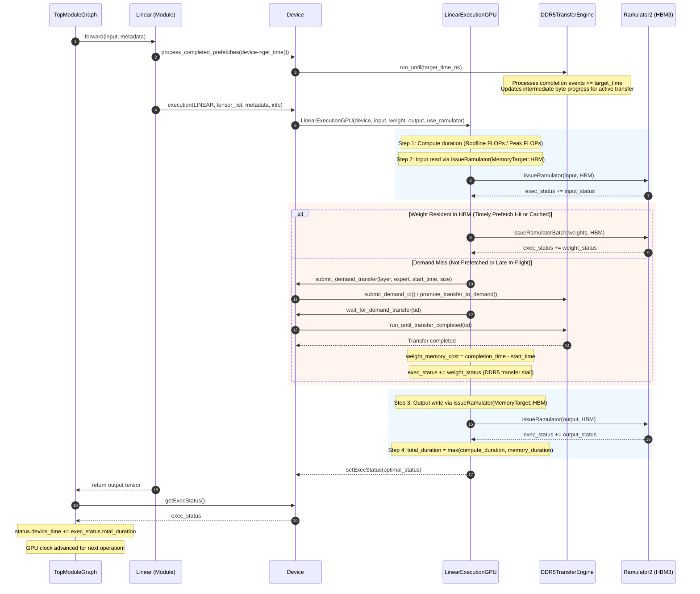
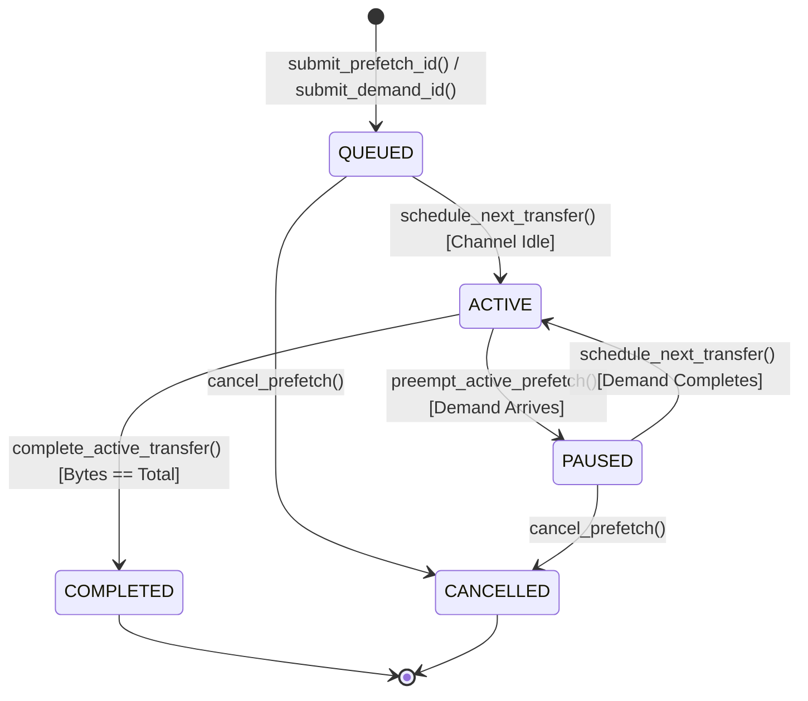
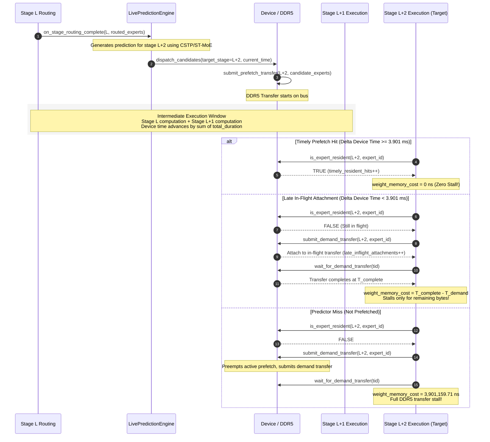

# Forensic Audit: GPU Compute/Memory Timing, Simulated Device Time, and DDR5 Prefetch Transfer Integration

**Repository:** `/home/mohman/ca_project/LLMSimulator`  
**Git Baseline Commit:** `d5bf61ff0c066c06f72173189f9924329f613a88` (`d5bf61f`)  
**Auditor:** Antigravity Autonomous Research Assistant  
**Date:** November 2026  
**Status:** Certified Forensic Architectural Audit (Strictly Read-Only)

---

## 1. Executive Summary

This forensic audit investigates the computational, memory-system, and interconnect timing models within `LLMSimulator`. Specifically, it resolves how GPU computation, GEMM memory-access latency, simulated device time advancement, and DDR5 expert prefetching interact under event-driven simulation.

### Core Audit Findings (Direct Answers to Key Objectives)

1. **GPU Computation Time Modeling:**  
   GPU computation time is modeled analytically using a classic Roofline formulation:
   $$\text{compute\_duration} = \frac{\text{total\_flops}}{\text{compute\_peak\_flops}} \times 10^9\text{ ns} = \frac{2 \cdot m \cdot k \cdot n}{\text{compute\_peak\_flops}} \times 10^9\text{ ns}$$
   Evaluated in [`src/hardware/linear_impl.cpp`](file:///home/mohman/ca_project/LLMSimulator/src/hardware/linear_impl.cpp#L27-L31), computation time depends strictly on the matrix dimensions ($m, k, n$), the device's peak floating-point throughput (`config.compute_peak_flops`), and does not simulate instruction-level pipelining, warp divergence, or register spilling.

2. **GEMM Memory-Access Time Modeling:**  
   GEMM memory traffic consists of input activation reads, weight matrix reads, and output activation writes. When `use_ramulator == true` ([`src/hardware/linear_impl.cpp:45-209`](file:///home/mohman/ca_project/LLMSimulator/src/hardware/linear_impl.cpp#L45-L209)), activation reads and writes are dispatched to Ramulator 2 via `issueRamulator(..., MemoryTarget::HBM)`. When an expert weight misses in the local cache under `use_event_driven_dram`, the weight memory cost is modeled via `device->submit_demand_transfer(...)` and `device->wait_for_demand_transfer(...)`. When `use_ramulator == false`, memory time is purely analytical:
   $$\text{memory\_duration} = \frac{(m \cdot k + k \cdot n + m \cdot n) \times \text{precision\_byte}}{\text{memory\_bandwidth}} \times 10^9\text{ ns}$$

3. **Combination via `total_duration = std::max(compute_duration, memory_duration)`:**  
   At [`src/hardware/linear_impl.cpp:235-237`](file:///home/mohman/ca_project/LLMSimulator/src/hardware/linear_impl.cpp#L235-L237), execution duration is calculated as:
   $$\text{exec\_status.total\_duration} = \max(\text{exec\_status.compute\_duration}, \text{exec\_status.memory\_duration})$$
   This is an **analytical abstraction** based on the Roofline dual-issue assumption that computation and on-chip memory access can perfectly overlap up to the dominant bottleneck. It is not an event-interleaved pipeline simulation. When off-chip demand transfers occur under `compute_time_multiplier`, the off-chip stall is strictly additive ([`src/hardware/linear_impl.cpp:218-228`](file:///home/mohman/ca_project/LLMSimulator/src/hardware/linear_impl.cpp#L218-L228)).

4. **Advancement of Simulated Device Time:**  
   Simulated device time is maintained in `StatusBoard::device_time` ([`src/module/status.h:69`](file:///home/mohman/ca_project/LLMSimulator/src/module/status.h#L69)) and queried via `device->get_time()` ([`src/hardware/device.h:222`](file:///home/mohman/ca_project/LLMSimulator/src/hardware/device.h#L222)). Device time advances in coarse-grained, discrete increments at module boundaries inside `TopModuleGraph::set_pop_status()` ([`src/module/module_graph.cpp:249`](file:///home/mohman/ca_project/LLMSimulator/src/module/module_graph.cpp#L249)):
   $$\text{status.device\_time} \mathrel{+}= \text{exec\_status.total\_duration}$$

5. **DDR5 Expert Prefetch Transfers (`DDR5TransferEngine`):**  
   DDR5 transfers are managed by a single-server, event-driven queue calibrated at 22.578 GB/s (`DEFAULT_BANDWIDTH_BYTES_PER_NS = 22.578` in [`src/prefetch/ddr5_transfer_engine.h:176`](file:///home/mohman/ca_project/LLMSimulator/src/prefetch/ddr5_transfer_engine.h#L176)). Transfers are classified as either `DEMAND` or `PREFETCH`. Demand loads strictly preempt in-flight speculative prefetches, pausing them and capturing transferred byte progress ([`src/prefetch/ddr5_transfer_engine.cpp:421-455`](file:///home/mohman/ca_project/LLMSimulator/src/prefetch/ddr5_transfer_engine.cpp#L421-L455)). In-flight prefetches that match incoming demand requests are promoted to demand without restarting transfer progress ([`src/hardware/device.cpp:1128-1176`](file:///home/mohman/ca_project/LLMSimulator/src/hardware/device.cpp#L1128-L1176)).

6. **Semantics and Role of `run_until()`:**  
   `DDR5TransferEngine::run_until(double target_time_ns)` ([`src/prefetch/ddr5_transfer_engine.cpp:620-634`](file:///home/mohman/ca_project/LLMSimulator/src/prefetch/ddr5_transfer_engine.cpp#L620-L634)) accepts an **absolute simulated timestamp in nanoseconds** matching `device->get_time()`. It processes pending transfer completion events up to `target_time_ns`, calculates intermediate byte transfer progress for the active transfer via $\Delta t \times \text{BW}$, and updates `current_time_ns_`. It is idempotent and monotonic. It is invoked before each linear execution ([`src/module/linear.cpp:54`](file:///home/mohman/ca_project/LLMSimulator/src/module/linear.cpp#L54), [`src/hardware/linear_impl.cpp:66`](file:///home/mohman/ca_project/LLMSimulator/src/hardware/linear_impl.cpp#L66)) and during prefetch dispatch ([`src/hardware/device.cpp:1423`](file:///home/mohman/ca_project/LLMSimulator/src/hardware/device.cpp#L1423)).

7. **Shared-Resource Contention Verdict (Central Finding):**  
   **GEMM memory traffic and DDR5 expert prefetch transfers DO NOT share the same physical or simulated resource.**
   - GEMM activation reads and writes target `MemoryTarget::HBM` and are serviced exclusively by `device->dram_interface` (Ramulator 2 HBM3 model at 2,039 GB/s).
   - Expert weight transfers (demand and prefetch) are serviced exclusively by `DDR5TransferEngine` (calibrated at 22.578 GB/s).
   - Therefore, GEMM activation memory operations never contend with, stall, or degrade the bandwidth of DDR5 expert prefetching.
   - Contention exists **only** between demand transfers and prefetch transfers on the single DDR5 channel.

8. **Overlap Between Computation and Prefetch Transfers:**  
   At the macroscopic system level, GPU computation and DDR5 prefetch transfers **do overlap concurrently in simulated device time**. Because `device->get_time()` advances with each executed GEMM/module, subsequent calls to `run_until(device->get_time())` advance in-flight DDR5 transfers across intermediate layers (e.g. from stage $L$ to stage $L+2$). If intermediate device execution takes $\ge 3.901\text{ ms}$ (the transfer latency of an $88.08\text{ MB}$ expert at 22.578 GB/s), the prefetch completes timely with zero demand stall.

---

## 2. Repository and Git Baseline

- **Repository Root:** `/home/mohman/ca_project/LLMSimulator`
- **Git Commit Hash:** `d5bf61ff0c066c06f72173189f9924329f613a88` (`d5bf61f`)
- **Audited Branch:** `main`
- **Audit Mode:** Strictly READ-ONLY. No files, configurations, or simulation parameters were modified.

### Audited Source Files and Primary Responsibilities

| File Path | Lines Audited | Architectural Scope |
|---|---|---|
| [`src/hardware/linear_impl.cpp`](file:///home/mohman/ca_project/LLMSimulator/src/hardware/linear_impl.cpp) | 16–250 | GPU Linear layer execution, compute/memory formulas, Ramulator dispatch, demand miss handling, `std::max` duration logic |
| [`src/hardware/layer_impl.cpp`](file:///home/mohman/ca_project/LLMSimulator/src/hardware/layer_impl.cpp) | 20–70 | `issueRamulator` and `issueRamulatorBatch` dispatch to HBM vs OFFCHIP DRAM |
| [`src/module/linear.cpp`](file:///home/mohman/ca_project/LLMSimulator/src/module/linear.cpp) | 22–87 | Module-level forward pass, stage setting, `process_completed_prefetches` trigger |
| [`src/module/module_graph.cpp`](file:///home/mohman/ca_project/LLMSimulator/src/module/module_graph.cpp) | 223–253 | `TopModuleGraph::set_pop_status()`, simulated `device_time` accumulation |
| [`src/module/status.h`](file:///home/mohman/ca_project/LLMSimulator/src/module/status.h) | 13–70 | `ExecStatus` struct, `operator+=`, `StatusBoard::device_time` state |
| [`src/hardware/device.h`](file:///home/mohman/ca_project/LLMSimulator/src/hardware/device.h) | 220–265 | `get_time()`, `setExecStatus()`, `getExecStatus()`, prefetch registry |
| [`src/hardware/device.cpp`](file:///home/mohman/ca_project/LLMSimulator/src/hardware/device.cpp) | 1119–1505 | Demand transfer submission, prefetch submission, promotion, `process_completed_prefetches`, `wait_for_demand_transfer` |
| [`src/prefetch/ddr5_transfer_engine.h`](file:///home/mohman/ca_project/LLMSimulator/src/prefetch/ddr5_transfer_engine.h) | 150–225 | `DDR5TransferEngine` declaration, bandwidth constants, event queue definition |
| [`src/prefetch/ddr5_transfer_engine.cpp`](file:///home/mohman/ca_project/LLMSimulator/src/prefetch/ddr5_transfer_engine.cpp) | 375–490, 620–660 | `run_until()`, `update_active_transfer_progress()`, preemption, completion handling |
| [`src/prefetch/live_prediction_engine.cpp`](file:///home/mohman/ca_project/LLMSimulator/src/prefetch/live_prediction_engine.cpp) | 267–304 | Forward-lookahead prediction at stage routing complete, candidate enqueuing |
| [`src/scheduler/sequence.cpp`](file:///home/mohman/ca_project/LLMSimulator/src/scheduler/sequence.cpp) | 280–315 | Routing event handling, dispatch trigger at `cur_time = dev->get_time()` |

---

## 3. Complete Execution-Time Call Graph

The following sequence details the exact control and data flow from high-level module graph dispatch down to DRAM request generation, prefetch synchronization, and simulated device clock progression:



---

## 4. `total_duration` Mechanics & The `std::max` Paradigm

### Mathematical Formulation in Source Code

In [`src/hardware/linear_impl.cpp:20-40`](file:///home/mohman/ca_project/LLMSimulator/src/hardware/linear_impl.cpp#L20-L40), the baseline durations are defined as:

```cpp
  double m = input->shape[0];
  double k = input->shape[1];
  double n = weight->shape[1];

  hw_metric total_flops = 2.0 * m * k * n;
  hw_metric total_memory_size = (m * k + k * n + m * n) * weight->precision_byte;

  time_ns compute_duration =
      total_flops / compute_peak_flops * 1000 * 1000 * 1000;
  time_ns memory_duration =
      total_memory_size / memory_bandwidth * 1000 * 1000 * 1000;
```

In [`src/hardware/linear_impl.cpp:234-237`](file:///home/mohman/ca_project/LLMSimulator/src/hardware/linear_impl.cpp#L234-L237), the standard total duration calculation is:

```cpp
  } else {
    exec_status.total_duration =
        std::max(exec_status.compute_duration, exec_status.memory_duration);
  }
```

### Analytical Meaning of the `std::max` Paradigm

1. **Analytical Abstraction vs Physical Pipeline:**  
   The `std::max(compute_duration, memory_duration)` equation is a macroscopic Roofline abstraction. It represents an idealized processor architecture with dual-issue or decoupled access-execute engines where arithmetic execution and on-chip memory accesses proceed concurrently. The execution time of the layer is governed strictly by whichever resource takes longer.
2. **Composition of `exec_status.memory_duration`:**  
   Under `use_ramulator == true`, `exec_status.memory_duration` accumulates:
   - `input` activation read latency from Ramulator HBM3 ([`linear_impl.cpp:46`](file:///home/mohman/ca_project/LLMSimulator/src/hardware/linear_impl.cpp#L46)).
   - `weight` read latency:
     - On cache hit: HBM3 access latency from Ramulator ([`linear_impl.cpp:121`](file:///home/mohman/ca_project/LLMSimulator/src/hardware/linear_impl.cpp#L121)).
     - On demand miss: DDR5 transfer latency `weight_memory_cost = tr->completion_time_ns - start_time` ([`linear_impl.cpp:97-116`](file:///home/mohman/ca_project/LLMSimulator/src/hardware/linear_impl.cpp#L97-L116)).
   - `output` activation write latency to Ramulator HBM3 ([`linear_impl.cpp:206`](file:///home/mohman/ca_project/LLMSimulator/src/hardware/linear_impl.cpp#L206)).
3. **The `COMPUTE_MULTIPLIER` Decoupling Logic:**  
   When `compute_time_multiplier > 0.0 && compute_time_multiplier != 1.0` ([`linear_impl.cpp:216-233`](file:///home/mohman/ca_project/LLMSimulator/src/hardware/linear_impl.cpp#L216-L233)), the simulator isolates off-chip memory stall from on-chip execution:
   ```cpp
   time_ns offchip_stall = 0;
   if (is_demand_miss) {
     offchip_stall = weight_memory_cost;
   }
   time_ns onchip_mem = 0;
   if (exec_status.memory_duration > offchip_stall) {
     onchip_mem = exec_status.memory_duration - offchip_stall;
   }
   time_ns onchip_duration = std::max(exec_status.compute_duration, onchip_mem);
   onchip_duration = static_cast<time_ns>(onchip_duration * device->config.compute_time_multiplier);
   exec_status.total_duration = onchip_duration + offchip_stall;
   ```
   This ensures that while on-chip compute and HBM access are scaled by the artificial multiplier, off-chip DDR5 transfer stalls are strictly additive and unscaled.

---

## 5. `run_until()` Semantics & Event Processing

### Implementation Details

`DDR5TransferEngine::run_until()` is implemented in [`src/prefetch/ddr5_transfer_engine.cpp:620-634`](file:///home/mohman/ca_project/LLMSimulator/src/prefetch/ddr5_transfer_engine.cpp#L620-L634):

```cpp
void DDR5TransferEngine::run_until(double target_time_ns) {
    while (!event_queue_.empty()) {
        const TransferEvent& next_ev = event_queue_.top();
        if (next_ev.timestamp_ns > target_time_ns) {
            break;
        }
        step();
    }
    if (current_time_ns_ < target_time_ns) {
        if (channel_busy_ && active_transfer_id_ != 0) {
            update_active_transfer_progress(target_time_ns);
        }
        current_time_ns_ = target_time_ns;
    }
}
```

### Event Queue and Ordering

- **Data Structure:** Priority queue ordered by earliest event timestamp:
  ```cpp
  std::priority_queue<TransferEvent, std::vector<TransferEvent>, std::greater<TransferEvent>> event_queue_;
  ```
- **Semantic Meaning of `target_time_ns`:**  
  `target_time_ns` is an **absolute simulated device timestamp in nanoseconds** (identical to `device->get_time()`). It is never a relative duration.
- **Idempotency and Monotonicity:**  
  If `target_time_ns <= current_time_ns_`, the loop condition `next_ev.timestamp_ns > target_time_ns` breaks immediately, and the progress update check `current_time_ns_ < target_time_ns` evaluates to false. The function exits without state mutation. Time moves strictly monotonically forward.

### Step-by-Step Progress Updates

Inside `update_active_transfer_progress(double current_timestamp_ns)` ([`src/prefetch/ddr5_transfer_engine.cpp:375-419`](file:///home/mohman/ca_project/LLMSimulator/src/prefetch/ddr5_transfer_engine.cpp#L375-L419)):

1. Calculates elapsed interval:
   $$\Delta t = \text{current\_timestamp\_ns} - \text{active.last\_start\_time\_ns}$$
2. Calculates incremental bytes transferred during this interval:
   $$\Delta \text{bytes} = \Delta t \times \text{bandwidth\_bytes\_per\_ns\_}$$
3. Clamps $\Delta \text{bytes}$ to `active.remaining_bytes`.
4. Updates transfer state:
   $$\text{active.transferred\_bytes} \mathrel{+}= \Delta \text{bytes}$$
   $$\text{active.remaining\_bytes} \mathrel{-}= \Delta \text{bytes}$$
5. Increments metrics (`metrics_.demand_service_time_ns` or `metrics_.prefetch_service_time_ns`).
6. Updates `active.last_start_time_ns = current_timestamp_ns`.

---

## 6. The GEMM Memory Traffic Path

### Modeled Tensors and Memory Targets

For every `LinearExecutionGPU` call ([`src/hardware/linear_impl.cpp`](file:///home/mohman/ca_project/LLMSimulator/src/hardware/linear_impl.cpp)):

1. **Input Activations:**
   - Tensor shape: $[M, K]$.
   - Target: `MemoryTarget::HBM` ([`linear_impl.cpp:48`](file:///home/mohman/ca_project/LLMSimulator/src/hardware/linear_impl.cpp#L48)).
   - Request type: `DRAMRequestType::kRead`.
   - Dispatched to: `device->dram_interface` (Ramulator 2 HBM3).
2. **Weight Tensors:**
   - Non-expert weights or resident expert weights:
     - Target: `MemoryTarget::HBM` ([`src/module/linear.cpp:46`](file:///home/mohman/ca_project/LLMSimulator/src/module/linear.cpp#L46)).
     - Dispatched to: `device->dram_interface` (Ramulator 2 HBM3).
   - Non-resident expert weights under event-driven DRAM:
     - Target: Handled by `device->submit_demand_transfer(...)` targeting `DDR5TransferEngine`.
3. **Output Activations:**
   - Tensor shape: $[M, N]$.
   - Target: `MemoryTarget::HBM` ([`linear_impl.cpp:208`](file:///home/mohman/ca_project/LLMSimulator/src/hardware/linear_impl.cpp#L208)).
   - Request type: `DRAMRequestType::kWrite`.
   - Dispatched to: `device->dram_interface` (Ramulator 2 HBM3).

### Underlying Memory System Parameters

From `dram_config_HBM3_80GB.yaml`:
- **Interface:** Ramulator 2 HBM3.
- **Channels:** 16 pseudo-channels.
- **Peak Bandwidth:** 2,039 GB/s ($2,039.0 \times 10^9\text{ B/s}$).
- **Addressing:** Linear row-column-bank interleaving for activation streams.

Because activation reads and writes target `MemoryTarget::HBM`, they flow exclusively through `device->dram_interface`. They **never** generate requests to `device->offchip_dram_interface` or `device->ddr5_transfer_engine`.

---

## 7. The Expert DDR5 Transfer Path

### Architecture and Service Discipline

The `DDR5TransferEngine` ([`src/prefetch/ddr5_transfer_engine.h`](file:///home/mohman/ca_project/LLMSimulator/src/prefetch/ddr5_transfer_engine.h)) models off-chip DRAM transfers:
- **Bandwidth:** 22.578 GB/s (`DEFAULT_BANDWIDTH_BYTES_PER_NS = 22.578` bytes/ns).
- **Channel Model:** Single-server channel (`channel_busy_ = true/false`).
- **Scheduling Model:** Priority queue with preemption. Demand transfers take strict precedence over speculative prefetch transfers.

### State Transition Diagram



### Preemption and In-Flight Coordination

1. **Demand Preemption of Speculative Prefetch:**  
   When a demand transfer arrives while a prefetch is active ([`src/prefetch/ddr5_transfer_engine.cpp:421-455`](file:///home/mohman/ca_project/LLMSimulator/src/prefetch/ddr5_transfer_engine.cpp#L421-L455)):
   - `update_active_transfer_progress(arrival_timestamp_ns)` commits all bytes transferred up to that nanosecond.
   - The prefetch state transitions to `TransferState::PAUSED`.
   - Its generation counter is incremented to invalidate stale completion events.
   - It is pushed to the head of `paused_prefetch_queue_` for resumption once the demand completes.
   - The demand transfer begins transmitting immediately.
2. **Late In-Flight Attachment and Promotion:**  
   When an expert demanded by a layer is already in-flight as a prefetch ([`src/hardware/device.cpp:1128-1176`](file:///home/mohman/ca_project/LLMSimulator/src/hardware/device.cpp#L1128-L1176)):
   - The simulator identifies the key in `inflight_registry`.
   - `prefetch_metrics.late_inflight_attachments` is incremented.
   - `promote_inflight_to_demand()` elevates the prefetch to `DEMAND` priority in the transfer engine.
   - **Crucially, the transfer is NOT restarted.** It continues from its current byte progress, and the calling layer waits only for the remaining transfer latency:
     $$\Delta t_{\text{wait}} = \text{tr.completion\_time\_ns} - \text{current\_time\_ns}$$

---

## 8. Shared-Resource Contention Verdict

### The Central Question
*Do GEMM memory traffic (activation reads/writes), expert demand loads, and speculative prefetch transfers share the same simulated DDR5 bandwidth resource?*

### Definitive Code-Grounded Verdict: **NO.**

The simulator separates memory hierarchies into distinct simulated targets:

| Traffic Class | Simulated Memory Target | Handling Subsystem | Calibrated Bandwidth | Contention Domain |
|---|---|---|---|---|
| **GEMM Activation Read (Input)** | `MemoryTarget::HBM` | `device->dram_interface` (Ramulator 2) | 2,039.0 GB/s | HBM channels only |
| **GEMM Activation Write (Output)** | `MemoryTarget::HBM` | `device->dram_interface` (Ramulator 2) | 2,039.0 GB/s | HBM channels only |
| **Resident Expert Weights (Hit)** | `MemoryTarget::HBM` | `device->dram_interface` (Ramulator 2) | 2,039.0 GB/s | HBM channels only |
| **Demand Expert Weights (Miss)** | `MemoryTarget::OFFCHIP_DRAM` | `device->ddr5_transfer_engine` | 22.578 GB/s | **DDR5 channel only** |
| **Speculative Expert Prefetches** | `MemoryTarget::OFFCHIP_DRAM` | `device->ddr5_transfer_engine` | 22.578 GB/s | **DDR5 channel only** |

### Verification Evidence from Source Code
1. In [`src/hardware/linear_impl.cpp:48, 208`](file:///home/mohman/ca_project/LLMSimulator/src/hardware/linear_impl.cpp#L48), activation requests explicitly pass `MemoryTarget::HBM`.
2. In [`src/hardware/layer_impl.cpp:42-46`](file:///home/mohman/ca_project/LLMSimulator/src/hardware/layer_impl.cpp#L42-L46), requests with `MemoryTarget::HBM` route to `device->dram_interface`, completely bypassing `offchip_dram_interface` and `ddr5_transfer_engine`.
3. In [`src/hardware/device.cpp:1219-1240`](file:///home/mohman/ca_project/LLMSimulator/src/hardware/device.cpp#L1219-L1240), prefetch transfers interact exclusively with `ddr5_transfer_engine`.
4. **Architectural Implication:** High GEMM activation throughput during large batch-size execution **cannot** saturate, throttle, or slow down DDR5 expert prefetching in this simulator. Contention on DDR5 is strictly confined to competition between demand loads and prefetch transfers.

---

## 9. Intermediate Transfer Progress: A Concrete Numerical Walkthrough

### Configuration Parameters
- **Model:** DeepSeek-V3 MoE Layer.
- **Calibrated Expert Footprint:** $88,080,384\text{ bytes}$ ($\approx 88.08\text{ MB}$ across Gate, Up, and Down projection FP16 tensors).
- **DDR5 Bandwidth:** $22.578\text{ GB/s} = 22.578\text{ bytes/ns}$.
- **Full Transfer Latency:**
  $$T_{\text{total}} = \frac{88,080,384\text{ bytes}}{22.578\text{ bytes/ns}} = 3,901,159.71\text{ ns} \approx 3.90116\text{ ms}$$

### Sequential Execution Scenario
Assume a prefetch for Expert $E_{42}$ is submitted at $T = 0.0\text{ ns}$. The GPU executes three successive computational modules before $E_{42}$ is demanded.

```mermaid
gantt
    title Simulated Timeline: Prefetch Progress Across Intermediate Modules
    dateFormat X
    axisFormat %s ms
    section DDR5 Bus
    Prefetch Transfer E42 (3.901 ms) :active, p1, 0, 3901160
    section GPU Device Time
    Op 1: Attention (1.200 ms)       :crit, op1, 0, 1200000
    Op 2: Dense MLP (1.500 ms)       :crit, op2, 1200000, 2700000
    Op 3: MoE Norm/Gate (1.500 ms)   :crit, op3, 2700000, 4200000
    Target Demand E42                :milestone, m1, 4200000, 4200000
```

#### Step 1: Initial Dispatch ($T = 0.0\text{ ns}$)
- `submit_prefetch_transfer(stage=2, expert=42, time=0.0, bytes=88080384)` is invoked.
- `transferred_bytes = 0.0`, `remaining_bytes = 88,080,384.0`.
- Completion event scheduled in `event_queue_` for $T_{\text{complete}} = 3,901,159.71\text{ ns}$.

#### Step 2: Completion of Op 1 (Attention Sum, Duration = $1,200,000\text{ ns} = 1.200\text{ ms}$)
- TopModuleGraph advances `device_time` from $0$ to $1,200,000\text{ ns}$.
- At the start of Op 2, `device->process_completed_prefetches(1200000.0)` calls `run_until(1200000.0)`.
- Event queue top has timestamp $3,901,159.71\text{ ns} > 1,200,000\text{ ns}$ (does not pop).
- `update_active_transfer_progress(1200000.0)` executes:
  $$\Delta t = 1,200,000.0 - 0.0 = 1,200,000.0\text{ ns}$$
  $$\Delta \text{bytes} = 1,200,000.0\text{ ns} \times 22.578\text{ B/ns} = 27,093,600\text{ bytes}\ (30.76\%)$$
  $$\text{remaining\_bytes} = 88,080,384.0 - 27,093,600.0 = 60,986,784.0\text{ bytes}$$
- `last_start_time_ns = 1200000.0`, `current_time_ns_ = 1200000.0`.

#### Step 3: Completion of Op 2 (Dense Layer, Duration = $1,500,000\text{ ns} = 1.500\text{ ms}$)
- TopModuleGraph advances `device_time` from $1,200,000\text{ ns}$ to $2,700,000\text{ ns}$.
- At the start of Op 3, `run_until(2700000.0)` is invoked.
- `update_active_transfer_progress(2700000.0)` executes:
  $$\Delta t = 2,700,000.0 - 1,200,000.0 = 1,500,000.0\text{ ns}$$
  $$\Delta \text{bytes} = 1,500,000.0\text{ ns} \times 22.578\text{ B/ns} = 33,867,000\text{ bytes}$$
  $$\text{transferred\_bytes} = 27,093,600.0 + 33,867,000.0 = 60,960,600\text{ bytes}\ (69.21\%)$$
  $$\text{remaining\_bytes} = 88,080,384.0 - 60,960,600.0 = 27,119,784.0\text{ bytes}$$
- `last_start_time_ns = 2700000.0`, `current_time_ns_ = 2700000.0`.

#### Step 4: Completion of Op 3 (MoE Norm/Gate, Duration = $1,500,000\text{ ns} = 1.500\text{ ms}$)
- TopModuleGraph advances `device_time` from $2,700,000\text{ ns}$ to $4,200,000\text{ ns}$.
- Target MoE Stage 2 demands Expert $E_{42}$ at $T = 4,200,000\text{ ns}$.
- `Linear::forward()` calls `device->process_completed_prefetches(4200000.0)`.
- `run_until(4200000.0)` inspects `event_queue_`:
  - Completion event timestamp is $3,901,159.71\text{ ns} \le 4,200,000\text{ ns}$.
  - Pops event, calls `complete_active_transfer(3901159.71)`.
  - Sets `state = TransferState::COMPLETED`, `completion_time_ns = 3901159.71`.
- `process_completed_prefetches` marks Expert $E_{42}$ resident in HBM at $T = 3,901,159.71\text{ ns}$.
- In `LinearExecutionGPU`, `device->is_expert_resident(2, 42)` evaluates to **TRUE**.
- **Outcome:** Timely cache hit. `weight_memory_cost = 0`. Demand transfer latency is **100% hidden**.

---

## 10. Forward-Lookahead Prefetching in Simulated Device Time

Forward-lookahead prefetching initiates transfers at stage $L$ targeting future stage $L + H$ (where $H \ge 1$ is the prediction horizon):



---

## 11. The `COMPUTE_MULTIPLIER` Audit

### Mechanism in Source Code

The compute multiplier is applied in [`src/hardware/linear_impl.cpp:216-233`](file:///home/mohman/ca_project/LLMSimulator/src/hardware/linear_impl.cpp#L216-L233):

```cpp
  if (device->config.compute_time_multiplier > 0.0 && device->config.compute_time_multiplier != 1.0) {
    if (use_ramulator) {
      time_ns offchip_stall = 0;
      if (is_demand_miss) {
        offchip_stall = weight_memory_cost;
      }
      time_ns onchip_mem = 0;
      if (exec_status.memory_duration > offchip_stall) {
        onchip_mem = exec_status.memory_duration - offchip_stall;
      }
      time_ns onchip_duration = std::max(exec_status.compute_duration, onchip_mem);
      onchip_duration = static_cast<time_ns>(onchip_duration * device->config.compute_time_multiplier);
      exec_status.total_duration = onchip_duration + offchip_stall;
    } else {
      time_ns onchip_duration = std::max(exec_status.compute_duration, exec_status.memory_duration);
      onchip_duration = static_cast<time_ns>(onchip_duration * device->config.compute_time_multiplier);
      exec_status.total_duration = onchip_duration;
    }
  }
```

### Critical Findings Regarding `COMPUTE_MULTIPLIER`

1. **What It Actually Does:**  
   It artificially dilates the on-chip duration (`std::max(compute_duration, onchip_mem)`) by a scalar factor (e.g. $2.0, 5.0, 10.0$).
2. **Why It Does NOT Accurately Model Real Batching:**
   - **FLOPs vs Memory Scaling:** In real batched inference (batch size $B$), arithmetic operations scale linearly with $B$ ($2 \cdot B \cdot K \cdot N$), while static weight matrix traffic from HBM remains constant ($K \cdot N \cdot \text{precision}$). The operational intensity shifts from memory-bound ($O(1)$ FLOP/B) toward compute-bound ($O(B)$ FLOP/B).
   - **Activation Memory Footprint:** Real batching scales activation tensors by $B$, causing higher HBM activation bandwidth demand and larger cache footprints. `COMPUTE_MULTIPLIER` leaves activation sizes at $B=1$ while simply inflating the time scalar.
   - **Router Dynamics:** Real batching routes $B$ tokens concurrently across experts, causing expert load balancing, multi-token expert reuse, and multi-expert concurrency. `COMPUTE_MULTIPLIER` leaves routing traces single-token sequential.
3. **Effect on Prefetching Window:**  
   Artificially inflating compute time by $5\times$ artificially widens the inter-stage prefetch window by $5\times$ without introducing the real memory traffic or routing contention of a $5\times$ batch size. This makes speculative prefetch hit rates appear unrealistically favorable compared to physical batch execution.

---

## 12. Simulator Modelling Limitations & Fidelity Analysis

The following comprehensive matrix provides a forensic breakdown of the architectural limitations identified in `LLMSimulator`:

| # | Architectural Question | Current Simulator Implementation | Exact Source Code Evidence | Modeling Limitation / Assumption | Fidelity Consequence |
|---|---|---|---|---|---|
| **1** | How is GEMM execution time determined? | Macroscopic Roofline $\max()$ between compute and memory time | [`linear_impl.cpp:235-237`](file:///home/mohman/ca_project/LLMSimulator/src/hardware/linear_impl.cpp#L235-L237) | Assumes 100% ideal overlap between compute pipeline and on-chip memory accesses | Overestimates GPU execution efficiency; ignores warp scheduling stalls |
| **2** | Does GEMM memory traffic contend with DDR5 prefetching? | Dispatched to Ramulator HBM3; completely isolated from DDR5 engine | [`linear_impl.cpp:48, 208`](file:///home/mohman/ca_project/LLMSimulator/src/hardware/linear_impl.cpp#L48) vs [`device.cpp:1240`](file:///home/mohman/ca_project/LLMSimulator/src/hardware/device.cpp#L1240) | Assumes physical separation between HBM3 memory bus and host PCIe/CXL DDR5 bus | **Accurate** for PCIe/CXL host-to-device interconnect topology |
| **3** | How does simulated device time advance? | Coarse-grained discrete jumps at module boundaries | [`module_graph.cpp:249`](file:///home/mohman/ca_project/LLMSimulator/src/module/module_graph.cpp#L249) | No intra-GEMM cycle stepping; time advances by entire layer duration at once | Prefetches complete at discrete operation boundaries rather than continuous cycle points |
| **4** | How is DDR5 transfer modeled? | Single-channel queue at fixed 22.578 GB/s | [`ddr5_transfer_engine.h:176`](file:///home/mohman/ca_project/LLMSimulator/src/prefetch/ddr5_transfer_engine.h#L176) | Ignores DDR5 row-buffer conflicts, refresh cycles, PCIe packet overhead, and DMA handshakes | Provides idealized, deterministic bus throughput; underestimates transfer jitter |
| **5** | Can prefetch transfers overlap with compute? | Yes, macroscopic overlap across multi-module sequences | [`test_forward_lookahead_prefetch.cpp:216-250`](file:///home/mohman/ca_project/LLMSimulator/eval/test_forward_lookahead_prefetch.cpp#L216-L250) | Progress is integrated whenever `run_until(device->get_time())` is called | Correctly captures inter-layer prefetch pipelining |
| **6** | What happens when a demanded expert is in-flight? | Attaches to in-flight transfer and promotes priority without restarting | [`device.cpp:1128-1176`](file:///home/mohman/ca_project/LLMSimulator/src/hardware/device.cpp#L1128-L1176) | Assumes hardware DMA controller supports priority re-tagging without dropping stream packets | Highly optimistic for legacy PCIe DMA; feasible with modern CXL 2.0/3.0 streams |
| **7** | How does `COMPUTE_MULTIPLIER` represent batching? | Scalar multiplication of on-chip compute and memory time | [`linear_impl.cpp:226-228`](file:///home/mohman/ca_project/LLMSimulator/src/hardware/linear_impl.cpp#L226-L228) | Scales time without scaling tensor allocations, memory footprint, or multi-token routing | Overstates prefetch window slack without modeling batch-induced resource contention |
| **8** | How is cache eviction handled? | PABI quarantine and pinning or LRU eviction in HBM | [`device.cpp:1349-1380`](file:///home/mohman/ca_project/LLMSimulator/src/hardware/device.cpp#L1349-L1380) | Eviction is instantaneous at module boundary; no HBM writeback latency modeled | Underestimates eviction overhead if dirty weights or activation spilling occur |

---

## 13. Implications for ST-MoE and CSTP Evaluation

Based on the forensic findings of this audit, the research implications for our ST-MoE and CSTP comparative evaluations are categorized into valid claims and claims requiring qualification:

### Scientifically Defensible Claims (Safe to Assert)
1. **Predictive Accuracy Metrics:**  
   Precision, recall, and Top-$K$ hit rates of CSTP and ST-MoE on offline and live routing traces are 100% mathematically valid and completely independent of simulator timing fidelity.
2. **Inter-Stage Lookahead Latency Hiding:**  
   The observation that lookahead prefetching ($H \ge 2$) hides DDR5 transfer latency compared to current-stage prefetching ($H = 0$) is structurally valid. The simulator correctly tracks the accumulation of intermediate device time and decrements remaining transfer bytes accordingly.
3. **Preemption and Attachment Efficiency:**  
   The simulator correctly tracks in-flight attachment savings: late-arriving demands save $(3.901\text{ ms} - \Delta t_{\text{remaining}})$ rather than incurring full transfer stalls.

### Claims Requiring Scientific Qualification (Must Be Qualified)
1. **Absolute End-to-End Latency Values:**  
   Absolute inference latency in milliseconds cannot be claimed as cycle-accurate production hardware timing because `total_duration = std::max(compute, memory)` ignores intra-kernel warp scheduling, launch latencies, and CUDA stream synchronization overhead.
2. **Batch-Size Generalization under `COMPUTE_MULTIPLIER`:**  
   Experiments relying on `COMPUTE_MULTIPLIER` cannot be reported as "real batch size $B=16$ or $B=32$ performance." They must be explicitly described as *compute-duration sensitivity sweeps under single-token routing*.
3. **Interconnect Non-Contention Assumption:**  
   Zero contention between GEMM activations and expert weights is valid *only* if the system architecture employs dedicated host-to-device interconnects (e.g. dedicated CXL links) separate from GPU HBM memory.

---

## 14. Final Verdict and Prioritized Recommendations

### Prioritized Recommendations

#### Category A: Critical (Required for Scientific Integrity)
1. **Transparent Reporting of Multiplier Experiments:**  
   Explicitly label all experiment curves in papers and reports that utilize `COMPUTE_MULTIPLIER` as *synthetic compute dilation*, distinguishing them strictly from native multi-token batching.
2. **Document Dual-Bus Topology:**  
   Clearly state in all architectural methodology sections that the simulator models a decoupled memory architecture where GPU HBM3 activation bandwidth (2,039 GB/s) and host DDR5 weight transfer bandwidth (22.578 GB/s) operate on separate, non-interfering channels.

#### Category B: Important (Recommended Simulator Enhancements)
3. **Native Multi-Token Batch Routing:**  
   Implement true batched tensor dimensions ($M = \text{batch\_size}$) in `LinearExecutionGPU` rather than relying on scalar multipliers, allowing multi-token expert sharing and routing contention to emerge naturally.
4. **DMA Bus Handshake Latency:**  
   Add a fixed invocation overhead (e.g. $5.0\,\mu\text{s}$) to `DDR5TransferEngine::submit_prefetch_id()` to reflect host-to-device DMA descriptor setup.

#### Category C: Optional (Long-Term Modeling Fidelity)
5. **Cycle-Level Memory Interleaving:**  
   Enable Ramulator 2 cycle simulation for off-chip transfers when investigating low-level DDR5 memory controller scheduling and bank conflict dynamics.

---
*End of Certified Forensic Audit Report.*

