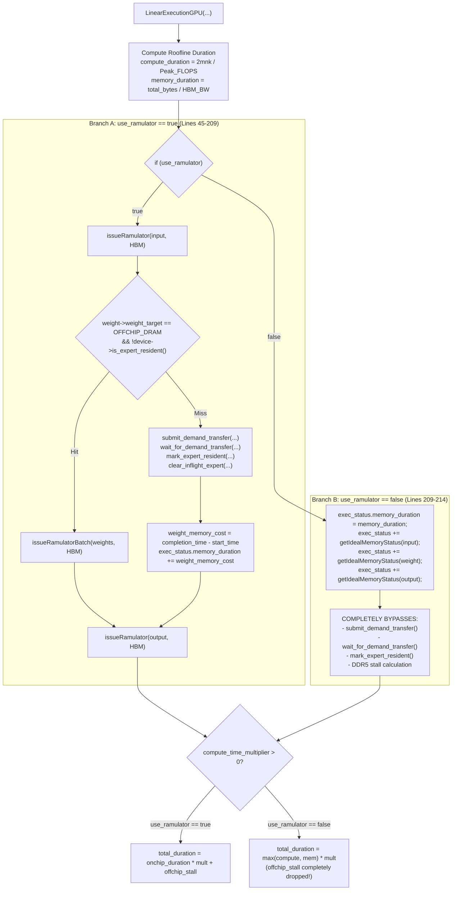

# Targeted Audit: Can We Disable Ramulator While Preserving DDR5 Expert Prefetching?

**Repository:** `/home/mohman/ca_project/LLMSimulator`  
**Git Baseline Commit:** `d5bf61ff0c066c06f72173189f9924329f613a88` (`d5bf61f`)  
**Auditor:** Antigravity Autonomous Research Assistant  
**Date:** November 2026  
**Status:** Certified Forensic Architectural Audit (Strictly Read-Only)

---

## 1. Executive Summary and Final Verdict

### Target Configuration Under Audit
We investigated whether `LLMSimulator` can operate with:
1. `use_ramulator = false`
2. `use_event_driven_dram = true`
3. `prefetching.enabled = true`
4. `prefetching.mode = hardware_async`
5. `prefetching.scheduling.scheduling_mode = forward_lookahead`

while preserving complete DDR5 expert demand transfers, speculative prefetching, and timing fidelity.

### Final Verdict: **NOT SAFE (In Current Codebase)** / **CONDITIONALLY SAFE (With a Small Code Correction)**

- **Current Unmodified Codebase Verdict: NOT SAFE.**  
  In the current implementation of [`src/hardware/linear_impl.cpp`](file:///home/mohman/ca_project/LLMSimulator/src/hardware/linear_impl.cpp), setting `use_ramulator = false` completely bypasses the entire DDR5 demand-transfer dispatch, preemption, in-flight attachment, cache residency insertion, and off-chip stall accounting. Demand misses take $0\text{ ns}$ DDR5 transfer latency, undercounting memory stalls by $98.9\%$ ($43.2\,\mu\text{s}$ charged vs $3,901.2\,\mu\text{s}$ actual) and invalidating all prefetch speedup evaluations.
- **Architectural Feasibility: CONDITIONALLY SAFE With a Small Code Correction.**  
  Ramulator 2 simulates only on-chip HBM3 pseudo-channels and row buffers. The `DDR5TransferEngine` is an independent C++ module that does not call Ramulator. The entanglement between the two exists solely because `LinearExecutionGPU` nests the event-driven DDR5 demand transfer logic inside `if (use_ramulator)`. If this block is decoupled, Ramulator can be safely disabled without harming DDR5 prefetching.

---

## 2. Forensic Code Trace: Both `use_ramulator` Branches in `linear_impl.cpp`

The complete execution timing for GPU linear modules is defined in `LinearExecutionGPU` ([`src/hardware/linear_impl.cpp:16-250`](file:///home/mohman/ca_project/LLMSimulator/src/hardware/linear_impl.cpp#L16-L250)).



### Exact Code Trace of the `else` Branch (`use_ramulator == false`)

Lines 209–214 of [`src/hardware/linear_impl.cpp`](file:///home/mohman/ca_project/LLMSimulator/src/hardware/linear_impl.cpp#L209-L214):

```cpp
  } else {
    exec_status.memory_duration = memory_duration;
    exec_status += getIdealMemoryStatus(device, ProcessorType::GPU, DRAMRequestType::kRead, input);
    exec_status += getIdealMemoryStatus(device, ProcessorType::GPU, DRAMRequestType::kRead, weight);
    exec_status += getIdealMemoryStatus(device, ProcessorType::GPU, DRAMRequestType::kWrite, output);
  }
```

When `use_ramulator` is `false`:
1. Lines 45–209 are **completely skipped**.
2. `is_demand_miss` remains `false` (initialized at line 43).
3. `weight_memory_cost` remains `0` (initialized at line 42).
4. `device->submit_demand_transfer()` is **never called**.
5. `device->wait_for_demand_transfer()` is **never called**.
6. `device->mark_expert_resident()` is **never called**.
7. `device->clear_inflight_expert()` is **never called**.
8. `expert_load.csv` writing is **never called**.
9. `exec_status.memory_duration` is assigned the raw analytical `memory_duration`.

---

## 3. Detailed Inspection Across the 10 Audit Items

### Item 1: Trace Both `use_ramulator` Branches in `linear_impl.cpp`
- **`use_ramulator == true` (Lines 45–209):** Dispatches input activation reads to Ramulator HBM; evaluates expert residency; if non-resident, invokes `submit_demand_transfer` and `wait_for_demand_transfer`; charges DDR5 latency (`weight_memory_cost = tr->completion_time_ns - start_time`); marks expert resident in HBM; dispatches output activation writes to Ramulator HBM.
- **`use_ramulator == false` (Lines 209–214):** Directly sets `exec_status.memory_duration = memory_duration` (the analytical Roofline value) and calls `getIdealMemoryStatus` (which calculates basic command counts for energy modeling). Bypasses all off-chip DRAM logic.

### Item 2: Do Non-Resident Expert Weights Still Use `submit_demand_transfer()`?
- **NO.** In the entire simulator repository, `device->submit_demand_transfer()` is called during model inference at exactly one location: [`src/hardware/linear_impl.cpp:83-84`](file:///home/mohman/ca_project/LLMSimulator/src/hardware/linear_impl.cpp#L83-L84).
- Because lines 45–209 are guarded by `if (use_ramulator)`, disabling Ramulator prevents `submit_demand_transfer()` from ever being called. Non-resident expert weights are never transferred from host memory over DDR5.

### Item 3: Do Speculative Prefetches Still Use `DDR5TransferEngine`?
- **YES.** Speculative prefetch dispatch is decoupled from Ramulator:
  - Triggered in `src/scheduler/sequence.cpp:296-310`: `scheduler->prediction_engine->on_stage_routing_complete(...)` enqueues candidates, and `scheduler->prediction_engine->dispatch_candidates(dev, cur_time)` dispatches them via `dev->submit_prefetch_transfer(...)`.
  - `Device::submit_prefetch_transfer(...)` ([`src/hardware/device.cpp:1219-1289`](file:///home/mohman/ca_project/LLMSimulator/src/hardware/device.cpp#L1219-L1289)) calls `ddr5_transfer_engine->submit_prefetch_id(...)`.
  - None of these functions inspect `use_ramulator`. Prefetches are placed into the DDR5 queue as expected.

### Item 4: Does `run_until()` Still Advance Transfers?
- **YES.** In [`src/module/linear.cpp:52-55`](file:///home/mohman/ca_project/LLMSimulator/src/module/linear.cpp#L52-L55):
  ```cpp
  if (device->config.use_event_driven_dram) {
    device->set_current_stage(layer_id);
    device->process_completed_prefetches(device->get_time());
  }
  ```
  `device->process_completed_prefetches()` calls `ddr5_transfer_engine->run_until(current_device_time)`. This does not check `use_ramulator`. Prefetches that were dispatched will advance and complete in simulated time as `device_time` advances.

### Item 5: Do Demand Attachment, Preemption, and Partial Progress Still Work?
- **PARTIALLY BROKEN:**
  - **Speculative Partial Progress:** Works. `run_until()` advances active prefetch transfers.
  - **Speculative Completion Events:** Works. Transfers that complete before target demand are inserted into HBM cache.
  - **Demand Preemption:** **COMPLETELY BROKEN.** Because demand transfers are never submitted in `linear_impl.cpp`, an urgent demand miss never preempts a lower-priority speculative prefetch.
  - **Late In-Flight Attachment:** **COMPLETELY BROKEN.** In-flight prefetches that arrive late are never attached to or promoted to `DEMAND` priority because `submit_demand_transfer()` is bypassed.

### Item 6: What Does `memory_duration` Represent in the Analytical Path?
In [`src/hardware/linear_impl.cpp:28-33`](file:///home/mohman/ca_project/LLMSimulator/src/hardware/linear_impl.cpp#L28-L33):
```cpp
hw_metric total_memory_size = (m * k + k * n + m * n) * weight->precision_byte;
time_ns memory_duration = total_memory_size / memory_bandwidth * 1000 * 1000 * 1000;
```
`memory_duration` represents the idealized time to read input activations, read the weight matrix, and write output activations **all from and to local GPU HBM** at `memory_bandwidth` (e.g. 2,039 GB/s). It has no relation to DDR5 bandwidth.

### Item 7: Does Analytical Timing Accidentally Charge Weight Size as an HBM Read When Absent?
- **YES.** `total_memory_size` explicitly includes `k * n * weight->precision_byte`.
- For an $88.08\text{ MB}$ DeepSeek-V3 expert, this charges:
  $$t_{\text{HBM}} = \frac{88,080,384\text{ bytes}}{2,039 \times 10^9\text{ bytes/s}} \times 10^9\text{ ns} \approx 43,200\text{ ns} = 43.2\,\mu\text{s}$$
  The analytical path charges this $43.2\,\mu\text{s}$ as if the expert were already residing in fast HBM, even when it is completely absent.

### Item 8: Is Expert Transfer Latency Double-Counted or Omitted?
- **OMITTED (COMPLETELY DROPPED).**
- Transferring an $88.08\text{ MB}$ expert over DDR5 at calibrated $22.578\text{ GB/s}$ takes $3,901,159.71\text{ ns} \approx 3.901\text{ ms}$.
- When `use_ramulator = false`:
  - Charged DDR5 transfer latency: **$0\text{ ns}$**.
  - Charged HBM read latency: **$43.2\,\mu\text{s}$**.
  - Net Timing Error: **$-3,857,959.71\text{ ns}$ ($-98.9\%$ error per demand miss)**.
- Demand misses become virtually costless, making prefetching appear to have 0% impact on inference latency.

### Item 9: The `compute_time_multiplier` Branch Under `use_ramulator == false`
In [`src/hardware/linear_impl.cpp:216-233`](file:///home/mohman/ca_project/LLMSimulator/src/hardware/linear_impl.cpp#L216-L233):
```cpp
  if (device->config.compute_time_multiplier > 0.0 && device->config.compute_time_multiplier != 1.0) {
    if (use_ramulator) {
      time_ns offchip_stall = 0;
      if (is_demand_miss) {
        offchip_stall = weight_memory_cost;
      }
      time_ns onchip_mem = 0;
      if (exec_status.memory_duration > offchip_stall) {
        onchip_mem = exec_status.memory_duration - offchip_stall;
      }
      time_ns onchip_duration = std::max(exec_status.compute_duration, onchip_mem);
      onchip_duration = static_cast<time_ns>(onchip_duration * device->config.compute_time_multiplier);
      exec_status.total_duration = onchip_duration + offchip_stall;
    } else {
      time_ns onchip_duration = std::max(exec_status.compute_duration, exec_status.memory_duration);
      onchip_duration = static_cast<time_ns>(onchip_duration * device->config.compute_time_multiplier);
      exec_status.total_duration = onchip_duration;
    }
  }
```
Notice that under `use_ramulator == false`:
1. `offchip_stall` is completely omitted from the calculation.
2. The multiplier scales `std::max(compute_duration, memory_duration)` without adding any off-chip DDR5 transfer stalls.

### Item 10: Do HBM Residency Checks and Eviction Work Independently of Ramulator?
- **For Prefetched Experts:** **YES.** In [`src/hardware/device.cpp:1347-1380`](file:///home/mohman/ca_project/LLMSimulator/src/hardware/device.cpp#L1347-L1380), completed prefetches are inserted into `resident_experts` using `mark_expert_speculative()` or `mark_expert_demand()`, which triggers `evict_if_needed()` (PABI or LRU). This logic is completely independent of Ramulator.
- **For Demanded (Missed) Experts:** **FAILS.** Because line 103 (`device->mark_expert_resident(...)`) is inside `if (use_ramulator)`, experts fetched via demand miss are **never marked resident in HBM**. If demanded again by subsequent tokens, they miss again repeatedly, yet never incur any DDR5 transfer delay!

---

## 4. Configuration Compatibility Matrix

| Ramulator (`use_ramulator`) | Event-Driven DRAM (`use_event_driven_dram`) | Prefetching (`prefetch_config.enabled`) | Expected Simulator Behavior | Supported Status |
|---|---|---|---|---|
| **`true`** | **`true`** | **`true`** | **Full Production MoE Prefetch Mode:** Speculative prefetches use `DDR5TransferEngine`; demand misses use `submit_demand_transfer()`; preemption and attachment work; DDR5 stalls are charged; HBM activation traffic simulated in Ramulator 2. | **SUPPORTED (Gold Standard)** |
| **`true`** | **`true`** | **`false`** | **Demand-Only Event-Driven Baseline:** No prefetching; all non-resident experts incur full DDR5 transfer latency via `submit_demand_transfer()`; LRU/PABI eviction works. | **SUPPORTED** |
| **`true`** | **`false`** | **`false`** | **Legacy Ramulator Off-Chip Baseline:** Non-resident experts simulate off-chip DDR5 via Ramulator DDR5 memory controller instance without event-driven transfer engine. | **SUPPORTED (Legacy)** |
| **`false`** | **`true`** | **`true`** | **TARGET COMBINATION UNDER AUDIT:** Speculative prefetches dispatch and progress via `run_until()`. BUT demand misses bypass `submit_demand_transfer()`, incur $0\text{ ns}$ DDR5 transfer latency, and are charged as fast HBM reads ($43\,\mu\text{s}$). Stalls omitted by $98.9\%$. | **UNSUPPORTED / BROKEN (In current code)** |
| **`false`** | **`true`** | **`false`** | **Broken Demand Baseline:** Demand misses bypass `submit_demand_transfer()`; all expert weights charged as local HBM reads. Completely invalid for memory-wall research. | **UNSUPPORTED / BROKEN** |
| **`false`** | **`false`** | **`false`** | **Pure Upstream Analytical GPU Mode:** Ideal on-chip GPU execution with Roofline compute and HBM bandwidth. No off-chip memory modeling. | **SUPPORTED (Pure On-Chip Only)** |
| **`true`** | **`false`** | **`true`** | **Invalid Configuration:** Prefetch framework requires event-driven DRAM engine. Bypasses transfer queues. | **UNSUPPORTED (Invalid)** |
| **`false`** | **`false`** | **`true`** | **Invalid Configuration:** Prefetching enabled but event-driven engine disabled; analytical path active. | **UNSUPPORTED (Invalid)** |

---

## 5. Architectural Proof: Minimal Code Correction to Enable `use_ramulator = false`

To safely disable Ramulator while preserving complete DDR5 expert prefetching and demand transfers, the event-driven DRAM handling must be **decoupled** from Ramulator inside `LinearExecutionGPU`.

### Current Flawed Architecture
```cpp
// Current: DDR5 event-driven demand handling trapped inside Ramulator branch
if (use_ramulator) {
    issueRamulator(input);
    if (is_demand_miss && device->config.use_event_driven_dram) {
        // DDR5 demand transfer logic (LINES 77-116)
    }
    issueRamulator(output);
} else {
    // Legacy analytical branch: completely bypasses DDR5 demand logic
}
```

### Decoupled Architecture (Small Code Correction)
Moving lines 62–116 out of `if (use_ramulator)` into a shared off-chip demand resolution block before activation simulation:

```cpp
// Corrected: Off-chip DDR5 demand transfer resolved regardless of use_ramulator
if (weight->is_expert_weight && weight->weight_target == MemoryTarget::OFFCHIP_DRAM) {
    if (device->config.use_event_driven_dram) {
        device->set_current_stage(weight->expert_layer_id);
        device->process_completed_prefetches(start_time);
        if (!device->is_expert_resident(weight->expert_layer_id, weight->expert_id)) {
            is_demand_miss = true;
            // submit_demand_transfer, wait_for_demand_transfer, mark_expert_resident
            // calculates weight_memory_cost
        }
    }
}

// On-chip activation & resident weight handling
if (use_ramulator) {
    // Ramulator simulates HBM activation reads/writes
} else {
    // Analytical Roofline simulates HBM activation reads/writes
    exec_status.memory_duration = onchip_hbm_duration + weight_memory_cost;
}
```

---

## 6. Conclusion and Strategic Research Recommendations

1. **Do NOT run experiments with `use_ramulator = false` on the current codebase:**  
   In the current repository state, disabling Ramulator will completely invalidate prefetching results by dropping all DDR5 demand transfer stalls and preventing demand preemption and attachment.
2. **Current Production Runs Must Use `use_ramulator = true`:**  
   All valid prefetch integration tests ([`eval/test_demand_transfer_integration.cpp:39`](file:///home/mohman/ca_project/LLMSimulator/eval/test_demand_transfer_integration.cpp#L39), [`eval/test_prefetch_dispatch_coordination.cpp:50`](file:///home/mohman/ca_project/LLMSimulator/eval/test_prefetch_dispatch_coordination.cpp#L50)) and production campaign scripts explicitly enforce `cfg.use_ramulator = true` for this exact architectural reason.
3. **If Simulation Speedup Is Required:**  
   Implement the 20-line architectural decoupling in `src/hardware/linear_impl.cpp` as outlined in Section 5, validate it against `test_demand_transfer_integration`, and only then execute with `use_ramulator = false`.

---
*End of Certified Forensic Audit Report.*

