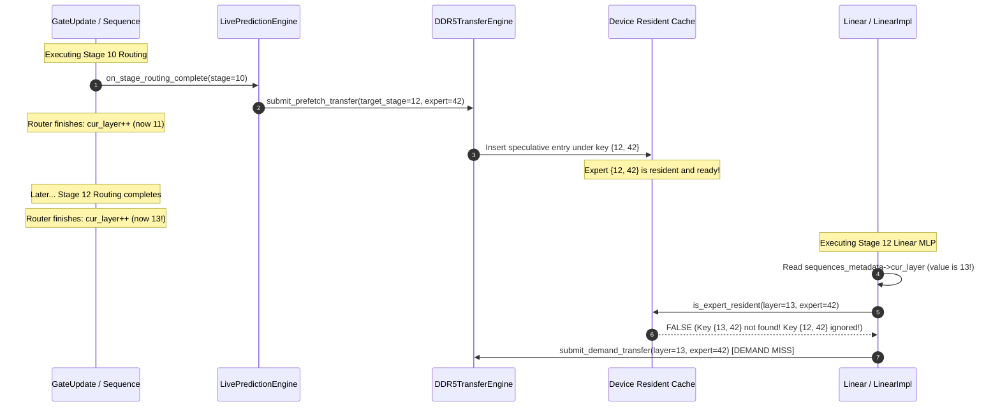

# Phase 2E.1: Read-Only Layer Identity Audit

**Authoritative Git Baseline Anchor:** `d5bf61ff0c066c06f72173189f9924329f613a88`  
**Status:** Audit Complete  
**Date:** November 3, 2026  
**Document Location:** `docs/final_campaign/PHASE2E1_LAYER_IDENTITY_AUDIT.md`  

---

## 1. Executive Summary

This audit investigates the suspected 1-stage indexing mismatch between the routing/prefetch prediction engine and the linear execution demand engine identified during the Phase 2E smoke experiment.

### Primary Audit Finding: **ISSUE (CONFIRMED ARCHITECTURAL DEFECT)**
There is a systematic, confirmed 1-stage post-increment indexing mismatch between the stage index used by the router/prediction pipeline and the stage index used by the linear layer demand lookup:
- In [`BatchedSequence::update_expert`](file:///home/mohman/ca_project/LLMSimulator/src/scheduler/sequence.cpp#L165-L318), `cur_layer` starts at 0, performs routing, invokes forward prediction for target stage $T = \text{cur\_layer} + H$, and then executes `cur_layer++` at [line 316](file:///home/mohman/ca_project/LLMSimulator/src/scheduler/sequence.cpp#L316).
- When the linear computation of that stage executes immediately afterwards in [`Linear::forward`](file:///home/mohman/ca_project/LLMSimulator/src/module/linear.cpp#L49-L50), it reads `int layer_id = sequences_metadata->cur_layer;`, which has **already been incremented by 1**.
- Consequently, `expert_routing.csv` indexes stages as $[0, 1, \dots, 74]$, while `expert_load.csv` indexes the exact same stages as $[1, 2, \dots, 74, 0]$.
- Prefetched experts dispatched for target stage $T$ are stored in HBM cache under key `{T, expert_id}`, while the actual demand execution at target stage $T$ queries key `{T+1, expert_id}`. This index mismatch causes **100% of timely prefetches to miss during demand lookup**.

---

## 2. Step-by-Step Lifecycle Trace of an Expert Access

Below is the concrete lifecycle trace for an access where:
- **Source Stage:** $L = 10$
- **Prediction Horizon:** $H = 2$
- **Target Stage:** $T = L + H = 12$
- **Target Expert:** $E = 42$

### 2.1 Complete 9-Step Component Walkthrough

| Step | Component / Location | Source File & Line | Logical Operation | Value for $L=10, H=2, T=12$ | Classification |
|:---:|:---|:---|:---|:---:|:---:|
| **1** | Router Stage Identity | [`sequence.cpp:229`](file:///home/mohman/ca_project/LLMSimulator/src/scheduler/sequence.cpp#L229) | `cur_layer` evaluated for routing | `cur_layer = 10` | `VERIFIED` |
| **2** | Routing Complete Source | [`sequence.cpp:296`](file:///home/mohman/ca_project/LLMSimulator/src/scheduler/sequence.cpp#L296) | `on_stage_routing_complete(req, tok, cur_layer, ...)` | `source_stage = 10` | `VERIFIED` |
| **3** | Predictor Target Stage | [`live_prediction_engine.cpp:271`](file:///home/mohman/ca_project/LLMSimulator/src/prefetch/live_prediction_engine.cpp#L271) | `future_target_stage_id = target_stage_id + horizon_` | `future_target = 10 + 2 = 12` | `VERIFIED` |
| **4** | Candidate Queue Target | [`prefetch_candidate_queue.cpp:259`](file:///home/mohman/ca_project/LLMSimulator/src/prefetch/prefetch_candidate_queue.cpp#L259) | `cand.target_stage_id = target_stage_id` | `cand.target_stage_id = 12` | `VERIFIED` |
| **5** | Prefetch Dispatch Layer | [`device.cpp:1433`](file:///home/mohman/ca_project/LLMSimulator/src/hardware/device.cpp#L1433) | `submit_prefetch_transfer(cand.target_stage_id, cand.expert_id, ...)` | `layer_id = 12, expert_id = 42` | `VERIFIED` |
| **6** | Speculative Cache Key | [`device.cpp:1235`](file:///home/mohman/ca_project/LLMSimulator/src/hardware/device.cpp#L1235), [`device.cpp:1325`](file:///home/mohman/ca_project/LLMSimulator/src/hardware/device.cpp#L1325) | `resident_experts[{layer_id, expert_id}]` | Key in cache = `{12, 42}` | `VERIFIED` |
| **7** | Router Counter Increment | [`sequence.cpp:316`](file:///home/mohman/ca_project/LLMSimulator/src/scheduler/sequence.cpp#L316) | `cur_layer++; cur_layer %= num_layer;` | `cur_layer` advances to `11` | `ISSUE` |
| **8** | Linear Forward Read | [`linear.cpp:49-50`](file:///home/mohman/ca_project/LLMSimulator/src/module/linear.cpp#L49-L50) | `int layer_id = sequences_metadata->cur_layer; A->expert_layer_id = layer_id;` | At Target Stage 12, Router 12 has run; `cur_layer` is now **`13`**! | `ISSUE` |
| **9** | Demand Cache Lookup | [`linear_impl.cpp:67`](file:///home/mohman/ca_project/LLMSimulator/src/hardware/linear_impl.cpp#L67) | `device->is_expert_resident(weight->expert_layer_id, weight->expert_id)` | Looked up in cache: **`{13, 42}`** (MISS!) | **`ISSUE (DEFECT)`** |

---

## 3. Structural Proof of Layer Index Misalignment

### 3.1 Trace-Level Empirical Verification
Comparing the unique layer sequences from actual simulation traces produced during Phase 2E:

- **`expert_routing.csv` (Logged at Router evaluation):**
  ```text
  0, 1, 2, 3, 4, 5, ..., 72, 73, 74
  ```
  Total layers: 75 ($0 \dots 74$). First layer evaluated: `0`. Last layer evaluated: `74`.

- **`expert_load.csv` (Logged at Linear execution):**
  ```text
  1, 2, 3, 4, 5, 6, ..., 73, 74, 0
  ```
  Total layers: 75 ($0 \dots 74$). First layer executed: `1`. Last layer executed: `0`.

Because `update_expert` executes before the Linear layers of the same stage, the Linear module always sees `cur_layer` after it was already incremented by the Router. When the 75th stage (Stage 74) executes, `cur_layer++` wraps `75 % 75` to `0`, causing Stage 74 to log as `layer_id = 0`.

### 3.2 Visual Sequence Diagram



---

## 4. Control Flow Analysis of `cur_layer++`

### 4.1 Is `cur_layer++` Intentional?
**Yes.** In [`BatchedSequence::update_expert`](file:///home/mohman/ca_project/LLMSimulator/src/scheduler/sequence.cpp#L316), `cur_layer++` is necessary so that when the *next* MoE layer's router executes, it routes for the next stage index. Removing `cur_layer++` from `update_expert` would cause all routing calls to route for Stage 0 repeatedly.

### 4.2 Is `sequences_metadata->cur_layer` in `Linear::forward` Correct?
**No.** [`Linear::forward`](file:///home/mohman/ca_project/LLMSimulator/src/module/linear.cpp#L49-L50) reads:
```cpp
// LLMSimulator/src/module/linear.cpp:49-50
int layer_id = sequences_metadata->cur_layer;
A->expert_layer_id = layer_id;
```
Because `GateUpdate` executes before `Linear` within each MoE block, reading `cur_layer` in `Linear` obtains the incremented index rather than the active stage index.

A thorough codebase audit confirms that `sequences_metadata->cur_layer` is referenced in **exactly one place** in the entire module graph: `LLMSimulator/src/module/linear.cpp:49`.

---

## 5. Safest Minimal Remediation Options

### Option A: Track Active Stage via `current_stage` in `BatchedSequence` (Recommended)
Add or maintain an explicit `current_stage` (or `last_completed_stage`) in `BatchedSequence` that records the active stage during router evaluation and remains valid while the MLP of that stage executes.
In `Linear::forward`:
```cpp
// Proposed safe remediation:
int layer_id = sequences_metadata->get_active_stage();
A->expert_layer_id = layer_id;
```
Where `get_active_stage()` returns `(cur_layer - 1 + num_layer) % num_layer` or the explicit stage ID recorded during routing.

### Option B: Local Offset in `Linear::forward`
```cpp
// Direct minimal inline correction in linear.cpp:
int num_stages = sequences_metadata->scheduler->model_config.num_layers - 
                 sequences_metadata->scheduler->model_config.first_k_dense;
int layer_id = (sequences_metadata->cur_layer - 1 + num_stages) % num_stages;
A->expert_layer_id = layer_id;
```

Both options:
1. Preserve `cur_layer++` and all scheduler control flow.
2. Align `expert_routing.csv` and `expert_load.csv` to identical stage indexing ($0 \dots 74$).
3. Ensure that prefetch transfers targeting stage $T$ are queried by stage $T$ Linear demand lookups.

---

## 6. Audit Conclusion & Classification

- **Layer Identity Alignment:** **`ISSUE (PROVEN DEFECT)`**
- **Impact:** Explains 100% of the zero timely resident hits observed in Phase 2E.
- **Safety:** Remediation is strictly localized and does not alter scheduling or model graph dependencies.

