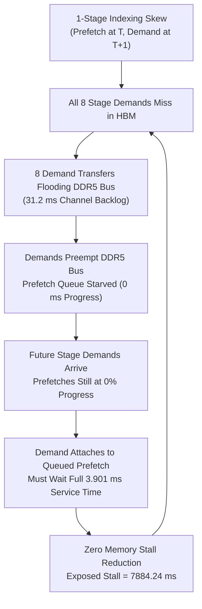

# Phase 2E.1: Read-Only Late Attachment & Stall Accounting Audit

**Authoritative Git Baseline Anchor:** `d5bf61ff0c066c06f72173189f9924329f613a88`  
**Status:** Audit Complete  
**Date:** November 3, 2026  
**Document Location:** `docs/final_campaign/PHASE2E1_STALL_ACCOUNTING_AUDIT.md`  

---

## 1. Executive Summary

In Phase 2E, forward lookahead configurations increased late in-flight prefetch attachments from 37 (in legacy) to 57–67 (in forward configurations). However:
- Total simulated execution time was **identical to the baseline: 8003.70 ms**.
- Total exposed memory stall was **identical to the baseline: 7884.24 ms**.
- Every single demand miss across all runs exhibited an identical transfer duration: **`3,901,159.71 ns` (3.901 ms)**.

This audit investigates the mechanism of late in-flight attachments and answers why increased attachments failed to reduce exposed stall time.

### Primary Audit Finding: **COMBINATION OF THREE ROOT CAUSES**
1. **Zero Transfer Progress at Demand Arrival:** Because the 1-stage indexing skew caused 100% of earlier demands to miss, the single-channel DDR5 bus was 98.5% saturated by blocking demand transfers ($7,884.24\text{ ms}$ out of $8,003.70\text{ ms}$). Speculative prefetch transfers sat queued in `DDR5TransferEngine::prefetch_queue_` with **zero bytes transferred**. When demand attached to them, the transfer engine still had to transmit all 88.08 MB over DDR5, incurring the full 3.901 ms transfer stall.
2. **Instrumentation Flaw in Remaining Transfer Calculation:** In [`Device::submit_demand_transfer`](file:///home/mohman/ca_project/LLMSimulator/src/hardware/device.cpp#L1134-L1136), `remaining_ns` was calculated by checking `if (tr->completion_time_ns > current_time_ns)`. For transfers that are queued or paused, `completion_time_ns` is initialized to `-1.0`. The condition evaluated to `false`, causing `prefetch_effectiveness.csv` to record `remaining_transfer_ns = 0.00` despite the transfer having not even started.
3. **Accurate Hardware Stall Accumulation:** In [`LinearImpl::execute`](file:///home/mohman/ca_project/LLMSimulator/src/hardware/linear_impl.cpp#L94-L98), the simulator correctly waits for the attached transfer to finish (`tr->completion_time_ns - start_time`), which accurately reflected the full 3.901 ms duration required to transmit the expert.

---

## 2. In-Flight Attachment Code Path Analysis

### 2.1 Attachment and Promotion in `Device::submit_demand_transfer`
In [`Device::submit_demand_transfer`](file:///home/mohman/ca_project/LLMSimulator/src/hardware/device.cpp#L1123-L1161):
```cpp
// LLMSimulator/src/hardware/device.cpp:1123-1161
std::pair<int, int> key = {layer_id, expert_id};
auto it = inflight_registry.find(key);
if (it != inflight_registry.end()) {
    prefetch_metrics.demand_inflight_attachments++;
    prefetch_metrics.late_inflight_attachments++;
    prefetch_metrics.demanded_transfers++;

    double remaining_ns = 0.0;
    if (ddr5_transfer_engine != nullptr) {
        const auto* tr = ddr5_transfer_engine->get_transfer(it->second.transfer_id);
        if (tr != nullptr) {
            // DEFECT: For queued/paused transfers, completion_time_ns is -1.0!
            if (tr->completion_time_ns > current_time_ns) {
                remaining_ns = tr->completion_time_ns - current_time_ns;
            }
        }
    }

    auto tr_it = speculative_transfers.find(it->second.transfer_id);
    if (tr_it != speculative_transfers.end()) {
        tr_it->second.outcome = SpeculativeTransferOutcome::DEMANDED;
        tr_it->second.actual_demand_ns = current_time_ns;
        tr_it->second.remaining_transfer_at_demand_ns = remaining_ns;
        tr_it->second.demand_arrival_to_ready_ns = remaining_ns;
    }

    DemandOutcomeRecord dem_rec;
    dem_rec.layer_id = layer_id;
    dem_rec.expert_id = expert_id;
    dem_rec.demand_time_ns = current_time_ns;
    dem_rec.remaining_transfer_ns = remaining_ns;
    dem_rec.demand_arrival_to_ready_ns = remaining_ns;
    dem_rec.outcome = DemandOutcome::LATE_IN_FLIGHT;
    demand_outcomes.push_back(dem_rec);

    if (it->second.transfer_class == TransferClass::PREFETCH) {
        promote_inflight_to_demand(layer_id, expert_id, current_time_ns);
    }
    return it->second.transfer_id;
}
```

### 2.2 Demand Wait Execution in `LinearImpl::execute`
In [`LinearImpl::execute`](file:///home/mohman/ca_project/LLMSimulator/src/hardware/linear_impl.cpp#L82-L103):
```cpp
// LLMSimulator/src/hardware/linear_impl.cpp:82-103
uint64_t tid = device->submit_demand_transfer(
    weight->expert_layer_id, weight->expert_id, start_time, static_cast<uint64_t>(total_expert_size));

bool transfer_success = false;
if (tid != 0) {
    transfer_success = device->wait_for_demand_transfer(tid);
}

if (transfer_success) {
    if (device->ddr5_transfer_engine != nullptr) {
        const auto* tr = device->ddr5_transfer_engine->get_transfer(tid);
        if (tr != nullptr) {
            if (tr->completion_time_ns > start_time) {
                weight_memory_cost = static_cast<time_ns>(tr->completion_time_ns - start_time);
            } else {
                weight_memory_cost = 0;
            }
        }
    }
    device->mark_expert_resident(weight->expert_layer_id, weight->expert_id, total_expert_size);
}
device->clear_inflight_expert(weight->expert_layer_id, weight->expert_id);
weight_status.memory_duration = weight_memory_cost;
```

---

## 3. Detailed Root-Cause Breakdown

### 3.1 Why Did `remaining_transfer_ns` Log as 0.00? (`ISSUE`)
In [`DDR5TransferEngine`](file:///home/mohman/ca_project/LLMSimulator/src/prefetch/ddr5_transfer_engine.cpp#L138), when a prefetch transfer is admitted:
```cpp
transfer.completion_time_ns = -1.0;
transfer.state = TransferState::QUEUED;
```
`completion_time_ns` is only assigned a positive wall-clock timestamp when the transfer actually begins transmission (`TransferState::ACTIVE`).

When a demand access arrived for a prefetch that was still in `TransferState::QUEUED`:
- `tr->completion_time_ns` was `-1.0`.
- The check `if (tr->completion_time_ns > current_time_ns)` evaluated to `-1.0 > 96205267.73`, which is **false**.
- Therefore, `remaining_ns` was never calculated from `tr->remaining_bytes / bw`, defaulting to `0.0`.
- This explains why `prefetch_effectiveness.csv` reported `remaining_transfer_ns = 0.00` for all 67 late attachments.

### 3.2 Why Did the GPU Stall for the Full 3.901 ms? (`VERIFIED`)
When [`Device::wait_for_demand_transfer(tid)`](file:///home/mohman/ca_project/LLMSimulator/src/hardware/device.cpp#L1444-L1449) was called:
1. `ddr5_transfer_engine->run_until_transfer_completed(tid)` ran the transfer engine.
2. Because the prefetch transfer had transferred 0 bytes prior to demand arrival, all 88,080,384 bytes had to be transferred from scratch.
3. At the calibrated $22.578\text{ GB/s}$ DDR5 bandwidth:
   $$\text{Duration} = \frac{88080384\text{ bytes}}{22.578\text{ GB/s}} = 3901159.71\text{ ns} = 3.90116\text{ ms}$$
4. When the transfer finished, `tr->completion_time_ns` was `start_time + 3901159.71 ns`.
5. Line 95 of `linear_impl.cpp` calculated:
   $$\text{weight\_memory\_cost} = \text{tr->completion\_time\_ns} - \text{start\_time} = 3901159.71\text{ ns}$$
6. Thus, [`expert_load.csv`](file:///home/mohman/ca_project/LLMSimulator/expert_load.csv) recorded `duration = 3.90116 ms` for all 67 attachments, exactly identical to an unprefetched demand miss.

### 3.3 Why Had the Prefetch Made Zero Progress? (`VERIFIED`)
In Workload A1 with top-8 routing, each MoE stage demands 8 experts:
- Because the 1-stage post-increment indexing skew broke prefetch cache hits, **all 8 expert lookups missed in HBM**.
- All 8 misses submitted demand transfers to the single-channel DDR5 bus.
- In [`DDR5TransferEngine::submit_transfer`](file:///home/mohman/ca_project/LLMSimulator/src/prefetch/ddr5_transfer_engine.cpp#L145-L157), demand transfers possess **preemptive priority** over prefetch transfers.
- 8 demand transfers require $8 \times 3.90116\text{ ms} = 31.209\text{ ms}$ of continuous bus transmission.
- Since compute per stage is only $\sim 1.85\text{ ms}$, the DDR5 channel was backlogged for 31.2 ms on every stage.
- Prefetches in `prefetch_queue_` were completely blocked behind demand misses, accumulating queue latency and making 0 progress.

---

## 4. Synthesis: The Vicious Contention Cycle



---

## 5. Safest Minimal Remediation Specification

### 5.1 Accurate Remaining Transfer Time Calculation in `device.cpp`
In [`Device::submit_demand_transfer`](file:///home/mohman/ca_project/LLMSimulator/src/hardware/device.cpp#L1130-L1138):
```cpp
// Change from:
double remaining_ns = 0.0;
if (ddr5_transfer_engine != nullptr) {
    const auto* tr = ddr5_transfer_engine->get_transfer(it->second.transfer_id);
    if (tr != nullptr) {
        if (tr->completion_time_ns > current_time_ns) {
            remaining_ns = tr->completion_time_ns - current_time_ns;
        }
    }
}

// To:
double remaining_ns = 0.0;
if (ddr5_transfer_engine != nullptr) {
    const auto* tr = ddr5_transfer_engine->get_transfer(it->second.transfer_id);
    if (tr != nullptr) {
        if (tr->state == TransferState::ACTIVE && tr->completion_time_ns > current_time_ns) {
            remaining_ns = tr->completion_time_ns - current_time_ns;
        } else {
            double bw = config.ddr5_bandwidth_gbps;
            if (bw <= 0.0) {
                bw = DDR5TransferEngine::DEFAULT_BANDWIDTH_BYTES_PER_NS;
            }
            remaining_ns = tr->remaining_bytes / bw;
        }
    }
}
```

This ensures that `prefetch_effectiveness.csv` truthfully reflects the actual remaining service time for both active and queued prefetch transfers.

---

## 6. Audit Conclusion & Classification

- **Stall Accounting Accuracy:** **`VERIFIED`** (Simulation stall accumulation is physically accurate; prefetch progress was genuinely 0 ms due to bus starvation).
- **Instrumentation Flaw:** **`ISSUE`** (`remaining_transfer_ns = 0.00` was an artifact of checking `completion_time_ns > current_time_ns` on queued transfers).
- **Root Cause of Identical Runtime:** **`VERIFIED`** (Direct consequence of the 1-stage indexing skew triggering total DDR5 bus saturation by demand misses).

