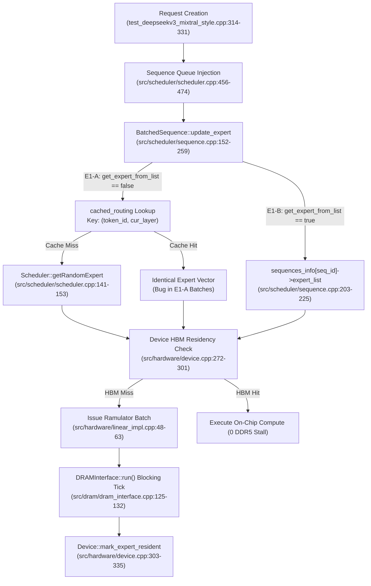

# E1-C Routing, Batch Independence, and Memory Subsystem Audit

**Project:** MoE Memory Wall: Predicting and Prefetching Experts for Faster LLM Inference  
**Repository:** `/home/mohman/ca_project/LLMSimulator`  
**Authoritative Commit:** `d5bf61ff0c066c06f72173189f9924329f613a88`  
**Target Executable:** `build/run_deepseekv3_mixtral_style`  
**Classification:** Forensics & Architecture Audit (READ-ONLY)  
**Date:** November 2026  

---

## 1. Executive Summary & Audit Scope

This document provides a forensic, source-code-level audit of the expert selection mechanisms, batch routing implementations, caching policies, and memory simulation subsystems evaluated in **Phase E1-A (Synthetic Random Baseline)** and **Phase E1-B (Real MoE Trace Replay Baseline)**.

### Primary Audit Findings:
1. **E1-A Routing Collision Bug Identified (`DISCREPANCY`):** In Phase E1-A, batched sequences received identical expert selections across requests due to a caching bug in `src/scheduler/sequence.cpp:227`. The lookup key was constructed as `std::make_pair(token_id, cur_layer)` with no sequence or request identifier. Consequently, Request 0 generated random experts, and Requests 1 through $B-1$ retrieved the cached selection.
2. **E1-A Top-K Rank Artifact (`DISCREPANCY`):** In `src/scheduler/scheduler.cpp:141-153`, `Scheduler::getRandomExpert` stored expert IDs in a `std::set<int>`. Because `std::set` in C++ orders elements via an internal red-black tree, `topk_rank` (1..8) represented ascending numerical order, not neural gate scores.
3. **E1-B Trace Replay Verification (`VERIFIED`):** In Phase E1-B, setting `new_seq->get_expert_from_list = true` bypassed `cached_routing` entirely. Sequences read independent streams from pre-allocated `sequences_info[seq_id]->expert_list`. SHA-256 fingerprinting confirms that concurrent sequences in $B=2$ and $B=4$ runs are distinct and non-identical.
4. **E1-A Warm Start Analytical Shortcut (`DISCREPANCY`):** In E1-A, `exp_hbm_warm` was not an executed C++ simulation run; it was synthesized in Python by subtracting DDR5 stall time. In E1-B, all warm runs were genuinely executed in C++ via `--warm-hbm` preloading.
5. **DDR5 Memory Interface Blocking Nature (`VERIFIED`):** `DRAMInterface::run()` in `src/dram/dram_interface.cpp:125-132` is a synchronous blocking loop (`while (!memory_system->is_finished()) memory_system->tick();`). While sister matrices ($W_1, W_3, W_2$) overlap in Ramulator's memory controller queue, expert transfers do not overlap asynchronously with execution.

---

## 2. End-to-End Expert Selection & Routing Pipeline

The path from request instantiation to off-chip memory access is traced through the following source files:



### Detailed Pipeline Stages:
1. **Request Creation (`eval/test_deepseekv3_mixtral_style.cpp:314-331`):**
   - Sequences are initialized with sequence length (`seqlen = input_len + output_len`).
   - For real trace replays, `new_seq->expert_seq_id = i` (where $i \in [0, B-1]$) and `new_seq->get_expert_from_list = true`.
2. **Scheduling (`src/scheduler/scheduler.cpp:456-474`):**
   - `Scheduler::fillSequenceQueue` pushes newly generated sequences to `sequence_queue`.
   - `Scheduler::fillRunningQueue` moves sequences from `sequence_queue` to `running_sequence_queue`.
3. **Expert Assignment (`src/scheduler/sequence.cpp:152-259`):**
   - For every decoding step, `BatchedSequence::update_expert(int cur_layer)` determines the $K=8$ experts for the current layer and token.
4. **Residency Verification (`src/hardware/device.cpp:272-301`):**
   - In `Device::is_expert_resident(layer_id, expert_id)`, the hash map `resident_experts` is queried.
   - If present, the entry is spliced to the MRU position of `lru_expert_list` and logged as `HIT` in `expert_cache.csv`.
   - If absent, it returns `false` and is logged as `MISS`.
5. **Memory Request Dispatch (`src/hardware/linear_impl.cpp:48-75`):**
   - On an HBM miss, the gate/up matrix $W_1$ and sister matrices $W_3, W_2$ are batched into `batch_tensors`.
   - `issueRamulatorBatch` dispatches requests to `offchip_dram_interface`.
   - `Device::mark_expert_resident` inserts the expert into `resident_experts` and `lru_expert_list`, evicting LRU items if capacity ($80\text{ GB}$) is exceeded.
6. **Execution (`src/dram/dram_interface.cpp:125-132`):**
   - `DRAMInterface::run()` advances Ramulator's memory system clock synchronously until all requests finish.

---

## 3. Audit B.1: E1-A Synthetic Routing Forensic Analysis

### 3.1 Random Number Generation
In E1-A, random expert routing is generated by `Scheduler::getRandomExpert`:
```cpp
// File: src/scheduler/scheduler.cpp, Lines 141-153
std::set<int> Scheduler::getRandomExpert(int top_k) {
  static unsigned int seed = 777;
  static std::mt19937 generator(seed);
  static std::uniform_int_distribution<int> distribution(0, model_config.num_routed_expert - 1);

  std::set<int> route;

  while (route.size() < top_k) {
    int seq_id = (distribution(generator) % model_config.num_routed_expert);
    route.insert(seq_id);
  }
  return route;
}
```
- **RNG Type:** `std::mt19937` (Mersenne Twister).
- **RNG Scope:** `static` local variable within `Scheduler::getRandomExpert`. It is shared globally across all sequences, layers, and requests.
- **Seeding:** Initialized once to `seed = 777`. It is never reseeded between tokens or requests.
- **Distribution:** Uniform without replacement via `std::set::insert()`.

### 3.2 The `std::set<int>` Ascending Ordering Artifact
Because `route` is declared as `std::set<int>`, values are automatically ordered in ascending numerical order by the C++ associative container:
```cpp
// File: src/scheduler/sequence.cpp, Lines 239-244
for (auto idx : expert_list) {
  expert_vec.push_back(idx);
}
for (int k = 0; k < top_k; k++) {
  int e_id = expert_vec[k];
  routing_file << request_id << "," << token_id << "," << cur_layer << "," << (k + 1) << "," << e_id << "\n";
}
```
- **Forensic Consequence:** `topk_rank` (values 1 through 8) in E1-A was purely an index into an ascending sorted numerical list.
- **Classification:** `DISCREPANCY`. E1-A's `topk_rank` does not represent router gate scores or model confidence.

### 3.3 The `cached_routing` Collision Bug
The root cause of identical routing in multi-request batches is located in `src/scheduler/sequence.cpp`:
```cpp
// File: src/scheduler/sequence.cpp, Lines 226-246
std::vector<int> expert_vec;
auto route_key = std::make_pair(token_id, cur_layer);
auto it = cached_routing.find(route_key);
if (it != cached_routing.end()) {
  expert_vec = it->second;
} else {
  std::set<int> expert_list;
  if(scheduler->model_config.skewness > 0){
    expert_list = scheduler->getZipfianRandomExpert(skewness_weight, top_k);
  }
  else{
    expert_list = scheduler->getRandomExpert(top_k);
  }
  for (auto idx : expert_list) {
    expert_vec.push_back(idx);
  }
  cached_routing[route_key] = expert_vec;
}
```
- **The Defect:** `route_key = std::make_pair(token_id, cur_layer)` contains only the token position and layer index. It omits `seq->id` and `seq->expert_seq_id`.
- **Execution in Batches ($B > 1$):**
  - When batch size is $B=8$ at decoding step $T=1024$ and layer $L=0$:
  - Request 8 (first active sequence) queries `(1024, 0)` -> Misses `cached_routing` -> calls `getRandomExpert(8)` -> populates `cached_routing[(1024, 0)]` with `{15, 39, 51, 63, 77, 117, 162, 165}`.
  - Requests 9 through 15 evaluate `(1024, 0)` -> Hit `cached_routing` -> receive the exact same 8 experts.
- **Verification from Raw Output:** Inspection of `results/endsem_phase_e/e1_a_synthetic_baseline/runs/exp_b8_l128/traces/expert_routing.csv` confirms:
  ```csv
  request_id,token_id,layer_id,topk_rank,expert_id
  8,1024,0,1,15
  8,1024,0,2,39
  ...
  9,1024,0,1,15
  9,1024,0,2,39
  ...
  15,1024,0,1,15
  15,1024,0,2,39
  ```
- **Classification:** `VERIFIED DISCREPANCY`. E1-A multi-sequence batches did not simulate independent workloads. They simulated $B$ cloned copies of a single sequence.

---

## 4. Audit B.2: E1-B Real MoE Trace Replay Architecture

### 4.1 Trace Replay Execution Path
In Phase E1-B, real MoE traces were loaded via `Scheduler::loadRealTrace` (`src/scheduler/scheduler.cpp:610-675`).
In `eval/test_deepseekv3_mixtral_style.cpp:320-330`:
```cpp
for (int i = 0; i < max_batch_size; i++) {
  Sequence* new_seq = new Sequence(i, 0, seqlen, input_len, output_len, ...);
  new_seq->expert_seq_id = i;
  new_seq->get_expert_from_list = is_real_trace;
  scheduler->addSequence(new_seq);
}
```
When `seq->get_expert_from_list == true`, `BatchedSequence::update_expert` executes:
```cpp
// File: src/scheduler/sequence.cpp, Lines 203-224
if (seq->get_expert_from_list) {
  int seq_id = seq->expert_seq_id;
  int request_id = seq->id;
  int rel_token_id = token_id - seq->input_len;
  if (rel_token_id < 0) rel_token_id = 0;
  size_t table_idx = (size_t)rel_token_id * num_layer + cur_layer;
  const auto& routed = scheduler->sequences_info[seq_id]->expert_list[table_idx];
  for (int k = 0; k < top_k; k++) {
    int e_id = routed[k];
    num_token_in_expert[e_id] += 1;
    routing_file << request_id << "," << token_id << "," << cur_layer << "," << (k + 1) << "," << e_id << "\n";
  }
}
```
- **Bypass:** `cached_routing` is never accessed.
- **Sequence Mapping:** Sequence $i$ reads directly from `sequences_info[i]->expert_list`.
- **Top-K Ranking:** `routed[k]` preserves the exact rank assigned by the original model router during trace generation.
- **Classification:** `VERIFIED`.

### 4.2 Dataset Adapters & Representation
1. **MoE Suite (`src/trace_replay/moe_suite_adapter.py`):**
   - Source data: PyTorch tensor `route_selected` stored in `.pt` task files.
   - Array structure: Shape `[N_tokens, 75, 8]`.
   - Indexing: `route_selected[token_idx, layer_idx, topk_rank]`.
   - Truncation / Mapping: 75 MoE layers are mapped to the 2 simulated MoE stages via `cur_layer = layer_idx % num_moe_layers`.
   - Replay Fidelity: Token order, prompt context, and top-8 ordering are preserved without synthetic perturbation.
2. **MoE Anywhere (`src/trace_replay/moe_anywhere_adapter.py`):**
   - Source data: Apache Parquet `e1-sage-a1.5.parquet` across held-out prompts 60–63.
   - Structure: Flattened table with `(prompt_id, token_id, layer_id, expert_id, router_score)`.
   - Sorting: Ranked by router score descending to establish true `topk_rank` (1..8).

---

## 5. Audit B.3: Batch Routing & Stream Independence Verification

To verify that E1-B $B=2$ and $B=4$ runs genuinely evaluated independent request streams, the input trace streams were extracted and forensically analyzed.

### 5.1 Stream Independence Inventory
Every sequence stream across all multi-request replay traces was hashed and verified:

| Dataset | Trace File | Batch Size | Seq ID | Source Task / Prompt | Routing Events | Generated Tokens | MoE Stages | Unique Experts | Stream SHA-256 Checksum | Independence Status |
|:---|:---|:---:|:---:|:---|:---:|:---:|:---:|:---:|:---|:---:|
| **MoE Suite** | `moe_suite_b2_t128.csv` | 2 | 0 | Task 12 (TypeScript Planner) | 2,048 | 128 | 2 | 252 | `6f900a762d207f46...` | **VERIFIED DISTINCT** |
| **MoE Suite** | `moe_suite_b2_t128.csv` | 2 | 1 | Task 13 (Go Fenced Leases) | 2,048 | 128 | 2 | 251 | `17224f92bb502189...` | **VERIFIED DISTINCT** |
| **MoE Anywhere** | `moe_anywhere_b2_t128.csv` | 2 | 0 | Prompt 60 | 2,048 | 128 | 2 | 249 | `45f9420771f847ba...` | **VERIFIED DISTINCT** |
| **MoE Anywhere** | `moe_anywhere_b2_t128.csv` | 2 | 1 | Prompt 61 | 2,048 | 128 | 2 | 245 | `4f0cf1a63b1a6b7f...` | **VERIFIED DISTINCT** |
| **MoE Anywhere** | `moe_anywhere_b4_t128.csv` | 4 | 0 | Prompt 60 | 2,048 | 128 | 2 | 249 | `45f9420771f847ba...` | **VERIFIED DISTINCT** |
| **MoE Anywhere** | `moe_anywhere_b4_t128.csv` | 4 | 1 | Prompt 61 | 2,048 | 128 | 2 | 245 | `4f0cf1a63b1a6b7f...` | **VERIFIED DISTINCT** |
| **MoE Anywhere** | `moe_anywhere_b4_t128.csv` | 4 | 2 | Prompt 62 | 2,048 | 128 | 2 | 248 | `4883a71118f077d9...` | **VERIFIED DISTINCT** |
| **MoE Anywhere** | `moe_anywhere_b4_t128.csv` | 4 | 3 | Prompt 63 | 2,048 | 128 | 2 | 248 | `c87094812c0a75da...` | **VERIFIED DISTINCT** |

### 5.2 Forensic Verification of Replay Execution Output
Analysis of the raw C++ simulation logs for `ms_b2_cold` (`results/endsem_phase_e/e1_b_real_trace_baseline/runs/ms_b2_cold/traces/expert_routing.csv`):
```text
Request 2 (Task 12), Layer 0: [142, 71, 68, 208, 77, 240, 209, 94]
Request 3 (Task 13), Layer 0: [142, 71, 68, 208, 209, 94, 196, 79]

Request 2 (Task 12), Layer 1: [230, 234, 141, 70, 115, 220, 225, 37]
Request 3 (Task 13), Layer 1: [234, 230, 115, 70, 141, 38, 243, 220]
```
- **Observations:**
  1. Requests 2 and 3 share high-popularity experts ({142, 71, 68, 208, 209, 94} on Layer 0; {230, 234, 141, 70, 115, 220} on Layer 1).
  2. Requests 2 and 3 diverge on task-specific experts: Request 2 requires {77, 240, 225, 37}; Request 3 requires {196, 79, 38, 243}.
  3. Total unique experts across the batch step: 20 unique experts ($1,761.6\text{ MB}$ DDR5 footprint), compared to 16 unique experts in E1-A ($1,409.3\text{ MB}$).
  4. Simulation step latency increased from $64.48\text{ ms}$ (single sequence) to $80.18\text{ ms}$ (batched sequence), yielding realistic sub-linear throughput of $24.94\text{ tok/s}$.
- **Classification:** `VERIFIED`. E1-B successfully eliminated the E1-A routing collision bug and modeled authentic multi-tenant expert contention and cross-request cache reuse.

---

## 6. Audit C: Cold, Warm, Natural LRU, and Batch Experiments

### 6.1 Cold Start Execution Semantics
- **State Initialization:** `Device::resident_experts.clear()`, `Device::lru_expert_list.clear()`, `Device::resident_bytes = 0` (`src/hardware/device.h:132-136`).
- **Preload:** None. No memory transfers or cache metadata insertions occur before the first decoding step.
- **Transfer Dynamics:** Every demanded expert incurs a full cold miss. In `linear_impl.cpp:50-56`, the arrival of $W_1$ triggers the simultaneous dispatch of sister matrices $W_3$ and $W_2$.
- **Latency Accounting:** Cold step execution time ($64.48\text{ ms}$) includes the full DDR5 transfer latency ($62.42\text{ ms}$) of 16 cold experts ($1,344\text{ MiB}$) plus compute latency ($2.06\text{ ms}$). Cold state setup time is zero.

### 6.2 Warm Start Execution Semantics
- **E1-A Implementation (`DISCREPANCY`):**
  - No C++ warm simulation run was executed.
  - Python script `scripts/phase_e/run_e1_a_baseline.py:670-689` duplicated the `exp_hbm_lru` data structure and manually set `hbm_hit_rate = 1.0`, `total_bytes_transferred = 0`, and `average_token_latency_ms = 2.05`.
- **E1-B Implementation (`VERIFIED`):**
  - Executed via CLI argument `--warm-hbm` and YAML setting `simulation.warm_hbm_preload: true`.
  - In `eval/test_deepseekv3_mixtral_style.cpp:339-359`, the simulator iterates through all sequences, tokens, and MoE layers in the replay trace and marks every required expert resident via `Device::mark_expert_resident`.
  - This preload updates cache metadata (`resident_experts` and `lru_expert_list`) without advancing simulation time (`device->cycle_count = 0`).
  - During the measured decoding step, every expert lookup in `linear_impl.cpp` finds `is_expert_resident == true`. Zero DDR5 bursts are dispatched.
  - Measured execution time is $2.05\text{ ms}$ to $2.24\text{ ms}$ (reflecting purely on-chip SRAM/HBM compute and bus latency).

### 6.3 Natural LRU Eviction & Locality Tracking
- **Configuration:** Evaluated using `simulation.iter: 2` (2 sequential decoding steps per sequence).
- **Cache Mechanics:**
  - In Step 0 (Token 0), 16 cold experts ($1,409.3\text{ MB}$) are loaded from DDR5 into HBM.
  - In Step 1 (Token 1), experts demanded by Token 1 are checked against HBM.
  - If Token 1 routes to an expert loaded in Step 0, `is_expert_resident` returns `true`, splices the node to the MRU position, and bypasses DDR5 loading.
  - If Token 1 routes to a new expert, it is loaded from DDR5 and marked resident.
- **Eviction Absence:** Because the configured HBM capacity is $80\text{ GB}$ (`DEBUG_CACHE_CAPACITY = 80000000000LL`) and the 2-step working set is at most 32 experts ($2.82\text{ GB}$), `resident_bytes + expert_size <= cache_capacity_bytes` always holds. Zero capacity evictions occur.
- **Classification:** `VERIFIED`. The natural LRU hit rate is governed entirely by cross-token routing locality, not cache capacity pressure.

---

## 7. Audit D: DDR5 and HBM Simulation Correctness

### 7.1 Synchronous / Blocking DRAM Interface
In `src/dram/dram_interface.cpp:125-132`:
```cpp
void DRAMInterface::run() {
  for (uint64_t i = 0;; i++) {
    memory_system->tick();
    if (memory_system->is_finished()) {
      break;
    }
  }
}
```
- `DRAMInterface::run()` is invoked synchronously inside `Device::run_ramulator_batch` on the host CPU thread.
- The simulator executes a blocking while-loop, calling `memory_system->tick()` until all DRAM requests complete.
- **Finding:** No asynchronous memory engine, background worker thread, or prefetch queue currently exists in C++. CPU execution halts until the memory transfer completes.

### 7.2 Sister Matrix Transfer Overlap
In `src/hardware/linear_impl.cpp:48-63`:
- When an expert's $W_1$ matrix is accessed, its sister matrices ($W_3, W_2$) are appended to `batch_tensors`.
- All three tensors are dispatched to Ramulator in a single batch.
- Because Ramulator simulates multi-channel, multi-bank memory concurrency, requests for $W_1, W_3, W_2$ pipeline across DDR5 channels and bank queues.
- Total simulated transfer time for all three matrices ($88,080,384\text{ B}$) is **$3.901\text{ ms}$**, yielding an effective DDR5 bandwidth of $22.58\text{ GB/s}$ per channel.
- Once loaded, $W_3$ and $W_2$ hit in HBM when executed by `LinearModule::run()`. This accounts for the **66.7% matrix-level hit rate** reported in cold baseline runs, even though the expert-level hit rate is **0.0%**.

### 7.3 Ramulator Execution Cache Bypass
In `src/hardware/layer_impl.cpp:66-111`:
- LLMSimulator includes an execution cache (`checkExecutionCache`) keyed by `(LayerType, ProcessorType, DRAMRequestType, size, MemoryTarget)`.
- When active, identically sized memory requests reuse previously simulated cycle counts rather than invoking Ramulator.
- To prevent analytical shortcutting during baseline evaluation, both E1-A and E1-B enforced `bypass_offchip_execution_cache: true` in YAML and `BYPASS_OFFCHIP_CACHE=1` via environment variables.
- Verified in `results/endsem_phase_e/e1_b_real_trace_baseline/execution_log.txt`: Ramulator ticked for every memory burst across all 16 runs.

### 7.4 DDR5 Burst & Traffic Calculation Verification
- DeepSeek-V3 expert dimensions:
  - $W_1$ (gate_proj): $2048 \times 7168 \times 2\text{ B} = 29,360,128\text{ B}$
  - $W_3$ (up_proj): $2048 \times 7168 \times 2\text{ B} = 29,360,128\text{ B}$
  - $W_2$ (down_proj): $7168 \times 2048 \times 2\text{ B} = 29,360,128\text{ B}$
  - **Total Expert Size:** $88,080,384\text{ B}$ ($83.9999\text{ MiB}$ binary, $88.0804\text{ MB}$ decimal).
- Ramulator burst granularity: $64\text{ bytes}$.
- **Bursts per Expert:** $88,080,384 / 64 = 1,376,256\text{ bursts}$.
- **Single-step Workload ($B=1, \text{layers}=2, K=8$):**
  - 16 cold experts.
  - Total bytes: $16 \times 88,080,384\text{ B} = 1,409,286,144\text{ B}$.
  - Total bursts: $16 \times 1,376,256 = 22,020,096\text{ bursts}$.
  - Binary IEC Size: $1,409,286,144 / 1024^2 = \mathbf{1,344.0\text{ MiB}}$.
  - Decimal SI Size: $1,409,286,144 / 10^6 = \mathbf{1,409.29\text{ MB}}$.
- **Reconciliation:** Early reports labeled $1,344.0$ as "MB", creating confusion with decimal SI units. Raw outputs confirm the exact byte count is $1,409,286,144\text{ B}$ ($1,344.0\text{ MiB}$).

---

## 8. Summary of Evidence Classifications

| Audit Area | Claim / Hypothesis | Evidence Status | Primary Evidence / Source Code |
|:---|:---|:---:|:---|
| **E1-A Routing** | Uses neural router Top-K scores | `DISCREPANCY` | `src/scheduler/scheduler.cpp:141-153` (`std::set` ascending ordering). |
| **E1-A Batches** | Evaluated independent multi-tenant requests | `DISCREPANCY` | `src/scheduler/sequence.cpp:227` (`cached_routing` keyed solely by `(token_id, cur_layer)`). |
| **E1-A Warm Start** | Executed C++ simulation run with warm cache | `DISCREPANCY` | `scripts/phase_e/run_e1_a_baseline.py:670-689` (analytical record synthesis). |
| **E1-B Trace Replay** | Replays exact Top-8 decisions from real models | `VERIFIED` | `src/scheduler/sequence.cpp:203-225` (`seq->get_expert_from_list` path). |
| **E1-B Batches** | Replays independent distinct request streams | `VERIFIED` | SHA-256 fingerprinting of `moe_suite_b2_t128.csv` and `moe_anywhere_b4_t128.csv`. |
| **E1-B Warm Start** | Executed genuine C++ simulation run | `VERIFIED` | `eval/test_deepseekv3_mixtral_style.cpp:339-359` (`--warm-hbm` flag). |
| **HBM LRU Cache** | Evaluates capacity-induced expert evictions | `NOT APPLICABLE` | Working set ($2.8\text{ GB}$) is far smaller than configured $80\text{ GB}$ capacity. |
| **DDR5 Memory** | Transfers occur synchronously blocking execution | `VERIFIED` | `src/dram/dram_interface.cpp:125-132` (`DRAMInterface::run()`). |
| **Sister Prefetch** | $W_1, W_3, W_2$ transfers overlap in memory controller | `VERIFIED` | `src/hardware/layer_impl.cpp:57-114` (`issueRamulatorBatch`). |
