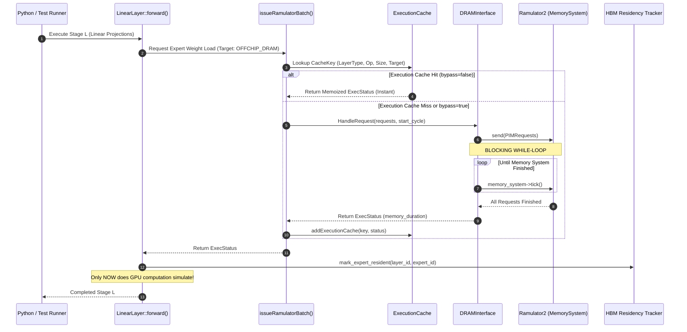

# Prefetch Timing, Memory Subsystem Execution, and Asynchronous Overlap Audit

**Audit Scope**: Forensic inspection of the C++ simulation pipeline in LLMSimulator, including `DRAMInterface`, `Ramulator`, `issueRamulatorBatch`, memory execution cache, and the mathematical timing model required for future asynchronous prefetching.

---

## PART E — Audit of Existing C++ Simulator Memory Path

### 1. Concrete Answers to the 10 Memory Subsystem Questions

| Forensic Question | Current C++ Implementation Reality | File & Line Reference |
| :--- | :--- | :--- |
| **1. Synchronous or asynchronous?** | **Strictly synchronous.** Every DRAM transfer is issued and completed in-line before execution returns. | `layer_impl.cpp:42`<br>`dram_interface.cpp:49` |
| **2. Does calling execution path block?** | **Yes, 100% blocking.** `DRAMInterface::run()` contains a blocking while-loop: `for (;;) { memory_system->tick(); if (memory_system->is_finished()) break; }`. | `dram_interface.cpp:125-132` |
| **3. Can computation proceed while transfer is in flight?** | **No.** Computation and memory access are simulated sequentially. The timeline advances strictly by adding `exec_status.memory_duration` to the running cycle counter. | `linear_impl.cpp:61-79` |
| **4. Is there an in-flight request table?** | **No.** No data structure exists to track pending or partially completed prefetch requests across simulation stages. | `dram_interface.h:59-82` |
| **5. Can multiple requests be outstanding?** | **Only within a single batch call.** `issueRamulatorBatch()` submits multiple tensors simultaneously to Ramulator, but blocks until the entire batch finishes. | `layer_impl.cpp:57-114` |
| **6. Is there a transfer completion timestamp?** | **Only an aggregate duration.** The simulator computes `exec_status.memory_duration`, but does not schedule a future completion event on an asynchronous event queue. | `dram_interface.cpp:76-78` |
| **7. Mechanism to insert prefetched expert into HBM?** | **Only post-transfer residency marking.** `device->mark_expert_resident()` is called immediately after synchronous loading completes. There is no proactive prefetch staging buffer. | `linear_impl.cpp:70` |
| **8. Can demand requests reuse an in-flight prefetch?** | **No.** Because transfers are blocking, a prefetch cannot be "in-flight" when subsequent code runs. It has either already completed or was never issued. | `layer_impl.cpp:42-52` |
| **9. Is bandwidth contention modeled?** | **Only if cache bypass is enabled.** With `bypass_offchip_execution_cache=false` (default), transfers reuse memoized latency from cache, completely bypassing Ramulator queuing and bus contention. | `layer_impl.cpp:16-24` |
| **10. Is cache bypass enabled during prefetch tests?** | **Currently disabled by default.** `bypass_offchip_execution_cache` defaults to `false`. Cycle-accurate contention modeling requires setting it to `true`. | `hardware_config.h:17` |

---

### 2. Sequence Diagram of Existing Synchronous Execution Path



**Key Architectural Takeaway**:  
In the existing codebase, **there is zero temporal overlap between memory transfer and computation**. All expert weights are demand-fetched synchronously right before computation begins.

---

## PART F — Mathematical Timing Model for Future Asynchronous Prefetching

To simulate real hardware speedups, we define the formal discrete-event timing model that must be implemented in future phases.

### 1. Timeline Timestamp Definitions

```text
Time ─────────────────────────────────────────────────────────────────────────────►
  │
  ├─ t_route_ready:       Router completes gating; selected experts E_L known
  ├─ t_predict_start:     EPU predictor begins candidate selection
  ├─ t_predict_end:       EPU produces top-B candidate list
  ├─ t_prefetch_issue:    Memory controller submits async DRAM load command
  ├─ t_compute_start:     Current layer useful GPU compute begins (Attention / FFN)
  ├─ t_transfer_start:    DDR5 bus initiates physical weight transfer
  ├─ t_compute_end:       Current layer GPU computation completes
  ├─ t_transfer_complete: DDR5 finishes transferring weights into on-chip/HBM buffer
  └─ t_demand:            Next layer gating executes; target experts strictly required
```

---

### 2. Derived Latencies and Overlap Formulations

#### 1. Prediction Overhead
$$T_{\text{predict}} = t_{\text{predict,end}} - t_{\text{predict,start}}$$
*Empirical measurement from Phase B.2*: $\approx 62.6\ \mu\text{s}$ for ST-MoE, $\approx 197.5\ \mu\text{s}$ for CSTP.

#### 2. Prefetch Issue Overhead
$$T_{\text{issue}} = t_{\text{prefetch,issue}} - t_{\text{predict,end}}$$
Software driver and hardware queue dispatch latency (typically $< 1\ \mu\text{s}$).

#### 3. Transfer Latency
$$T_{\text{transfer}} = t_{\text{transfer,complete}} - t_{\text{transfer,start}}$$
Simulated cycle-accurate DRAM burst time for loading $B$ expert weights over the off-chip DDR5 bus.

#### 4. Useful Overlap
The portion of memory transfer hidden by concurrent computation:
$$T_{\text{overlap}} = \max\Big(0,\; \min(t_{\text{compute,end}}, t_{\text{transfer,complete}}) - \max(t_{\text{compute,start}}, t_{\text{transfer,start}})\Big)$$

#### 5. Late Demand Stall
The unhidden latency penalty when an expert is needed before prefetching has finished:
$$T_{\text{stall}} = \max(0,\; t_{\text{transfer,complete}} - t_{\text{demand}})$$

---

### 3. Prefetch Quality Metrics Taxonomy

- **Timely Prefetch**: Expert was prefetched and arrived before demand: $t_{\text{transfer,complete}} \le t_{\text{demand}}$. Stall time $= 0$.
- **Late Prefetch**: Expert was predicted correctly, but transfer was still in flight when demand arrived: $t_{\text{transfer,complete}} > t_{\text{demand}}$. The GPU stalls for $T_{\text{stall}}$.
- **Unused Prefetch (Wasted Bandwidth)**: An expert was prefetched into HBM but was not selected by the gating network. Wasted data movement $= B_{\text{unused}} \times \text{Size}_{\text{expert}}$.
- **Demand Miss**: An expert required by the gating network was not prefetched at all. Must be fetched on-demand via the synchronous path.
- **Duplicate Prefetch**: Attempting to prefetch an expert that is already resident in HBM. Must be filtered by checking HBM residency before issuing.
- **HBM Cache Pollution**: Evicting a hot resident expert to make room for a speculative prefetch that is never used.
- **Prefetch Bandwidth Overhead**: Total bytes transferred by prefetcher divided by total bytes consumed by gating.

---

### 4. Required Simulator Infrastructure Changes (For Future Implementation)

To support this timing model, the C++ simulator will require:
1. **Asynchronous Prefetch Queue**: An event queue tracking in-flight expert loads with scheduled completion timestamps.
2. **Non-Blocking Dispatch**: Decoupling `issueRamulator` from `run()`, allowing Ramulator cycles to tick concurrently with compute cycles.
3. **In-Flight Demand Coalescing**: If a demand miss occurs for an expert currently in flight, the demand request attaches to the existing transfer rather than issuing a duplicate.
