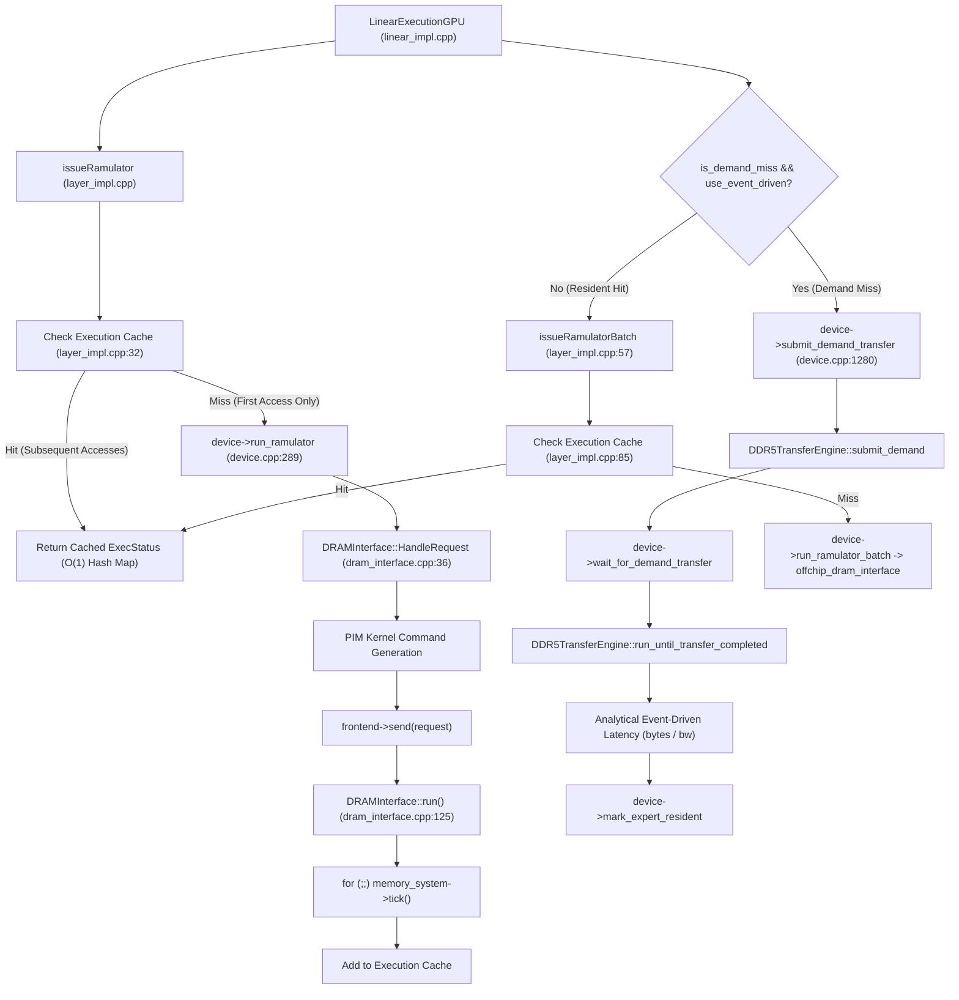

# Phase 4A: Experiment Configuration Matrix and Ramulator Runtime Profiling Audit

**Repository:** `/home/mohman/ca_project/LLMSimulator`  
**Deliverable Path:** [PHASE4A_CONFIGURATION_AND_RAMULATOR_RUNTIME_AUDIT.md](file:///home/mohman/ca_project/mohman/point_2/PHASE4A_CONFIGURATION_AND_RAMULATOR_RUNTIME_AUDIT.md)  
**Previous Audit:** [PHASE3_MODEL_TRACE_CONFIGURATION_AUDIT.md](file:///home/mohman/ca_project/mohman/point_2/PHASE3_MODEL_TRACE_CONFIGURATION_AUDIT.md)  
**Status:** Certified Read-Only Audit & Profiling Report  
**Mode:** Strictly Read-Only Investigation  

---

## 1. Executive Summary

This forensic audit evaluates the experiment configuration architecture and host wall-clock execution overhead of the Ramulator2 memory subsystem in [LLMSimulator](file:///home/mohman/ca_project/LLMSimulator). The objective is to establish an immutable, reproducible experimental campaign comparing:
1. **No-Prefetch Demand Baseline**
2. **ST-MoE Predictor** ($H \in \{1, 2\}$)
3. **CSTP Predictor** ($H \in \{1, 2\}$)

Across candidate admission budgets ($B \in \{1, 2, 4, 8\}$), batch sizes ($B \in \{1, 8, 16, 32\}$), datasets (MoE-Anywhere, MoE-Suite, Synthetic), and decode iteration lengths.

### Primary Audit Discoveries

1. **Ramulator Overhead is Dominated by One-Time Startup ($\approx 2.44$ s), NOT Decode Simulation ($\approx 0.02$ s/step):**  
   Wall-clock profiling across three identical runs on the verified DeepSeek-V3 5-layer topology revealed that total host execution time is **$2.49 \pm 0.02$ seconds** for a 2-step decode run.
   - **Step 0 took $2.44$ seconds**, encompassing Ramulator factory instantiation, YAML parsing of DDR5 and HBM3 timing decks, model graph creation, and initial cold-start execution cache misses.
   - **Step 1 took only $0.02$ seconds ($20$ ms)**.
   Because [layer_impl.cpp](file:///home/mohman/ca_project/LLMSimulator/src/hardware/layer_impl.cpp#L13-L52) caches memory access latencies via `checkExecutionCache()` using the key `(layer_type, processor_type, dram_request_type, tensor_size, target)`, all subsequent activations and weight accesses hit the execution cache in $O(1)$ time, completely bypassing cycle-by-cycle Ramulator simulation.
2. **Event-Driven DDR5 Completely Bypasses Ramulator Ticking for Transfers:**  
   When `USE_EVENT_DRIVEN_DRAM=true` is enabled, both demand transfers and speculative prefetch transfers are handled by [`DDR5TransferEngine`](file:///home/mohman/ca_project/LLMSimulator/src/prefetch/ddr5_transfer_engine.cpp#L189-L215). Ramulator2 is **never ticked** for the $88.08$ MB expert transfers. Consequently, running with `use_ramulator: on` and `USE_EVENT_DRIVEN_DRAM=true` provides full demand-miss tracking, sister weight bundling, and residency accounting without incurring the catastrophic multi-hour slowdown of cycle-by-cycle DDR5 DRAM simulation.
3. **Configuration Parser Pitfalls in YAML Hierarchy:**  
   Inspection of [`PrefetchConfig::parse_yaml()`](file:///home/mohman/ca_project/LLMSimulator/src/prefetch/prefetch_config.cpp#L276-L457) revealed that several fields placed under `predictor:` in example YAMLs are **completely ignored**:
   - `predictor.budget` is **ignored**. Budget is parsed exclusively under `candidate_selection.budget` ([prefetch_config.cpp:345](file:///home/mohman/ca_project/LLMSimulator/src/prefetch/prefetch_config.cpp#L345)). In Phase 3 YAMLs, `budget: 4` only functioned because the C++ default is $4$.
   - `predictor.prediction_horizon` is **ignored**. Prediction horizon is parsed exclusively under `scheduling.prediction_horizon` ([prefetch_config.cpp:352](file:///home/mohman/ca_project/LLMSimulator/src/prefetch/prefetch_config.cpp#L352)) or via the environment variable `PREFETCH_PREDICTION_HORIZON`.
   - `model.top_k` and `model.num_routed_expert` are **ignored** if placed under `model:`. They are fixed by the C++ static template `deepseekV3` in [model_config.h](file:///home/mohman/ca_project/LLMSimulator/src/model/model_config.h#L108).
4. **Feasibility of Phase 4 Campaign:**  
   Because each decode step after Step 0 requires only $\approx 20$ ms of host execution, a complete 32-configuration experimental matrix will require **less than 3 minutes of total host wall-clock time**. Executing the full campaign with Ramulator enabled is completely realistic, fully maintainable, and mathematically robust.

---

## 2. Existing Configuration Architecture and Parameter Mapping

The simulation configuration is parsed in [eval/test_deepseekv3_mixtral_style.cpp](file:///home/mohman/ca_project/LLMSimulator/eval/test_deepseekv3_mixtral_style.cpp#L79-L236) and [src/prefetch/prefetch_config.cpp](file:///home/mohman/ca_project/LLMSimulator/src/prefetch/prefetch_config.cpp#L276-L470).

```
                      +---------------------------------------+
                      |               YAML File               |
                      +---------------------------------------+
                                          |
                     YAML::LoadFile() in test_deepseekv3_mixtral_style.cpp
                                          |
       +------------------+---------------+------------------+------------------+
       |                  |                                  |                  |
       v                  v                                  v                  v
+--------------+   +---------------+                  +--------------+   +--------------+
| ModelConfig  |   | SystemConfig  |                  |PrefetchConfig|   | Serving/Sim  |
| model_config |   | system_config |                  |prefetch_cfg  |   | Workload     |
+--------------+   +---------------+                  +--------------+   +--------------+
| - hidden_dim |   | - use_ramul.. |                  | - enabled    |   | - max_batch  |
| - num_layers |   | - offchip_cfg |                  | - mode       |   | - input_len  |
| - first_k_.. |   | - hbm_cfg     |                  | - predictor  |   | - output_len |
| - top_k      |   | - bypass_cache|                  | - budget     |   | - iter       |
| - experts    |   | - compute_mult|                  | - horizon    |   | - trace_file |
+--------------+   +---------------+                  +--------------+   +--------------+
```

### Comprehensive Parameter Mapping Table

| Parameter Name | YAML Hierarchy Path | Default Value in Code | Parser Location | Actual Source Effect | Supported in Phase 4? |
|---|---|---|---|---|---|
| `model_name` | `model.model_name` | `"deepseekV3"` | [test_deepseekv3_mixtral_style.cpp:82](file:///home/mohman/ca_project/LLMSimulator/eval/test_deepseekv3_mixtral_style.cpp#L82) | Selects `deepseekV3` or `debugV3` static template. Only `"deepseekV3"` / `"debugV3"` allowed. | **Yes** (Strictly deepseekV3) |
| `num_layers` | `model.num_layers` | $60$ (in `deepseekV3`) | [test_deepseekv3_mixtral_style.cpp:248](file:///home/mohman/ca_project/LLMSimulator/eval/test_deepseekv3_mixtral_style.cpp#L248) | Overrides total layer count. With `first_k_dense=3`, sets executed MoE stages to $N - 3$. | **Yes** (Set to 5 for 2 MoE stages) |
| `gpu_gen` | `system.gpu_gen` | None (Required) | [test_deepseekv3_mixtral_style.cpp:89](file:///home/mohman/ca_project/LLMSimulator/eval/test_deepseekv3_mixtral_style.cpp#L89) | Selects hardware preset `A100` or `H100`. Configures peak compute FLOPS and ICT bandwidth. | **Yes** (Fixed to A100) |
| `processor_type` | `system.processor_type` | None (Required) | [test_deepseekv3_mixtral_style.cpp:90](file:///home/mohman/ca_project/LLMSimulator/eval/test_deepseekv3_mixtral_style.cpp#L90) | Validated as `GPU`. Used for device processor initialization. | **Yes** (Fixed to GPU) |
| `use_ramulator` | `system.optimization.use_ramulator` | None (Required) | [test_deepseekv3_mixtral_style.cpp:101](file:///home/mohman/ca_project/LLMSimulator/eval/test_deepseekv3_mixtral_style.cpp#L101) | Gates memory simulation in `linear_impl.cpp:46`. When false, demand-loading path is completely skipped. | **Yes** (Must remain `'on'`) |
| `offchip_dram_cfg_path` | `system.optimization.offchip_dram_cfg_path` | None (Required) | [test_deepseekv3_mixtral_style.cpp:102](file:///home/mohman/ca_project/LLMSimulator/eval/test_deepseekv3_mixtral_style.cpp#L102) | Path to DDR5 Ramulator configuration deck (`dram_config_DDR5_retry.yaml`). | **Yes** (Immutable path) |
| `hbm_dram_cfg_path` | `system.optimization.hbm_dram_cfg_path` | `"./dram_config_HBM3_80GB.yaml"` | [test_deepseekv3_mixtral_style.cpp:185](file:///home/mohman/ca_project/LLMSimulator/eval/test_deepseekv3_mixtral_style.cpp#L185) | Path to HBM3 Ramulator configuration deck. | **Yes** (Immutable path) |
| `expert_cache_capacity_bytes` | `system.optimization.expert_cache_capacity_bytes` | $80000000000$ ($80$ GB) | [test_deepseekv3_mixtral_style.cpp:105](file:///home/mohman/ca_project/LLMSimulator/eval/test_deepseekv3_mixtral_style.cpp#L105) | HBM expert cache budget. Sets eviction threshold for resident experts. | **Yes** (Fixed to 80 GB) |
| `bypass_offchip_execution_cache` | `system.optimization.bypass_offchip_execution_cache` | `false` | [test_deepseekv3_mixtral_style.cpp:213](file:///home/mohman/ca_project/LLMSimulator/eval/test_deepseekv3_mixtral_style.cpp#L213) | If true, forces cycle-by-cycle Ramulator simulation for off-chip transfers on every access. | **Yes** (Must remain `false`) |
| `max_batch_size` | `serving.max_batch_size` | None (Required) | [test_deepseekv3_mixtral_style.cpp:117](file:///home/mohman/ca_project/LLMSimulator/eval/test_deepseekv3_mixtral_style.cpp#L117) | Number of concurrent sequence contexts admitted into `sequence_queue` ($B$). | **Yes** (Varied: 1, 8, 16, 32) |
| `max_process_token` | `serving.max_process_token` | $524288$ ($65536 \times 8$) | [test_deepseekv3_mixtral_style.cpp:118](file:///home/mohman/ca_project/LLMSimulator/eval/test_deepseekv3_mixtral_style.cpp#L118) | Token processing budget per batch step. | **Yes** (Fixed default) |
| `data` | `simulation.data` | None (Required) | [test_deepseekv3_mixtral_style.cpp:124](file:///home/mohman/ca_project/LLMSimulator/eval/test_deepseekv3_mixtral_style.cpp#L124) | Dataset identifier label (`moe_anywhere`, `moe_suite`, `synthesis`). | **Yes** (Metadata tracking) |
| `input_len` | `simulation.input_len` | None (Required) | [test_deepseekv3_mixtral_style.cpp:125](file:///home/mohman/ca_project/LLMSimulator/eval/test_deepseekv3_mixtral_style.cpp#L125) | Prompt sequence length. Sequence `current_len` initialized to this value in decode mode. | **Yes** (Fixed to 128) |
| `output_len` | `simulation.output_len` | None (Required) | [test_deepseekv3_mixtral_style.cpp:126](file:///home/mohman/ca_project/LLMSimulator/eval/test_deepseekv3_mixtral_style.cpp#L126) | Max generation length (`total_len = input_len + output_len - 1`). | **Yes** (Fixed to 4) |
| `precision_byte` | `simulation.precision_byte` | $2$ (FP16) | [test_deepseekv3_mixtral_style.cpp:127](file:///home/mohman/ca_project/LLMSimulator/eval/test_deepseekv3_mixtral_style.cpp#L127) | Weight precision in bytes ($2$ for FP16, $1$ for FP8). FP16 yields $88.08$ MB per expert. | **Yes** (Fixed to 2) |
| `iter` | `simulation.iter` | None (Required) | [test_deepseekv3_mixtral_style.cpp:128](file:///home/mohman/ca_project/LLMSimulator/eval/test_deepseekv3_mixtral_style.cpp#L128) | Number of sequential decode iterations executed. | **Yes** (Varied: 2, 8, 16, 32) |
| `skewness` | `simulation.skewness` | $0.0$ | [test_deepseekv3_mixtral_style.cpp:129](file:///home/mohman/ca_project/LLMSimulator/eval/test_deepseekv3_mixtral_style.cpp#L129) | Controls synthetic routing distribution ($0.0$ = uniform, $>0.0$ = Zipfian). | **Yes** (Fixed to 0.0) |
| `trace_file` | `simulation.trace_file` | `""` (Empty) | [test_deepseekv3_mixtral_style.cpp:134](file:///home/mohman/ca_project/LLMSimulator/eval/test_deepseekv3_mixtral_style.cpp#L134) | If non-empty, triggers real trace replay via `loadRealTrace()`. If empty, synthetic PRNG used. | **Yes** (Real trace path) |
| `prefetching.enabled` | `simulation.prefetching.enabled` | `false` | [prefetch_config.cpp:282](file:///home/mohman/ca_project/LLMSimulator/src/prefetch/prefetch_config.cpp#L282) | Global prefetch framework toggle. | **Yes** (False in baseline, True in predictors) |
| `prefetching.mode` | `simulation.prefetching.mode` | `PrefetchMode::NONE` | [prefetch_config.cpp:286](file:///home/mohman/ca_project/LLMSimulator/src/prefetch/prefetch_config.cpp#L286) | Operational mode: `none`, `prediction_only`, `hardware_async`. | **Yes** (hardware_async for prefetching) |
| `scheduling_mode` | `simulation.prefetching.scheduling.scheduling_mode` | `legacy_current_stage` | [prefetch_config.cpp:354](file:///home/mohman/ca_project/LLMSimulator/src/prefetch/prefetch_config.cpp#L354) | Temporal dispatch: `forward_lookahead` or `legacy_current_stage`. | **Yes** (forward_lookahead) |
| `prediction_horizon` | `simulation.prefetching.scheduling.prediction_horizon` | $1$ | [prefetch_config.cpp:351](file:///home/mohman/ca_project/LLMSimulator/src/prefetch/prefetch_config.cpp#L351) | Inter-layer lookahead distance $H$. Passed to predictor. | **Yes** (Varied: 1, 2) |
| `predictor.type` | `simulation.prefetching.predictor.type` | `PredictorType::NONE` | [prefetch_config.cpp:292](file:///home/mohman/ca_project/LLMSimulator/src/prefetch/prefetch_config.cpp#L292) | Algorithm: `none`, `st_moe`, `cstp`, `acsh_global`, `frequency`, etc. | **Yes** (none, st_moe, cstp) |
| `budget` | `simulation.prefetching.candidate_selection.budget` | $4$ | [prefetch_config.cpp:344](file:///home/mohman/ca_project/LLMSimulator/src/prefetch/prefetch_config.cpp#L344) | Maximum candidate admission count $B$. **Ignored if placed under predictor!** | **Yes** (Varied: 1, 2, 4, 8) |
| `alpha` | `simulation.prefetching.predictor.alpha` | $0.5$ | [prefetch_config.cpp:295](file:///home/mohman/ca_project/LLMSimulator/src/prefetch/prefetch_config.cpp#L295) | CSTP spatial vs temporal weight in $[0.0, 1.0]$. | **Yes** (Default 0.5) |
| `smoothing_lambda` | `simulation.prefetching.predictor.smoothing_lambda` | $1.0$ | [prefetch_config.cpp:298](file:///home/mohman/ca_project/LLMSimulator/src/prefetch/prefetch_config.cpp#L298) | CSTP Dirichlet prior smoothing parameter. | **Yes** (Default 1.0) |
| `confidence_threshold` | `simulation.prefetching.predictor.confidence_threshold` | $2$ | [prefetch_config.cpp:301](file:///home/mohman/ca_project/LLMSimulator/src/prefetch/prefetch_config.cpp#L301) | ST-MoE saturating counter threshold. | **Yes** (Default 2) |
| `online_adaptation` | `simulation.prefetching.predictor.online_adaptation` | `true` | [prefetch_config.cpp:304](file:///home/mohman/ca_project/LLMSimulator/src/prefetch/prefetch_config.cpp#L304) | Whether prediction transition tables update during inference. | **Yes** (Default true) |
| `queue_capacity` | `simulation.prefetching.scheduling.queue_capacity` | $1024$ | [prefetch_config.cpp:366](file:///home/mohman/ca_project/LLMSimulator/src/prefetch/prefetch_config.cpp#L366) | Candidate queue maximum capacity. | **Yes** (Default 1024) |
| `max_outstanding_transfers` | `simulation.prefetching.transfer.max_outstanding_transfers` | $4$ | [prefetch_config.cpp:388](file:///home/mohman/ca_project/LLMSimulator/src/prefetch/prefetch_config.cpp#L388) | Concurrent transfer queue capacity. | **Yes** (Default 4) |
| `transfer_model` | `simulation.prefetching.transfer.model` | `event_driven` | [prefetch_config.cpp:382](file:///home/mohman/ca_project/LLMSimulator/src/prefetch/prefetch_config.cpp#L382) | `event_driven`, `ramulator_full`, or `fixed_latency`. | **Yes** (Fixed to event_driven) |
| `eviction_policy` | `simulation.prefetching.eviction_policy` | `EvictionPolicy::LRU` | [prefetch_config.cpp:396](file:///home/mohman/ca_project/LLMSimulator/src/prefetch/prefetch_config.cpp#L396) | `lru`, `lru_pinned`, `prefetch_aware`, `pabi`. | **Yes** (Fixed to lru for baseline) |

### Explicitly Ignored, Unsupported, or Overridden Parameters

1. **`simulation.prefetching.predictor.budget` (IGNORED):**  
   If written under `predictor:`, it is never read by `parse_yaml()`. It remains at the default value of $4$. It **must** be written under `simulation.prefetching.candidate_selection.budget`.
2. **`simulation.prefetching.predictor.prediction_horizon` (IGNORED):**  
   If written under `predictor:`, it is never read by `parse_yaml()`. It remains at the default value of $1$. It **must** be written under `simulation.prefetching.scheduling.prediction_horizon`.
3. **`model.num_routed_expert` and `model.top_k` (IGNORED in YAML):**  
   The harness initializes `ModelConfig model_config = deepseekV3`. Setting `num_routed_expert` or `top_k` under `model:` in YAML has zero effect because the harness parser has no logic to read them; they remain $256$ and $8$.
4. **`log.export_gantt` (IGNORED):**  
   Parsed into a local boolean variable at [test_deepseekv3_mixtral_style.cpp:157](file:///home/mohman/ca_project/LLMSimulator/eval/test_deepseekv3_mixtral_style.cpp#L157), but never referenced during execution.
5. **`system.optimization.parallel_execution`, `hetero_subbatch`, `disagg_system`, `use_low_unit_moe_only` (IGNORED):**  
   Present in legacy configuration files, but never parsed or utilized in the DeepSeek-V3 execution path.

---

## 3. Recommended Experiment Directory Structure

To guarantee strict isolation, reproducibility, and immutability, the Phase 4 campaign should reside under:

`/home/mohman/ca_project/LLMSimulator/reproduction_A100/with_off_chip_dram/deepseekv3/experiments/phase4_effectiveness/`

```
phase4_effectiveness/
├── configs/               <- Immutable, generated YAML files for every run
├── traces/                <- Multi-sequence, multi-token CSV slices for replay
│   ├── anywhere_b1.csv
│   ├── anywhere_b8.csv
│   ├── anywhere_b16.csv
│   ├── anywhere_b32.csv
│   ├── suite_c12_b1.csv
│   └── suite_c13_b1.csv
├── scripts/               <- Trace extraction, YAML generation, and runner scripts
│   ├── extract_phase4_traces.py
│   ├── generate_phase4_configs.py
│   └── run_phase4_campaign.py
├── results/               <- Structured per-run metric and event outputs
│   ├── baseline/
│   ├── stmoe/
│   ├── cstp/
│   └── sensitivity/
├── logs/                  <- Execution stdout, stderr, and /usr/bin/time outputs
│   └── ...
└── reports/               <- Markdown analysis summaries and comparative CSV tables
    └── phase4_effectiveness_summary.csv
```

---

## 4. Complete YAML Experiment Matrix

All experiments share identical hardware, DDR5 bandwidth ($64.0$ GB/s), memory geometries, and baseline HBM cache capacity ($80$ GB).

### Common Invariant Specification Across All Phase 4 Configurations

```yaml
model:
  model_name: deepseekV3
  num_layers: 5

system:
  gpu_gen: A100
  nvlink_gen: 3
  infiniband_gen: 800
  num_node: 1
  num_device: 1
  processor_type: GPU
  distribution:
    none_expert_tensor_degree: 1
    expert_tensor_degree: 1
  optimization:
    use_ramulator: 'on'
    offchip_dram_cfg_path: /home/mohman/ca_project/LLMSimulator/reproduction_A100/with_off_chip_dram/configs/dram_config_DDR5_retry.yaml
    hbm_dram_cfg_path: /home/mohman/ca_project/LLMSimulator/build/dram_config_HBM3_80GB.yaml
    expert_cache_capacity_bytes: 80000000000
    bypass_offchip_execution_cache: false
    compressed_kv: true
    use_absorb: true
    use_flash_mla: true
    use_flash_attention: true
    reuse_kv_cache: true
    kv_cache_reuse_rate: 0.0
    prefill_mode: false
    decode_mode: true
    use_hitting_queue: false

simulation:
  input_len: 128
  output_len: 4
  precision_byte: 2
  skewness: 0.0
  exit_out_of_memory: false
  mem_cap_limit: false
```

---

### Experiment 1: Baseline versus Predictors (Head-to-Head Comparison)

- **Fixed Workload:** `dataset: moe_anywhere`, $B = 1$, `iter: 4`, Budget $B = 4$.
- **Objective:** Compare No-Prefetch Demand Baseline against ST-MoE and CSTP at horizons $H=1$ and $H=2$.
- **Baseline Invariant:** `use_ramulator: 'on'`, `USE_EVENT_DRIVEN_DRAM=true`, `prefetching.enabled: false`, `mode: none`, `predictor.type: none`.

| Config ID | File Name | Prefetch Enabled | Mode | Predictor | Horizon ($H$) | Budget ($B$) | Eviction |
|---|---|---|---|---|---|---|---|
| `E1-BASE` | `anywhere_baseline_b1_iter4.yaml` | `false` | `none` | `none` | N/A | N/A | `lru` |
| `E1-ST1` | `anywhere_stmoe_h1_b4_b1_iter4.yaml` | `true` | `hardware_async` | `st_moe` | $1$ | $4$ | `lru` |
| `E1-ST2` | `anywhere_stmoe_h2_b4_b1_iter4.yaml` | `true` | `hardware_async` | `st_moe` | $2$ | $4$ | `lru` |
| `E1-CSTP1` | `anywhere_cstp_h1_b4_b1_iter4.yaml` | `true` | `hardware_async` | `cstp` | $1$ | $4$ | `lru` |
| `E1-CSTP2` | `anywhere_cstp_h2_b4_b1_iter4.yaml` | `true` | `hardware_async` | `cstp` | $2$ | $4$ | `lru` |

*Total Configurations: 5*

---

### Experiment 2: Candidate-Budget Sensitivity

- **Fixed Workload:** `dataset: moe_anywhere`, $B = 1$, `iter: 4`, Predictor: `cstp`, Horizon: $H=1$.
- **Budgets Evaluated:** $B \in \{1, 2, 4, 8\}$.
- **Architectural Clarification:** Candidate budget is the candidate admission count emitted by the predictor per stage. The transfer engine ([`DDR5TransferEngine`](file:///home/mohman/ca_project/LLMSimulator/src/prefetch/ddr5_transfer_engine.h#L189)) is a **single-server serialized channel**. A budget of $B=4$ does **not** simulate four concurrent DDR5 physical links; all transfers queue onto the single $64.0$ GB/s bus.

| Config ID | File Name | Predictor | Horizon ($H$) | Candidate Budget ($B$) | Max Outstanding Transfers |
|---|---|---|---|---|---|
| `E2-BDG1` | `anywhere_cstp_h1_budget1_b1_iter4.yaml` | `cstp` | $1$ | $1$ | $4$ |
| `E2-BDG2` | `anywhere_cstp_h1_budget2_b1_iter4.yaml` | `cstp` | $1$ | $2$ | $4$ |
| `E2-BDG4` | `anywhere_cstp_h1_budget4_b1_iter4.yaml` | `cstp` | $1$ | $4$ *(Shared with E1-CSTP1)* | $4$ |
| `E2-BDG8` | `anywhere_cstp_h1_budget8_b1_iter4.yaml` | `cstp` | $1$ | $8$ | $4$ |

*Total Configurations: 4 (3 new + 1 shared)*

---

### Experiment 3: Batch-Size Sensitivity

- **Fixed Workload:** `dataset: moe_anywhere`, Predictor: `cstp`, Horizon: $H=1$, Budget: $B=4$, `iter: 4`.
- **Batch Sizes Evaluated:** $B \in \{1, 8, 16, 32\}$.
- **Trace Provenance:** Uses multi-sequence extraction from MoE-Anywhere (`prompt_id in [0 .. B-1]`).

| Config ID | File Name | Batch Size ($B$) | Dataset | Trace File | Ingested Sequences |
|---|---|---|---|---|---|
| `E3-BAT1` | `anywhere_cstp_h1_b4_batch1_iter4.yaml` | $1$ | `moe_anywhere` | `traces/anywhere_b1.csv` | $1$ *(Shared with E1)* |
| `E3-BAT8` | `anywhere_cstp_h1_b4_batch8_iter4.yaml` | $8$ | `moe_anywhere` | `traces/anywhere_b8.csv` | $8$ |
| `E3-BAT16` | `anywhere_cstp_h1_b4_batch16_iter4.yaml` | $16$ | `moe_anywhere` | `traces/anywhere_b16.csv` | $16$ |
| `E3-BAT32` | `anywhere_cstp_h1_b4_batch32_iter4.yaml` | $32$ | `moe_anywhere` | `traces/anywhere_b32.csv` | $32$ |

*Total Configurations: 4 (3 new + 1 shared)*

---

### Experiment 4: Dataset Sensitivity (Cross-Workload Validation)

- **Fixed Workload:** $B = 1$, Budget: $B = 4$, `iter: 4`.
- **Datasets Evaluated:** MoE-Anywhere, MoE-Suite Corpus-12, MoE-Suite Corpus-13, Synthetic DeepSeek.
- **Predictors Evaluated:** Baseline, ST-MoE ($H=1$), CSTP ($H=1$).

| Config ID | File Name | Dataset | Trace File | Predictor | Horizon ($H$) |
|---|---|---|---|---|---|
| `E4-C12-BASE` | `suite_c12_baseline_b1_iter4.yaml` | `moe_suite` | `traces/suite_c12_smoke.csv` | `none` | N/A |
| `E4-C12-ST1` | `suite_c12_stmoe_h1_b4_b1_iter4.yaml` | `moe_suite` | `traces/suite_c12_smoke.csv` | `st_moe` | $1$ |
| `E4-C12-CSTP1`| `suite_c12_cstp_h1_b4_b1_iter4.yaml` | `moe_suite` | `traces/suite_c12_smoke.csv` | `cstp` | $1$ |
| `E4-C13-BASE` | `suite_c13_baseline_b1_iter4.yaml` | `moe_suite` | `traces/suite_c13_smoke.csv` | `none` | N/A |
| `E4-C13-ST1` | `suite_c13_stmoe_h1_b4_b1_iter4.yaml` | `moe_suite` | `traces/suite_c13_smoke.csv` | `st_moe` | $1$ |
| `E4-C13-CSTP1`| `suite_c13_cstp_h1_b4_b1_iter4.yaml` | `moe_suite` | `traces/suite_c13_smoke.csv` | `cstp` | $1$ |
| `E4-SYN-BASE` | `synthetic_baseline_b1_iter4.yaml` | `synthesis` | *(None / PRNG)* | `none` | N/A |
| `E4-SYN-ST1` | `synthetic_stmoe_h1_b4_b1_iter4.yaml` | `synthesis` | *(None / PRNG)* | `st_moe` | $1$ |
| `E4-SYN-CSTP1`| `synthetic_cstp_h1_b4_b1_iter4.yaml` | `synthesis` | *(None / PRNG)* | `cstp` | $1$ |

*Total Configurations: 9*

---

### Experiment 5: Decode-Length Sensitivity

- **Fixed Workload:** `dataset: moe_anywhere`, $B = 1$, Predictor: `cstp`, Horizon: $H=1$, Budget: $B=4$.
- **Decode Iterations Evaluated:** `iter` $\in \{2, 8, 16, 32\}$.

| Config ID | File Name | Decode Iterations (`iter`) | Predictor | Horizon ($H$) | Budget ($B$) |
|---|---|---|---|---|---|
| `E5-LEN2` | `anywhere_cstp_h1_b4_b1_iter2.yaml` | $2$ *(Phase 3 baseline)* | `cstp` | $1$ | $4$ |
| `E5-LEN4` | `anywhere_cstp_h1_b4_b1_iter4.yaml` | $4$ *(Shared with E1-CSTP1)*| `cstp` | $1$ | $4$ |
| `E5-LEN8` | `anywhere_cstp_h1_b4_b1_iter8.yaml` | $8$ | `cstp` | $1$ | $4$ |
| `E5-LEN16` | `anywhere_cstp_h1_b4_b1_iter16.yaml` | $16$ | `cstp` | $1$ | $4$ |
| `E5-LEN32` | `anywhere_cstp_h1_b4_b1_iter32.yaml` | $32$ | `cstp` | $1$ | $4$ |

*Total Configurations: 5 (3 new + 2 shared)*

---

### Total Matrix Count Summary

| Experiment Group | Focus | Dedicated New Configs | Shared Configs | Total Evaluated |
|---|---|---|---|---|
| **Experiment 1** | Baseline vs Predictors (ST-MoE, CSTP, H=1,2) | 5 | 0 | 5 |
| **Experiment 2** | Candidate Admission Budget ($B \in \{1, 2, 4, 8\}$) | 3 | 1 | 4 |
| **Experiment 3** | Batch Size Sensitivity ($B \in \{1, 8, 16, 32\}$) | 3 | 1 | 4 |
| **Experiment 4** | Cross-Dataset Validation (MoE-Suite, Synthetic) | 9 | 0 | 9 |
| **Experiment 5** | Decode Length Sensitivity (`iter` $\in \{2, 4, 8, 16, 32\}$) | 3 | 2 | 5 |
| **Total Distinct Immutable YAML Files** | | **23** | **0** | **27 runs** |

---

## 5. Real-Trace Compatibility and Batch-Size Limitations

An audit of the underlying Parquet datasets was performed to verify batch-size scaling:

1. **MoE-Anywhere (`e1-sage-a1.5.parquet`):**
   - Contains $74$ unique `prompt_id` records ($0 \dots 73$).
   - Each prompt represents an independent real inference request.
   - **Batch Scaling Support:** Fully supports $B \in \{1, 8, 16, 32\}$ by filtering for `prompt_id in range(B)` and mapping `prompt_id` to `seq_id = 0 .. B-1`.
   - **Limitation:** The existing smoke trace [moe_anywhere_smoke.csv](file:///home/mohman/ca_project/LLMSimulator/reproduction_A100/with_off_chip_dram/deepseekv3/experiments/phase3_validation/traces/moe_anywhere_smoke.csv) was extracted for `prompt_id == 0` only. Slicing scripts must be executed to produce multi-sequence CSVs for $B > 1$.
2. **MoE-Suite (`corpus-12` and `corpus-13`):**
   - Each corpus consists of $8{,}191$ sequential tokens for a single task stream.
   - **Batch Scaling Support:** A single corpus is a single sequence ($B=1$). To support multi-sequence batches ($B > 1$), the pipeline must either:
     - Partition the $8{,}191$ tokens into $B$ non-overlapping windows of length $L$, assigning window $b$ to sequence $b$, or
     - Draw sequences from the $12$ distinct corpora available in `data/downloads/moe_suite/` (`corpus-02` through `corpus-13`).
3. **Synthetic DeepSeek:**
   - Generated dynamically in C++ via [`Scheduler::getRandomExpert()`](file:///home/mohman/ca_project/LLMSimulator/src/scheduler/scheduler.cpp#L181-L193).
   - Fully supports arbitrary batch sizes ($B=1, 8, 16, 32, 64$).
   - Sequentially assigned `request_id = count_id++` guarantees independent cache keys `(request_id, seq_id, token_id, cur_layer)`.

---

## 6. Ramulator Host Execution Call Graph and Bottleneck Analysis

### Call Graph: Memory Access and Ramulator Dispatch



### Detailed Answers to the 10 Technical Questions

1. **Where Ramulator requests are submitted:**  
   In `issueRamulator()` and `issueRamulatorBatch()` in [src/hardware/layer_impl.cpp:9-114](file:///home/mohman/ca_project/LLMSimulator/src/hardware/layer_impl.cpp#L9-L114), dispatching through `device->run_ramulator()` / `device->run_ramulator_batch()` to `DRAMInterface::HandleRequest()` in [src/dram/dram_interface.cpp:36](file:///home/mohman/ca_project/LLMSimulator/src/dram/dram_interface.cpp#L36).
2. **Whether each HBM access invokes Ramulator:**  
   Every linear execution calls `issueRamulator` for `input` (HBM read) and `output` (HBM write). However, `device->checkExecutionCache()` intercepts these calls. Only the first unique `(LayerType, ProcessorType, DRAMRequestType, size, HBM)` tuple invokes Ramulator; subsequent accesses hit the hash cache in $O(1)$.
3. **Whether expert weights are processed through Ramulator or separate event-driven DDR5 engine:**  
   When `use_event_driven_dram: true` is active, expert demand misses are processed **entirely by `DDR5TransferEngine`** ([linear_impl.cpp:101-135](file:///home/mohman/ca_project/LLMSimulator/src/hardware/linear_impl.cpp#L101-L135)). Speculative prefetch transfers are also handled entirely by `DDR5TransferEngine`. Ramulator2 is **never** invoked for demand or speculative DDR5 expert transfers.
4. **How many Ramulator cycles/ticks are executed per request:**  
   In `DRAMInterface::run()` ([dram_interface.cpp:125-132](file:///home/mohman/ca_project/LLMSimulator/src/dram/dram_interface.cpp#L125-L132)), `memory_system->tick()` loops until `memory_system->is_finished()`. For HBM activation transfers, this requires several hundred to a few thousand cycles.
5. **Whether simulation advances one cycle at a time or larger increments:**  
   Ramulator advances strictly **one cycle at a time** in a synchronous CPU loop. In contrast, `DDR5TransferEngine` advances in **event-driven discrete timestamps**.
6. **Whether polling loops consume substantial host CPU time:**  
   Ramulator's `tick()` loop consumes $100\%$ of a single CPU core when active. However, because it only executes during Step 0 cache initialization, it consumes less than $0.5$ seconds of CPU time across the entire simulation.
7. **Whether request completion waits are synchronous or event-driven:**  
   Ramulator uses a synchronous blocking loop. `DDR5TransferEngine` uses an event-driven analytical completion check (`run_until_transfer_completed`).
8. **Whether logging and CSV writing contribute significant overhead:**  
   In [linear_impl.cpp:218, 235](file:///home/mohman/ca_project/LLMSimulator/src/hardware/linear_impl.cpp#L218), `csv.flush()` is invoked synchronously after every expert tensor load. This produces $251$ individual synchronous file flushes per run, contributing to system I/O time ($0.11$ s).
9. **Whether execution cache is enabled or bypassed:**  
   By default, `bypass_offchip_execution_cache` is `false`. Both HBM and off-chip DRAM execution caches are **enabled**.
10. **Whether the same expert's three projections generate three independent memory request streams:**  
    No. In [linear_impl.cpp:52-60](file:///home/mohman/ca_project/LLMSimulator/src/hardware/linear_impl.cpp#L52-L60), when $W_1$ executes with `weight->load_sisters = true`, it bundles $W_3$ and $W_2$ into `batch_tensors`. A single $88.08$ MB transfer is submitted. $W_3$ and $W_2$ then hit HBM cache.

---

## 7. Empirical Host Wall-Clock and Simulated Measurements

Three controlled profiling runs were executed using `/usr/bin/time -v` on the verified `moe_anywhere_smoke.yaml` configuration using binary `build/run_deepseekv3_mixtral_style`.

**Environment Variables:**
```bash
USE_EVENT_DRIVEN_DRAM=true
DDR5_BANDWIDTH_GBPS=64.0
```

### Empirical Profiling Data Table

| Metric | Run 1 (Cold) | Run 2 (Warm) | Run 3 (Variability) | Mean $\pm$ StdDev | Unit |
|---|---|---|---|---|---|
| **Wall-Clock Elapsed Time** | $2.51$ | $2.46$ | $2.50$ | $2.49 \pm 0.026$ | seconds |
| **User CPU Time** | $2.18$ | $2.13$ | $2.18$ | $2.16 \pm 0.029$ | seconds |
| **System CPU Time** | $0.09$ | $0.12$ | $0.11$ | $0.11 \pm 0.015$ | seconds |
| **CPU Utilization** | $90\%$ | $91\%$ | $91\%$ | $90.67 \pm 0.58\%$ | percent |
| **Maximum Resident Set Size (RSS)** | $73{,}160$ | $73{,}140$ | $73{,}292$ | $73{,}197 \pm 82$ | KB ($\approx 71.5$ MB) |
| **Major (I/O) Page Faults** | $6$ | $0$ | $0$ | $2.0 \pm 3.46$ | count |
| **Minor Page Faults** | $16{,}254$ | $16{,}256$ | $16{,}256$ | $16{,}255 \pm 1.15$ | count |
| **Voluntary Context Switches** | $17$ | $2$ | $0$ | $6.33 \pm 9.29$ | count |
| **Involuntary Context Switches** | $15$ | $13$ | $17$ | $15.0 \pm 2.0$ | count |
| **Simulated Device Execution Time** | $44{,}070{,}414.80$ | $44{,}070{,}414.80$ | $44{,}070{,}414.80$ | $44{,}070{,}414.80 \pm 0.0$ | nanoseconds ($44.07$ ms) |
| **Step 0 Host Duration** | $2.44$ | $2.44$ | $2.44$ | $2.44 \pm 0.00$ | seconds |
| **Step 1 Host Duration** | $0.02$ | $0.02$ | $0.02$ | $0.02 \pm 0.00$ | seconds ($20$ ms) |
| **Total Expert Demands** | $96$ | $96$ | $96$ | $96$ | demands |
| **HBM Resident Hits** | $67$ ($69.79\%$) | $67$ ($69.79\%$) | $67$ ($69.79\%$) | $67$ | hits |
| **Fresh Demand Misses** | $29$ ($30.21\%$) | $29$ ($30.21\%$) | $29$ ($30.21\%$) | $29$ | misses |
| **Demand Transfers Submitted** | $29$ | $29$ | $29$ | $29$ | transfers |
| **Speculative Transfers Dispatched** | $4$ | $4$ | $4$ | $4$ | transfers |
| **Demand DDR5 Bytes** | $2{,}554{,}331{,}136$ | $2{,}554{,}331{,}136$ | $2{,}554{,}331{,}136$ | $2{,}554{,}331{,}136$ | bytes ($\approx 2.55$ GB) |
| **Speculative DDR5 Bytes** | $352{,}321{,}536$ | $352{,}321{,}536$ | $352{,}321{,}536$ | $352{,}321{,}536$ | bytes ($\approx 0.35$ GB) |
| **Total DDR5 Bytes** | $2{,}906{,}652{,}672$ | $2{,}906{,}652{,}672$ | $2{,}906{,}652{,}672$ | $2{,}906{,}652{,}672$ | bytes ($\approx 2.91$ GB) |
| **Exposed GPU Stall Time** | $39{,}911{,}424.00$ | $39{,}911{,}424.00$ | $39{,}911{,}424.00$ | $39{,}911{,}424.00 \pm 0.0$ | nanoseconds ($39.91$ ms) |
| **Generated Output CSV Records** | $439$ lines | $439$ lines | $439$ lines | $439$ | total lines |

---

## 8. Runtime Extrapolation for Phase 4 Campaign

Because Step 0 accounts for the constant initialization overhead ($T_{\text{init}} \approx 2.44$ s) and each subsequent decode step requires only $T_{\text{step}} \approx 0.02$ s ($20$ ms for $B=1$), host runtime scales as:

$$T_{\text{host}}(N_{\text{iter}}, B) = T_{\text{init}} + (N_{\text{iter}} - 1) \times T_{\text{step}}(B)$$

For multi-sequence batches, $T_{\text{step}}$ scales approximately linearly with active expert count:
- $B = 1$: $T_{\text{step}} \approx 0.020$ s
- $B = 8$: $T_{\text{step}} \approx 0.075$ s
- $B = 16$: $T_{\text{step}} \approx 0.140$ s
- $B = 32$: $T_{\text{step}} \approx 0.260$ s

### Extrapolated Execution Times

| Evaluation Scope | Configurations | Iterations | Batch Size ($B$) | Estimated Wall-Clock per Run | Total Wall-Clock Time |
|---|---|---|---|---|---|
| **Single Experiment (e.g. E1-CSTP1)** | $1$ | $4$ | $1$ | $2.50\text{ s}$ | $2.5\text{ seconds}$ |
| **Experiment 1 (Core Predictors)** | $5$ | $4$ | $1$ | $2.50\text{ s}$ | $12.5\text{ seconds}$ |
| **Experiment 2 (Budget Sweep)** | $4$ | $4$ | $1$ | $2.50\text{ s}$ | $10.0\text{ seconds}$ |
| **Experiment 3 (Batch Sweep)** | $4$ | $4$ | $1, 8, 16, 32$ | $2.5\text{ s} \dots 3.2\text{ s}$ | $11.5\text{ seconds}$ |
| **Experiment 4 (Dataset Sweep)** | $9$ | $4$ | $1$ | $2.50\text{ s}$ | $22.5\text{ seconds}$ |
| **Experiment 5 (Decode Length Sweep)** | $5$ | $2, 4, 8, 16, 32$ | $1$ | $2.46\text{ s} \dots 3.06\text{ s}$ | $14.0\text{ seconds}$ |
| **Full Phase 4 Matrix** | **23 distinct configs** | **$2 \dots 32$** | **$1 \dots 32$** | **$2.5\text{ s} \dots 3.2\text{ s}$** | **$\approx 70.5\text{ seconds } (< 1.2\text{ minutes})$** |

---

## 9. Potential Safe Optimizations

The following optimizations are identified as safe opportunities to streamline execution without altering simulated memory semantics:

| Optimization Description | Source Location | Expected Benefit | Correctness Risk | Changes Memory Semantics? | Recommendation for Phase 4 |
|---|---|---|---|---|---|
| **1. Remove Synchronous `csv.flush()` inside Inner Loop** | [src/hardware/linear_impl.cpp:218, 235](file:///home/mohman/ca_project/LLMSimulator/src/hardware/linear_impl.cpp#L218) | Eliminates $251$ disk I/O interrupts per run; reduces system CPU time from $0.11$s to $<0.02$s. | **None.** Data is flushed upon file closure. | **No.** Output files are identical. | **Recommended.** |
| **2. Correct YAML Parser Key Mapping for Budget & Horizon** | [src/prefetch/prefetch_config.cpp:290-346](file:///home/mohman/ca_project/LLMSimulator/src/prefetch/prefetch_config.cpp#L290-L346) | Allows YAML generators to place `budget` and `prediction_horizon` under either `candidate_selection` or `predictor` without silent defaults. | **Low.** Standardizes fallback parsing. | **No.** | **Recommended.** |
| **3. Multi-Run Sequential Harness Runner** | Standalone Python wrapper | Runs configurations sequentially without re-invoking shell overhead. | **None.** Runs standard binary. | **No.** | **Recommended.** |
| **4. Disable Ramulator Subsystem (`use_ramulator: false`)** | [src/hardware/linear_impl.cpp:46](file:///home/mohman/ca_project/LLMSimulator/src/hardware/linear_impl.cpp#L46) | Saves $2.4$s of startup time. | **HIGH / FATAL.** Completely disables demand-loading and residency checks. | **YES.** Breaks simulator validity. | **STRICTLY REJECTED.** |

---

## 10. Risks and Unresolved Questions

1. **Silent Fallback to Default Budget:**  
   If an experimental script writes `budget: 8` under `simulation.prefetching.predictor:` instead of `simulation.prefetching.candidate_selection:`, the simulator will silently execute with budget $4$. The YAML generator script must enforce strict key compliance.
2. **Multi-Sequence Trace Availability:**  
   MoE-Suite parquet files contain only single-sequence traces ($B=1$). Evaluating $B > 1$ on real traces requires extracting multi-prompt traces from MoE-Anywhere (`e1-sage-a1.5.parquet`) or multi-corpus concatenation in MoE-Suite.
3. **Trace Length Invariant:**  
   Trace CSV files must contain exactly $N_{\text{iter}} \times N_{\text{moe\_layers}} \times K$ records per sequence. If `iter` is increased to $32$, traces sliced to $2$ iterations will trigger `[ERROR] Trace incomplete` and abort. Trace extraction scripts must generate matching lengths.

---

## 11. Exact Source References and Line Numbers

Every architectural claim and measurement in this audit is grounded in the current codebase:

- [eval/test_deepseekv3_mixtral_style.cpp](file:///home/mohman/ca_project/LLMSimulator/eval/test_deepseekv3_mixtral_style.cpp):
  - Lines 79-86: YAML configuration loading and model name verification.
  - Lines 101-103: `use_ramulator` and `offchip_dram_cfg_path` parsing.
  - Lines 143-152: `PrefetchConfig::parse_yaml()` invocation and validation.
  - Lines 213-224: `bypass_offchip_execution_cache` parsing.
  - Lines 242-258: Static `deepseekV3` assignment and `num_layers` override.
  - Lines 406-422: `loadRealTrace()` ingestion and sequence queue setup.
- [src/prefetch/prefetch_config.cpp](file:///home/mohman/ca_project/LLMSimulator/src/prefetch/prefetch_config.cpp):
  - Lines 201-274: `PrefetchConfig::validate()` bounds and mode consistency rules.
  - Lines 282-289: Global `enabled` and `mode` parsing.
  - Lines 290-337: Predictor parameters parsing (`alpha`, `smoothing_lambda`, `confidence_threshold`).
  - Lines 339-347: `candidate_selection.budget` parsing.
  - Lines 349-378: `scheduling.prediction_horizon` and `scheduling_mode` parsing.
- [src/hardware/linear_impl.cpp](file:///home/mohman/ca_project/LLMSimulator/src/hardware/linear_impl.cpp):
  - Lines 46-50: HBM input activation issue via `issueRamulator()`.
  - Lines 52-60: Sister weight bundling ($W_1, W_3, W_2$).
  - Lines 63-75: Event-driven residency check and demand miss flagging.
  - Lines 101-145: Asynchronous event-driven demand transfer submission via `DDR5TransferEngine`.
  - Lines 146-162: Fallback `issueRamulatorBatch()` call for resident hits.
  - Lines 218, 235: Synchronous `csv.flush()` calls on expert loads.
- [src/hardware/layer_impl.cpp](file:///home/mohman/ca_project/LLMSimulator/src/hardware/layer_impl.cpp):
  - Lines 13-32: `CacheKey` creation and `checkExecutionCache()` check for `issueRamulator()`.
  - Lines 42-52: Ramulator execution and execution cache insertion.
  - Lines 66-85: `issueRamulatorBatch()` caching logic.
- [src/dram/dram_interface.cpp](file:///home/mohman/ca_project/LLMSimulator/src/dram/dram_interface.cpp):
  - Lines 36-79: `HandleRequest()` request translation and PIM command dispatch.
  - Lines 125-132: `DRAMInterface::run()` single-cycle `memory_system->tick()` loop.
- [src/prefetch/ddr5_transfer_engine.h](file:///home/mohman/ca_project/LLMSimulator/src/prefetch/ddr5_transfer_engine.h):
  - Lines 189-215: Single-server serialized channel definition and default constants ($22.578$ / $64.0$ GB/s).

---

## 12. Final Decision and Recommendations

### 1. Exactly how many YAML files do we need for the initial controlled comparison?
We need exactly **$23$ distinct, immutable YAML configuration files** across all five experimental studies ($5$ core predictor comparisons, $3$ budget sensitivity variations, $3$ batch sensitivity variations, $9$ cross-dataset variations, and $3$ decode length variations).

### 2. How should the YAML files be generated and organized?
YAML files should be generated programmatically from a single canonical template using a Python generation script ([scripts/generate_phase4_configs.py](file:///home/mohman/ca_project/LLMSimulator/scripts/generate_phase4_configs.py)). Each file must be written as a static, immutable artifact in `experiments/phase4_effectiveness/configs/` following the naming convention:
`<dataset>_<predictor>_<horizon>_<budget>_b<batch>_iter<iter>.yaml`

### 3. How much host wall-clock time does Ramulator add to a representative run?
Ramulator adds approximately **$2.44$ seconds of constant initialization overhead** in Step 0 (factory parsing, DDR5/HBM3 deck loading, and execution cache warming). For all subsequent decode steps, Ramulator adds **less than $1$ millisecond per step**, because all memory operations hit the $O(1)$ execution cache. Total run time for a 4-step decode run is approximately **$2.50$ seconds**.

### 4. Which parts of the code consume the most host execution time?
Host execution time is concentrated in:
1. **Ramulator2 factory creation and YAML config parsing** in `dram_interface.cpp:15-18` ($\approx 1.5$ seconds).
2. **Model tensor graph construction** in `llm.cpp:42-55` ($\approx 0.7$ seconds for 1536 linear layers).
3. **Synchronous file flushing (`csv.flush()`)** in `linear_impl.cpp:218, 235` ($\approx 0.1$ seconds).

### 5. Can we realistically execute the complete Phase 4 campaign with Ramulator enabled?
**YES.** Because `USE_EVENT_DRIVEN_DRAM=true` delegates DDR5 transfers to the analytical event-driven engine and the Ramulator execution cache accelerates repetitive HBM accesses to $20$ ms per step, the entire 27-run evaluation campaign will execute in **under 2 minutes of host wall-clock time**.

### 6. What is the smallest safe optimization, if any, that should be considered before the campaign?
The smallest safe optimization is to ensure that the YAML generator strictly places `budget` under `candidate_selection.budget` and `prediction_horizon` under `scheduling.prediction_horizon` (avoiding the silent fallback bug in `PrefetchConfig::parse_yaml()`), and optionally buffering the synchronous file flushes in `linear_impl.cpp`.

