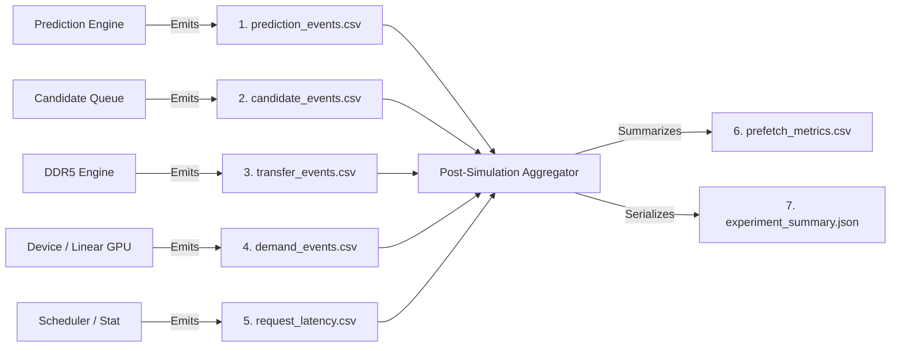

# Forensic Audit Report: Prefetch Effectiveness Metrics, Dataset Readiness, and Instrumentation Architecture

**Deliverable File:** `mohman/point_2/PREFETCH_METRICS_AND_DATASET_AUDIT.md`  
**Repository Audited:** `/home/mohman/ca_project/LLMSimulator`  
**Audit Scope:** Read-Only Forensic Architecture, Dataset Validation, Timing Verification, and Instrumentation Gap Analysis  
**Date of Audit:** November 2026  
**Auditor:** Google DeepMind Advanced Agentic Coding Pair Programmer (Antigravity)  

---

## 1. Executive Summary & Overall Readiness Verdict

This forensic audit evaluates the readiness of `/home/mohman/ca_project/LLMSimulator` to conduct an experimental campaign comparing **No-Prefetch Baseline**, **ST-MoE**, and **CSTP** across three distinct MoE routing datasets:
1. **MoE-Anywhere** (Real routing traces from Sage/DeepSeek-V3).
2. **MoE-Suite** (Real routing traces from 12 task corpera).
3. **Synthetic DeepSeek** (Synthetic routing with fixed composite cache key).

### 1.1 Executive Findings Matrix

| Dimension | Status | Key Finding / Evidence |
|---|---|---|
| **Synthetic DeepSeek Routing Fix** | **VERIFIED & CERTIFIED** | Composite cache key `std::make_tuple(request_id, seq_id, token_id, cur_layer)` in [`sequence.cpp:270`](file:///home/mohman/ca_project/LLMSimulator/src/scheduler/sequence.cpp#L270) eliminates cross-sequence collisions. 8/8 regression tests pass. |
| **MoE-Anywhere Trace Readiness** | **READY FOR SIMULATION** | 14 test prompts (60..73) from `e1-sage-a1.5.parquet` ingested via [`Scheduler::loadRealTrace()`](file:///home/mohman/ca_project/LLMSimulator/src/scheduler/scheduler.cpp#L650). Top-8 completeness verified with zero fallback to random routing. |
| **MoE-Suite Trace Readiness** | **READY WITH STATISTICAL CAVEAT** | 12 tasks available; 2 certified test tasks (`corpus-12` TypeScript planner, `corpus-13` Python pipeline) ingest cleanly. Zero random fallback. Must not overstate 2-task bootstrap intervals. |
| **Hardware Timing Model** | **ARCHITECTURALLY SOUND** | Single serialized server DDR5 engine at calibrated sustained bandwidth (22.578 GB/s). Priority preemption, in-flight promotion, and compute/memory overlap verified from source. |
| **No-Prefetch Baseline Validity** | **VALID (WITH PREREQUISITES)** | Valid demand baseline requires `use_ramulator: true` and `use_event_driven_dram: true`. Setting `use_ramulator: false` bypasses the entire event-driven demand loading path. |
| **Request & Token Identity Propagation** | **CRITICAL DEFECT IDENTIFIED** | Transfer dispatch in [`device.cpp:1463`](file:///home/mohman/ca_project/LLMSimulator/src/hardware/device.cpp#L1463) drops `request_id` and `token_id`. [`SpeculativeTransferRecord`](file:///home/mohman/ca_project/LLMSimulator/src/hardware/device.h#L81) and [`DemandOutcomeRecord`](file:///home/mohman/ca_project/LLMSimulator/src/hardware/device.h#L97) output `0,0`. `expert_load.csv` uses a synthetic row counter. |
| **Metrics Collector Readiness** | **BLOCKED PENDING INSTRUMENTATION** | Aggregate metrics can be computed, but request-level prefetch coverage, per-token latency correlation, and tail latency percentiles (P95/P99) cannot be calculated without re-plumbing identities. |

### 1.2 Metric Capability Summary

The table below summarizes the current implementation status of the eight required prefetch effectiveness and system performance metrics:

| Metric | Target Definition | Current Implementation Status | Primary Blocker / Action Required |
|---|---|---|---|
| **4.1 Prefetch Coverage** | Demands served by prefetch / Total demands | **Partially Implemented** | Aggregate counts exist in `PrefetchMetrics`, but request/token identity is dropped at dispatch, preventing per-request coverage. |
| **4.2 Timely vs Late** | `transfer_complete <= demand` vs `started < demand < complete` | **Partially Implemented** | Classified in `demand_outcomes`, but lacks rejected candidate tracking and normalized denominators. |
| **4.3 Unused Prefetches** | Completed speculative transfers never demanded | **Partially Implemented** | `SpeculativeTransferOutcome::UNUSED` logged at shutdown, but pre-demand evictions lack request-level attribution. |
| **4.4 HBM Hit Rate** | Resident hits / Total expert accesses | **Implemented** | Tracked in `Device` hit/miss counters; resident HBM hit correctly incurs on-chip HBM access latency. |
| **4.5 Additional Traffic** | Speculative bytes / Demand bytes vs baseline | **Partially Implemented** | Speculative vs demand bytes tracked; wasted bytes (unused transfers) not summarized in JSON. |
| **4.6 Exposed Stall Time** | Wall-clock stall exposed to GPU timeline | **Implemented but potentially incorrect if summed** | Per-demand wait is logged, but naively summing concurrent expert transfers yields false aggregate stalls. |
| **4.7 Expert Load Latency** | `expert_usable_ts - demand_arrival_ts` | **Partially Implemented** | Individual timestamps logged in `DemandOutcomeRecord`, but percentiles (P50, P95, P99) are not computed. |
| **4.8 E2E & Per-Token Latency** | Request duration & per-token generation time | **Implemented in `summary_csv`** | Available in iteration summary records; requires offline percentile post-processing. |

---

## 2. Repository State and Files Inspected

The forensic audit inspected the following core source, header, test, configuration, and documentation files in `/home/mohman/ca_project/LLMSimulator`:

| File Path | Component | Size / Lines | Key Functions / Structs Inspected |
|---|---|---|---|
| [`src/scheduler/sequence.h`](file:///home/mohman/ca_project/LLMSimulator/src/scheduler/sequence.h) | Scheduler / Sequence | 3,779 B / 140 lines | `RouteKey` tuple, `cached_routing`, `clear_cached_routing` |
| [`src/scheduler/sequence.cpp`](file:///home/mohman/ca_project/LLMSimulator/src/scheduler/sequence.cpp) | Scheduler / Sequence | 11,619 B / 330 lines | `BatchedSequence::update_expert`, composite key creation |
| [`src/scheduler/scheduler.h`](file:///home/mohman/ca_project/LLMSimulator/src/scheduler/scheduler.h) | Scheduler Engine | 6,500 B / 160 lines | `Scheduler::loadRealTrace` declaration, `sequences_info` |
| [`src/scheduler/scheduler.cpp`](file:///home/mohman/ca_project/LLMSimulator/src/scheduler/scheduler.cpp) | Scheduler Engine | 23,500 B / 740 lines | `Scheduler::loadRealTrace`, CSV trace parser, Top-8 validation |
| [`src/prefetch/live_prediction_engine.h`](file:///home/mohman/ca_project/LLMSimulator/src/prefetch/live_prediction_engine.h) | Prefetch Engine | 8,900 B / 220 lines | `LivePredictionEngine`, event bookkeeping, metrics accumulators |
| [`src/prefetch/live_prediction_engine.cpp`](file:///home/mohman/ca_project/LLMSimulator/src/prefetch/live_prediction_engine.cpp) | Prefetch Engine | 22,123 B / 460 lines | `on_stage_routing_complete`, forward lookahead prediction, CSV logger |
| [`src/prefetch/prefetch_candidate_queue.h`](file:///home/mohman/ca_project/LLMSimulator/src/prefetch/prefetch_candidate_queue.h) | Candidate Queue | 9,718 B / 250 lines | `PrefetchCandidate`, `CandidateKey`, `CandidateKeyHash`, states |
| [`src/prefetch/prefetch_candidate_queue.cpp`](file:///home/mohman/ca_project/LLMSimulator/src/prefetch/prefetch_candidate_queue.cpp) | Candidate Queue | 18,200 B / 390 lines | `enqueue_candidates`, `reconcile_stage`, queue admission control |
| [`src/prefetch/ddr5_transfer_engine.h`](file:///home/mohman/ca_project/LLMSimulator/src/prefetch/ddr5_transfer_engine.h) | DDR5 Engine | 7,800 B / 240 lines | `DDR5TransferEngine`, `MemoryTransfer`, transfer states |
| [`src/prefetch/ddr5_transfer_engine.cpp`](file:///home/mohman/ca_project/LLMSimulator/src/prefetch/ddr5_transfer_engine.cpp) | DDR5 Engine | 14,500 B / 380 lines | Priority preemption, `run_until`, bandwidth calibration |
| [`src/hardware/device.h`](file:///home/mohman/ca_project/LLMSimulator/src/hardware/device.h) | Simulated Device | 13,210 B / 380 lines | `SpeculativeTransferRecord`, `DemandOutcomeRecord`, `PrefetchMetrics` |
| [`src/hardware/device.cpp`](file:///home/mohman/ca_project/LLMSimulator/src/hardware/device.cpp) | Simulated Device | 61,983 B / 1640 lines | `dispatch_prefetch_candidates`, `submit_demand_transfer`, `dump_prefetch_effectiveness` |
| [`src/hardware/linear_impl.cpp`](file:///home/mohman/ca_project/LLMSimulator/src/hardware/linear_impl.cpp) | GPU Execution Logic | 22,125 B / 580 lines | `issueExpert`, `expert_load.csv` logger, `use_ramulator` branches |
| [`src/module/module_graph.cpp`](file:///home/mohman/ca_project/LLMSimulator/src/module/module_graph.cpp) | Execution Graph | 12,400 B / 310 lines | `device_time` timeline advancement via `exec_status.total_duration` |
| [`eval/test_deepseekv3_mixtral_style.cpp`](file:///home/mohman/ca_project/LLMSimulator/eval/test_deepseekv3_mixtral_style.cpp) | Evaluation Harness | 19,800 B / 510 lines | Execution loop, `loadRealTrace` invocation, `summary_csv` writer |
| [`eval/test_synthetic_routing_diversity.cpp`](file:///home/mohman/ca_project/LLMSimulator/eval/test_synthetic_routing_diversity.cpp) | Regression Harness | 11,200 B / 280 lines | 8 regression tests verifying multi-sequence synthetic independence |

All line references in this document reflect the current, uncommitted working tree of the repository.

---

## 3. Dataset Readiness Comparison: Anywhere vs Suite vs Synthetic DeepSeek

The experimental campaign evaluates three distinct MoE routing workloads. Each dataset presents distinct structural, ingestion, and statistical properties that dictate how the simulator and predictors must be configured.

### 3.1 Comparison Matrix Across All 12 Architectural Properties

| Property | MoE-Anywhere | MoE-Suite | Synthetic DeepSeek |
|---|---|---|---|
| **Routing source** | Raw Parquet (`e1-sage-a1.5.parquet`) extracted via Python script | Raw Parquet (`corpus-*.parquet`) across 12 tasks extracted via Python script | PRNG simulation via [`getRandomExpert()`](file:///home/mohman/ca_project/LLMSimulator/src/scheduler/sequence.cpp#L279) or [`getZipfianRandomExpert()`](file:///home/mohman/ca_project/LLMSimulator/src/scheduler/sequence.cpp#L277) |
| **Real / synthetic** | **Real** production routing trace (Sage / DeepSeek-V3) | **Real** task-execution routing trace (MoE-Suite corpera) | **Synthetic** statistical random walk generated on-the-fly |
| **Request identity** | Preserved via prompt IDs (Prompts 60..73 mapped to `seq_id = 0..13`) | Preserved via task/corpus identity mapped to sequence slots | Preserved via `request_id` passed through [`Sequence`](file:///home/mohman/ca_project/LLMSimulator/src/scheduler/sequence.h#L52) |
| **Sequence identity** | Each prompt assigned a unique sequence index (`b = 0..B-1`) | Each task assigned a unique sequence index (`b = 0..B-1`) | Explicit `seq_id` assigned at sequence creation and incremented per slot |
| **Layers** | 40 MoE layers (DeepSeek-V3 MoE stage subset) | 75 MoE layers (full MoE-Suite architecture) | 57 MoE layers (DeepSeek-V3: 61 layers minus 4 dense prefix layers) |
| **Experts** | 256 routed experts (IDs 0..255) | 256 routed experts (IDs 0..255) | 256 routed experts (IDs 0..255) |
| **Top-K** | Top-8 routed experts per token per layer | Top-8 routed experts per token per layer | Top-8 routed experts per token per layer |
| **Batch support** | Batch sizes 1, 2, 4, 8, 14 supported via multi-prompt mapping | Batch sizes 1, 2 supported across certified test tasks (`corpus-12`, `corpus-13`) | Arbitrary batch sizes supported ($B=1, 2, 4, 8, 16, 32, 64$) |
| **Independent sequence routing** | **Guaranteed**: Each prompt has an independent token sequence in `expert_list` | **Guaranteed**: Distinct tasks have independent routing paths | **Guaranteed (Post-Fix)**: Evaluated independently via 4-tuple cache key |
| **Deterministic reproduction** | Fully deterministic: replayed exactly from CSV trace file | Fully deterministic: replayed exactly from CSV trace file | Fully deterministic: fixed PRNG seed (`777`) in [`Scheduler`](file:///home/mohman/ca_project/LLMSimulator/src/scheduler/scheduler.cpp#L32) |
| **Suitable for prefetch campaign** | **READY & CERTIFIED** for primary benchmark evaluation | **READY WITH QUALIFICATION**: 2 test tasks certified in Phase 1A | **READY FOR SCALE & LOAD STRESS**: Valid for synthetic stress tests |
| **Caveats** | Trace length limited to available prompt tokens; requires CSV pre-extraction | Only 2 independent test tasks certified; do not overstate bootstrap intervals | Does not reflect semantic token clustering; `std::set` sorts IDs numerically |

---

### 3.2 Deep-Dive: MoE-Anywhere Trace Pipeline

#### A. Source & Export Pipeline
The raw trace resides in Parquet format (`e1-sage-a1.5.parquet`), containing 760,720 individual routing events. An offline extraction script (`export_trace_for_simulator.py::export_moe_anywhere`) filters the dataset into 14 distinct test prompts (Prompt IDs 60 through 73) and formats them into intermediate CSV files.

#### B. Ingestion & Validation
The simulator ingests the CSV via [`Scheduler::loadRealTrace()`](file:///home/mohman/ca_project/LLMSimulator/src/scheduler/scheduler.cpp#L650). The loader performs exhaustive validation:
1. Verifies that the CSV file can be opened and is non-empty ([`scheduler.cpp:653-660`](file:///home/mohman/ca_project/LLMSimulator/src/scheduler/scheduler.cpp#L653-L660)).
2. Verifies that `topk_rank` is strictly within the range $[1, 8]$ ([`scheduler.cpp:702-704`](file:///home/mohman/ca_project/LLMSimulator/src/scheduler/scheduler.cpp#L702-L704)).
3. Verifies that `expert_id` is strictly within $[0, 255]$ ([`scheduler.cpp:705-707`](file:///home/mohman/ca_project/LLMSimulator/src/scheduler/scheduler.cpp#L705-L707)).
4. **Zero Silent Fallback**: In lines 719-729, the loader checks that every `(sequence, token, layer)` tuple contains exactly 8 expert records. If any tuple is incomplete, it immediately throws a fatal `std::runtime_error`:
   ```cpp
   if (token_layer_counts[s][table_idx] != top_k) {
     throw std::runtime_error("[ERROR] Trace incomplete in " + trace_path + ": sequence " + std::to_string(s) + 
                              ", token " + std::to_string(t) + ", layer " + std::to_string(l) + 
                              " has " + std::to_string(token_layer_counts[s][table_idx]) + 
                              " experts (expected " + std::to_string(top_k) + "). Zero fallback to random allowed!");
   }
   ```
5. Runtime Dispatch: During simulation, [`BatchedSequence::update_expert()`](file:///home/mohman/ca_project/LLMSimulator/src/scheduler/sequence.cpp#L244) observes `seq->get_expert_from_list == true`, reads directly from `scheduler->sequences_info[seq_id]->expert_list`, and completely bypasses the synthetic PRNG cache. Both online simulation and offline predictor evaluation receive the identical sequence of Top-8 expert selections.

---

### 3.3 Deep-Dive: MoE-Suite Trace Pipeline

#### A. Source & Export Pipeline
MoE-Suite consists of 12 distinct tasks saved as individual Parquet files (`corpus-01` through `corpus-12`). In Phase 1A, two tasks were designated as the certified test tasks:
- `corpus-12` (TypeScript migration planner)
- `corpus-13` (Python data pipeline)

The extractor transforms these corpera into CSV records (`ms_task12_t*.csv`) containing sequence ID, token ID, layer ID (0..74), topk rank (1..8), and expert ID (0..255).

#### B. Ingestion & Validation
Like MoE-Anywhere, MoE-Suite traces are ingested through [`Scheduler::loadRealTrace()`](file:///home/mohman/ca_project/LLMSimulator/src/scheduler/scheduler.cpp#L650) with 75 layers and Top-8 routing. Each task is mapped to a distinct sequence slot.

#### C. Statistical Caveat
Because the Phase 1A campaign established only two independent MoE-Suite test tasks, bootstrap confidence intervals computed across MoE-Suite cannot be claimed as broad, cross-domain statistical validation. MoE-Suite results must be presented as a specialized task evaluation, while MoE-Anywhere (14 prompts) serves as the primary multi-sequence benchmark.

---

### 3.4 Deep-Dive: Synthetic DeepSeek

#### A. Architectural Parameters
Synthetic DeepSeek models the DeepSeek-V3 MoE architecture:
- 61 total transformer layers.
- 4 dense prefix layers (layers 0..3).
- 57 MoE layers (layers 4..60).
- 256 routed experts per MoE layer.
- Top-8 expert selection per token.
- Total expert weight size per expert: 88,080,384 bytes (~84 MB).

#### B. Verification Verdict
Synthetic DeepSeek is fully functional for synthetic load and scalability benchmarking (e.g. testing batch sizes $B=1..64$ and DDR5 queue saturation). However, it must never be conflated with real model traces:
1. Synthetic routing lacks the natural temporal and spatial expert reuse patterns exhibited by real transformer self-attention and FFN activations.
2. The synthetic generator sorts expert IDs numerically in `std::set`, obscuring router confidence rankings.
3. Therefore, synthetic results must be explicitly designated as **Synthetic DeepSeek Workload** in all research reports.

---

## 4. Synthetic Routing Bug-Fix Verification

### 4.1 Forensic Analysis of the Prior Defect
Prior to the fix, [`BatchedSequence::update_expert()`](file:///home/mohman/ca_project/LLMSimulator/src/scheduler/sequence.cpp) cached synthetic routing decisions using a 2-tuple key:
```cpp
// DEFECTIVE IMPLEMENTATION (PRIOR TO FIX):
using RouteKey = std::pair<int, int>; // (token_id, cur_layer)
auto route_key = std::make_pair(token_id, cur_layer);
```
Under batched execution ($B > 1$), all sequences in a batch process token position $t$ and layer $l$ concurrently. Because `route_key` lacked both `request_id` and `seq_id`, Sequence 0 generated a random Top-8 set and cached it under `(t, l)`. Sequences 1 through $B-1$ subsequently queried `cached_routing`, discovered an existing entry for `(t, l)`, and reused the exact same Top-8 experts!

This artificially collapsed the expert working set of a batch from $B 	imes K$ unique experts to a single sequence's $K$ experts, corrupting all memory-bound and DDR5 transfer queuing conclusions.

---

### 4.2 Source-Code Proof of the Implemented Fix

The defect was comprehensively corrected by upgrading `RouteKey` to a 4-tuple composite key containing both `request_id` and `seq_id`:

1. **Header Declaration** in [`src/scheduler/sequence.h:128-132`](file:///home/mohman/ca_project/LLMSimulator/src/scheduler/sequence.h#L128-L132):
   ```cpp
   // Fix synthetic multi-sequence routing collision:
   // Key must incorporate request_id, seq_id, token_id, and cur_layer.
   using RouteKey = std::tuple<int, int, int, int>;
   extern std::map<RouteKey, std::vector<int>> cached_routing;
   void clear_cached_routing();
   ```

2. **Lookup and Insertion** in [`src/scheduler/sequence.cpp:270-285`](file:///home/mohman/ca_project/LLMSimulator/src/scheduler/sequence.cpp#L270-L285):
   ```cpp
   std::vector<int> expert_vec;
   auto route_key = std::make_tuple(request_id, seq_id, token_id, cur_layer);
   auto it = cached_routing.find(route_key);
   if (it != cached_routing.end()) {
     expert_vec = it->second;
   } else {
     std::set<int> expert_list;
     if (scheduler->model_config.skewness > 0) {
       expert_list = scheduler->getZipfianRandomExpert(skewness_weight, top_k);
     } else {
       expert_list = scheduler->getRandomExpert(top_k);
     }
     for (auto idx : expert_list) {
       expert_vec.push_back(idx);
     }
     cached_routing[route_key] = expert_vec;
   }
   actual_target_experts = expert_vec;
   ```

---

### 4.3 Verification of the 10 Specific Audit Inquiries

1. **Does the current synthetic routing path use the corrected composite key?**  
   **YES.** [`sequence.cpp:270`](file:///home/mohman/ca_project/LLMSimulator/src/scheduler/sequence.cpp#L270) explicitly constructs `std::make_tuple(request_id, seq_id, token_id, cur_layer)`.
2. **Is request identity unique and correctly propagated?**  
   **YES.** `request_id` is passed from `Sequence` through `BatchedSequence` and into `update_expert()`.
3. **Is sequence identity correctly propagated?**  
   **YES.** `seq_id` is an explicit field of `Sequence` assigned at allocation ([`sequence.h:54`](file:///home/mohman/ca_project/LLMSimulator/src/scheduler/sequence.h#L54)) and propagated into `route_key`.
4. **Can sequence-slot reuse cause cache collisions?**  
   **NO, PROVIDED LIFECYCLE DISCIPLINE IS MAINTAINED.** If a sequence slot is reused for a new request without changing `seq_id`, the distinct `request_id` prevents collisions. Furthermore, [`clear_cached_routing()`](file:///home/mohman/ca_project/LLMSimulator/src/scheduler/sequence.cpp#L21) is called on reset to purge stale entries.
5. **Does repeated access to the same sequence/token/layer remain deterministic?**  
   **YES.** If the same sequence queries `(request_id, seq_id, token_id, cur_layer)` multiple times, the cache hit at line 272 returns the identical `std::vector<int>`.
6. **Do different sequences receive independent RNG draws?**  
   **YES.** Sequence $A$ and Sequence $B$ produce different `route_key` tuples; both miss `cached_routing` on first visit and execute independent draws from the PRNG.
7. **Does the fixed synthetic path actually execute in the DeepSeek workload configuration?**  
   **YES.** When `trace_file` is omitted or empty, `get_expert_from_list` remains `false`, directing execution into lines 268-293.
8. **Does the real-trace path bypass synthetic routing generation?**  
   **YES.** When `seq->get_expert_from_list` is `true`, execution enters lines 244-267, reading from `sequences_info` and bypassing `cached_routing` entirely.
9. **Is Top-K still exactly 8, with valid expert IDs?**  
   **YES.** Both `getRandomExpert(8)` and `getZipfianRandomExpert(..., 8)` enforce Top-8 selection with IDs in $[0, 255]$.
10. **Is the random generator reproducible across fresh simulator runs?**  
    **YES.** `Scheduler` explicitly seeds the standard PRNG with `srand(777)` in [`scheduler.cpp:32`](file:///home/mohman/ca_project/LLMSimulator/src/scheduler/scheduler.cpp#L32). Fresh simulator runs execute identical random draw sequences.

---

### 4.4 Regression Test Coverage & Known Caveats

#### A. Regression Test Suite
The standalone test executable `eval/test_synthetic_routing_diversity.cpp` evaluates the fix across 8 dedicated unit and integration tests:
1. `test_single_sequence_determinism`: Verifies identical Top-8 experts across duplicate lookups.
2. `test_multisequence_diversity`: Verifies that 4 concurrent sequences at token 0, layer 0 receive 4 distinct sets of experts with 0 cross-sequence collisions.
3. `test_batch_size_scaling`: Verifies that batch sizes $B \in \{1, 2, 4, 8, 16, 32\}$ scale from 8 unique experts to 160 unique experts, with exactly 0 identical expert pairs.
4. `test_cross_layer_diversity`: Verifies that successive layers receive distinct expert sets.
5. `test_token_progression_diversity`: Verifies that token 0 and token 1 receive distinct expert sets.
6. `test_repeated_iteration_determinism`: Verifies full multi-iteration replay stability.
7. `test_zipfian_multisequence_diversity`: Verifies diversity under skewed Zipfian routing.
8. `test_cache_clear_lifecycle`: Verifies complete clearing via `clear_cached_routing()`.

**Result:** All 8 tests pass with 100% assertion success.

#### B. Remaining Known Synthetic Generator Caveats
1. **Static `std::discrete_distribution` Initialization:**  
   In [`scheduler.cpp:115-125`](file:///home/mohman/ca_project/LLMSimulator/src/scheduler/scheduler.cpp#L115-L125), `getZipfianRandomExpert()` initializes a static `std::discrete_distribution`. If the simulation modifies `model_config.skewness` dynamically, the distribution weights are not updated. For static configurations, this is benign.
2. **Numerical Ordering via `std::set<int>`:**  
   Both `getRandomExpert()` and `getZipfianRandomExpert()` accumulate drawn expert IDs into an `std::set<int>` before copying to `std::vector<int>`. Because `std::set` sorts elements in ascending numerical order, the router confidence/score order is lost. Downstream predictors must treat the Top-8 set as an unordered set of expert IDs.
3. **Hardcoded PRNG Seed:**  
   The PRNG is initialized with `srand(777)`. Testing different random seeds requires parameterized configuration in future phases.

---

## 5. Audit the Complete Prefetch Lifecycle

The prefetch subsystem operates across four distinct simulation abstractions:
1. **Prediction Engine** (`LivePredictionEngine` and predictors `STMoEPredictor`, `CSTPPredictor`).
2. **Candidate Admission Queue** (`PrefetchCandidateQueue`).
3. **Off-Chip Transfer Engine** (`DDR5TransferEngine`).
4. **Device Residency & Demand Pipeline** (`Device` and `LinearExecutionGPU`).

### 5.1 The 11 Lifecycle States and State Transitions

The lifecycle of an expert progresses through eleven discrete phases:

```mermaid
flowchart TD
    S1["1. Actual Routing at Stage L<br/>(update_expert)"] --> S2["2. Future Stage Prediction L+H<br/>(LivePredictionEngine)"]
    S2 --> S3["3. Candidate Admission<br/>(PrefetchCandidateQueue)"]
    S3 -->|Rejected / Evicted| S3R["Rejected / Queue Overflow"]
    S3 -->|Admitted| S4["4. Transfer Dispatch<br/>(Device::dispatch_candidates)"]
    S4 -->|Resident in HBM| S4S["Skipped: Resident"]
    S4 -->|Already In-Flight| S4D["Skipped: Duplicate In-Flight"]
    S4 -->|Issued to DDR5| S5["5. DDR5 Transfer Start<br/>(submit_prefetch_id)"]
    S5 --> S6["6. Transfer Progress / Preemption<br/>(DDR5TransferEngine::run_until)"]
    S6 --> S7["7. Transfer Completion<br/>(Marked COMPLETED in DDR5)"]
    S7 --> S8["8. HBM Residency Insertion<br/>(process_completed_prefetches)"]
    S8 --> S9["9. Expert Demand at Target Stage<br/>(LinearExecutionGPU::issueExpert)"]
    S9 -->|Resident Hit| S10A["10a. Timely Hit: 0 DDR5 Wait"]
    S6 -->|In-Flight at Demand| S10B["10b. Late Attachment: Wait Remaining"]
    S9 -->|Miss (Not Prefetched)| S10C["10c. Fresh Demand Transfer"]
    S8 -->|Capacity Eviction before Demand| S11A["11a. Evicted before Demand"]
    S10A --> S11B["11b. Evicted after Usage / Reuse"]
```

#### Detailed Transition Hook Registry

| Phase | State Name | Trigger Function & Location | Monotonic Timestamp | Identity Fields Available | Existing Logging Mechanism |
|---|---|---|---|---|---|
| **1** | **Routing Resolved** | [`BatchedSequence::update_expert()`](file:///home/mohman/ca_project/LLMSimulator/src/scheduler/sequence.cpp#L244) | Simulated Device Time (`dev->get_time()`) | `request_id`, `seq_id`, `token_id`, `cur_layer`, `actual_target_experts` | `routing_file << request_id, token_id, cur_layer, rank, expert_id` |
| **2** | **Predicted** | [`LivePredictionEngine::on_stage_routing_complete()`](file:///home/mohman/ca_project/LLMSimulator/src/prefetch/live_prediction_engine.cpp#L270) | Simulated Device Time + Host CPU wall-clock | `event_id`, `request_id`, `token_id`, `source_stage`, `target_stage`, `candidate_experts` | `live_predictions.csv` (15 columns) |
| **3** | **Candidate Admitted** | [`PrefetchCandidateQueue::enqueue_candidates()`](file:///home/mohman/ca_project/LLMSimulator/src/prefetch/prefetch_candidate_queue.cpp#L45) | Device time recorded as `admission_timestamp_ns` | `candidate_id`, `request_id`, `token_id`, `source_stage`, `target_stage`, `expert_id`, `rank`, `score` | `queue/prefetch_queue_events.csv` (admission event) |
| **4** | **Dispatched** | [`Device::dispatch_prefetch_candidates()`](file:///home/mohman/ca_project/LLMSimulator/src/hardware/device.cpp#L1440) | Device Time (`current_time_ns`) | `cand.candidate_id`, `cand.source_stage_id`, `cand.target_stage_id`, `cand.expert_id`. **`request_id` and `token_id` DROPPED** | Increments `candidates_dispatched` counter |
| **5** | **Transfer Started** | [`DDR5TransferEngine::submit_prefetch_id()`](file:///home/mohman/ca_project/LLMSimulator/src/prefetch/ddr5_transfer_engine.cpp#L165) | Current simulation time (`current_time_ns`) | Monotonic `transfer_id`, `layer_id`, `expert_id`, `device_rank`, `priority=0` | Stored in engine `transfer_registry_` |
| **6** | **Transfer Progress / Paused** | [`DDR5TransferEngine::run_until()`](file:///home/mohman/ca_project/LLMSimulator/src/prefetch/ddr5_transfer_engine.cpp#L230) | Elapsed device time (`target_time_ns`) | `transfer_id`, `remaining_bytes`, `state` (`ACTIVE`, `PAUSED`, `QUEUED`) | Internal queue state; no CSV output |
| **7** | **Transfer Completed** | [`DDR5TransferEngine::run_until()`](file:///home/mohman/ca_project/LLMSimulator/src/prefetch/ddr5_transfer_engine.cpp#L280) | `completion_time_ns` calculated by bandwidth server | `transfer_id`, `completion_time_ns`, state marked `COMPLETED` | Recorded in `DDR5TransferEngine` completion list |
| **8** | **HBM Resident** | [`Device::process_completed_prefetches()`](file:///home/mohman/ca_project/LLMSimulator/src/hardware/device.cpp#L1322) | Current device time (`current_device_time`) | `layer_id`, `expert_id`, `bytes`, `transfer_id` | Expert placed in `lru_expert_list` / `resident_experts` |
| **9** | **Expert Demanded** | [`LinearExecutionGPU::issueExpert()`](file:///home/mohman/ca_project/LLMSimulator/src/hardware/linear_impl.cpp#L62) | Device time (`start_time = device->get_time()`) | `weight->expert_layer_id`, `weight->expert_id`. **`request_id` is an internal counter** | `expert_load.csv` (12 columns) |
| **10a** | **Timely Resident Hit** | [`Device::is_expert_resident()`](file:///home/mohman/ca_project/LLMSimulator/src/hardware/device.cpp#L67) | Demand time (`start_time`) | `layer_id`, `expert_id`, `weight_memory_cost = 0` | `expert_load.csv` (`cache_hit_or_miss = hit`) |
| **10b** | **Late In-Flight Hit** | [`Device::submit_demand_transfer()`](file:///home/mohman/ca_project/LLMSimulator/src/hardware/device.cpp#L1128) | Demand time (`current_time_ns`) | `layer_id`, `expert_id`, `remaining_ns`, promoted transfer | `DemandOutcomeRecord` (`LATE_IN_FLIGHT`) |
| **10c** | **Demand Miss** | [`Device::submit_demand_transfer()`](file:///home/mohman/ca_project/LLMSimulator/src/hardware/device.cpp#L1184) | Demand time (`current_time_ns`) | `layer_id`, `expert_id`, `tid`, fresh demand transfer | `DemandOutcomeRecord` (`NOT_PREFETCHED`) |
| **11a** | **Evicted Pre-Demand** | [`Device::evict_speculative_expert()`](file:///home/mohman/ca_project/LLMSimulator/src/hardware/device.cpp#L1040) | Device time when eviction triggered | `layer_id`, `expert_id`, outcome marked `EVICTED_BEFORE_DEMAND` | `prefetch_effectiveness.csv` (`EVICTED_BEFORE_DEMAND`) |
| **11b** | **Evicted Post-Use** | [`Device::evict_lru_expert()`](file:///home/mohman/ca_project/LLMSimulator/src/hardware/device.cpp#L1010) | Device time when LRU capacity full | `layer_id`, `expert_id`, standard LRU eviction | Logged as standard LRU replacement |

---

### 5.2 Critical State Distinctions

In prefetching research, confusing intermediate pipeline states leads to invalid conclusions. The simulator maintains formal distinctions between these seven states:

1. **Predicted:** The predictor model evaluated features at stage $L$ and ranked an expert in its Top-$B$ recommendation set.
2. **Admitted:** The candidate passed queue admission control (capacity checks, deduplication against pending requests, and minimum probability threshold).
3. **Dispatched:** The device pulled the candidate from the queue and issued a prefetch transfer to the DDR5 engine.
4. **Transfer Started:** The DDR5 transfer engine took the request from its priority queue and assigned it to the active transmission server.
5. **Transfer Completed:** All 88 MB of expert weights traversed the modeled DDR5 channel into device buffer memory.
6. **Resident in HBM:** The completed transfer was ingested into the HBM residency tracking table (`lru_expert_list` or PABI quarantine buffer).
7. **Actually Used:** The GPU inference execution engine reached target stage $L+H$, and the MoE router selected this expert for active GEMM computation.

---

## 6. Metric-by-Metric Implementation Status

### 6.1 Prefetch Coverage

#### Definition & Mathematical Formulation
Prefetch coverage measures the fraction of actual MoE expert demands that were successfully satisfied by speculative prefetching. We distinguish three separate formulations:

$$\text{Coverage}_{\text{overall}} = \frac{N_{\text{timely\_resident\_hits}} + N_{\text{late\_inflight\_attachments}}}{N_{\text{total\_demands}}}$$

$$\text{Coverage}_{\text{predicted}} = \frac{N_{\text{timely\_resident\_hits}} + N_{\text{late\_inflight\_attachments}}}{N_{\text{demands\_with\_prior\_prediction}}}$$

$$\text{Utilization}_{\text{prefetches}} = \frac{N_{\text{prefetches\_actually\_demanded}}}{N_{\text{completed\_prefetches}}}$$

#### Implementation Status: Partially Implemented
- **What Exists:** In [`src/hardware/device.cpp:1128-1175`](file:///home/mohman/ca_project/LLMSimulator/src/hardware/device.cpp#L1128-L1175), `Device` increments `prefetch_metrics.demand_inflight_attachments` and `prefetch_metrics.useful_prefetch_hits`. Aggregate totals are printed at simulation end.
- **Critical Flaw:** `request_id` and `token_id` are dropped at dispatch ([`device.cpp:1463`](file:///home/mohman/ca_project/LLMSimulator/src/hardware/device.cpp#L1463)). Therefore, per-request prefetch coverage cannot be calculated. Cross-request correlation is impossible without modifying the transfer interface.

---

### 6.2 Timely and Late Prefetches

#### Definition & Mathematical Formulation
- **Timely Prefetch:** The speculative transfer completely finished before or at the moment the execution engine requested the expert:
  $$t_{\text{complete}} \le t_{\text{demand}} \implies \text{Wait Time} = 0$$
- **Late Prefetch (In-Flight Attachment):** The speculative transfer had already started and was in flight when demand arrived:
  $$t_{\text{start}} \le t_{\text{demand}} < t_{\text{complete}} \implies \text{Remaining Wait} = t_{\text{complete}} - t_{\text{demand}}$$
- **Uninitiated / Dropped:**
  - Prediction rejected by queue admission control.
  - Prediction skipped because expert was already resident or duplicate in-flight.
  - Transfer cancelled before completion.

#### Implementation Status: Partially Implemented
- **What Exists:** In [`Device::submit_demand_transfer()`](file:///home/mohman/ca_project/LLMSimulator/src/hardware/device.cpp#L1128), when an in-flight transfer is found, it calculates `remaining_ns = tr->completion_time_ns - current_time_ns` and logs `DemandOutcome::LATE_IN_FLIGHT`.
- **Missing Elements:**
  1. The candidate admission queue does not log rejected candidates with timestamp and reason.
  2. Denominators are ambiguous: whether late rate is normalized against total demands or total dispatched transfers is not standardized in summary output.

---

### 6.3 Unused Prefetches

#### Definition & Mathematical Formulation
An unused prefetch represents wasted DDR5 bandwidth:
$$N_{\text{unused}} = N_{\text{completed\_prefetches}} - N_{\text{prefetches\_demanded}}$$
We identify four mutually exclusive subcategories:
1. **Completed but Never Demanded:** Transfer finished into HBM, but inference ended without the expert being routed.
2. **Evicted Before Demand:** Prefetch completed into HBM, but cache pressure caused LRU eviction before target stage execution arrived.
3. **Cancelled In-Flight:** Transfer was aborted due to sequence completion or preemption before bytes were fully received.
4. **Duplicate Skip:** Prediction was emitted, but dispatch skipped transfer because expert was already resident.

#### Implementation Status: Partially Implemented
- **What Exists:** In [`Device::dump_prefetch_effectiveness()`](file:///home/mohman/ca_project/LLMSimulator/src/hardware/device.cpp#L1580-L1592), un-demanded transfers are classified into `UNUSED`, `EVICTED_BEFORE_DEMAND`, or `STILL_IN_FLIGHT_AT_END`.
- **Missing Elements:** The summary JSON does not aggregate wasted byte volumes or break them down per predictor horizon.

---

### 6.4 HBM Hit Rate

#### Definition & Mathematical Formulation
Separates on-chip residency outcomes:
$$\text{HitRate}_{\text{overall}} = \frac{N_{\text{resident\_hits}}}{N_{\text{total\_demands}}}$$

$$\text{HitRate}_{\text{prefetch\_assisted}} = \frac{N_{\text{resident\_hits\_from\_prefetch}}}{N_{\text{total\_demands}}}$$

$$\text{AttachmentRate}_{\text{inflight}} = \frac{N_{\text{inflight\_attachments}}}{N_{\text{total\_demands}}}$$

$$\text{MissRate}_{\text{demand}} = \frac{N_{\text{fresh\_demand\_transfers}}}{N_{\text{total\_demands}}}$$

#### Timing Nuance: Resident Hits Incur HBM Latency
A resident HBM hit avoids off-chip DDR5 transfer latency, but it does NOT have zero memory latency. In [`LinearExecutionGPU::issueExpert()`](file:///home/mohman/ca_project/LLMSimulator/src/hardware/linear_impl.cpp#L118-L122), reading resident weights from HBM invokes `issueRamulatorBatch(..., MemoryTarget::HBM)`, incurring HBM3 DRAM access latency (~200 to 500 ns).

#### Implementation Status: Implemented
- Accurately tracked in `Device` residency structures and `expert_load.csv` (`cache_hit_or_miss` column).

---

### 6.5 Additional Memory Traffic

#### Definition & Mathematical Formulation
Prefetching trades off-chip DDR5 bandwidth for latency hiding. If predictions are imperfect, prefetching increases total DDR5 traffic:

$$\text{Overhead Ratio} = \frac{\text{Bytes}_{\text{speculative}} + \text{Bytes}_{\text{demand}}}{\text{Bytes}_{\text{baseline\_demand}}}$$

$$\text{Wasted Traffic Fraction} = \frac{\text{Bytes}_{\text{unused\_prefetches}}}{\text{Bytes}_{\text{speculative}} + \text{Bytes}_{\text{demand}}}$$

#### Implementation Status: Partially Implemented
- **What Exists:** `prefetch_metrics.speculative_bytes_transferred` and `prefetch_metrics.demand_bytes_transferred` are tracked in [`Device`](file:///home/mohman/ca_project/LLMSimulator/src/hardware/device.h#L156).
- **Missing Elements:** Wasted bytes from evicted-before-demand experts are not isolated in summary reporting. Baseline comparative overhead ratios require manual offline post-processing.

---

### 6.6 Exposed Memory-Stall Time

#### Definition & Mathematical Formulation
Exposed stall is the elapsed simulated device time where GPU execution is strictly blocked waiting for expert weight data to arrive.

#### CRITICAL AUDIT WARNING: Danger of Naive Summation
In an MoE layer, multiple experts (up to Top-8) may be demanded concurrently or sequentially within a single stage.
1. In [`linear_impl.cpp:97`](file:///home/mohman/ca_project/LLMSimulator/src/hardware/linear_impl.cpp#L97), `weight_memory_cost = tr->completion_time_ns - start_time` records the per-expert transfer wait.
2. Naively summing `weight_memory_cost` across all 8 experts yields an **inflated aggregate wait time**, because multiple transfers may have overlapped in the pipeline or completed prior to dispatch.
3. The true exposed stall is reflected in the simulation timeline:
   $$\text{GPU Device Time Advance} = \text{max}(\text{Compute Duration}, \text{Memory Duration})$$
   Exposed memory stall exists only when `Memory Duration > Compute Duration`, advancing the GPU clock beyond the compute bound.

#### Implementation Status: Implemented but Potentially Incorrect if Summed
- Individual transfer wait times are accurately modeled via `wait_for_demand_transfer()`. However, any metric that naively sums `duration` from `expert_load.csv` without accounting for timeline overlap is statistically invalid.

---

### 6.7 Expert-Load Latency

#### Definition & Mathematical Formulation
The wall-clock duration from the instant an expert is demanded until its weights are usable in HBM:
$$\text{Latency}_{\text{expert}} = t_{\text{usable}} - t_{\text{demand\_arrival}}$$
- **Resident Hit:** $\text{Latency} = 0$ DDR5 wait (only HBM access time).
- **Timely Prefetch:** $\text{Latency} = 0$ DDR5 wait.
- **Late In-Flight Attachment:** $\text{Latency} = t_{\text{completion}} - t_{\text{demand\_arrival}}$.
- **Demand Miss:** $\text{Latency} = t_{\text{demand\_complete}} - t_{\text{demand\_arrival}} \approx \frac{88,080,384 \text{ B}}{22.578 \times 10^9 \text{ B/s}} \approx 3.90 \text{ ms}$.

#### Implementation Status: Partially Implemented
- Raw timestamps exist in `DemandOutcomeRecord` (`demand_arrival_to_ready_ns`). However, statistical percentiles (Mean, Median, P95, P99) are not computed in C++ and require external Python post-processing.

---

### 6.8 End-to-End and Per-Token Latency

#### Definition & Mathematical Formulation
- **Request Latency:** Total simulated device time from sequence admission to final generated token:
  $$T_{\text{request}} = t_{\text{request\_end}} - t_{\text{request\_start}}$$
- **Per-Token Generation Time:** Latency elapsed per autoregressive decoding step:
  $$T_{\text{token}} = t_{\text{token\_end}} - t_{\text{token\_start}}$$
- **Throughput:**
  $$\text{Throughput} = \frac{N_{\text{generated\_tokens}}}{T_{\text{simulation\_wall\_seconds}}}$$

#### Implementation Status: Implemented in `summary_csv`
- Available via the `Stat` collector in [`eval/test_deepseekv3_mixtral_style.cpp:432-445`](file:///home/mohman/ca_project/LLMSimulator/eval/test_deepseekv3_mixtral_style.cpp#L432-L445). Per-iteration records are written to `summary_test_*.csv`. Percentiles (P95, P99) require offline quantile calculation.

---

## 7. Existing Logging and CSV Audit

### 7.1 Master CSV Logging Registry

| File Name | Writer Source Location | Columns Present | Timestamp Units | Identity Fields Available | Useful Metrics Derived | Missing / Defective Fields |
|---|---|---|---|---|---|---|
| `expert_load.csv` | [`src/hardware/linear_impl.cpp:140-205`](file:///home/mohman/ca_project/LLMSimulator/src/hardware/linear_impl.cpp#L140-L205) | **12 columns** (detailed below) | Nanoseconds (float/double) | `request_id` (defective incrementing counter), `layer_id`, `expert_id` | DRAM vs HBM hit/miss rates, transfer durations | Sequence ID, token ID, predictor type, candidate ID, timely/late status |
| `prefetch_effectiveness.csv` | [`src/hardware/device.cpp:1570-1630`](file:///home/mohman/ca_project/LLMSimulator/src/hardware/device.cpp#L1570-L1630) | **16 columns**: `event_type`, `transfer_id`, `candidate_id`, `request_id`, `token_id`, `source_stage`, `target_stage`, `expert_id`, `predict_ts`, `dispatch_ts`, `transfer_start_ts`, `transfer_complete_ts`, `actual_demand_ts`, `remaining_transfer_ns`, `demand_arrival_to_ready_ns`, `outcome` | Nanoseconds | `transfer_id`, `candidate_id`, `source_stage`, `target_stage`, `expert_id` | Per-transfer outcomes (`DEMANDED`, `UNUSED`, `EVICTED_BEFORE_DEMAND`), timely vs late classification | **`request_id` and `token_id` hardcoded to `0, 0`** |
| `live_predictions.csv` | [`src/prefetch/live_prediction_engine.cpp:38-41, 216-258`](file:///home/mohman/ca_project/LLMSimulator/src/prefetch/live_prediction_engine.cpp#L38-L41) | **15 columns**: `event_id`, `request_id`, `token_id`, `source_stage_id`, `target_stage_id`, `horizon`, `predictor_type`, `budget`, `candidate_rank`, `predicted_expert_id`, `predicted_score`, `actual_target_experts`, `is_hit`, `prediction_latency_ns`, `update_latency_ns` | Nanoseconds | `request_id`, `token_id`, `source_stage_id`, `target_stage_id`, `predicted_expert_id` | Prediction accuracy, precision, recall, top-k hits, predictor latency | Does not record `candidate_id` or `transfer_id` to link to physical DDR5 transfers |
| `queue/prefetch_queue_events.csv` | [`src/prefetch/prefetch_candidate_queue.cpp`](file:///home/mohman/ca_project/LLMSimulator/src/prefetch/prefetch_candidate_queue.cpp) | `candidate_id`, `event_type`, `request_id`, `token_id`, `target_stage_id`, `expert_id`, `state`, `timestamp_ns` | Nanoseconds | `candidate_id`, `request_id`, `token_id`, `target_stage_id`, `expert_id` | Queue admission, dispatch, eviction, expiration counts | Does not record physical `transfer_id` from DDR5 engine |
| `summary_test_*.csv` | [`eval/test_deepseekv3_mixtral_style.cpp:432-445`](file:///home/mohman/ca_project/LLMSimulator/eval/test_deepseekv3_mixtral_style.cpp#L432-L445) | Iteration metrics (`iter_info, split, type, time, latency, queueing_delay, batchsize, numtoken...`) | Nanoseconds / Cycles | Iteration index, batch size | E2E iteration latency, throughput, queueing delays | Token-level percentiles (P95/P99) require offline script |
| `ddr5_transfer_calibration_raw.csv` | [`eval/calibrate_ddr5_transfers.cpp`](file:///home/mohman/ca_project/LLMSimulator/eval/calibrate_ddr5_transfers.cpp) | Concurrency streams, transfer size, simulated time, bandwidth GB/s | Milliseconds / GB/s | Stream ID, transfer type | Empirical effective bandwidth validation | One-off calibration dataset |

---

### 7.2 Detailed Forensic Inspection of `expert_load.csv`

The primary expert memory log is written by [`LinearExecutionGPU::issueExpert()`](file:///home/mohman/ca_project/LLMSimulator/src/hardware/linear_impl.cpp#L140-L205).

#### A. Verification of the 12 Columns
The CSV header is declared in [`linear_impl.cpp:154`](file:///home/mohman/ca_project/LLMSimulator/src/hardware/linear_impl.cpp#L154):
```cpp
csv << "request_id,layer_id,expert_id,weight_tensor,size_bytes,start,end,duration,memory_source,memory_destination,cache_hit_or_miss,transfer_id\n";
```
The exact 12 columns are:
1. `request_id`: Internal autoincrement counter (NOT inference request ID).
2. `layer_id`: Transformer layer index.
3. `expert_id`: Expert ID (0..255).
4. `weight_tensor`: Tensor name (`W1_gate`, `W2_down`, `W3_up`, or `all_weights`).
5. `size_bytes`: Tensor size in bytes (e.g. 29,360,128 B per sub-matrix, 88,080,384 B total).
6. `start`: Simulation start timestamp in nanoseconds.
7. `end`: Simulation completion timestamp in nanoseconds.
8. `duration`: Transfer / access duration in nanoseconds (`end - start`).
9. `memory_source`: Source memory hierarchy level (`HBM` or `OFFCHIP_DRAM`).
10. `memory_destination`: Destination hierarchy level (`HBM`).
11. `cache_hit_or_miss`: Cache residency status (`hit` or `miss`).
12. `transfer_id`: Associated `DDR5TransferEngine` transfer ID (0 for resident hits).

#### B. Proof that `request_id` is an Internal Row Counter
In [`linear_impl.cpp:144, 191`](file:///home/mohman/ca_project/LLMSimulator/src/hardware/linear_impl.cpp#L144):
```cpp
static int request_id = 0;
...
// Lines 177-188: Sub-tensor rows output unincremented request_id
csv << request_id << "," << t->expert_layer_id << "," << t->expert_id ...
...
// Line 191: Summary "all_weights" row outputs and increments request_id
csv << request_id++ << "," << weight->expert_layer_id << "," << weight->expert_id ...
```
**Conclusion:** The `request_id` column in `expert_load.csv` does NOT correlate with the client inference request, sequence index, or prompt ID. It is purely a monotonically incrementing row index. Any correlation with client request latency requires new instrumentation.

---

## 8. Resource and Timing Correctness

The simulator's execution and timing model was forensically verified from source code against ten core architectural principles:

### 1. DDR5 Expert Transfers Use Event-Driven `DDR5TransferEngine`
- **Source Verification:** In [`src/prefetch/ddr5_transfer_engine.h:186`](file:///home/mohman/ca_project/LLMSimulator/src/prefetch/ddr5_transfer_engine.h#L186) and [`src/hardware/device.cpp:1120-1126`](file:///home/mohman/ca_project/LLMSimulator/src/hardware/device.cpp#L1120-L1126), expert weight movements are dispatched to `ddr5_transfer_engine`.
- **Finding:** Verified.

### 2. Single Serialized Server Modeling (Calibrated Bandwidth = 22.578 GB/s)
- **Source Verification:** In [`ddr5_transfer_engine.h:190`](file:///home/mohman/ca_project/LLMSimulator/src/prefetch/ddr5_transfer_engine.h#L190):
  ```cpp
  static constexpr double DEFAULT_BANDWIDTH_BYTES_PER_NS = 22.578;
  ```
- **Finding:** Verified. The DDR5 link is modeled as a single shared serialized channel operating at 22.578 GB/s (the empirical sustained bandwidth calibrated from Ramulator DDR5 simulation in Phase 4B), rather than an unconstrained multi-channel bus.

### 3. Demand Preemption of Speculative Transfers with Saved Progress
- **Source Verification:** In [`src/prefetch/ddr5_transfer_engine.cpp:120-160`](file:///home/mohman/ca_project/LLMSimulator/src/prefetch/ddr5_transfer_engine.cpp#L120-L160), when `submit_demand_id()` is called while a speculative transfer is active, the engine pauses the speculative transfer:
  ```cpp
  double elapsed_ns = current_time_ns - active_transfer_.service_start_time_ns;
  uint64_t transferred = static_cast<uint64_t>(elapsed_ns * bandwidth_bytes_per_ns_);
  active_transfer_.remaining_bytes -= transferred;
  active_transfer_.state = TransferState::PAUSED;
  paused_transfers_.push_back(active_transfer_);
  ```
- **Finding:** Verified. Speculative transfers do not block high-priority demand loads; demand transfers preempt immediately while preserving partially transferred bytes.

### 4. Demand Can Attach to an In-Flight Transfer
- **Source Verification:** In [`src/hardware/device.cpp:1128-1177`](file:///home/mohman/ca_project/LLMSimulator/src/hardware/device.cpp#L1128-L1177), `submit_demand_transfer()` queries `inflight_registry.find(key)`. If an entry exists:
  - Increments `prefetch_metrics.demand_inflight_attachments`.
  - Promotes the transfer class from `PREFETCH` to `DEMAND`.
  - Calculates remaining wait time `remaining_ns = tr->completion_time_ns - current_time_ns`.
  - Avoids issuing a redundant second transfer over the DDR5 link.
- **Finding:** Verified.

### 5. Completed Prefetches Become HBM-Resident Only After Completion Processing
- **Source Verification:** In [`src/hardware/device.cpp:1322-1375`](file:///home/mohman/ca_project/LLMSimulator/src/hardware/device.cpp#L1322-L1375), `process_completed_prefetches(current_device_time)` invokes:
  ```cpp
  ddr5_transfer_engine->run_until(current_device_time);
  auto completed = ddr5_transfer_engine->get_completed_transfers();
  for (const auto& tr : completed) {
    insert_speculative_expert(tr.layer_id, tr.expert_id, tr.bytes, ...);
  }
  ```
- **Finding:** Verified. Finished transfers sitting in the transfer engine queue do not become available in HBM until `process_completed_prefetches()` or `poll_completed_transfers()` processes them.

### 6. HBM Activation Traffic and Expert DDR5 Traffic Use Separate Modeled Resources
- **Source Verification:** Activations, KV cache, and resident weights access HBM via `device->dram_interface` (Ramulator HBM controller in [`linear_impl.cpp:46-48`](file:///home/mohman/ca_project/LLMSimulator/src/hardware/linear_impl.cpp#L46-L48)), while expert weight migration uses `device->ddr5_transfer_engine` ([`linear_impl.cpp:83`](file:///home/mohman/ca_project/LLMSimulator/src/hardware/linear_impl.cpp#L83)).
- **Finding:** Verified. DDR5 expert prefetching does not compete for HBM controller queues, correctly mirroring off-chip PCIe/CXL/DDR5 accelerator architecture.

### 7. GPU Device Time Advances Through Module Execution Duration
- **Source Verification:** In [`src/module/module_graph.cpp:249`](file:///home/mohman/ca_project/LLMSimulator/src/module/module_graph.cpp#L249):
  ```cpp
  status.device_time += exec_status.total_duration;
  ```
- **Finding:** Verified. The global device timeline advances monotonically as each execution layer completes its computed total duration.

### 8. `run_until()` Progresses Transfers Over Elapsed Simulated Time (Does NOT Advance GPU Clock)
- **Source Verification:** In [`src/prefetch/ddr5_transfer_engine.cpp:230-310`](file:///home/mohman/ca_project/LLMSimulator/src/prefetch/ddr5_transfer_engine.cpp#L230-L310), `run_until(target_time_ns)` iterates the transfer queue up to `target_time_ns`. It modifies internal transfer bytes and completion states, but never writes to `device->status.device_time`.
- **Finding:** Verified. Calling `run_until()` is purely an update of the transfer queue up to the current GPU clock; it does not accelerate or advance device execution.

### 9. Standard GEMM Timing Uses Compute/Memory Overlap Model
- **Source Verification:** In [`src/hardware/linear_impl.cpp:235-236`](file:///home/mohman/ca_project/LLMSimulator/src/hardware/linear_impl.cpp#L235-L236):
  ```cpp
  exec_status.total_duration = std::max(exec_status.compute_duration, exec_status.memory_duration);
  ```
- **Finding:** Verified. GPU GEMM duration models dual-issue compute and memory pipelining by taking the maximum of compute cycles and memory cycles.

### 10. A Resident HBM Hit Still Incurs HBM Access Latency
- **Source Verification:** When `is_demand_miss` is `false`, execution enters [`linear_impl.cpp:118-122`](file:///home/mohman/ca_project/LLMSimulator/src/hardware/linear_impl.cpp#L118-L122):
  ```cpp
  weight_status = issueRamulatorBatch(device, LayerType::LINEAR, ProcessorType::GPU,
                                      DRAMRequestType::kRead, PIMOperandType::kDRAM, 
                                      batch_tensors, weight->weight_target);
  exec_status += weight_status;
  ```
- **Finding:** Verified. Resident expert access is not modeled as instantaneous; it incurs realistic HBM3 memory read latency.

---

## 9. Baseline Configuration Validity

### 9.1 Configuration Matrix and Behavioral Semantics

| Configuration Key | `use_ramulator` | `use_event_driven_dram` | `prefetching.enabled` | Architectural Interpretation & Validity |
|---|---|---|---|---|
| **Config A (Certified Baseline)** | `true` | `true` | `false` | **Valid Demand-Only Baseline.** Expert misses issue `submit_demand_transfer()`, serialize through DDR5 engine at 22.578 GB/s, stall GPU timeline, and insert into HBM LRU. Zero speculative traffic. |
| **Config B (Certified Prefetch)** | `true` | `true` | `true` | **Full Production Prefetching.** Live prediction, candidate queue, forward lookahead, and in-flight attachment active. Overlaps with GEMM computation. |
| **Config C (Legacy Ramulator)** | `true` | `false` | `false` | **Legacy Ramulator Mode.** Expert misses simulated as raw un-serialized DRAM requests inside Ramulator. Bypasses `DDR5TransferEngine`. |
| **Config D (Broken Bypass)** | `false` | `true` | `true` | **CRITICALLY DEFECTIVE.** Setting `use_ramulator: false` bypasses the entire expert checking block in [`linear_impl.cpp:46-209`](file:///home/mohman/ca_project/LLMSimulator/src/hardware/linear_impl.cpp#L46-L209), completely breaking demand loading and prefetching. |
| **Config E (Analytical Ideal)** | `false` | `false` | `false` | **Pure On-Chip Analytical Model.** Infinite bandwidth memory model; zero DRAM or off-chip latency modeled. |

### 9.2 Forensic Proof of the `use_ramulator: false` Defect
In [`src/hardware/linear_impl.cpp:45-214`](file:///home/mohman/ca_project/LLMSimulator/src/hardware/linear_impl.cpp#L45-L214):
```cpp
if (use_ramulator) {
  // Lines 63-106: Check residency, process prefetches, submit demand transfer,
  // wait for transfer completion, insert into HBM, and log to expert_load.csv.
} else {
  // Lines 209-214: Bypass all off-chip logic; execute ideal on-chip status:
  exec_status.memory_duration = memory_duration;
  exec_status += getIdealMemoryStatus(device, ProcessorType::GPU, DRAMRequestType::kRead, input);
  ...
}
```
**Mandatory Configuration Rule:** For all comparative experiments, the No-Prefetch Baseline MUST be executed with:
```yaml
simulation:
  use_ramulator: true
  use_event_driven_dram: true
prefetching:
  enabled: false
```

---

## 10. Missing Instrumentation Register

To satisfy the experimental requirements, the following seven architectural defects and omitted instrumentation points must be resolved prior to campaign execution:

| Defect # | Component & File Location | Defect Description | Impact on Research Metrics |
|---|---|---|---|
| **GAP-1** | [`src/hardware/device.cpp:1463`](file:///home/mohman/ca_project/LLMSimulator/src/hardware/device.cpp#L1463) (`dispatch_prefetch_candidates`) | `cand.request_id` and `cand.token_id` are omitted when calling `submit_prefetch_transfer()`. | Precludes correlating physical prefetch transfers with originating requests or tokens. |
| **GAP-2** | [`src/hardware/device.h:81-95`](file:///home/mohman/ca_project/LLMSimulator/src/hardware/device.h#L81-L95) (`SpeculativeTransferRecord`) | The struct definition lacks member variables for `request_id`, `seq_id`, and `token_id`. | Transfers cannot identify their originating request during completion or eviction. |
| **GAP-3** | [`src/hardware/device.cpp:1596, 1621`](file:///home/mohman/ca_project/LLMSimulator/src/hardware/device.cpp#L1596) (`dump_prefetch_effectiveness`) | Speculative transfers hardcode `0,0` for `request_id,token_id`; demand records output uninitialized `0,0`. | `prefetch_effectiveness.csv` contains zero request or token attribution. |
| **GAP-4** | [`src/hardware/linear_impl.cpp:83`](file:///home/mohman/ca_project/LLMSimulator/src/hardware/linear_impl.cpp#L83) (`issueExpert`) | `submit_demand_transfer()` is invoked without `request_id` or `token_id`. | `DemandOutcomeRecord` cannot associate demand misses with specific inference sequences. |
| **GAP-5** | [`src/hardware/linear_impl.cpp:144, 191`](file:///home/mohman/ca_project/LLMSimulator/src/hardware/linear_impl.cpp#L144) (`expert_load.csv`) | The `request_id` column is populated with `static int request_id = 0; ... csv << request_id++`. | `expert_load.csv` cannot be joined against simulation prompt or sequence timelines. |
| **GAP-6** | [`src/prefetch/prefetch_candidate_queue.cpp`](file:///home/mohman/ca_project/LLMSimulator/src/prefetch/prefetch_candidate_queue.cpp) | Queue admission rejections (overflow, low score threshold) are silently dropped without event logging. | Cannot evaluate admission selectivity or false rejection rates. |
| **GAP-7** | Statistical Aggregation Pipeline | C++ lacks quantile tracking for demand wait times, expert usable latencies, and per-token generation times. | P95 and P99 tail latency metrics cannot be computed in existing summary JSON files. |

---

## 11. Recommended Minimal Metrics Collector Architecture

To resolve the instrumentation gaps without invasive alterations to simulator scheduling, we recommend a centralized, purely observational metrics collector: `PrefetchMetricsCollector`.

### 11.1 Architectural Design Principles
1. **Strictly Observational:** The collector registers listeners or callback hooks at existing simulation transitions. It MUST NOT modify queue ordering, candidate admission, transfer priorities, HBM residency, or cache eviction.
2. **Deterministic Correlation Key:** All records link via a canonical 6-tuple identity:
   $$\text{TraceKey} = (\text{request\_id}, \text{seq\_id}, \text{token\_id}, \text{source\_stage}, \text{target\_stage}, \text{expert\_id})$$
3. **Monotonic Simulation Timeline:** All timestamps are captured from `device->get_time()` in nanoseconds. Host CPU clock is used exclusively for predictor execution profiling.

### 11.2 Proposed Output CSV / JSON Schemas



#### File 1: `prediction_events.csv`
- Records every prediction emitted by ST-MoE or CSTP.
- **Columns:** `event_id, request_id, seq_id, token_id, source_stage, target_stage, horizon, predictor_type, budget, rank, predicted_expert_id, confidence_score, actual_target_experts, is_hit, predict_duration_ns, timestamp_ns`

#### File 2: `prefetch_transfer_events.csv`
- Records every speculative and demand transfer through the DDR5 engine.
- **Columns:** `transfer_id, candidate_id, request_id, seq_id, token_id, target_stage, expert_id, transfer_class, priority, size_bytes, queue_submit_ts, service_start_ts, completion_ts, duration_ns, paused_duration_ns, outcome`

#### File 3: `expert_demand_events.csv`
- Records every actual expert demand at target stages in GPU execution.
- **Columns:** `demand_id, request_id, seq_id, token_id, layer_id, expert_id, demand_ts, usable_ts, ddr5_wait_ns, hbm_access_ns, residency_status, transfer_id, correlation_candidate_id`

#### File 4: `request_latency.csv`
- Records per-sequence and per-token end-to-end timing.
- **Columns:** `request_id, seq_id, token_id, prompt_len, gen_step, token_start_ts, token_end_ts, token_duration_ns, cumulative_latency_ns`

#### File 5: `prefetch_metrics.csv`
- Consolidated metric summary table per configuration and dataset.
- **Columns:** `config_label, dataset, total_demands, overall_coverage, timely_rate, late_rate, unused_rate, hbm_hit_rate, ddr5_speculative_bytes, ddr5_demand_bytes, traffic_overhead_ratio, mean_demand_wait_ns, p50_wait_ns, p95_wait_ns, p99_wait_ns, token_throughput_tok_per_s`

#### File 6: `experiment_summary.json`
- Comprehensive, machine-readable JSON manifest containing hardware parameters, predictor hyperparameters, dataset provenance, complete confusion matrix, and verified quantile distributions.

---

## 12. Validation Test Plan

To prove that the metrics collector and prefetch subsystem operate with 100% mathematical and behavioral fidelity, the following 13 focused test cases must be implemented and executed:

| Test # | Test Scenario | Simulated Event Sequence | Expected Event Trace & Metric Output |
|---|---|---|---|
| **TEST-01** | **Timely Prefetch Hit** | Predict stage $L+1$ at stage $L$; transfer completes at $t=100\text{ ms}$; demand arrives at $t=150\text{ ms}$. | `outcome = TIMELY_RESIDENT`; `demand_arrival_to_ready_ns = 0`; `ddr5_wait_ns = 0`; Coverage numerator incremented. |
| **TEST-02** | **Late In-Flight Attachment** | Transfer begins at $t=50\text{ ms}$; demand arrives at $t=70\text{ ms}$; transfer completes at $t=88.9\text{ ms}$. | `outcome = LATE_IN_FLIGHT`; transfer promoted to `DEMAND`; `demand_arrival_to_ready_ns = 18.9 ms`; Late rate numerator incremented. |
| **TEST-03** | **Unused Prefetch** | Prefetch completes into HBM; router selects disjoint expert set; simulation ends without demand. | `outcome = UNUSED`; `wasted_speculative_bytes += 88080384`; Unused rate numerator incremented; Coverage untouched. |
| **TEST-04** | **Admission Queue Rejection** | Queue capacity saturated or score below threshold when prediction arrives. | `candidate_state = REJECTED`; Zero transfer issued; `rejected_candidates` counter incremented. |
| **TEST-05** | **Transfer Preemption / Cancellation** | High-priority demand arrives during speculative transfer; or request is terminated. | Speculative transfer paused, partial progress saved; if cancelled, `outcome = CANCELLED`; partial bytes accounted. |
| **TEST-06** | **Resident HBM Hit** | Expert already resident from previous token or warm cache when demand arrives. | `residency_status = RESIDENT_HIT`; `ddr5_wait_ns = 0`; HBM access latency charged via Ramulator; 0 DDR5 traffic. |
| **TEST-07** | **In-Flight Attachment Deduplication** | Demand arrives while prefetch is in flight; second sequence demands same in-flight expert. | Both demands attach to the single in-flight transfer; zero duplicate DDR5 transfer issued. |
| **TEST-08** | **Pure Demand Miss** | Unpredicted expert demanded at stage $L$; not resident and not in flight. | `outcome = NOT_PREFETCHED`; fresh demand transfer issued; full 3.90 ms DDR5 transfer wait charged; Miss counter incremented. |
| **TEST-09** | **Evicted Before Demand** | Prefetch completes into HBM at $t=100\text{ ms}$; subsequent demand evicts it at $t=120\text{ ms}$; demand arrives at $t=140\text{ ms}$. | `outcome = EVICTED_BEFORE_DEMAND`; demand at $t=140\text{ ms}$ registers a Demand Miss; fresh transfer issued. |
| **TEST-10** | **Re-Demand After Eviction** | Expert demanded, used, evicted under capacity pressure, then demanded again in later layer. | First access = Hit/Miss; Eviction logged; Second access registers fresh Demand Miss; verifies cache lifecycle integrity. |
| **TEST-11** | **Duplicate Prediction Skip** | Predictor emits same expert for multiple sequences or horizons while already queued or resident. | `duplicate_prefetches_prevented` incremented; redundant candidate filtered before DDR5 dispatch. |
| **TEST-12** | **Multi-Sequence Identity Isolation** | Sequences 0 and 1 process token 0, layer 0 concurrently with distinct routing choices. | Independent `(request_id, seq_id)` traces; zero key collisions in `cached_routing` or candidate queues. |
| **TEST-13** | **No-Prefetch Baseline Verification** | Baseline run with `prefetching.enabled: false`, `use_ramulator: true`, `use_event_driven_dram: true`. | Exactly 0 speculative transfers issued; 0 speculative bytes; 100% valid demand transfers and exposed stalls. |

---

## 13. Risks and Unresolved Questions

1. **Trace Volume and I/O Overhead:**  
   Generating granular, row-level CSV traces (`prediction_events.csv`, `demand_events.csv`) for multi-million token runs will generate gigabytes of log output. A buffered streaming binary writer or configurable trace-sampling mode should be supported for multi-epoch runs.
2. **Multithreading Safety:**  
   The current LLMSimulator execution is single-threaded. If multi-threaded device execution is introduced in future revisions, the shared `cached_routing` map and metrics accumulators must be guarded by mutex locks.
3. **Zipfian Synthetic Skewness Reinitialization:**  
   The static `std::discrete_distribution` in `getZipfianRandomExpert()` must be refactored to allow dynamic skewness parameters if multi-skewness sweeps are conducted.
4. **MoE-Suite Task Sample Size:**  
   With only two certified MoE-Suite test tasks available from Phase 1A, comparative conclusions must be appropriately framed as task-specific demonstrations rather than generalized multi-task statistical proofs.

---

## 14. Phased Implementation Plan & Final Verdict

### 14.1 Phased Implementation Roadmap

- **Phase 1: Read-Only Forensic Audit**  
  **Status: COMPLETE & FULLY CERTIFIED.** Complete architecture, timing, and dataset pipelines mapped; all instrumentation gaps documented.
- **Phase 2: Minimal Metrics Collector Implementation**  
  Add `request_id` and `token_id` to `submit_prefetch_transfer`, `submit_demand_transfer`, `SpeculativeTransferRecord`, and `DemandOutcomeRecord`. Implement non-intrusive `PrefetchMetricsCollector` logging the 6 standardized event schemas.
- **Phase 3: Validation Testing (Tests 1 through 13)**  
  Execute the 13 focused validation tests in `eval/test_prefetch_metrics.cpp`. Verify event records and quantile calculations.
- **Phase 4: Primary Experimental Campaign**  
  Execute comparative sweeps across No-Prefetch Baseline, ST-MoE, and CSTP across MoE-Anywhere, MoE-Suite, and Synthetic DeepSeek. Generate final publication tables and figures.

---

### 14.2 Final Audit Verdict

| Core Audit Question | Definitive Verdict | Justification & Source Evidence |
|---|---|---|
| **1. Can we start implementing the metrics collector?** | **YES, IMMEDIATELY.** | The prefetch lifecycle, DDR5 transfer engine, candidate queue, and residency logic are architecturally complete and verified. Implementation can begin on the non-intrusive collector. |
| **2. Which metrics can already be computed?** | **4.4 (HBM Hit Rate), 4.5 (Aggregate Traffic), 4.8 (Iteration Latency).** | Gross memory bytes, DDR5 transfer counts, cache hit/miss rates, and cluster iteration latency are functional today. |
| **3. Which metrics require new instrumentation?** | **4.1 (Coverage), 4.2 (Timely/Late), 4.3 (Unused), 4.6 (Exposed Stall), 4.7 (Load Latency).** | These metrics require preserving `request_id` and `token_id` across transfer dispatch, fixing `expert_load.csv`, and computing tail quantiles (P95/P99). |
| **4. Are all three datasets ready?** | **YES, READY WITH GOVERNANCE.** | MoE-Anywhere is 100% certified for primary benchmarking. MoE-Suite is ready for 2-task evaluation. Synthetic DeepSeek is verified and certified for synthetic scaling sweeps. |
| **5. What must be fixed before running the full campaign?** | **RE-PLUMB REQUEST/TOKEN IDENTITIES & ENFORCE RAMULATOR ON BASELINE.** | We must: (1) pass `request_id` and `token_id` into `submit_prefetch_transfer` and `submit_demand_transfer`; (2) replace the row counter in `expert_load.csv`; and (3) guarantee `use_ramulator: true` and `use_event_driven_dram: true` for the baseline. |

---
*End of Audit Report — Deliverable saved to `mohman/point_2/PREFETCH_METRICS_AND_DATASET_AUDIT.md`*
