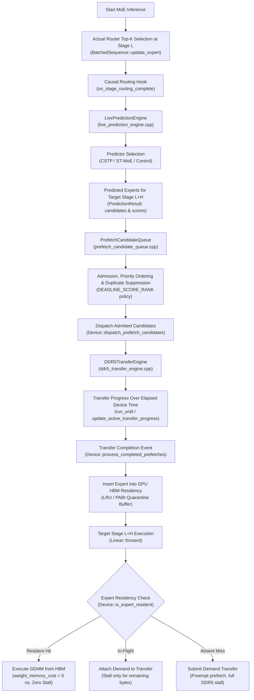
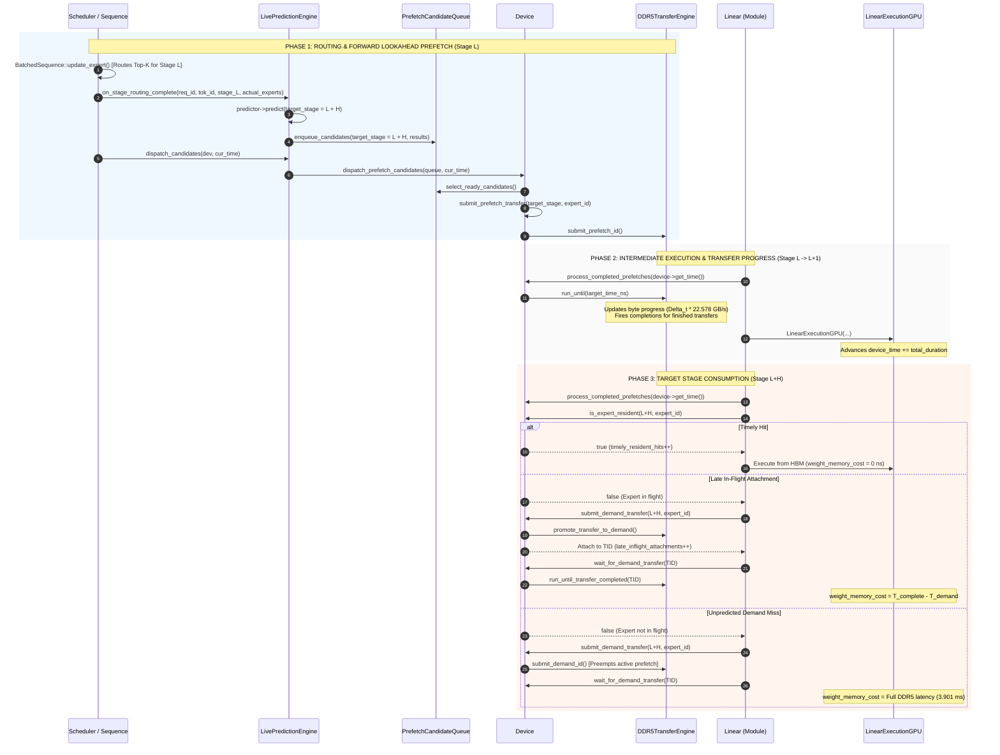
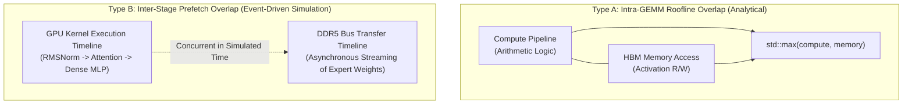
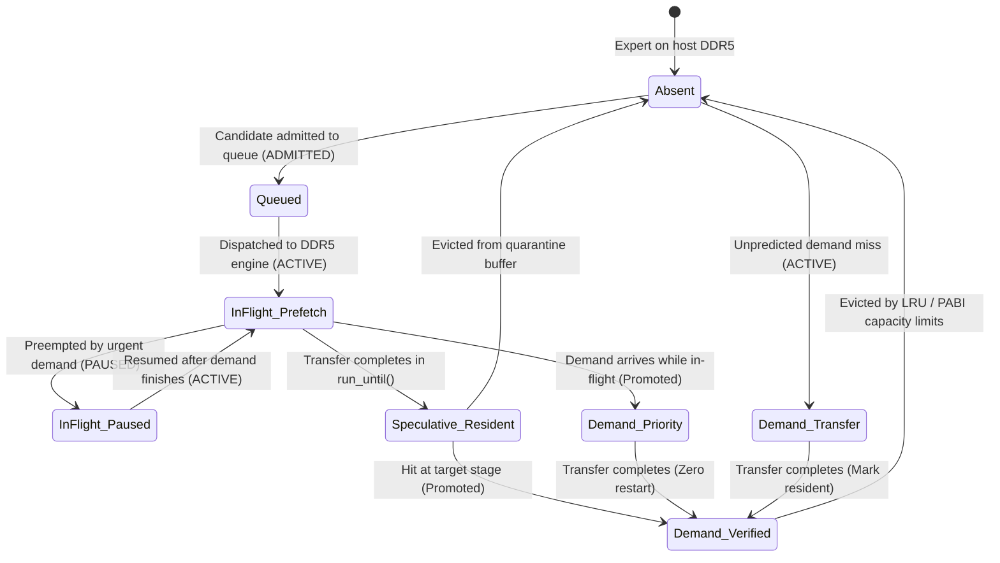
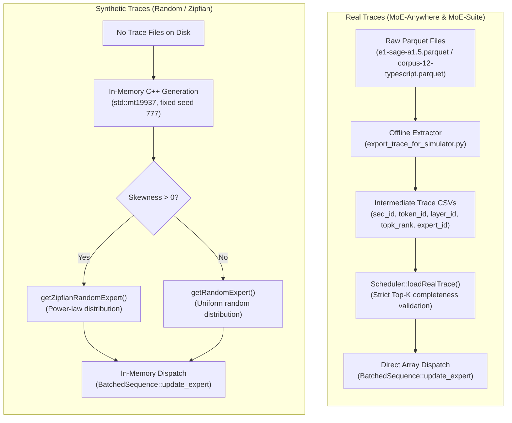

# Predictor-Driven Expert Prefetching into GPU HBM

This document explains the predictor-driven expert prefetching mechanism implemented in `LLMSimulator`. It follows the execution path from actual MoE routing through future expert prediction, candidate admission, DDR5 transfer dispatch, simulated transfer progress, HBM residency insertion, and eventual expert consumption. It also explains the simulator's timing model and the distinction between synthetic routing traces and real MoE-Anywhere/MoE-Suite routing.

---

## 1. Overall Architecture

### The Problem: The MoE Memory Wall
In Mixture-of-Experts (MoE) architectures (such as DeepSeek-V3 and Mixtral-8x7B), parameter counts scale by instantiating dozens or hundreds of specialized expert sub-networks. During token generation, only a small subset of experts ($K \ll N$) is routed per token per layer. 

When model parameters exceed the capacity of fast on-chip GPU High-Bandwidth Memory (HBM), unrouted or infrequently used experts must reside in host memory (DDR5 DRAM). When a layer requires an expert that is absent from HBM, execution stalls while its weight tensors are fetched across the off-chip interconnect (e.g. PCIe / CXL). At a DDR5 transfer throughput of $\approx 22.58\text{ GB/s}$, fetching an $88.08\text{ MB}$ expert requires $\approx 3.90\text{ ms}$ of transfer time, severely degrading generation latency and GPU compute utilization.

### The Solution: Predictor-Driven Lookahead Prefetching
Our prefetching architecture overcomes this memory wall by predicting future expert requirements in advance and asynchronously streaming expert weights into GPU HBM ahead of execution:

1. **Routing Observation:** At MoE stage $L$, the token router selects the Top-$K$ experts for current computation.
2. **Predictor Triggering:** Upon router resolution, the `LivePredictionEngine` receives the observed routing decisions.
3. **Forward Lookahead:** The configured predictor (e.g., CSTP or ST-MoE) predicts expert requirements for a future target stage $L + H$, where $H \ge 1$ is the prediction horizon.
4. **Candidate Admission:** Predictions are evaluated by the `PrefetchCandidateQueue`, which enforces budget constraints, priority ranking, and duplicate suppression.
5. **DDR5 Dispatch:** Admitted candidates are submitted to the `DDR5TransferEngine`, initiating serialized asynchronous data movement from host DRAM to GPU HBM.
6. **Concurrent Transfer Progress:** While the GPU executes intermediate computation across stages $L$ and $L+1$, simulated device time advances, progressing the DDR5 transfer.
7. **HBM Residency Insertion:** Completed transfers insert the expert weights into HBM cache (managed by LRU or PABI quarantine policies).
8. **Target Execution at Stage $L+H$:**
   - **Timely Hit:** If the prefetch finished, execution proceeds with zero off-chip transfer stall.
   - **Late In-Flight Attachment:** If the transfer is still in progress, the layer attaches to the running transfer, promoting its priority and stalling only for the remaining transfer latency.
   - **Demand Miss:** If the expert was not predicted, execution initiates an urgent demand transfer, preempting any speculative prefetch.



---

## 2. Complete Function Call Chain

The execution path consists of two coordinated control loops: the **Prefetch Dispatch Loop** (which predicts and streams weights ahead of time) and the **Demand Execution Loop** (which evaluates cache hits, attaches to in-flight transfers, or stalls on demand misses).



### Detailed Step-by-Step Function Documentation

#### 1. Routing Trigger: `BatchedSequence::update_expert`
- **File & Lines:** [`src/scheduler/sequence.cpp:165-320`](file:///home/mohman/ca_project/LLMSimulator/src/scheduler/sequence.cpp#L165-L320)
- **Caller:** `GateUpdate::aggregate_expert` ([`src/module/route.cpp:165`](file:///home/mohman/ca_project/LLMSimulator/src/module/route.cpp#L165)).
- **Arguments:** `int num_expert`, `int top_k`, `bool need_new_expert`.
- **Action:** Resolves the Top-$K$ routing decisions for all active sequences in the current batch at stage `cur_layer`. Either loads ground-truth decisions from `sequences_info[seq_id]->expert_list` (real trace path) or queries `getRandomExpert()` / `getZipfianRandomExpert()` (synthetic path). Writes routing records to `expert_routing.csv`.
- **Successor:** Calls `LivePredictionEngine::on_stage_routing_complete`.

#### 2. Forward Prediction: `LivePredictionEngine::on_stage_routing_complete`
- **File & Lines:** [`src/prefetch/live_prediction_engine.cpp:141-304`](file:///home/mohman/ca_project/LLMSimulator/src/prefetch/live_prediction_engine.cpp#L141-L304)
- **Caller:** `BatchedSequence::update_expert` ([`src/scheduler/sequence.cpp:297`](file:///home/mohman/ca_project/LLMSimulator/src/scheduler/sequence.cpp#L297)).
- **Arguments:** `int request_id`, `int token_id`, `int target_stage_id`, `const std::vector<int>& actual_target_experts`.
- **Action:** 
  1. Stores actual observed routing for causal evaluation and offline reconciliation.
  2. Updates predictor state for prior predictions arriving at this stage via `predictor_->update()`.
  3. Under `FORWARD_LOOKAHEAD` mode ([`live_prediction_engine.cpp:270-303`](file:///home/mohman/ca_project/LLMSimulator/src/prefetch/live_prediction_engine.cpp#L270-L303)), calculates future target stage:
     $$\text{future\_target\_stage\_id} = \text{target\_stage\_id} + H$$
  4. Bounds-checks target stage (`future_target_stage_id < num_stages_`). If out-of-bounds (e.g. beyond final model layer), prediction is safely skipped.
  5. Invokes `predictor_->predict(...)` with observed source experts to obtain Top-$B$ candidate experts and scores.
  6. Enqueues candidates via `candidate_queue_->enqueue_candidates(...)`.

#### 3. Candidate Admission & Ranking: `PrefetchCandidateQueue::enqueue_candidates`
- **File & Lines:** [`src/prefetch/prefetch_candidate_queue.cpp:242-276`](file:///home/mohman/ca_project/LLMSimulator/src/prefetch/prefetch_candidate_queue.cpp#L242-L276)
- **Caller:** `LivePredictionEngine::on_stage_routing_complete`.
- **Arguments:** `int request_id`, `int token_id`, `int source_stage_id`, `int target_stage_id`, `int horizon`, `const PredictionResult& result`.
- **Action:** 
  1. Validates candidate fields (`validate_candidate`: bounds, NaN/Inf checks).
  2. Checks for duplicates against active queue entries (`CandidateKey {request_id, token_id, target_stage_id, expert_id}`).
  3. If duplicate, applies `RETAIN_HIGHEST_PRIORITY` (updates score if higher, else suppresses).
  4. Enforces capacity limit (`queue_capacity = 1024`). Under overflow, rejects or evicts lowest priority.
  5. Sets state to `CandidateState::ADMITTED`.

#### 4. Candidate Dispatch: `Device::dispatch_prefetch_candidates`
- **File & Lines:** [`src/hardware/device.cpp:1418-1474`](file:///home/mohman/ca_project/LLMSimulator/src/hardware/device.cpp#L1418-L1474)
- **Caller:** `LivePredictionEngine::dispatch_candidates` ([`src/scheduler/sequence.cpp:307`](file:///home/mohman/ca_project/LLMSimulator/src/scheduler/sequence.cpp#L307)).
- **Arguments:** `std::shared_ptr<PrefetchCandidateQueue> queue`, `double current_time_ns`, `int max_candidates`.
- **Action:**
  1. Flushes pending completions via `process_completed_prefetches(current_time_ns)`.
  2. Pulls prioritized candidates via `queue->select_ready_candidates(max_candidates)` (`DEADLINE_SCORE_RANK` order).
  3. Skips candidates if expert is already resident (`has_resident_expert()`).
  4. Skips candidates if expert is already in-flight (`is_expert_inflight()`).
  5. Submits new prefetch via `submit_prefetch_transfer(...)`.
  6. On successful submission, calls `queue->mark_candidate_dispatched(cand_id)` (state transitions to `READY`).

#### 5. DDR5 Transfer Submission: `Device::submit_prefetch_transfer`
- **File & Lines:** [`src/hardware/device.cpp:1219-1289`](file:///home/mohman/ca_project/LLMSimulator/src/hardware/device.cpp#L1219-L1289)
- **Caller:** `Device::dispatch_prefetch_candidates`.
- **Arguments:** `int layer_id`, `int expert_id`, `double current_time_ns`, `uint64_t bytes`, `int priority`, `int source_stage`, `uint64_t candidate_id`.
- **Action:**
  1. Instantiates `DDR5TransferEngine` if null.
  2. Submits transfer to `ddr5_transfer_engine->submit_prefetch_id(...)`.
  3. Creates an `InflightExpertEntry` in `inflight_registry[{layer_id, expert_id}]`.
  4. Records metadata in `speculative_transfers` map for metric accounting.

#### 6. Simulated Transfer Stepping: `DDR5TransferEngine::run_until`
- **File & Lines:** [`src/prefetch/ddr5_transfer_engine.cpp:620-634`](file:///home/mohman/ca_project/LLMSimulator/src/prefetch/ddr5_transfer_engine.cpp#L620-L634)
- **Caller:** `Device::process_completed_prefetches` ([`src/module/linear.cpp:54`](file:///home/mohman/ca_project/LLMSimulator/src/module/linear.cpp#L54), [`src/hardware/linear_impl.cpp:66`](file:///home/mohman/ca_project/LLMSimulator/src/hardware/linear_impl.cpp#L66)).
- **Arguments:** `double target_time_ns` (absolute simulated timestamp matching `device->get_time()`).
- **Action:**
  1. Pops and processes completion events from `event_queue_` where `timestamp_ns <= target_time_ns`.
  2. For the currently active transfer, computes elapsed time $\Delta t = \text{target\_time\_ns} - \text{last\_start\_time\_ns}$.
  3. Decrements `remaining_bytes` and increments `transferred_bytes` by $\Delta t \times \text{bandwidth}$.
  4. Advances internal clock `current_time_ns_ = target_time_ns`.

#### 7. Residency Insertion: `Device::process_completed_prefetches`
- **File & Lines:** [`src/hardware/device.cpp:1322-1416`](file:///home/mohman/ca_project/LLMSimulator/src/hardware/device.cpp#L1322-L1416)
- **Caller:** `Linear::forward` ([`src/module/linear.cpp:54`](file:///home/mohman/ca_project/LLMSimulator/src/module/linear.cpp#L54)).
- **Arguments:** `double current_device_time`.
- **Action:**
  1. Calls `ddr5_transfer_engine->run_until(current_device_time)`.
  2. Identifies all transfers in `inflight_registry` marked `COMPLETED`.
  3. Inserts completed experts into HBM cache:
     - Under `PABI`: calls `mark_expert_speculative(...)` (inserted into quarantine buffer; pinned if eligible).
     - Under standard `LRU`: calls `mark_expert_demand(...)`.
  4. Removes entry from `inflight_registry` and `inflight_experts`.

#### 8. Target Consumption & Stalls: `LinearExecutionGPU`
- **File & Lines:** [`src/hardware/linear_impl.cpp:45-133`](file:///home/mohman/ca_project/LLMSimulator/src/hardware/linear_impl.cpp#L45-L133)
- **Caller:** `Executor::executeLinear` ([`src/hardware/executor.cpp:176`](file:///home/mohman/ca_project/LLMSimulator/src/hardware/executor.cpp#L176)).
- **Arguments:** `Device_Ptr device`, `Tensor_Ptr input`, `Tensor_Ptr weight`, `Tensor_Ptr output`, `bool use_ramulator`.
- **Action:**
  1. If expert is absent from HBM (`!device->is_expert_resident()`):
     - Calls `device->submit_demand_transfer(...)`. If already in-flight, attaches to prefetch and promotes priority (`promote_inflight_to_demand()`); if not pre-fetched, issues new demand transfer (preempting active prefetches).
     - Calls `device->wait_for_demand_transfer(tid)`.
     - Calculates stall: `weight_memory_cost = tr->completion_time_ns - start_time`.
     - Marks expert resident in HBM.
  2. Accumulates duration: `exec_status.total_duration = std::max(compute_duration, memory_duration)`.
  3. Global time advances in `TopModuleGraph::set_pop_status()`: `status.device_time += exec_status.total_duration`.

---

## 3. The Complete Timing Model

`LLMSimulator` combines an analytical compute model with an event-driven DRAM prefetching engine. Understanding how time advances and where operations overlap is essential.

### 3.1 GPU Operation Duration

In [`src/hardware/linear_impl.cpp:20-34`](file:///home/mohman/ca_project/LLMSimulator/src/hardware/linear_impl.cpp#L20-L34), pure compute and HBM bandwidth durations are computed from tensor dimensions:

$$\text{total\_flops} = 2.0 \cdot m \cdot k \cdot n$$

$$\text{total\_memory\_size} = (m \cdot k + k \cdot n + m \cdot n) \times \text{precision\_byte}$$

$$T_{\text{compute}} = \frac{\text{total\_flops}}{\text{compute\_peak\_flops}} \times 10^9\text{ ns}$$

$$T_{\text{HBM}} = \frac{\text{total\_memory\_size}}{\text{memory\_bandwidth}} \times 10^9\text{ ns}$$

- $m$: Input sequence/token batch dimension (`input->shape[0]`).
- $k$: Input hidden dimension (`input->shape[1]`).
- $n$: Output projection dimension (`weight->shape[1]`).
- $\text{compute\_peak\_flops}$: Peak floating-point throughput (e.g. $312 \times 10^{12}\text{ FLOPS}$ for A100 FP16).
- $\text{memory\_bandwidth}$: Peak HBM bandwidth (e.g. $2,039 \times 10^9\text{ B/s}$ for HBM3).

For standard on-chip GEMMs, total duration is modeled via the Roofline abstraction ([`linear_impl.cpp:235-237`](file:///home/mohman/ca_project/LLMSimulator/src/hardware/linear_impl.cpp#L235-L237)):

$$T_{\text{GEMM}} = \max(T_{\text{compute}}, T_{\text{HBM}})$$

### 3.2 Global Simulated Device Time

Simulated GPU time is maintained in `StatusBoard::device_time` ([`src/module/status.h:69`](file:///home/mohman/ca_project/LLMSimulator/src/module/status.h#L69)) and queried by `device->get_time()` ([`src/hardware/device.h:222`](file:///home/mohman/ca_project/LLMSimulator/src/hardware/device.h#L222)). 

Time advances in discrete chunks at **module execution boundaries** inside `TopModuleGraph::set_pop_status()` ([`src/module/module_graph.cpp:249`](file:///home/mohman/ca_project/LLMSimulator/src/module/module_graph.cpp#L249)):

$$\text{status.device\_time} \mathrel{+}= \text{exec\_status.total\_duration}$$

Every operation executed by the GPU (Attention, RMSNorm, Gate GEMM, Up GEMM, Down GEMM) pushes `device_time` forward along the simulated timeline.

### 3.3 DDR5 Transfer Progress

When `device->process_completed_prefetches(device->get_time())` calls `ddr5_transfer_engine->run_until(target_time_ns)` ([`src/prefetch/ddr5_transfer_engine.cpp:620`](file:///home/mohman/ca_project/LLMSimulator/src/prefetch/ddr5_transfer_engine.cpp#L620)), `target_time_ns` is an **absolute timestamp**.

If a transfer was active on the channel during interval $[t_0, t_1]$, where $\Delta t = t_1 - t_0$:

$$\Delta \text{bytes} = \Delta t \times \text{BW}_{\text{DDR5}}$$

$$\text{remaining\_bytes} \mathrel{-}= \Delta \text{bytes}$$

$$\text{transferred\_bytes} \mathrel{+}= \Delta \text{bytes}$$

`run_until()` synchronizes the transfer engine up to the current GPU clock without advancing the global clock further.

### 3.4 The Two Types of Overlap



1. **Type A (Intra-GEMM Compute & HBM Overlap):** Modeled analytically via `std::max()`. Assumes perfect pipelining between GPU arithmetic units and on-chip HBM3 memory channels.
2. **Type B (Inter-Stage GPU Execution & DDR5 Overlap):** Modeled dynamically. The DDR5 bus is a physically separate channel from HBM. Transfers run asynchronously on the host bus while the GPU executes intermediate layers.

### 3.5 Critical Distinctions: Service Time vs. Progress vs. Exposed Stall

Consider a DeepSeek-V3 expert layer ($88,080,384\text{ bytes}$) over a calibrated DDR5 bus ($22.578\text{ GB/s}$):

$$T_{\text{service}} = \frac{88,080,384\text{ B}}{22.578\text{ B/ns}} = 3,901,159.71\text{ ns} \approx 3.901\text{ ms}$$

- **Transfer Service Time ($3.901\text{ ms}$):** The duration required to transmit the complete expert over DDR5 uninterrupted.
- **Transfer Progress:** The quantity of data transferred by time $t$: $\min(\text{total\_bytes}, (t - t_{\text{start}}) \times 22.578\text{ B/ns})$.
- **Exposed Stall:** The delay incurred on the critical execution path:
  - If prefetch completed before demand: $\text{Exposed Stall} = 0.0\text{ ms}$ ($100\%$ latency hiding).
  - If prefetch is partially complete: $\text{Exposed Stall} = T_{\text{completion}} - T_{\text{demand}} = \frac{\text{remaining\_bytes}}{\text{BW}_{\text{DDR5}}}$.
  - If unpredicted (pure miss): $\text{Exposed Stall} = T_{\text{service}} = 3.901\text{ ms}$.

### 3.6 Single Serialized DDR5 Engine and Queueing

The `DDR5TransferEngine` models a **single serialized transfer channel**:
- Multiple concurrent prefetch candidates are queued in FIFO / priority order.
- They do **not** each receive $22.578\text{ GB/s}$ in parallel. If two candidates are dispatched simultaneously, candidate 1 requires $3.901\text{ ms}$ and candidate 2 completes at $7.802\text{ ms}$.
- **Demand Preemption:** An incoming demand miss immediately pauses an active prefetch, preserving its transferred bytes, servicing the demand transfer, and resuming the prefetch afterward ([`src/prefetch/ddr5_transfer_engine.cpp:421-455`](file:///home/mohman/ca_project/LLMSimulator/src/prefetch/ddr5_transfer_engine.cpp#L421-L455)).

---

## 4. Expert Residency Lifecycle



### State Definitions and Transition Rules

| State | Memory Location | Description | Trigger Function |
|---|---|---|---|
| **Absent** | Host DDR5 | Weight tensors exist only in host system memory. | Initial state / after eviction |
| **Queued** | Queue Memory | Candidate passed admission checks; awaiting dispatch slot. | `PrefetchCandidateQueue::enqueue_candidates` |
| **In-Flight (Prefetch)** | DDR5 Bus | Actively streaming across DDR5 bus at speculative priority. | `Device::submit_prefetch_transfer` |
| **In-Flight (Paused)** | Host Memory Buffer | Speculative transfer paused due to higher-priority demand load. | `DDR5TransferEngine::preempt_active_prefetch` |
| **Speculative Resident** | GPU HBM (Quarantine) | Prefetch completed; protected under PABI quarantine buffer. | `Device::mark_expert_speculative` |
| **Demand Verified** | GPU HBM (Active Cache) | Demanded by actual routing; eligible for full LRU cache retention. | `Device::mark_expert_resident` / `promote_speculative_to_demand` |
| **Evicted** | Host DDR5 | Removed from HBM when resident capacity exceeds limit. | `Device::evict_if_needed` |

---

## 5. End-to-End Numerical Walkthrough

The following concrete walkthrough illustrates prediction, dispatch, transfer overlap, timely hit, late attachment, and unpredicted miss.

### Configuration
- **Model:** DeepSeek-V3 MoE Layer.
- **Expert Size:** $88,080,384\text{ bytes}$ ($\approx 88.08\text{ MB}$).
- **DDR5 Bandwidth:** $22.578\text{ GB/s} = 22.578\text{ bytes/ns}$.
- **Uninterrupted Transfer Latency:** $3,901,159.71\text{ ns} \approx 3.901\text{ ms}$.
- **Lookahead Horizon:** $H = 2$ stages.
- **Initial Device Time:** $T_0 = 10.000\text{ ms}$.

```mermaid
gantt
    title Detailed Timing Walkthrough: Horizon H=2 Prefetching
    dateFormat X
    axisFormat %s ms
    section Stage L (10.0 - 12.5 ms)
    Observe Routing E0..E7           :milestone, m0, 10000000, 10000000
    Predict Stage L+2 (E10, E20)     :milestone, m1, 10000000, 10000000
    Op 1: Gate & Up GEMMs (1.2 ms)   :crit, op1, 10000000, 11200000
    Op 2: Down GEMM (1.3 ms)         :crit, op2, 11200000, 12500000
    section Stage L+1 (12.5 - 15.0 ms)
    Op 3: Attention (1.2 ms)         :crit, op3, 12500000, 13700000
    Op 4: MoE MLP (1.3 ms)           :crit, op4, 13700000, 15000000
    section DDR5 Interconnect
    Prefetch E10 (3.901 ms)          :active, p10, 10000000, 13901160
    Prefetch E20 (Queued -> InFlight):active, p20, 13901160, 17802320
    section Stage L+2 Execution (15.0 ms)
    Demand E10 (Timely Hit!)         :milestone, hit10, 15000000, 15000000
    Demand E20 (Late In-Flight Att.) :crit, att20, 15000000, 17802320
```

### Chronological Trace

#### 1. Stage $L$ Routing and Dispatch ($T = 10.000\text{ ms}$)
- Router selects 8 experts for Stage $L$: $\{1, 3, 5, 7, 9, 11, 13, 15\}$.
- `on_stage_routing_complete` invokes predictor with horizon $H=2$, targeting Stage $L+2$.
- Predictor outputs candidate set: $\{E_{10}, E_{20}\}$.
- Queue admits both candidates.
- `dispatch_candidates()` submits transfers:
  - $E_{10}$ begins transmitting immediately on DDR5 channel ($T_{\text{start}} = 10.000\text{ ms}$, $T_{\text{comp}} = 13.901\text{ ms}$).
  - $E_{20}$ is queued behind $E_{10}$ ($T_{\text{start}} = 13.901\text{ ms}$, $T_{\text{comp}} = 17.802\text{ ms}$).

#### 2. Intermediate Execution Across Stages $L$ and $L+1$ ($10.000\text{ ms} \to 15.000\text{ ms}$)
- GPU executes Stage $L$ MLP computation ($2.500\text{ ms}$) and Stage $L+1$ Attention & MLP ($2.500\text{ ms}$).
- Cumulative GPU device time advances by $+5.000\text{ ms}$ to $T = 15.000\text{ ms}$.
- Along the way, `run_until(15.000\text{ ms})` executes:
  - At $T = 13.901\text{ ms}$: $E_{10}$ completes transfer, enters HBM speculative buffer.
  - At $T = 13.901\text{ ms}$: $E_{20}$ starts transmitting. By $T = 15.000\text{ ms}$, $\Delta t = 1.099\text{ ms}$.
  - $E_{20}$ has transferred $1.099\text{ ms} \times 22.578\text{ B/ns} = 24,813,222\text{ bytes}$ ($28.2\%$). Remaining: $63,267,162\text{ bytes}$.

#### 3. Stage $L+2$ Actual Routing Resolution ($T = 15.000\text{ ms}$)
Actual router for Stage $L+2$ requires three experts: $\{E_{10}, E_{20}, E_{30}\}$.

- **Case 1: Timely Hit ($E_{10}$):**  
  `is_expert_resident(L+2, 10)` returns **TRUE**. `timely_resident_hits` is incremented. `weight_memory_cost = 0 ns`. GPU executes immediately with **zero stall**.
- **Case 2: Late In-Flight Attachment ($E_{20}$):**  
  `is_expert_resident(L+2, 20)` returns **FALSE**, but $E_{20}$ is found in `inflight_registry`.
  `submit_demand_transfer` attaches to existing transfer, promoting priority. `late_inflight_attachments` is incremented.
  GPU waits for remaining bytes:
  $$\text{Stall} = \frac{63,267,162\text{ B}}{22.578\text{ B/ns}} = 2,802,159.71\text{ ns} \approx 2.802\text{ ms}$$
  *(Savings: $3.901\text{ ms} - 2.802\text{ ms} = 1.099\text{ ms}$ saved compared to pure miss).*
- **Case 3: Unpredicted Demand Miss ($E_{30}$):**  
  $E_{30}$ was not predicted. `submit_demand_transfer` submits new demand transfer.
  GPU stalls for the full transfer duration: $\text{Stall} = 3.901\text{ ms}$.

---

## 6. Random/Synthetic Traces vs. Real Routing Traces

A critical contribution of this research is establishing that **synthetic random routing cannot accurately validate prefetch performance**.

### 6.1 Trace Provenance and Ingestion Pipelines



### 6.2 Forensic Comparison Matrix

| Property | Synthetic / Random Routing | Real MoE-Anywhere Traces | Real MoE-Suite Traces |
|---|---|---|---|
| **Routing Origin** | In-memory pseudorandom generation (`std::mt19937`) | Real LLaMA/Mixtral model inference logs | Real multi-task code/agent workload logs |
| **Dataset Source** | None (generated live in C++ RAM) | `e1-sage-a1.5.parquet` | `corpus-12-typescript-migration-planner.parquet` |
| **Ingestion Routine** | `Scheduler::getRandomExpert` ([`sequence.cpp:280`](file:///home/mohman/ca_project/LLMSimulator/src/scheduler/sequence.cpp#L280)) | `Scheduler::loadRealTrace` ([`scheduler.cpp:650`](file:///home/mohman/ca_project/LLMSimulator/src/scheduler/scheduler.cpp#L650)) | `Scheduler::loadRealTrace` ([`scheduler.cpp:650`](file:///home/mohman/ca_project/LLMSimulator/src/scheduler/scheduler.cpp#L650)) |
| **Top-K Verification** | Guaranteed by sampling $K$ unique ints | Strict C++ exception if token has $< K$ records | Strict C++ exception if token has $< K$ records |
| **Fallback to Random** | Native behavior | **ZERO fallback** (fatal `std::runtime_error`) | **ZERO fallback** (fatal `std::runtime_error`) |
| **Temporal Locality** | Zero (independent draws per step) | High (same tokens reuse semantic experts) | High (long prompt/code migration context) |
| **Cross-Stage Correlation** | Zero ($P(e_{L+1} \mid e_L) = \text{Uniform}$) | Strong structural routing pathways | Strong task-specific expert clustering |
| **Working Set Size** | Disperses uniformly across all $N$ experts | Concentrates on active sub-network | Concentrates on specialized domain experts |
| **CSTP / ST-MoE Validity** | Destroys correlation learning ($\approx \text{Random}$) | Validates spatial & temporal prediction | Validates cross-stage lookahead adaptation |
| **Intended Research Use** | Smoke testing & memory engine unit tests | Primary baseline campaign evaluation | Primary comparative predictor evaluation |

### 6.3 Why Real Traces Are Essential for Prefetching Research
Predictors such as CSTP and ST-MoE rely on two physical phenomena in trained MoE models:
1. **Spatial Correlation:** Activation of Expert $A$ at Stage $L$ strongly predicts activation of Expert $B$ at Stage $L+1$ because deep neural representations follow structured feature transformations.
2. **Temporal Locality:** An expert utilized by token $t$ is frequently reused by token $t+1$ within the same sequence.

Under synthetic uniform random routing, all conditional transition probabilities collapse to $\frac{1}{N}$. As a consequence, predictor accuracy drops to random guessing ($\text{Recall@4} \approx 6.25\%$), prefetch queues are flooded with false positives, and HBM cache thrashing eliminates all speedup. Real MoE traces are mandatory to observe authentic predictor hit rates ($\text{Recall@4} > 60\%$) and latency savings.

---

## 7. Multi-Token / Batch Execution ($B > 1$)

When the inference batch size exceeds 1 ($B > 1$), multiple tokens are evaluated concurrently in `BatchedSequence::update_expert` ([`src/scheduler/sequence.cpp:219-312`](file:///home/mohman/ca_project/LLMSimulator/src/scheduler/sequence.cpp#L219-L312)).

### 7.1 Per-Token Prediction & Candidate Deduplication
1. **Per-Token Routing:** For each token $i \in \{1 \dots B\}$, the router selects a Top-$K$ set $A_L^{(i)}$. The total expert assignments across the batch is $B \times K$.
2. **Per-Token Prediction:** `LivePredictionEngine::on_stage_routing_complete` invokes `predictor_->predict(...)` independently for each token $i$, generating candidate sets $P_{L+H}^{(i)}$.
3. **Queue Deduplication:** Candidates are keyed by `CandidateKey {request_id, token_id, target_stage_id, expert_id}`.
4. **Device Dispatch Deduplication:** When candidates are selected for physical dispatch in `Device::dispatch_prefetch_candidates` ([`src/hardware/device.cpp:1451-1461`](file:///home/mohman/ca_project/LLMSimulator/src/hardware/device.cpp#L1451-L1461)):
   - If Token 1 already dispatched a prefetch for Expert $E_{42}$, $E_{42}$ is marked in `inflight_registry`.
   - When Token 2's candidate for $E_{42}$ is evaluated, `is_expert_inflight()` returns **TRUE**.
   - The duplicate prefetch is suppressed (`duplicate_prefetches_prevented++`).
   - Only **one** physical transfer is issued across DDR5.

### 7.2 Unique Experts and Batched GEMM Dimensions
While routing assignments scale as $B \times K$, the number of **unique experts** is bounded by:

$$U_L = \left| \bigcup_{i=1}^{B} A_L^{(i)} \right| \le \min(B \times K, N)$$

When multiple tokens in a batch select the same expert, their inputs are aggregated into a single batched GEMM:
- GEMM dimension $M = \text{tokens\_assigned\_to\_expert} \le B$.
- The weight tensor is loaded **once** from HBM, amortizing weight read overhead across all tokens routed to that expert.

### 7.3 Predictor State Isolation
- In `STMoEPredictor::reset(int request_id)` ([`src/prefetch/st_moe_predictor.cpp:32`](file:///home/mohman/ca_project/LLMSimulator/src/prefetch/st_moe_predictor.cpp#L32)) and `CSTPPredictor::reset(int request_id)` ([`src/prefetch/cstp_predictor.cpp:38`](file:///home/mohman/ca_project/LLMSimulator/src/prefetch/cstp_predictor.cpp#L38)), `history_table_.erase(request_id)` is called at sequence boundaries.
- Temporal history is strictly isolated per sequence, preventing cross-request pollution.
- Offline-profiled spatial correlation matrices are globally shared across sequences.

---

## 8. Configuration Reference

All prefetching parameters are parsed through `PrefetchConfig::parse_yaml` ([`src/prefetch/prefetch_config.cpp:276-472`](file:///home/mohman/ca_project/LLMSimulator/src/prefetch/prefetch_config.cpp#L276-L472)).

### Production YAML Configuration Example

```yaml
system:
  optimization:
    use_ramulator: on               # Mandatory: Enables detailed memory and demand stall path
    use_event_driven_dram: on       # Mandatory: Activates DDR5TransferEngine
  
  prefetch:
    enabled: true                   # Global prefetch toggle
    mode: "hardware_async"          # Event-driven asynchronous prefetch engine
    
    predictor:
      type: "cstp"                  # Choices: 'cstp', 'st_moe', 'frequency', 'random'
      alpha: 0.5                    # CSTP: Spatial (0.5) vs Temporal (0.5) weight
      smoothing_lambda: 1.0         # CSTP: Dirichlet smoothing constant
      confidence_threshold: 2       # ST-MoE: Counter threshold for admission
      online_adaptation: true       # Dynamic learning from observed routing
    
    candidate_selection:
      policy: "top_k"               # Choices: 'top_k', 'threshold_filtered'
      budget: 4                     # Candidate prefetch budget B
    
    scheduling:
      scheduling_mode: "forward_lookahead" # Mandatory: Predicts L+H at stage L
      prediction_horizon: 2         # Lookahead distance H (stages)
      queue_enabled: true           # Candidate queue toggle
      queue_capacity: 1024          # Maximum entries in candidate queue
      priority_policy: "deadline_score_rank" # Ordering: deadline -> score -> rank
      duplicate_policy: "retain_highest_priority"
      overflow_policy: "reject_lowest_priority"
    
    transfer:
      model: "event_driven"         # Event-driven queue calibrated at 22.578 GB/s
      asynchronous: true            # Overlap transfers with GPU computation
      max_outstanding_transfers: 4  # Channel queue depth
    
    eviction_policy: "pabi"         # Choices: 'pabi', 'lru', 'lru_pinned'
    
    pabi:
      quarantine_enabled: true      # Isolates speculative prefetches from demand cache
      speculative_fraction: 0.20    # 20% of HBM allocated to speculative buffer
      pinning_enabled: true         # Protects high-confidence lookahead candidates
      max_pinned_experts: 4         # Maximum pinned experts per stage
```

### Critical Architectural Caveat: Why `use_ramulator: on` Is Mandatory
As established in our forensic timing audit ([`docs/RAMULATOR_OFF_PREFETCH_COMPATIBILITY_AUDIT.md`](file:///home/mohman/ca_project/docs/RAMULATOR_OFF_PREFETCH_COMPATIBILITY_AUDIT.md)):
- When `use_ramulator` is set to `off`, `LinearExecutionGPU` enters an analytical fallback branch ([`linear_impl.cpp:209-214`](file:///home/mohman/ca_project/LLMSimulator/src/hardware/linear_impl.cpp#L209-L214)) that **completely bypasses `submit_demand_transfer`**.
- As a consequence, demand misses incur $0\text{ ns}$ DDR5 transfer latency, charging only local HBM read time ($43.2\,\mu\text{s}$ instead of $3.901\text{ ms}$).
- Demand preemption and in-flight attachments never execute.
- **Therefore, all production prefetching experiments must run with `use_ramulator: on` and `use_event_driven_dram: on`.**

---

## 9. Metrics, Output Files, and Debugging

The prefetching framework instruments metrics across the entire prediction, transfer, and memory hierarchy.

### Primary Metrics Inventory

| Metric Category | Metric Name | Source Variable / Code Anchor | Description |
|---|---|---|---|
| **Prediction** | Precision@K | `LiveEventMetrics::precision` | Fraction of predicted candidates that were actually routed |
| **Prediction** | Recall@K | `LiveEventMetrics::recall` | Fraction of actual routed experts successfully predicted |
| **Prediction** | Hit Rate | `LiveEventMetrics::hit_rate` | Boolean indicator whether at least 1 candidate was routed |
| **Prefetching** | Dispatched | `prefetch_metrics.candidates_dispatched` | Admitted candidates submitted to DDR5 engine |
| **Prefetching** | Resident Skipped | `prefetch_metrics.resident_prefetches_skipped` | Candidates skipped because expert already in HBM |
| **Prefetching** | Duplicates Prevented | `prefetch_metrics.duplicate_prefetches_prevented` | Candidates skipped because expert already in-flight |
| **Hardware** | Timely Hits | `prefetch_metrics.timely_resident_hits` | Demanded experts fully resident via prior prefetch |
| **Hardware** | In-Flight Attached | `prefetch_metrics.late_inflight_attachments` | Demanded experts attached to ongoing prefetch |
| **Hardware** | Demand Misses | `prefetch_metrics.not_prefetched_misses` | Demanded experts completely unpredicted (full stall) |
| **Interconnect** | Preemptions | `metrics_.prefetch_preemptions` | Active prefetches paused by urgent demand transfers |
| **Interconnect** | DDR5 Bytes | `metrics_.total_bytes_transferred` | Total payload transmitted across DDR5 bus |

### Output CSV Files and Schemas

1. **`expert_routing.csv`** (Logged by `BatchedSequence::update_expert`):
   ```csv
   request_id,token_id,layer_id,topk_rank,expert_id
   0,0,0,1,14
   0,0,0,2,88
   ```
2. **`expert_load.csv`** (Logged by `LinearExecutionGPU`):
   ```csv
   request_id,layer_id,expert_id,weight_tensor,size_bytes,start,end,duration,memory_source,memory_destination,cache_hit_or_miss,transfer_id
   0,0,14,all_weights,88080384,10000000,10000000,0,HBM,HBM,hit,0
   1,0,88,all_weights,88080384,10000000,13901159,3901159,OFFCHIP_DRAM,HBM,miss,101
   ```
3. **`expert_cache.csv`** (Logged by `Device` residency manager):
   ```csv
   layer_id,expert_id,event_type,resident_bytes
   0,14,HIT,70464307200
   0,88,MISS,70464307200
   0,88,INSERT,70552387584
   ```

### Diagnostic Troubleshooting Recipes

- **Symptom 1: High Recall@4 but Zero Speedup:**  
  *Diagnosis:* Predictions are accurate, but the prefetch window is too short. Lookahead horizon $H=1$ does not provide enough intervening computation time to overlap the $3.901\text{ ms}$ transfer. Increase horizon to $H=2$ or $H=3$.
- **Symptom 2: High Timely Hits but Frequent Evictions:**  
  *Diagnosis:* Speculative prefetches are evicting active demand-verified experts. Enable PABI quarantine (`pabi.quarantine_enabled: true`) to segregate speculative prefetches into a dedicated buffer.
- **Symptom 3: Huge Number of In-Flight Attachments:**  
  *Diagnosis:* Transfers are consistently arriving slightly late. The predictor is correctly identifying targets, but the DDR5 queue is congested. Reduce candidate budget from $B=8$ to $B=4$ to prevent queue serialization delays.
- **Symptom 4: Prefetch Speedup Is Exactly 0% with Demand Misses Costing 43 $\mu$s:**  
  *Diagnosis:* `use_ramulator` was mistakenly set to `off`, causing the simulator to bypass `submit_demand_transfer` and drop all off-chip stalls. Set `use_ramulator: on`.

---

## 10. Limitations and Modeling Assumptions

To preserve scientific rigor, users of `LLMSimulator` must keep the following architectural modeling limitations in mind:

1. **Macroscopic Roofline Overlap:** Intra-GEMM execution time uses $\max(T_{\text{compute}}, T_{\text{HBM}})$. It does not simulate cycle-by-cycle warp divergence, thread block scheduling, or memory controller bank conflicts within the GPU kernel.
2. **Decoupled Interconnect Channels:** HBM activation traffic (2,039 GB/s) and DDR5 expert transfers (22.58 GB/s) operate on separate simulated channels. The simulator models dedicated host-to-device interconnects (PCIe/CXL) and assumes high activation traffic does not throttle DDR5 bus bandwidth.
3. **Discrete Time Advancement:** GPU time advances in discrete increments at module boundaries rather than per clock cycle. Prefetch progress is evaluated whenever `run_until()` is invoked.
4. **Single-Channel DDR5 Engine:** All off-chip transfers share a single serialized channel calibrated at 22.578 GB/s. Multi-channel host interleaving and PCIe packetization headers are abstracted into the calibrated effective bandwidth.
5. **Zero DMA Descriptor Overhead:** Dispatching a transfer via `submit_prefetch_transfer()` incurs zero software driver or DMA ring buffer launch overhead.
6. **Synthetic Compute Multiplier Caution:** The `COMPUTE_MULTIPLIER` parameter scales execution time scalars without scaling tensor dimensions or multi-token routing competition. It must be reported as *synthetic compute dilation*, not physical multi-token batching.

---
*End of Point 2 Deliverable Documentation.*

