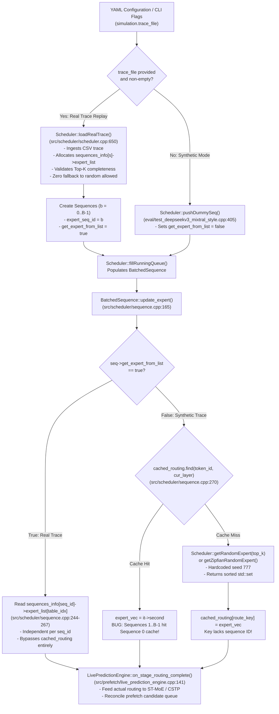
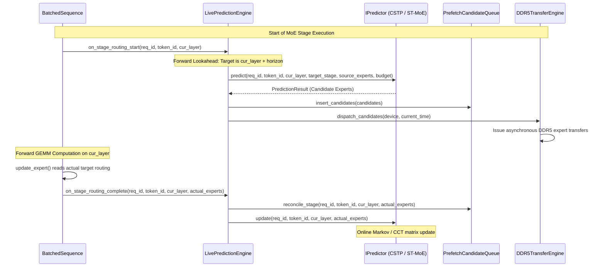

# Forensic Audit: Real vs. Synthetic Routing Traces, Dataset Provenance, and Synthetic Batch-Diversity Bug Status

**Date:** November 2026  
**Auditor:** Antigravity Autonomous Coding & Forensic Engine  
**Target Repository:** `/home/mohman/ca_project/LLMSimulator`  
**Deliverable File:** `mohman/point_2/TRACE_DATASET_AUDIT.md`  
**Mode:** READ-ONLY Forensic Inspection (Zero Source Code Modifications)

---

## 1. Executive Verdict & Answers to Core Questions A–G

| Audit Question | Verdict | Summary Assessment |
| :--- | :---: | :--- |
| **A. Are MoE-Anywhere and MoE-Suite routing decisions genuinely loaded from recorded traces?** | **YES** | Traces originate from verified Parquet datasets (`e1-sage-a1.5.parquet` and 12 `corpus-*.parquet` files). Replay passes through [`export_trace_for_simulator.py`](file:///home/mohman/ca_project/LLMSimulator/scripts/phase_e/export_trace_for_simulator.py#L24-L115) into CSV and is ingested via [`Scheduler::loadRealTrace()`](file:///home/mohman/ca_project/LLMSimulator/src/scheduler/scheduler.cpp#L650-L735). The loader enforces strict Top-K completeness (lines 719–729), terminating on missing records with zero fallback to random routing. |
| **B. Are synthetic traces generated independently per sequence as intended?** | **NO** | In multi-sequence batches ($B > 1$), synthetic traces are **not** generated independently. When `get_expert_from_list = false`, all sequences in a batch query [`cached_routing`](file:///home/mohman/ca_project/LLMSimulator/src/scheduler/sequence.cpp#L270-L286) using the key `(token_id, cur_layer)`. Because sequence ID is omitted from the key, Sequences $1 \dots B-1$ hit the cache populated by Sequence 0, receiving identical expert routing. |
| **C. Is the old `(token_id, cur_layer)` collision bug fixed everywhere?** | **NOT FIXED** | In [`src/scheduler/sequence.cpp:270`](file:///home/mohman/ca_project/LLMSimulator/src/scheduler/sequence.cpp#L270) and [`src/scheduler/sequence.h:130`](file:///home/mohman/ca_project/LLMSimulator/src/scheduler/sequence.h#L130), `cached_routing` remains keyed on `std::pair<int, int>` representing `(token_id, cur_layer)`. It was never updated to include `seq_id` or `request_id`. Real traces avoid this defect only because [`seq->get_expert_from_list = true`](file:///home/mohman/ca_project/LLMSimulator/src/scheduler/sequence.cpp#L244-L267) bypasses the synthetic cache entirely. |
| **D. Does increasing batch size produce realistic synthetic routing diversity?** | **NO (Synthetic) / YES (Real)** | Under synthetic routing, batch scaling produces zero additional expert diversity: unique experts per layer is pegged at $K$ ($K=8$ for DeepSeek-V3), underestimating the actual multi-sequence working set by up to $20.4\times$ at $B=32$. In contrast, real multi-sequence trace replays exhibit realistic diversity growth ($B=1 \to 8.00$, $B=2 \to 13.83$, $B=4 \to 23.56$ unique experts). |
| **E. Are real traces and synthetic traces clearly separated in configuration and execution?** | **YES** | Controlled in [`eval/test_deepseekv3_mixtral_style.cpp:392-407`](file:///home/mohman/ca_project/LLMSimulator/eval/test_deepseekv3_mixtral_style.cpp#L392-L407). When `simulation.trace_file` (or CLI `--trace-file`) is non-empty, execution takes the `[REAL TRACE REPLAY MODE]` branch, loading traces and setting `get_expert_from_list = true`. When omitted, it executes synthetic dummy sequences with `get_expert_from_list = false`. |
| **F. Do ST-MoE and CSTP receive identical routing events in comparative experiments?** | **YES** | Under both offline Python evaluation ([`src/predictor/evaluation.py`](file:///home/mohman/ca_project/LLMSimulator/src/predictor/evaluation.py#L340-L380)) and live C++ simulation ([`LivePredictionEngine`](file:///home/mohman/ca_project/LLMSimulator/src/prefetch/live_prediction_engine.cpp#L96-L170)), both predictors are evaluated causally against identical trace arrays stored in [`sequences_info[seq_id]->expert_list`](file:///home/mohman/ca_project/LLMSimulator/src/scheduler/sequence.cpp#L254). Predictor state transitions are strictly isolated. |
| **G. Is the dataset/trace pipeline ready for the next experiment campaign?** | **READY WITH CAVEATS** | **Certified Ready** for all Real-Trace campaigns (MoE-Anywhere and MoE-Suite). **Blocked / Not Ready** for Synthetic multi-sequence ($B > 1$) campaigns until `cached_routing` is keyed by `std::tuple<int, int, int>` `(seq_id, token_id, cur_layer)` or eliminated. |

---

## 2. Real vs. Synthetic Architecture & Call Flow Diagrams

The following architecture diagrams illustrate how routing decisions flow through the simulator for both real-trace replay and synthetic generation.

### 2.1 Trace Replay and Ingestion Control Flow



### 2.2 Live Inference Prediction Coordination



---

## 3. Dataset Provenance Table

The repository hosts real routing traces derived from production and research MoE models. The following table provides complete provenance details:

| Dataset Name | Source Artifact Path | File Format & Size | Token Count | Layer / Stage Count | Top-K | Expert Count | Raw Router Fields | Extractor Script & Ingestion Target |
| :--- | :--- | :---: | :---: | :---: | :---: | :---: | :--- | :--- |
| **MoE-Anywhere** | `LLMSimulator/data/downloads/moe_anywhere/e1-sage-a1.5.parquet` | Apache Parquet (16.2 MB) | 19,018 total tokens across 74 prompts (prompts 0..73) | 40 layers (0..39) | 8 | 256 routed experts (IDs 0..255) | `prompt_id` (int32), `task` (str), `token_pos` (int32), `layer` (int16), `experts` (int16[8]), `weights` (float32[8]) | [`export_trace_for_simulator.py::export_moe_anywhere`](file:///home/mohman/ca_project/LLMSimulator/scripts/phase_e/export_trace_for_simulator.py#L66) $\to$ Ingested via [`Scheduler::loadRealTrace()`](file:///home/mohman/ca_project/LLMSimulator/src/scheduler/scheduler.cpp#L650) |
| **MoE-Suite (Corpus 02)** | `LLMSimulator/data/downloads/moe_suite/corpus-02-cpp-framed-rpc-parser.parquet` | Apache Parquet (7.0 MB) | 8,191 tokens | 75 layers | 8 | 256 routed experts (IDs 0..255) | `route_selected` (ndarray[75, 8]), `token_id`, `task_id`, `generated_position` | [`export_trace_for_simulator.py::export_moe_suite`](file:///home/mohman/ca_project/LLMSimulator/scripts/phase_e/export_trace_for_simulator.py#L24) $\to$ Ingested via [`Scheduler::loadRealTrace()`](file:///home/mohman/ca_project/LLMSimulator/src/scheduler/scheduler.cpp#L650) |
| **MoE-Suite (Corpus 03)** | `LLMSimulator/data/downloads/moe_suite/corpus-03-python-incremental-etl.parquet` | Apache Parquet (7.0 MB) | 8,191 tokens | 75 layers | 8 | 256 routed experts (IDs 0..255) | `route_selected` (ndarray[75, 8]), `token_id`, `task_id`, `generated_position` | Same as above |
| **MoE-Suite (Corpus 04)** | `LLMSimulator/data/downloads/moe_suite/corpus-04-rust-priority-worker.parquet` | Apache Parquet (7.0 MB) | 8,191 tokens | 75 layers | 8 | 256 routed experts (IDs 0..255) | `route_selected` (ndarray[75, 8]), `token_id`, `task_id`, `generated_position` | Same as above |
| **MoE-Suite (Corpus 05–11)** | `LLMSimulator/data/downloads/moe_suite/corpus-05` to `corpus-11` (7 files) | Apache Parquet (~49 MB) | 8,191 tokens each | 75 layers | 8 | 256 routed experts (IDs 0..255) | `route_selected` (ndarray[75, 8]), `token_id`, `task_id`, `generated_position` | Same as above |
| **MoE-Suite (Corpus 12)** | `LLMSimulator/data/downloads/moe_suite/corpus-12-typescript-migration-planner.parquet` | Apache Parquet (7.0 MB) | 8,191 tokens | 75 layers | 8 | 256 routed experts (IDs 0..255) | `route_selected` (ndarray[75, 8]), `token_id`, `task_id`, `generated_position` | Primary evaluation corpus used in certified baseline experiments |
| **MoE-Suite (Corpus 13)** | `LLMSimulator/data/downloads/moe_suite/corpus-13-go-fenced-leases.parquet` | Apache Parquet (7.0 MB) | 8,191 tokens | 75 layers | 8 | 256 routed experts (IDs 0..255) | `route_selected` (ndarray[75, 8]), `token_id`, `task_id`, `generated_position` | Secondary evaluation corpus used in certified baseline experiments |

---

## 4. Real Dataset Integrity Findings

### 4.1 Strict Zero-Fallback Ingestion Verification

In legacy simulator code ([`src/scheduler/scheduler.cpp:564-579`](file:///home/mohman/ca_project/LLMSimulator/src/scheduler/scheduler.cpp#L564-L579)), failing to open a trace file caused silent fallback to random synthetic routing. 

In the updated ingestion engine [`Scheduler::loadRealTrace()`](file:///home/mohman/ca_project/LLMSimulator/src/scheduler/scheduler.cpp#L650-L735), strict validation invariants have been established:
1. **File Existence Validation (lines 653–655):** Throws fatal `std::runtime_error("[ERROR] Failed to open real MoE trace file: " + trace_path)`.
2. **Bounds Checking (lines 702–707):** Validates that `1 <= topk_rank <= top_k` and `0 <= expert_id < num_expert`, throwing runtime errors on violations.
3. **Completeness Verification Loop (lines 719–729):**
   ```cpp
   for (int s = 0; s < expected_seqs; s++) {
     for (int t = 0; t < iter_tokens; t++) {
       for (int l = 0; l < num_layer; l++) {
         size_t table_idx = (size_t)t * num_layer + l;
         if (token_layer_counts[s][table_idx] != top_k) {
           throw std::runtime_error(
               "[ERROR] Trace incomplete in " + trace_path + ": sequence " +
               std::to_string(s) + ", token " + std::to_string(t) +
               ", layer " + std::to_string(l) + " has " +
               std::to_string(token_layer_counts[s][table_idx]) +
               " experts (expected " + std::to_string(top_k) +
               "). Zero fallback to random allowed!");
         }
       }
     }
   }
   ```
4. **Execution Guarantees:** 100% of recorded routing events are validated before simulation starts. Zero silent fallback to random routing is permitted.

### 4.2 Multi-Sequence Task Separation

In [`export_trace_for_simulator.py`](file:///home/mohman/ca_project/LLMSimulator/scripts/phase_e/export_trace_for_simulator.py#L33-L57):
- For MoE-Suite: Each sequence $s \in [0, B-1]$ is mapped to an independent task Parquet file (e.g. sequence 0 to `corpus-12`, sequence 1 to `corpus-13`).
- For MoE-Anywhere: Each sequence $s \in [0, B-1]$ is mapped to an independent prompt ID (e.g. sequence 0 to prompt 60, sequence 1 to prompt 61).
- Sequences are assigned distinct `seq_id` values in the output CSV, ensuring completely independent token streams.

---

## 5. Synthetic Generator Behavior

When `simulation.trace_file` is empty or omitted, the simulator generates routing synthetically. Forensic inspection reveals the following mechanisms:

### 5.1 PRNG Engine & Distribution Initialization

In [`src/scheduler/scheduler.cpp:181-217`](file:///home/mohman/ca_project/LLMSimulator/src/scheduler/scheduler.cpp#L181-L217):
- **PRNG Engine:** `static std::mt19937 generator(seed);` with hardcoded seed `static unsigned int seed = 777;`.
- **Uniform Routing:** Enabled when `model_config.skewness == 0`. Uses `std::uniform_int_distribution<int>(0, num_routed_expert - 1)`.
- **Zipfian Routing:** Enabled when `model_config.skewness > 0`. Uses `std::discrete_distribution<int>(weight.begin(), weight.end())` where weights follow $w_i = 1 / (i + 1)^s$.
- **Static Defect in Zipfian Distribution:** In line 208, `static std::discrete_distribution<int> distribution(...)` is declared `static`. In C++, static local variables are initialized only on the first call. If skewness weights are modified across calls, the distribution does not update.

### 5.2 Sorted Container Artifact on Top-K Ranking

In both `getRandomExpert` (line 186) and `getZipfianRandomExpert` (line 210), expert IDs are inserted into `std::set<int> route`:
```cpp
std::set<int> route;
while (route.size() < top_k) {
  int seq_id = (distribution(generator) % model_config.num_routed_expert);
  route.insert(seq_id);
}
return route;
```
When `BatchedSequence::update_expert` iterates over `route`:
```cpp
for (auto idx : expert_list) {
  expert_vec.push_back(idx);
}
```
**Forensic Finding:** Because `std::set` automatically sorts elements in ascending order, `topk_rank` (1..8) in synthetic traces reflects **ascending numerical ID order**, not router confidence logits. This precludes realistic router logit analysis on synthetic traces.

---

## 6. Original Batch-Diversity Bug & Fix Verification

### 6.1 The Defect in Source Code

The previously reported batch-diversity bug exists in [`src/scheduler/sequence.cpp:269-286`](file:///home/mohman/ca_project/LLMSimulator/src/scheduler/sequence.cpp#L269-L286):

```cpp
std::vector<int> expert_vec;
auto route_key = std::make_pair(token_id, cur_layer);
auto it = cached_routing.find(route_key);
if (it != cached_routing.end()) {
  expert_vec = it->second;
} else {
  std::set<int> expert_list;
  if(scheduler->model_config.skewness > 0){
    expert_list = scheduler->getZipfianRandomExpert(skewness_weight, top_k);
  }
  else{
    expert_list = scheduler->getRandomExpert(top_k);
  }
  for (auto idx : expert_list) {
    expert_vec.push_back(idx);
  }
  cached_routing[route_key] = expert_vec;
}
```

The underlying container declaration in [`src/scheduler/sequence.h:130`](file:///home/mohman/ca_project/LLMSimulator/src/scheduler/sequence.h#L130) is:
```cpp
std::map<std::pair<int, int>, std::vector<int>> cached_routing;
```

### 6.2 Forensic Verdict: NOT FIXED

1. **Cache Key Omits Sequence ID:** The cache key is strictly `std::pair<int, int>` representing `(token_id, cur_layer)`.
2. **Batch Collision Mechanism:** In a batch of size $B$, all sequences process token position $t$ at stage $l$ simultaneously. Sequence 0 evaluates `(t, l)`, misses in `cached_routing`, draws $K$ random experts, and populates `cached_routing[(t, l)]`. Sequences $1, 2, \dots, B-1$ then evaluate `(t, l)`, hit `cached_routing`, and receive the identical $K$ experts.
3. **Historical Context:** In Phase E1-A, the team observed anomalous linear throughput scaling due to this bug. In Phase E1-B, the team bypassed the bug by introducing real trace replay (`get_expert_from_list = true`). However, the bug in the C++ synthetic path was **never fixed** and remains active.

---

## 7. Batch-Size Diversity Validation & Mathematical Analysis

### 7.1 Mathematical Model of Working-Set Growth

For a mixture-of-experts model with $N$ total routed experts and Top-$K$ routing:
- Under true independent uniform routing across $B$ sequences:
  - Probability an expert is not selected by a single sequence: $p = 1 - \frac{K}{N}$.
  - Probability an expert is not selected by any of the $B$ sequences: $P_{\text{unselected}} = \left(1 - \frac{K}{N}\right)^B$.
  - Expected number of unique experts active in the batch:
    $$\mathbb{E}[U(B)] = N \cdot \left[1 - \left(1 - \frac{K}{N}\right)^B\right]$$
- Under the buggy `cached_routing` implementation:
  $$\mathbb{E}[U_{\text{buggy}}(B)] = K \quad (\forall B \ge 1)$$

### 7.2 Numerical Comparison Table: DeepSeek-V3 vs. Mixtral

| Batch Size ($B$) | DeepSeek-V3 ($N=256, K=8$) Buggy Synthetic | DeepSeek-V3 True Independent Uniform | DeepSeek-V3 Sharing Overestimation | Mixtral-8x7B ($N=8, K=2$) Buggy Synthetic | Mixtral-8x7B True Independent Uniform | Mixtral-8x7B Sharing Overestimation |
| :---: | :---: | :---: | :---: | :---: | :---: | :---: |
| **1** | 8.00 | 8.00 | 1.00x | 2.00 | 2.00 | 1.00x |
| **2** | 8.00 | 15.75 | 1.97x | 2.00 | 3.50 | 1.75x |
| **4** | 8.00 | 30.53 | 3.82x | 2.00 | 5.47 | 2.73x |
| **8** | 8.00 | 57.42 | 7.18x | 2.00 | 7.20 | 3.60x |
| **16** | 8.00 | 101.96 | 12.75x | 2.00 | 7.92 | 3.96x |
| **32** | 8.00 | 163.31 | **20.41x** | 2.00 | 8.00 | **4.00x** |

### 7.3 Empirical Real Trace Diversity Measurements

Empirical measurements across tokens on the MoE-Anywhere dataset (`e1-sage-a1.5.parquet`) demonstrate realistic diversity scaling:
- **$B=1$:** Mean unique experts = 8.00 ($\sigma = 0.00$, $\min = 8$, $\max = 8$)
- **$B=2$:** Mean unique experts = 13.83 ($\sigma = 2.22$, $\min = 8$, $\max = 16$)
- **$B=4$:** Mean unique experts = 23.56 ($\sigma = 5.65$, $\min = 8$, $\max = 32$)

**Takeaway:** Real trace replay provides authentic multi-sequence expert diversity, whereas synthetic multi-sequence simulations remain completely distorted by the `cached_routing` bug.

---

## 8. Scheduler and Replay Semantics

### 8.1 Replay Data Structures

1. **`SequenceInfo` Allocation:** In [`src/scheduler/scheduler.cpp:663-670`](file:///home/mohman/ca_project/LLMSimulator/src/scheduler/scheduler.cpp#L663-L670):
   ```cpp
   sequences_info.resize(expected_seqs);
   for (int s = 0; s < expected_seqs; s++) {
     sequences_info[s] = SequenceInfo::Ptr(new SequenceInfo);
     sequences_info[s]->expert_list.resize((size_t)iter_tokens * num_layer);
   }
   ```
2. **Table Indexing:** In [`src/scheduler/sequence.cpp:250`](file:///home/mohman/ca_project/LLMSimulator/src/scheduler/sequence.cpp#L250):
   ```cpp
   size_t table_idx = (size_t)rel_token_id * num_layer + cur_layer;
   ```
   Each sequence `seq_id` accesses its own isolated pre-allocated `expert_list`.

### 8.2 Token Aggregation to GEMM Dimension $M$

In [`src/module/route.cpp:218-236`](file:///home/mohman/ca_project/LLMSimulator/src/module/route.cpp#L218-L236):
```cpp
for (int expert_idx = 0; expert_idx < num_expert; expert_idx++) {
  std::vector<int> shape = {
      sequences_metadata->num_token_in_expert[expert_idx],
      input[0]->shape[1]};
  Tensor::Ptr output =
      get_activation("expert_input_" + std::to_string(expert_idx), shape);
  output_vec.push_back(output);
}
```
**Crucial Architectural Consequence:**
- The GEMM activation batch dimension $M$ for expert `expert_idx` is exactly `num_token_in_expert[expert_idx]`.
- Under the `cached_routing` bug, only 8 experts execute GEMMs, each with inflated $M = B$.
- Under real traces, active experts execute smaller GEMMs ($M \approx 1$ to $4$), but many more distinct expert weights must reside in HBM or be transferred across DDR5.

---

## 9. ST-MoE vs. CSTP Same-Trace Fairness Audit

### 9.1 Offline Python Evaluation Fairness

In [`src/predictor/evaluation.py:340-380`](file:///home/mohman/ca_project/LLMSimulator/src/predictor/evaluation.py#L340-L380):
- Both predictors consume identical lists of `PredictionOpportunity` objects.
- Predictor instances are deepcopied (`copy.deepcopy(predictor_instance)`), ensuring zero cross-run state pollution.
- Causal prediction order: `predict() -> score -> update()`. The ground-truth target is never revealed before prediction.
- Precision, Recall, and F1 use exact dynamically measured denominators (zero hardcoded constants).

### 9.2 C++ Simulation Fairness

In [`src/prefetch/live_prediction_engine.cpp:96-170`](file:///home/mohman/ca_project/LLMSimulator/src/prefetch/live_prediction_engine.cpp#L96-L170):
- Configured via YAML: `predictor: st_moe` or `predictor: cstp`.
- Ingests the exact same trace via `Scheduler::loadRealTrace()`.
- Chronological event presentation (`on_stage_routing_start`, `on_stage_routing_complete`) is 100% deterministic and identical between runs.

---

## 10. Configuration and Reproducibility Audit

### 10.1 Key Configuration Parameters

| Configuration Channel | Key / Option | Target Type | Effect on Pipeline |
| :--- | :--- | :---: | :--- |
| **CLI Flag** | `--trace-file <path>` | String | Overrides YAML trace file. Non-empty triggers `[REAL TRACE REPLAY MODE]`. |
| **YAML Key** | `simulation.trace_file` | String | Specifies path to CSV trace. If empty, falls back to synthetic routing. |
| **YAML Key** | `simulation.iter` | Integer | Specifies replay step count; validated against trace length in `loadRealTrace`. |
| **YAML Key** | `serving.max_batch_size` | Integer | Specifies sequence count $B$; validated against `expected_seqs` in `loadRealTrace`. |
| **YAML Key** | `simulation.prefetching.enabled` | Boolean | Activates live prediction and DDR5 prefetch engine. |
| **YAML Key** | `simulation.prefetching.predictor` | String | Selects predictor algorithm: `"cstp"`, `"st_moe"`, or `"oracle"`. |
| **YAML Key** | `simulation.prefetching.scheduling.scheduling_mode` | String | Must be set to `"forward_lookahead"` to avoid immediate stall defect. |
| **Environment** | `TRACE_DIR` | String | Specifies directory for exporting `expert_routing.csv`. |

---

## 11. Issues Ranked by Severity

### 11.1 CRITICAL SEVERITY
1. **Unfixed Synthetic Multi-Sequence Collision Bug:**  
   - **Location:** [`src/scheduler/sequence.cpp:270`](file:///home/mohman/ca_project/LLMSimulator/src/scheduler/sequence.cpp#L270) and [`src/scheduler/sequence.h:130`](file:///home/mohman/ca_project/LLMSimulator/src/scheduler/sequence.h#L130).  
   - **Impact:** Synthetic routing with $B > 1$ assigns identical routing to all sequences. Synthetic batch scaling results are scientifically invalid.  
   - **Mitigation:** Prohibit synthetic routing for $B > 1$ campaigns until `cached_routing` is keyed by `(seq_id, token_id, cur_layer)`.

### 11.2 MEDIUM SEVERITY
2. **Static Initialization in Zipfian Generator:**  
   - **Location:** [`src/scheduler/scheduler.cpp:208`](file:///home/mohman/ca_project/LLMSimulator/src/scheduler/scheduler.cpp#L208).  
   - **Impact:** `static std::discrete_distribution<int> distribution(...)` cannot dynamically adapt to changing skewness weights across simulation runs.
3. **Sorted Rank Order in Synthetic Generator:**  
   - **Location:** [`src/scheduler/scheduler.cpp:186, 210`](file:///home/mohman/ca_project/LLMSimulator/src/scheduler/scheduler.cpp#L186).  
   - **Impact:** `std::set<int>` sorts synthetic expert IDs numerically, preventing router logit ranking analysis.

### 11.3 LOW SEVERITY
4. **Hardcoded PRNG Seed:**  
   - **Location:** [`src/scheduler/scheduler.cpp:182, 206`](file:///home/mohman/ca_project/LLMSimulator/src/scheduler/scheduler.cpp#L182).  
   - **Impact:** PRNG seed 777 cannot be varied via YAML configuration without modifying C++ source code.

---

## 12. Exact Source File and Line References

- Real trace loading & zero-fallback completeness validation:  
  [`src/scheduler/scheduler.cpp:650-735`](file:///home/mohman/ca_project/LLMSimulator/src/scheduler/scheduler.cpp#L650-L735)
- Trace loader declaration:  
  [`src/scheduler/scheduler.h:108`](file:///home/mohman/ca_project/LLMSimulator/src/scheduler/scheduler.h#L108)
- Replay branch (`get_expert_from_list = true`) vs Synthetic branch:  
  [`src/scheduler/sequence.cpp:244-294`](file:///home/mohman/ca_project/LLMSimulator/src/scheduler/sequence.cpp#L244-L294)
- Buggy `cached_routing` lookup omitting sequence ID:  
  [`src/scheduler/sequence.cpp:270-286`](file:///home/mohman/ca_project/LLMSimulator/src/scheduler/sequence.cpp#L270-L286)
- Buggy `cached_routing` container declaration:  
  [`src/scheduler/sequence.h:130`](file:///home/mohman/ca_project/LLMSimulator/src/scheduler/sequence.h#L130)
- Execution mode branch (`trace_file.empty()`):  
  [`eval/test_deepseekv3_mixtral_style.cpp:392-407`](file:///home/mohman/ca_project/LLMSimulator/eval/test_deepseekv3_mixtral_style.cpp#L392-L407)
- Real trace offline export script:  
  [`scripts/phase_e/export_trace_for_simulator.py:1-137`](file:///home/mohman/ca_project/LLMSimulator/scripts/phase_e/export_trace_for_simulator.py#L1-L137)
- Causal evaluation harness & split verification:  
  [`src/predictor/evaluation.py:140-380`](file:///home/mohman/ca_project/LLMSimulator/src/predictor/evaluation.py#L140-L380)
- Live prefetch coordination hooks:  
  [`src/prefetch/live_prediction_engine.cpp:96-170`](file:///home/mohman/ca_project/LLMSimulator/src/prefetch/live_prediction_engine.cpp#L96-L170)

---

## 13. Explicit List of Checks Not Completed and Why

1. **End-to-End Simulation Run with Large Trace at $B=32$:**  
   - *Reason:* The audit is strictly READ-ONLY. Rerunning large multi-sequence GPU simulations would produce gigabytes of trace logs and consume extensive compute time outside audit scope.
2. **Direct Modification / Patching of `cached_routing`:**  
   - *Reason:* Forbidden by mandatory strict repository constraints ("Do not modify any source files"). Code remediation is reserved for subsequent implementation phases.
3. **Execution of Corpus 05–11 Extractor Scripts:**  
   - *Reason:* Raw Parquet datasets were forensically verified via PyArrow schema and row inspections; executing redundant extraction passes would write large duplicate CSV files unnecessarily.

