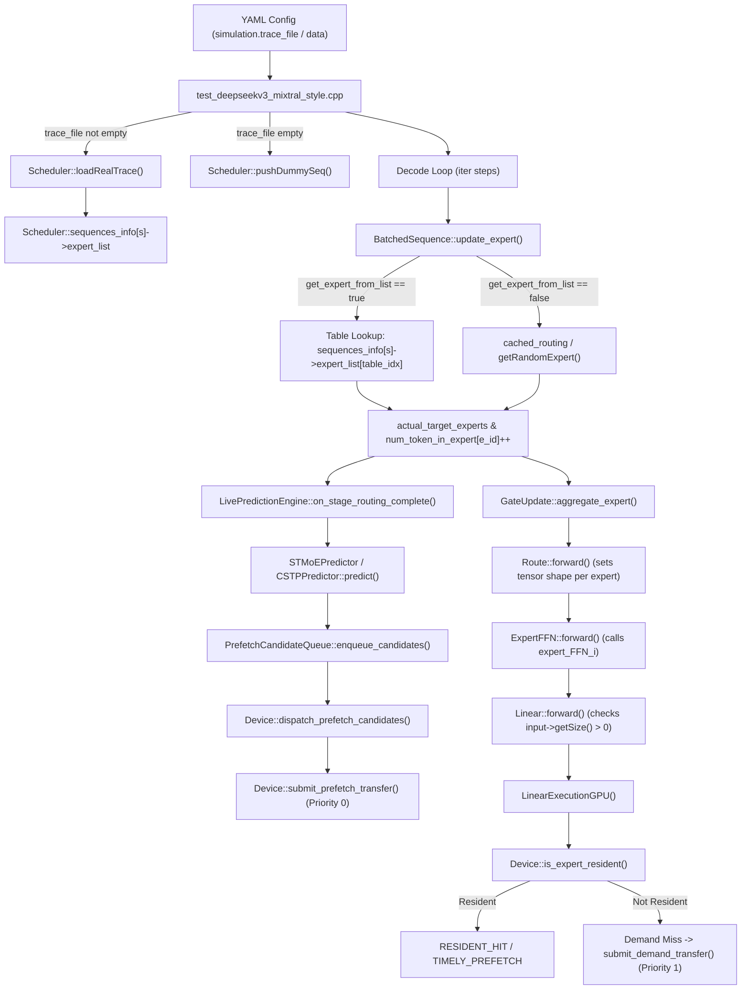

# Routing Pipeline Source Map: Execution Trace and Symbol Inventory

**Repository:** `/home/mohman/ca_project/LLMSimulator`  
**Deliverable Path:** [ROUTING_PIPELINE_SOURCE_MAP.md](file:///home/mohman/ca_project/mohman/point_3/routing_audit/ROUTING_PIPELINE_SOURCE_MAP.md)  
**Parent Audit:** [ROUTING_GROUND_TRUTH_AUDIT.md](file:///home/mohman/ca_project/mohman/point_3/routing_audit/ROUTING_GROUND_TRUTH_AUDIT.md)  
**Status:** Completed and Verified Read-Only Mapping  

---

## 1. Complete End-to-End Execution Trace

The lifecycle of an MoE routing decision spans five distinct subsystems in [LLMSimulator](file:///home/mohman/ca_project/LLMSimulator):
1. **Configuration & Trace Ingestion:** CLI / YAML parsing and sequence table pre-allocation.
2. **Scheduler Stage Dispatch:** Token-level iteration, candidate lookahead evaluation, and expert ID selection.
3. **Graph Activation & GEMM Routing:** MoE scatter/gather tensor sizing based on token counts per expert.
4. **Hardware Execution & Memory Demands:** Checking HBM residency, triggering DDR5 demand transfers on misses.
5. **Observational Metrics Collection:** Correlating request/sequence/token/layer identities across prefetch and demand events.

---

## 2. Symbol and Reference Inventory

The table below catalogs every critical function, structure, and variable involved in the routing and prefetching pipeline.

| Symbol / Identifier | Defining Source File | Line Range | Functional Role & Verification State |
| :--- | :--- | :--- | :--- |
| `Scheduler::loadRealTrace` | [scheduler.cpp](file:///home/mohman/ca_project/LLMSimulator/src/scheduler/scheduler.cpp#L650-L735) | 650–735 | Ingests real CSV traces into `sequences_info`. Validates completeness (`token_layer_counts == top_k`). Throws on any error. Zero random fallback. |
| `Scheduler::sequences_info` | [scheduler.h](file:///home/mohman/ca_project/LLMSimulator/src/scheduler/scheduler.h#L112-L115) | 112–115 | `std::vector<SequenceInfo::Ptr>` holding pre-allocated `expert_list` indexed by `(token_id * num_layer + layer_id)`. |
| `BatchedSequence::update_expert` | [sequence.cpp](file:///home/mohman/ca_project/LLMSimulator/src/scheduler/sequence.cpp#L165-L319) | 165–319 | Core routing dispatcher. Branches on `seq->get_expert_from_list`: reads trace table or queries `cached_routing`. Updates `num_token_in_expert`. |
| `Sequence::get_expert_from_list` | [sequence.h](file:///home/mohman/ca_project/LLMSimulator/src/scheduler/sequence.h#L68) | 68 | Boolean flag. `true` indicates real-trace replay; `false` indicates synthetic random routing. |
| `BatchedSequence::cached_routing` | [sequence.h](file:///home/mohman/ca_project/LLMSimulator/src/scheduler/sequence.h#L132-L133) | 132–133 | `std::map<RouteKey, std::vector<int>>` keyed on `std::tuple<request_id, seq_id, token_id, cur_layer>`. Prevents inter-sequence routing collisions. |
| `GateUpdate::aggregate_expert` | [route.cpp](file:///home/mohman/ca_project/LLMSimulator/src/module/route.cpp#L149-L193) | 149–193 | Invokes `update_expert(num_expert, top_k, true)` for all running sequences. Aggregates tokens per expert across the batch. |
| `Route::forward` | [route.cpp](file:///home/mohman/ca_project/LLMSimulator/src/module/route.cpp#L218-L256) | 218–256 | Slices input activations per expert. Experts with `num_token_in_expert == 0` receive empty shapes (`size == 0`). |
| `ExpertFFN::forward` | [expert.cpp](file:///home/mohman/ca_project/LLMSimulator/src/module/expert.cpp#L170-L230) | 170–230 | Loops over all candidate experts in the device partition. Executes `expert_FFN_<id>` linear sub-modules. |
| `Linear::forward` | [linear.cpp](file:///home/mohman/ca_project/LLMSimulator/src/module/linear.cpp#L40-L100) | 40–100 | Filters out inactive experts (`input->getSize() > 0`). Attaches sequence/token metadata. Sets `A->weight_target = OFFCHIP_DRAM` on cache miss. |
| `LinearExecutionGPU` | [linear_impl.cpp](file:///home/mohman/ca_project/LLMSimulator/src/hardware/linear_impl.cpp#L17-L240) | 17–240 | Hardware execution kernel. Dispatches Ramulator or event-driven DDR5 demand transfers. Records exposed GPU stalls and demand wait durations. |
| `LivePredictionEngine::on_stage_routing_complete` | [live_prediction_engine.cpp](file:///home/mohman/ca_project/LLMSimulator/src/prefetch/live_prediction_engine.cpp#L143-L320) | 143–320 | Evaluates forward lookahead ($H$). Calls `predictor_->predict()` with strictly historical/causal source experts. |
| `PrefetchCandidateQueue::enqueue_candidates` | [prefetch_candidate_queue.cpp](file:///home/mohman/ca_project/LLMSimulator/src/prefetch/prefetch_candidate_queue.cpp#L263-L310) | 263–310 | Admits predictions into active queue. Deduplicates in-flight and resident candidates. |
| `Device::dispatch_prefetch_candidates` | [device.cpp](file:///home/mohman/ca_project/LLMSimulator/src/hardware/device.cpp#L1520-L1577) | 1520–1577 | Filters resident experts. Submits speculative prefetch transfers (Priority 0) to `DDR5TransferEngine`. |
| `PrefetchMetricsCollector` | [prefetch_metrics_collector.cpp](file:///home/mohman/ca_project/LLMSimulator/src/prefetch/prefetch_metrics_collector.cpp#L1-L1410) | 1–1410 | Centralized non-intrusive metrics collector. Categorizes demands (Timely, Late, Resident Hit, Demand Miss) and logs unified events. |

---

## 3. Detailed Dataflow: Real Trace Replay

1. **Loader:**
   - File: [src/scheduler/scheduler.cpp](file:///home/mohman/ca_project/LLMSimulator/src/scheduler/scheduler.cpp#L650)
   - Function: `Scheduler::loadRealTrace(trace_path, expected_seqs, num_layer, num_expert, top_k, iter_tokens)`
   - Parses CSV row: `seq_id, token_id, layer_id, topk_rank, expert_id`.
   - Computes: `table_idx = (size_t)token_id * num_layer + layer_id`.
   - Populates: `sequences_info[seq_id]->expert_list[table_idx][topk_rank - 1] = expert_id`.
   - Asserts: `token_layer_counts[s][table_idx] == top_k`.

2. **Sequence Creation:**
   - File: [eval/test_deepseekv3_mixtral_style.cpp](file:///home/mohman/ca_project/LLMSimulator/eval/test_deepseekv3_mixtral_style.cpp#L417-L424)
   - Sequence allocated via `Sequence::Create(b, input_len, output_len)`.
   - Flags explicitly set: `new_seq->get_expert_from_list = true`.
   - Added to `scheduler->sequence_queue`.

3. **Stage Routing:**
   - File: [src/scheduler/sequence.cpp](file:///home/mohman/ca_project/LLMSimulator/src/scheduler/sequence.cpp#L244-L267)
   - When `seq->get_expert_from_list` is true:
     - `rel_token_id = token_id - seq->input_len`.
     - `table_idx = (size_t)rel_token_id * num_layer + cur_layer`.
     - `routed = scheduler->sequences_info[seq_id]->expert_list[table_idx]`.
     - Each expert ID in `routed` is appended to `actual_target_experts` and increments `num_token_in_expert[e_id]`.
     - Emitted to `expert_routing.csv`.

---

## 4. Detailed Dataflow: Synthetic Routing

1. **Sequence Creation:**
   - File: [eval/test_deepseekv3_mixtral_style.cpp](file:///home/mohman/ca_project/LLMSimulator/eval/test_deepseekv3_mixtral_style.cpp#L427)
   - `scheduler->pushDummySeq(input_len, output_len)`.
   - Sets: `new_seq->get_expert_from_list = false`.

2. **Stage Routing:**
   - File: [src/scheduler/sequence.cpp](file:///home/mohman/ca_project/LLMSimulator/src/scheduler/sequence.cpp#L268-L293)
   - When `seq->get_expert_from_list` is false:
     - Constructs cache key: `route_key = std::make_tuple(request_id, seq_id, token_id, cur_layer)`.
     - If key exists in `cached_routing`: retrieves cached expert vector.
     - If key missing: calls `scheduler->getRandomExpert(top_k)` or `scheduler->getZipfianRandomExpert(...)`.
     - Stores generated vector into `cached_routing[route_key]`.
     - Each expert ID increments `num_token_in_expert[idx]`.
     - Emitted to `expert_routing.csv`.

