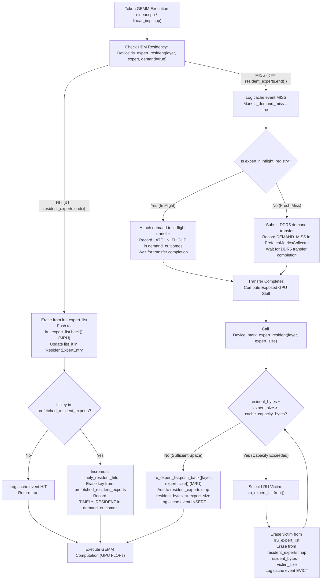

# HBM Cache Architecture Audit — LLMSimulator

## MoE Memory Wall: Predicting and Prefetching Experts for Faster LLM Inference

---

## 1. Executive Summary

This document presents a code-level forensic audit of the High Bandwidth Memory (HBM) expert cache architecture within `LLMSimulator`. All findings are strictly grounded in source code citations from [`src/hardware/device.h`](file:///home/mohman/ca_project/LLMSimulator/src/hardware/device.h), [`src/hardware/device.cpp`](file:///home/mohman/ca_project/LLMSimulator/src/hardware/device.cpp), [`src/hardware/linear_impl.cpp`](file:///home/mohman/ca_project/LLMSimulator/src/hardware/linear_impl.cpp), [`src/module/linear.cpp`](file:///home/mohman/ca_project/LLMSimulator/src/module/linear.cpp), [`src/prefetch/prefetch_config.h`](file:///home/mohman/ca_project/LLMSimulator/src/prefetch/prefetch_config.h), and [`src/prefetch/prefetch_metrics_collector.cpp`](file:///home/mohman/ca_project/LLMSimulator/src/prefetch/prefetch_metrics_collector.cpp).

---

## 2. Architectural Findings & Component Identification

### 2.1 Cache Manager Location
There is **no standalone `HBMCache` class** in the codebase. Expert weight residency, capacity enforcement, recency tracking, and eviction selection are implemented directly inside the `Device` class:
- Header: [`src/hardware/device.h:284-360`](file:///home/mohman/ca_project/LLMSimulator/src/hardware/device.h#L284-L360)
- Implementation: [`src/hardware/device.cpp:665-1177`](file:///home/mohman/ca_project/LLMSimulator/src/hardware/device.cpp#L665-L1177)

### 2.2 Core Residency Data Structures
The `Device` class maintains the following data structures for HBM tracking:

1. **Resident Expert Table:**
   ```cpp
   // src/hardware/device.h:309
   std::unordered_map<std::pair<int, int>, ResidentExpertEntry, PairHash> resident_experts;
   ```
   Provides $O(1)$ lookup for any expert currently resident in GPU HBM.

2. **Cache Key & Hashing:**
   ```cpp
   // src/hardware/device.h:285-292
   struct PairHash {
     template <class T1, class T2>
     std::size_t operator () (const std::pair<T1,T2> &p) const {
         auto h1 = std::hash<T1>{}(p.first);
         auto h2 = std::hash<T2>{}(p.second);
         return h1 ^ h2;  
     }
   };
   ```
   - **Cache Key:** Composite `std::pair<int, int>` representing `{layer_id, expert_id}`.
   - **Isolation Invariant:** Experts from different MoE stages with identical intra-stage IDs (e.g., layer 0 expert 5 vs layer 1 expert 5) map to distinct keys `{0, 5}` and `{1, 5}`. No cross-layer aliasing can occur.

3. **Recency Ordering Lists:**
   ```cpp
   // src/hardware/device.h:306-308
   std::list<std::tuple<int, int, long long>> demand_lru_list;
   std::list<std::tuple<int, int, long long>> speculative_lru_list;
   std::list<std::tuple<int, int, long long>> lru_expert_list;
   ```
   - In standard `LRU` mode: `lru_expert_list` serves as the single recency list.
     - `lru_expert_list.front()` is the Least Recently Used (LRU) candidate for eviction.
     - `lru_expert_list.back()` is the Most Recently Used (MRU) candidate.
   - In `PABI` mode: `speculative_lru_list` isolates speculative prefetches, while `demand_lru_list` tracks demand-verified experts.

4. **Resident Entry Metadata:**
   ```cpp
   // src/hardware/device.h:134-164
   struct ResidentExpertEntry {
     int layer_id = -1;
     int expert_id = -1;
     long long size_bytes = 0;
     ExpertClassification classification = ExpertClassification::DEMAND_VERIFIED;
     std::list<std::tuple<int, int, long long>>::iterator list_it;
     bool is_pinned = false;
     int pin_target_stage_id = -1;
     int pin_expiration_stage_id = -1;
     int prediction_rank = 0;
     double prediction_score = 0.0;
     uint64_t candidate_id = 0;
     bool is_prefetched = false;
     uint64_t transfer_id = 0;
     int source_stage = -1;
     int request_id = 0;
     int seq_id = 0;
     int token_id = 0;
     double dispatch_time_ns = 0.0;
     double completion_time_ns = 0.0;
     bool was_demanded = false;
   };
   ```
   Crucially, `list_it` stores an iterator directly into `lru_expert_list`, enabling $O(1)$ list splicing on cache hits without scanning.

5. **Prefetch Tracking Set:**
   ```cpp
   // src/hardware/device.h:315
   std::unordered_set<std::pair<int, int>, PairHash> prefetched_resident_experts;
   ```
   Tracks all resident experts that were placed into HBM by a speculative prefetch and have not yet been consumed by a demand hit.

---

## 3. Capacity Accounting and Enforcement

### 3.1 Capacity Units and Memory Variables
Capacity and resident footprints are accounted for as exact integer bytes:
- `long long cache_capacity_bytes = 80000000000LL;` ([`device.h:297`](file:///home/mohman/ca_project/LLMSimulator/src/hardware/device.h#L297)): Total allocated expert cache capacity in HBM. Defaults to 80 GB ($80 \times 10^9$ bytes).
- `long long resident_bytes = 0;` ([`device.h:299`](file:///home/mohman/ca_project/LLMSimulator/src/hardware/device.h#L299)): Aggregate bytes of all currently resident experts.
- `long long resident_demand_bytes = 0;` ([`device.h:300`](file:///home/mohman/ca_project/LLMSimulator/src/hardware/device.h#L300)): Aggregate bytes of demand-verified experts.
- `long long resident_speculative_bytes = 0;` ([`device.h:301`](file:///home/mohman/ca_project/LLMSimulator/src/hardware/device.h#L301)): Aggregate bytes of quarantined speculative prefetches (under PABI).

### 3.2 Expert Size Determination
In MoE execution ([`src/hardware/linear_impl.cpp:102-105`](file:///home/mohman/ca_project/LLMSimulator/src/hardware/linear_impl.cpp#L102-L105)), expert weight size is calculated by summing the byte sizes of the three projection tensors ($W_1$, $W_3$, $W_2$):
```cpp
long long total_expert_size = 0;
for (auto t : batch_tensors) {
  total_expert_size += t->getSize();
}
```
For DeepSeek-V3:
- $W_1$ (gate projection): 29,360,128 bytes
- $W_3$ (up projection): 29,360,128 bytes
- $W_2$ (down projection): 29,360,128 bytes
- **Total single-expert footprint:** $88,080,384 \text{ bytes} \approx 88.08 \text{ MB}$.

### 3.3 Cache Sizing and Working Set Coverage
- **Full Model Working Set:** 40 MoE stages $\times$ 256 routed experts = 10,240 routed experts = $901.94 \text{ GB}$ of weights.
- **80 GB Capacity:** $\lfloor 80,000,000,000 / 88,080,384 \rfloor = 908 \text{ experts}$ (~8.87% of total model).
- **50 GB Capacity:** $\lfloor 50,000,000,000 / 88,080,384 \rfloor = 567 \text{ experts}$ (~5.54% of total model).
- **35 GB Capacity:** $\lfloor 35,000,000,000 / 88,080,384 \rfloor = 397 \text{ experts}$ (~3.88% of total model).
- **25 GB Capacity:** $\lfloor 25,000,000,000 / 88,080,384 \rfloor = 283 \text{ experts}$ (~2.76% of total model).

### 3.4 Capacity Configuration Mechanism
In [`src/hardware/device.cpp:101-107`](file:///home/mohman/ca_project/LLMSimulator/src/hardware/device.cpp#L101-L107):
```cpp
const char* debug_cap = std::getenv("DEBUG_CACHE_CAPACITY");
if (debug_cap != nullptr) {
  try {
    cache_capacity_bytes = std::stoll(debug_cap);
  } catch (...) {
  }
}
```
> [!IMPORTANT]
> The YAML property `expert_cache_capacity_bytes` is parsed into `PrefetchConfig` in some branches, but `Device::Device` reads directly from the environment variable `DEBUG_CACHE_CAPACITY`. If unset, it falls back to the hardcoded default of 80 GB ($80,000,000,000$ bytes).

---

## 4. Code-Level Execution Flow

The following sequence reflects the verified C++ code flow in `LLMSimulator`:



---

## 5. Answers to the 13 LRU Behavior Questions (Part B2)

| # | Question | Verified Implementation Answer | Source Reference |
| :--- | :--- | :--- | :--- |
| **1** | Is LRU updated on every expert access? | **Yes**, for every demand access (`is_demand_access = true`). The entry is erased from its position in `lru_expert_list` and pushed to the back (MRU). | [`device.cpp:711-714`](file:///home/mohman/ca_project/LLMSimulator/src/hardware/device.cpp#L711-L714) |
| **2** | Are both demand accesses and prefetch accesses counted? | **No.** Speculative prefetch probes pass `is_demand_access = false`. Lines 681–683 explicitly short-circuit: they return residency status without touching recency or counters. Completed prefetch admissions under LRU mode do enter at MRU via `mark_expert_demand()`. | [`device.cpp:681-683`](file:///home/mohman/ca_project/LLMSimulator/src/hardware/device.cpp#L681-L683) |
| **3** | Does an HBM hit update recency? | **Yes.** In standard LRU mode, lines 711–714 splice the hit entry to `lru_expert_list.back()` and update `it->second.list_it`. | [`device.cpp:711-714`](file:///home/mohman/ca_project/LLMSimulator/src/hardware/device.cpp#L711-L714) |
| **4** | Does a newly loaded expert become MRU? | **Yes.** In `mark_expert_resident()` (lines 789–796), `lru_expert_list.push_back()` inserts the newly loaded expert at the MRU position. | [`device.cpp:789-796`](file:///home/mohman/ca_project/LLMSimulator/src/hardware/device.cpp#L789-L796) |
| **5** | What happens when a prefetched expert enters HBM? | Under standard LRU mode, line 1471 calls `mark_expert_demand()`, which inserts the prefetch at MRU and triggers capacity evictions if full. The entry is added to `prefetched_resident_experts` with `was_demanded = false`. (Under PABI, it is quarantined in `speculative_lru_list`). | [`device.cpp:1471-1481`](file:///home/mohman/ca_project/LLMSimulator/src/hardware/device.cpp#L1471-L1481) |
| **6** | Are prefetch admissions treated differently from demand admissions? | In standard LRU mode, **no**. They use the identical `mark_expert_resident()` function, occupy the shared `resident_bytes`, and evict LRU entries identically. The only difference is metadata tagging (`is_prefetched = true`). In PABI mode, **yes**, they are quarantined in `speculative_lru_list`. | [`device.cpp:759-806`](file:///home/mohman/ca_project/LLMSimulator/src/hardware/device.cpp#L759-L806) |
| **7** | Can an in-flight prefetch reserve capacity? | **No.** In-flight transfers are held in `inflight_registry` and `inflight_experts`. They do not decrement available cache capacity or evict resident experts until completion. | [`device.cpp:1288-1290`](file:///home/mohman/ca_project/LLMSimulator/src/hardware/device.cpp#L1288-L1290), [`device.cpp:1438`](file:///home/mohman/ca_project/LLMSimulator/src/hardware/device.cpp#L1438) |
| **8** | Can an in-flight prefetch be evicted or cancelled? | An in-flight prefetch cannot be evicted because it is not resident in HBM. However, it **can be cancelled or preempted** by higher-priority demand transfers within `DDR5TransferEngine`. When demanded before completion, it is promoted to demand via `promote_inflight_to_demand()`. | [`device.cpp:1242-1244`](file:///home/mohman/ca_project/LLMSimulator/src/hardware/device.cpp#L1242-L1244), [`device.cpp:1502-1510`](file:///home/mohman/ca_project/LLMSimulator/src/hardware/device.cpp#L1502-L1510) |
| **9** | What happens when an expert is already resident? | If prefetch is submitted for an already-resident expert, `submit_prefetch_transfer()` returns 0 immediately (rejected). If demanded, `is_expert_resident()` returns true, updates recency, and records a resident hit (or timely prefetch hit). | [`device.cpp:670-747`](file:///home/mohman/ca_project/LLMSimulator/src/hardware/device.cpp#L670-L747), [`device.cpp:1309`](file:///home/mohman/ca_project/LLMSimulator/src/hardware/device.cpp#L1309) |
| **10** | Can multiple requests reference the same expert? | **Yes.** In batched inference ($B \ge 1$), multiple tokens across sequences can route to the same `{layer_id, expert_id}` within the same or subsequent execution steps. | [`linear.cpp:49-115`](file:///home/mohman/ca_project/LLMSimulator/src/module/linear.cpp#L49-L115) |
| **11** | How are duplicate expert references handled? | If resident, all subsequent references hit in `resident_experts` with 0 memory duration. If in flight, subsequent demands attach to the existing transfer via `inflight_registry` rather than issuing duplicate DDR5 traffic. | [`linear_impl.cpp:77-98`](file:///home/mohman/ca_project/LLMSimulator/src/hardware/linear_impl.cpp#L77-L98), [`device.cpp:1189-1245`](file:///home/mohman/ca_project/LLMSimulator/src/hardware/device.cpp#L1189-L1245) |
| **12** | Are experts evicted immediately or only after a capacity check? | **Only upon new insertion** when `resident_bytes + expert_size > cache_capacity_bytes`. There is no background eviction thread or proactive pruning. | [`device.cpp:761`](file:///home/mohman/ca_project/LLMSimulator/src/hardware/device.cpp#L761) |
| **13** | Is there any pinning or protection mechanism for experts currently in use? | Under standard LRU, **none**. An active expert can theoretically be evicted if intervening loads exceed cache capacity before its GEMM completes. Under PABI, pinning is supported for speculative experts via `is_pinned` and stage deadlines. | [`device.cpp:761-787`](file:///home/mohman/ca_project/LLMSimulator/src/hardware/device.cpp#L761-L787), [`device.cpp:828-832`](file:///home/mohman/ca_project/LLMSimulator/src/hardware/device.cpp#L828-L832) |

---

## 6. Existing Instrumentation and Missing Metrics

### 6.1 Existing Cache Instrumentation
1. **Event Trace File (`expert_cache.csv`):**
   - Function: `log_cache_event()` ([`device.cpp:374-394`](file:///home/mohman/ca_project/LLMSimulator/src/hardware/device.cpp#L374-L394)).
   - Format: `layer_id,expert_id,action,resident_bytes`.
   - Actions emitted: `MISS`, `HIT`, `INSERT`, `EVICT`, `PROMOTION`, `SPECULATIVE_INSERT`, `SPECULATIVE_EVICT`, `SPECULATIVE_REJECT`, `DEMAND_INSERT`, `DEMAND_EVICT`.
2. **Device Cache Counters:**
   - `pabi_metrics.demand_insertions`, `pabi_metrics.demand_evictions`, `pabi_metrics.useful_prefetch_hits`.
3. **Effectiveness Trace File (`prefetch_effectiveness.csv`):**
   - Function: `Device::dump_prefetch_effectiveness()` ([`device.cpp:1650-1737`](file:///home/mohman/ca_project/LLMSimulator/src/hardware/device.cpp#L1650-L1737)).

### 6.2 Missing Instrumentation & Architectural Gaps
1. **Collector Stubs:** In [`src/prefetch/prefetch_metrics_collector.cpp:328-352`](file:///home/mohman/ca_project/LLMSimulator/src/prefetch/prefetch_metrics_collector.cpp#L328-L352), `record_hbm_resident()` and `record_hbm_evicted()` are completely uninstrumented no-ops (`(void)layer_id; ...`). Eviction reasons and eviction counts are not aggregated into `PrefetchMetricsCollector`.
2. **Per-Expert Access Frequencies:** `ResidentExpertEntry` does not track access counts. When an entry hits, it is moved to MRU, but its lifetime activation frequency is lost.
3. **Reload / Re-eviction Tracking:** The simulator does not count how many times an evicted expert is subsequently reloaded from DDR5 ("cache churn").
4. **Residency Lifespan Accounting:** The simulator does not record how long (in simulated nanoseconds or token intervals) an expert remained resident before being evicted.

