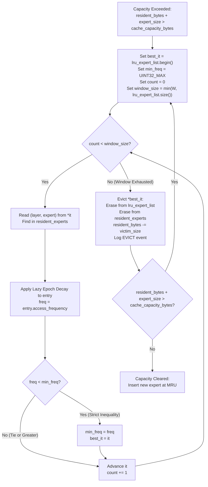

# Final Policy Specification — Frequency-Aware LRU (FA-LRU)

## Point 4: HBM Management Beyond Standard LRU

---

## 1. Executive Summary

This document specifies the exact, finalized algorithmic and architectural design of the **Frequency-Aware Least Recently Used (FA-LRU)** eviction policy for `LLMSimulator`. It resolves all outstanding design ambiguities identified in Phase 1 regarding access coalescing, frequency accounting units, decay semantics, victim selection, and backward compatibility with standard LRU and PABI quarantine modes.

---

## 2. Demand-Access Path & Frequency Semantics

### 2.1 Access Coalescing & The Sub-Projection Problem
A rigorous inspection of [`src/module/expert.cpp`](file:///home/mohman/ca_project/LLMSimulator/src/module/expert.cpp), [`src/module/layer.cpp`](file:///home/mohman/ca_project/LLMSimulator/src/module/layer.cpp), [`src/module/linear.cpp`](file:///home/mohman/ca_project/LLMSimulator/src/module/linear.cpp), and [`src/hardware/linear_impl.cpp`](file:///home/mohman/ca_project/LLMSimulator/src/hardware/linear_impl.cpp) reveals how expert demands are dispatched:

1. **MoE Layer Forward Pass:**
   In `FeedForward3Way::forward` ([`layer.cpp:415-437`](file:///home/mohman/ca_project/LLMSimulator/src/module/layer.cpp#L415-L437)), each routed expert executes three successive linear projections:
   - `gate_proj` ($W_1$)
   - `up_proj` ($W_3$)
   - `down_proj` ($W_2$)
2. **Sub-Projection Invocations:**
   Each projection calls `Linear::launch` ([`linear.cpp:49-115`](file:///home/mohman/ca_project/LLMSimulator/src/module/linear.cpp#L49-L115)).
   When an expert $\{l, e\}$ is demanded, `Linear::launch` calls `device->is_expert_resident(l, e)` for $W_1$.
   If it misses, $W_1$ sets `load_sisters = true` and loads all three sister weights ($W_1, W_3, W_2$) together from DDR5 in a single combined transfer.
   Subsequently, when $W_3$ and $W_2$ execute, `Linear::launch` calls `is_expert_resident(l, e)` again.
3. **Coalesced Batch Execution:**
   In `ExpertFFN::forward` ([`expert.cpp:208-215`](file:///home/mohman/ca_project/LLMSimulator/src/module/expert.cpp#L208-L215)), expert execution is invoked **once per expert per layer** for the entire batch. The input tensor has batch dimension $M = \text{num\_token\_in\_expert}[e]$, coalescing all tokens in the current serving batch that routed to expert $e$.

### 2.2 Frequency-Counting Unit Definition
If `access_frequency` were incremented unconditionally inside `is_expert_resident()`, every single expert activation would be counted three times (once for $W_1$, once for $W_3$, and once for $W_2$). Furthermore, on a demand miss, $W_1$ would insert the expert, while $W_3$ and $W_2$ would immediately register hits, inflating the frequency of a newly admitted expert to 3 before the stage even completes.

**Finalized Policy Decision: Stage-Coalesced Demand Counting**
- The frequency-counting unit is the **Coalesced MoE Stage Activation**.
- An expert's activation frequency represents the number of distinct MoE stages in which that expert was actively required by the model.
- Intra-stage sub-projection calls ($W_3$ and $W_2$) must **not** increment frequency.

### 2.3 Exact State Transition Rules

| Event | Calling Site | Frequency Action | Recency Action |
| :--- | :--- | :--- | :--- |
| **Demand Miss Admission** | `linear_impl.cpp:128` -> `mark_expert_resident()` | $F(l, e) \leftarrow 1$ | Push to `lru_expert_list.back()` (MRU) |
| **Demand Hit on Resident Expert** | `linear.cpp:106` ($W_1$ only) -> `is_expert_resident()` | $F(l, e) \leftarrow F(l, e) + 1$ | Splice to `lru_expert_list.back()` (MRU) |
| **Sub-Projection Hit ($W_3, W_2$)** | `linear.cpp:106` ($W_3, W_2$) -> `is_expert_resident()` | **No change** (frequency already counted by $W_1$) | Splice to MRU (preserves MRU status) |
| **Speculative Prefetch Admission** | `device.cpp:1471` -> `mark_expert_demand()` | $F(l, e) \leftarrow 1$, `was_demanded = false` | Push to `lru_expert_list.back()` (MRU) |
| **First Demand Hit on Prefetched Expert** | `linear.cpp:106` -> `is_expert_resident()` | $F(l, e) \leftarrow 2$, `was_demanded = true` | Splice to `lru_expert_list.back()` (MRU) |
| **In-Flight Prefetch Promoted to Demand** | `device.cpp:1243` -> `promote_inflight_to_demand()` | $F(l, e) \leftarrow 1$ (upon completion) | Placed at MRU upon completion |
| **Speculative Probe / Scheduling Check** | `device.cpp:680` (`is_demand_access = false`) | **Strictly No change** | **Strictly No change** |

### 2.4 Multi-Sequence Token Demands within a Batch
When multiple concurrent sequences in a serving batch route to the same expert in the same stage:
- The expert is fetched once from DDR5 (if missing) and executed once as a batched GEMM ($M \ge 1$).
- In FA-LRU, this counts as **1 stage demand activation**, because the cache required the expert for that execution stage.
- *Rationale:* Memory traffic and cache residency are stage-level hardware events. Weight retention prevents exactly one off-chip transfer per stage regardless of batch size.

---

## 3. Frequency Aging and Decay Mechanism

### 3.1 Layer Progression Hooks
In `BatchedSequence::update_expert` ([`src/scheduler/sequence.cpp:217-322`](file:///home/mohman/ca_project/LLMSimulator/src/scheduler/sequence.cpp#L217-L322)):
```cpp
current_moe_stage_id = cur_layer;
// ... execute routing ...
last_completed_stage = cur_layer;
cur_layer++;
cur_layer %= num_layer;
```
For DeepSeek-V3, `num_layer = 40`.
- At the start of a token decode step: `cur_layer = 0`.
- As the token progresses through the model: `cur_layer` advances sequentially $0, 1, 2, \dots, 39$.
- After stage 39: `cur_layer` wraps around to 0 via `cur_layer %= num_layer;`.

**Verified Implementation Fact:**
A 40-stage progression interval **genuinely and exactly represents one complete model decode step** across all 40 MoE layers. Under batching, all sequences progress through stages synchronously, preserving this exact 40-stage epoch invariant across all batch sizes.

### 3.2 Decay Mechanism: Lazy Epoch Discounting
To prevent historical heavy hitters from permanently occupying cache lines after routing distributions shift, frequencies must be decayed.

We evaluate two implementation options:

#### Option 1: Periodic Eager Sweep
Iterate through `resident_experts` whenever `cur_layer == 0` (every 40 stages):
```cpp
for (auto& kv : resident_experts) {
  kv.second.access_frequency = std::max(1u, kv.second.access_frequency / 2u);
}
```
- Total resident entries: $\le 908$ entries (at 80 GB).
- Computational overhead: Sweeping 908 elements and performing integer right-shifts takes $\approx 1.5\,\mu\text{s}$ of CPU time once per token step. In a simulation step taking several hundred milliseconds, this accounts for less than $0.001\%$ of runtime.

#### Option 2: Lazy Epoch Discounting (Recommended & Selected)
Instead of sweeping the map, maintain a global epoch counter:
- `global_epoch`: Incremented by 1 in `Device` whenever a complete pass of 40 stages finishes (`cur_layer == 0`).
- Each resident entry stores: `uint32_t last_epoch = 0;`.
- Whenever an entry's frequency is read (during victim selection) or updated (on demand hit), its effective frequency is computed via:
```cpp
uint32_t epoch_diff = global_epoch - entry.last_epoch;
if (epoch_diff > 0) {
  if (epoch_diff >= 16) {
    entry.access_frequency = 1;
  } else {
    entry.access_frequency = std::max(1u, entry.access_frequency >> epoch_diff);
  }
  entry.last_epoch = global_epoch;
}
```
- **Properties:**
  - Runtime overhead at stage transitions: **Exactly $0\,\text{ns}$**.
  - Computation is deferred strictly to victim selection ($W=16$ entries) and hits ($1$ entry).
  - Bounded arithmetic: Bit-shift ensures zero risk of division by zero or underflow.

---

## 4. FA-LRU Victim Selection Algorithm

### 4.1 Specification
When `resident_bytes + expert_size > cache_capacity_bytes`, victim selection is performed as follows:



### 4.2 Algorithm Parameters & Properties

1. **Window Size ($W$):**
   Default: $W = 16$.
   - Configurable via `prefetch_config.yaml` as `fa_lru_window_size: 16` and environment variable `FA_LRU_WINDOW_SIZE=16`.
   - If $W = 1$: Degenerates identically to standard LRU.
   - If $|\text{lru\_expert\_list}| < W$: The algorithm sets $\text{window\_size} = |\text{lru\_expert\_list}|$ and inspects all currently resident entries.
2. **Strict Tie-Breaking:**
   By using strict inequality (`freq < min_freq`), if two or more candidates in the window have the identical lowest frequency (e.g., both have $F=1$), the candidate closest to the front of `lru_expert_list` is selected. This ensures that between equally cold experts, the least recently used expert is evicted first.
3. **Complexity:**
   The search loop executes at most $\min(W, |\text{lru\_expert\_list}|) \le 16$ iterations.
   Each iteration performs an $O(1)$ hash table lookup.
   Total time complexity: **Strictly $O(1)$ constant time**.
4. **Frequency Overflow Protection:**
   Frequencies are stored as `uint32_t`. Because frequencies decay every 40 stages, the maximum reachable frequency in any practical workload is bounded ($F < 100$). Overflow is mathematically impossible.

### 4.3 Interaction with Prefetched Experts
- **Unconsumed Prefetches:** A prefetched expert that has completed DDR5 transfer but has not yet been demanded has $F = 1$. When it drifts into the bottom-$W$ window, it is considered among the coldest candidates. If a high-frequency demand expert ($F \ge 3$) is also in the window, FA-LRU protects the demand expert and evicts the unconsumed prefetch. This directly mitigates prefetch cache pollution.
- **Timely Prefetches:** When a prefetched expert is demanded before eviction, its frequency is updated to $F \leftarrow 2$. It is spliced to MRU, protecting it from immediate eviction.

### 4.4 Backward Compatibility & Policy Isolation
FA-LRU is registered as a distinct enum value `EvictionPolicy::FA_LRU`.
- When `eviction_policy == EvictionPolicy::LRU`: The existing unconditional `lru_expert_list.front()` pop executes with zero change in behavior.
- When `eviction_policy == EvictionPolicy::PABI`: The speculative buffer quarantine and Belády pinning paths execute with zero change in behavior.
- FA-LRU executes **only** when explicitly configured.

---

## 5. Coding Standards & Invariants

1. **Zero Ternary Operators:**
   Strict prohibition of `? :` in C++, `ast.IfExp` in Python harnesses, and ternary prose syntax.
2. **Residency Invariants:**
   - $\text{resident\_bytes} \le \text{cache\_capacity\_bytes}$ holds at all times.
   - $|\text{resident\_experts}| = |\text{lru\_expert\_list}|$ holds at all times.
   - For every entry in `resident_experts`, `entry.list_it` dereferences to the identical `(layer_id, expert_id)`.

