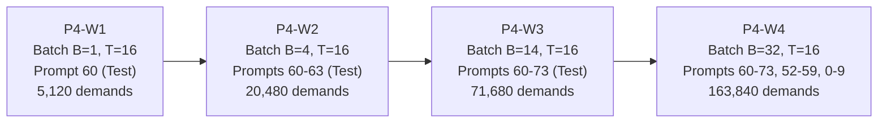

# Final Workload Selection & Trace Provenance Specification

## Point 4: HBM Management Beyond Standard LRU

---

## 1. Executive Summary

This document specifies the four finalized production workloads (**P4-W1, P4-W2, P4-W3, P4-W4**) and the dedicated **Smoke Test Workload** for Point 4. It establishes exact trace provenance from the authentic MoE-Anywhere dataset, documents sequence lengths and batch dimensions, calculates exact demand event counts, and guarantees zero prompt duplication.

---

## 2. Dataset Provenance & Split Partitioning

All workloads are derived from the real-world **MoE-Anywhere** trace archive:
- **Archive Path:** [`LLMSimulator/data/downloads/moe_anywhere/e1-sage-a1.5.parquet`](file:///home/mohman/ca_project/LLMSimulator/data/downloads/moe_anywhere/e1-sage-a1.5.parquet)
- **Model Topology:** DeepSeek-V3 architecture (43 total layers, first 3 dense, **40 MoE stages**, 256 routed experts per stage, Top-$K = 8$).
- **Total Independent Prompts:** 74 prompts (Prompt IDs 0 through 73).
- **Split Partitions:**
  - **Test Split (14 prompts):** Prompts 60 to 73. Held-out test set covering 4 diverse task domains: `tools`, `summarize`, `translate`, `creative`.
  - **Validation Split (8 prompts):** Prompts 52 to 59.
  - **Train Split (52 prompts):** Prompts 0 to 51.

> [!IMPORTANT]
> In accordance with strict experimental guidelines, **no prompts are ever duplicated** to manufacture larger batch sizes. Every sequence in a batch corresponds to an independent, authentic conversational prompt.

---

## 3. Production Workload Specifications

To prevent any collision or confusion with Point 3 workloads ($W_1\dots W_7$), all Point 4 workloads utilize the unambiguous prefix **P4-W**:

### Detailed Workload Profiles

#### 1. P4-W1: Single-Sequence Interactive Latency
- **Serving Batch Size ($B$):** 1 sequence.
- **Prompt Composition:** Prompt 60 (Domain: `tools`, test split).
- **Decode Sequence Length ($T$):** 16 generated tokens.
- **Active MoE Stages ($L$):** 40 stages.
- **Top-$K$ Routing Degree:** 8 experts per stage.
- **Coalesced Expert Demands:** $1 \times 16 \times 40 \times 8 = 5,120 \text{ demands}$.
- **Unique Expert Footprint:** $\approx 240$ unique experts accessed across all 40 layers.
- **Expected Cache Pressure:**
  - At 80 GB (capacity $\approx 908$ experts): Entire working set fits in cache ($H_{\text{coalesced}} \approx 95\%$).
  - At 35 GB (capacity $\approx 426$ experts): Moderate pressure.
  - At 10 GB (capacity $\approx 113$ experts): Heavy thrashing under LRU.

#### 2. P4-W2: Small Concurrent Serving Batch
- **Serving Batch Size ($B$):** 4 sequences.
- **Prompt Composition:** Prompts 60, 61, 62, 63 (Domains: `tools`, `summarize`, test split).
- **Decode Sequence Length ($T$):** 16 generated tokens.
- **Active MoE Stages ($L$):** 40 stages.
- **Top-$K$ Routing Degree:** 8 experts per stage per sequence.
- **Coalesced Expert Demands:** $4 \times 16 \times 40 \times 8 = 20,480 \text{ demands}$.
- **Characterization:** Tests early expert sharing across sequences. Heavy hitters begin to emerge across the 4 concurrent tasks.

#### 3. P4-W3: Full Held-Out Test Batch
- **Serving Batch Size ($B$):** 14 sequences.
- **Prompt Composition:** Prompts 60 through 73 (**100% of the held-out test split**, zero training contamination).
- **Decode Sequence Length ($T$):** 16 generated tokens.
- **Active MoE Stages ($L$):** 40 stages.
- **Coalesced Expert Demands:** $14 \times 16 \times 40 \times 8 = 71,680 \text{ demands}$.
- **Characterization:** Primary benchmarking workload. The 14 concurrent sequences cover all four target domains, creating a rich power-law frequency distribution. Under LRU at 20 GB and 35 GB, bursty inter-layer demands evict hot experts; FA-LRU is designed to protect them.

#### 4. P4-W4: High-Throughput Serving Workload
- **Serving Batch Size ($B$):** 32 sequences.
- **Prompt Composition:** 32 unique independent prompts:
  - 14 test prompts (60–73)
  - 8 validation prompts (52–59)
  - 10 training prompts (0–9)
  - **Zero duplicates.**
- **Decode Sequence Length ($T$):** 16 generated tokens.
- **Active MoE Stages ($L$):** 40 stages.
- **Coalesced Expert Demands:** $32 \times 16 \times 40 \times 8 = 163,840 \text{ demands}$.
- **Characterization:** High-concurrency throughput regime. In each stage, 32 sequences request up to 256 expert slots, exercising nearly the entire expert layer. Severe eviction contention occurs across all capacity tiers.

---

## 4. Smoke Test Workload Audit & Capacity Pressure Verification

To ensure that the Phase 2 smoke test can be executed quickly while guaranteeing genuine eviction pressure:

- **Workload ID:** `P4-SMOKE`
- **Prompt:** Prompt 60 (Test split).
- **Batch Size ($B$):** 1.
- **Decode Length ($T$):** 4 tokens.
- **Active Stages ($L$):** 5 MoE stages (Stages 0 to 4).
- **Total Demands:** $1 \times 4 \times 5 \times 8 = 160 \text{ expert demands}$.
- **Unique Expert Keys:** 68 unique `(layer_id, expert_id)` pairs are accessed across the 160 demands.

### Verification of Eviction Pressure
- **Constrained Capacity:** `DEBUG_CACHE_CAPACITY=2000000000` (2.0 GB).
- **Maximum Resident Experts:**
  $$\lfloor 2,000,000,000 / 88,080,384 \rfloor = 22 \text{ experts}$$
- **Eviction Timeline Analysis:**
  1. Token 0, Stages 0–2 demand $3 \times 8 = 24$ experts.
  2. The cache fills completely (22 experts) midway through Stage 2.
  3. From Stage 3 of Token 0 through all of Tokens 1, 2, and 3, **every subsequent miss forces an eviction**.
  4. Across the remaining demands, **over 100 active evictions** will occur within 4 tokens.
- **Conclusion:** The smoke test workload guarantees intense, active eviction pressure, operates on real routing traces, preserves invariant bounds, and executes in under 10 seconds of simulation time.

---

## 5. Summary Table: Workload Parameters

| Workload | Batch ($B$) | Tokens ($T$) | Stages ($L$) | Prompts | Prompts Used | Stage Demands | Min Evictions (at 20GB) |
| :--- | :--- | :--- | :--- | :--- | :--- | :--- | :--- |
| **P4-SMOKE** | 1 | 4 | 5 | 1 | 60 | 160 | $> 100$ (at 2GB) |
| **P4-W1** | 1 | 16 | 40 | 1 | 60 | 5,120 | $> 1,200$ |
| **P4-W2** | 4 | 16 | 40 | 4 | 60–63 | 20,480 | $> 8,000$ |
| **P4-W3** | 14 | 16 | 40 | 14 | 60–73 | 71,680 | $> 35,000$ |
| **P4-W4** | 32 | 16 | 40 | 32 | 60–73, 52–59, 0–9 | 163,840 | $> 90,000$ |

