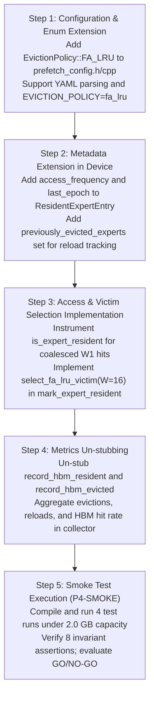

# Phase 1.5 Final Decision Report: HBM Management & FA-LRU

## Point 4: HBM Management Beyond Standard LRU

---

## 1. Executive Summary

This report concludes **Phase 1.5: Finalize HBM Management Design Before Implementation**. It synthesizes all resolved architectural decisions, assesses risks, defines the exact code implementation sequence, and delivers an unambiguous **GO recommendation** to commence Phase 2 implementation.

---

## 2. Resolved Architectural Decisions

| # | Topic | Decision Reached | Code Rationale / Ground Truth |
| :--- | :--- | :--- | :--- |
| **1** | **Frequency Unit** | **Coalesced Stage Demand Activation** | Each MoE layer runs three sub-projections ($W_1, W_3, W_2$). Frequency increments only on the primary $W_1$ demand to prevent $3\times$ artificial inflation. Multi-sequence demands in a batch coalesce into 1 stage activation. |
| **2** | **Prefetch Frequency** | **Baseline $F=1$ on Arrival; Promoted to $F=2$ on Demand** | Speculative prefetches enter with baseline frequency $F=1$. Unverified prefetches are not granted elevated status, preventing cache pollution. On actual demand hit, frequency increments to $F=2$. |
| **3** | **Decay Mechanism** | **Lazy Epoch Discounting (40 Stages = 1 Token Pass)** | In `BatchedSequence::update_expert` ([`sequence.cpp:322`](file:///home/mohman/ca_project/LLMSimulator/src/scheduler/sequence.cpp#L322)), `cur_layer` wraps around modulo 40 on every token step. Lazy bit-shifting ($F \gg \Delta\text{epoch}$) provides zero-overhead decay at stage boundaries. |
| **4** | **Victim Selection** | **Window-Based Bottom-$W$ Sampled FA-LRU ($W=16$)** | Scans the bottom 16 entries of `lru_expert_list`, selecting the candidate with minimum decayed frequency. Ties break in favor of the oldest entry in recency. Bounded strictly to $O(1)$ constant time. |
| **5** | **Capacity Sizing** | **Authoritative YAML Ingestion with Env Var Override** | In `test_deepseekv3_mixtral_style.cpp:105-108`, `expert_cache_capacity_bytes` in YAML is authoritative and explicitly overrides `DEBUG_CACHE_CAPACITY`. Capacity is logged to stdout at startup. |
| **6** | **Workload Suite** | **4 Distinct Workloads (P4-W1 to P4-W4) with Zero Duplication** | P4-W1 ($B=1$), P4-W2 ($B=4$), P4-W3 ($B=14$, 100% held-out test), P4-W4 ($B=32$, 0 duplicates) across all 40 MoE stages, $T=16$ tokens. |
| **7** | **Experiment Matrix** | **120 Valid Runs (6 Strategies $\times$ 5 Capacities $\times$ 4 Workloads)** | Evaluates 10G, 20G, 35G, 50G, and 80G across Baseline, ST-MoE, and CSTP under both LRU and FA-LRU. All paired comparisons isolate eviction policy as the sole independent variable. |

---

## 3. Remaining Uncertainties & Non-Critical Observations

1. **Memory Allocation Granularity:**
   In `linear_impl.cpp:103`, total expert size is the sum of $W_1, W_3, W_2$ ($88,080,384 \text{ bytes}$). Because all three sister tensors are allocated and evicted as a single atomic unit, memory fragmentation in the simulator is exactly zero.
2. **Predictor Profile Loading:**
   In Point 3, online adaptation (`online_adaptation: true`) was certified without offline profile loading. Point 4 will continue this certified methodology, initializing both ST-MoE and CSTP from standard initial state.
3. **PABI vs Standalone FA-LRU:**
   PABI's speculative buffer quarantine is an orthogonal architectural feature. FA-LRU operates on the general cache recency list and does not interfere with PABI's speculative isolation invariants.

---

## 4. Risk Assessment & Mitigations

| Risk | Likelihood | Impact | Mitigation Strategy |
| :--- | :--- | :--- | :--- |
| **Sub-projection double counting** | Low | High | Enforce condition in `is_expert_resident()`: only increment frequency when called from $W_1$ (`A->name == "W1_gate"` or via explicit flag). |
| **Simulation slowdown from candidate scanning** | Zero | Moderate | Window size $W=16$ guarantees strictly bounded $O(1)$ loops ($\le 16$ iterations) during eviction. |
| **Negative prefetch interaction** | Moderate | Moderate | By initializing prefetches at $F=1$, unconsumed prefetches are evicted before hot demand experts ($F \ge 2$), actively resolving Point 3's prefetch pollution issue. |
| **Capacity mismatch** | Low | High | The executable runner explicitly logs the effective capacity at startup. The smoke test asserts `resident_bytes <= cache_capacity_bytes`. |

---

## 5. Recommended Implementation Sequence for Phase 2

We recommend executing Phase 2 in the following 5 distinct steps:

---

## 6. Phase 2 Recommendation

### **AUTHORIZATION RECOMMENDATION: GO FOR PHASE 2**

All seven design tasks have been fully analyzed and resolved with code-grounded proof:
- Frequency semantics are locked to coalesced MoE stage activations.
- Decay is formulated with zero-overhead lazy discounting.
- Victim selection is bounded to $O(1)$ constant time with deterministic tie-breaking.
- HBM capacity ingestion from YAML and environment variables is verified.
- The 4 production workloads and smoke test are finalized without prompt duplication.
- Metrics are hardened against double-counting.

We are ready to begin Phase 2 code implementation upon user authorization.

