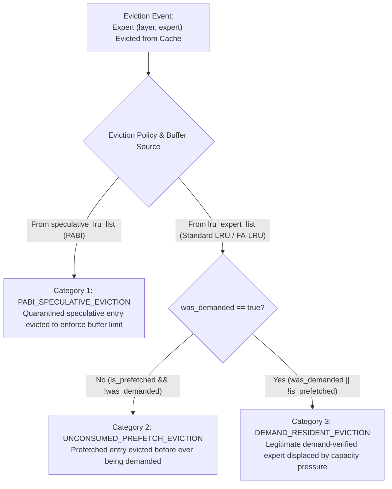

# Eviction and Transfer Accounting Corrections

## Point 4 — Phase 1.6 Consistency Audit & Design Corrections

---

## 1. Executive Summary

This document formalizes a mutually exclusive taxonomy of HBM eviction categories and clarifies the memory transfer accounting for in-flight prefetches promoted to demand. It guarantees that no eviction event is counted under multiple primary categories and that every physical DDR5 byte transfer is counted exactly once.

---

## 2. Mutually Exclusive Eviction Taxonomy

Under cache capacity enforcement in `Device::mark_expert_resident()` ([`src/hardware/device.cpp:761-787`](file:///home/mohman/ca_project/LLMSimulator/src/hardware/device.cpp#L761-L787)), an expert is selected for eviction because:
$$\text{resident\_bytes} + \text{expert\_size} > \text{cache\_capacity\_bytes}$$

To ensure exact conservation and eliminate overlapping metrics, every evicted expert is classified into **exactly one** primary eviction category:

### 2.1 Formal Category Definitions

1. **`UNCONSUMED_PREFETCH_EVICTION` ($E_{\text{unconsumed}}$):**
   - **Condition:** `victim.is_prefetched == true && victim.was_demanded == false`.
   - **Meaning:** A speculative prefetch completed DDR5 transfer and entered HBM, but was evicted before any demand access requested it.
   - **Metric Role:** Directly measures wasted cache capacity and failed prefetch utility.
2. **`DEMAND_RESIDENT_EVICTION` ($E_{\text{demand}}$):**
   - **Condition:** `victim.was_demanded == true || victim.is_prefetched == false`.
   - **Meaning:** A demand-verified resident expert (loaded by demand miss or successfully consumed prefetch) was evicted due to cache capacity pressure.
   - **Metric Role:** Measures standard cache capacity displacements.
3. **`PABI_SPECULATIVE_EVICTION` ($E_{\text{pabi\_spec}}$):**
   - **Condition:** Evicted from `speculative_lru_list` under PABI mode.
   - **Meaning:** Eviction from the dedicated speculative quarantine buffer.

### 2.2 Conservation Law
The total eviction count $E_{\text{total}}$ satisfies the strict partition identity:
$$E_{\text{total}} = E_{\text{unconsumed}} + E_{\text{demand}} + E_{\text{pabi\_spec}}$$
No eviction event can be categorized under more than one primary category.

---

## 3. Secondary Cache Pollution Metric: Prefetch-Induced Evictions

Orthogonal to the victim's classification is the **cause of the eviction**:
- Did the eviction occur because a new **demand miss** arrived?
- Or did it occur because an incoming **speculative prefetch** was being admitted to HBM?

### Definition of Prefetch-Induced Eviction ($E_{\text{prefetch\_induced}}$)
$$E_{\text{prefetch\_induced}} = \sum \mathbb{I}\Big( \text{admitting\_transfer.transfer\_class} == \text{PREFETCH} \;\land\; \text{victim.was\_demanded} == \text{true} \Big)$$
- **Significance:** Measures **genuine cache pollution**—the exact number of times a useful, demand-verified expert was evicted solely to make room for an unverified speculative prefetch.
- Under pure LRU, prefetch-induced evictions degrade demand hit rates.
- Under FA-LRU, because unconsumed prefetches ($F=1$) are colder than hot demand experts ($F \ge 2$), FA-LRU prevents prefetch-induced evictions of heavy hitters.

---

## 4. Transfer Accounting for In-Flight Prefetches Promoted to Demand

### 4.1 Physical Transfer Trace
Tracing [`src/hardware/device.cpp:1189-1245`](file:///home/mohman/ca_project/LLMSimulator/src/hardware/device.cpp#L1189-L1245):
1. Scheduler issues a speculative prefetch: `submit_prefetch_transfer(l, e)`.
2. `DDR5TransferEngine` creates a transfer record with ID `tid`, `transfer_class = PREFETCH`, and state `QUEUED` or `ACTIVE`.
3. Before the transfer finishes, an actual token GEMM demands expert $\{l, e\}$.
4. `submit_demand_transfer(l, e)` is invoked:
   - Finds `{l, e}` in `inflight_registry`.
   - Splicing: Line 1243 calls `promote_inflight_to_demand(l, e)`.
   - In `DDR5TransferEngine`, the transfer's priority is elevated to demand, but its `transfer_id` remains `tid`.
   - Lines 1236–1240 record a `LATE_IN_FLIGHT` demand outcome.
   - Line 1245 returns the existing `tid`.

### 4.2 Traffic Conservation
- **Number of Physical Transfers:** **Exactly 1**. No secondary transfer is issued to DDR5.
- **Bytes Transferred Across Bus:** **Exactly $88,080,384 \text{ bytes}$**.
- **Metrics Deduplication Rule:**
  $$\text{Total DDR5 Bytes} = \sum_{\text{unique } \text{tid}} \text{bytes}(\text{tid})$$
  Because metrics are keyed on unique `transfer_id`, promoting an in-flight prefetch to demand **never double-counts physical bus traffic**.

